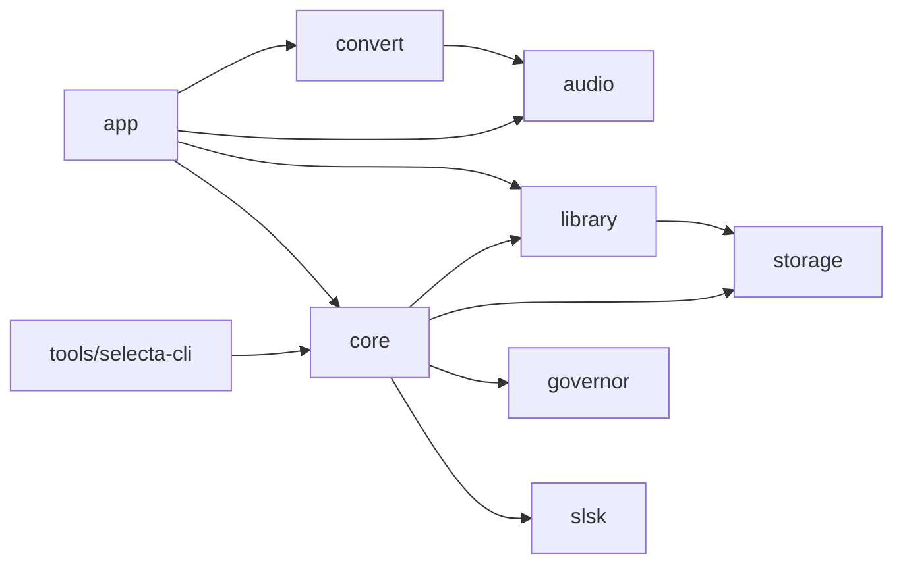
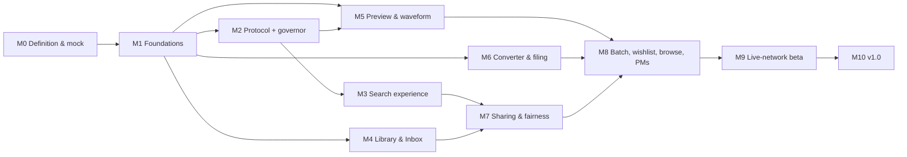

# Selecta — Implementation Plan

| | |
|---|---|
| **Status** | Draft v0.3 — tracks [PRD.md](PRD.md) v0.3 |
| **Date** | 2026-10-19 |
| **Inputs** | PRD (decisions D1–D18), research notes in [../references/](../references/) (in progress), maintainer Q&A rounds |

This plan describes **how** Selecta gets built: architecture, repository layout, milestones, the safe-development
setup, testing, risks, and the decisions still to record. Requirement IDs (e.g. `SRCH-3`) refer to the PRD.

---

## 1. Approach

1. **Mock first.** Validate layout and interactions in an HTML/JS mock ([../mock/index.html](../mock/index.html)) before
   writing any Qt UI. The validated mock becomes the UI reference.
2. **Safety first on the network.** Build the local test network and the network governor *before* any code
   talks to a Soulseek server. The live network is only touched by the maintainer, manually, late (M9).
3. **Research → decisions → code.** The research notes feed short architecture decision records (ADRs, `docs/adr/`).
   Code follows accepted ADRs.
4. **Parallel tracks after the foundations.** Network, media (audio + converter) and library are independent until
   they meet in the UI. Each milestone ends with something demonstrable.
5. **Me first.** Release target is macOS on Apple Silicon for the maintainer's workflow. Linux and Windows must compile
   and pass unit tests in CI, nothing more in v1.

## 2. Architecture (proposed — ratified by ADRs once research lands)

### 2.1 Stack

| Concern | Proposal | Notes |
|---|---|---|
| Language | C++20 | C++23 features only if Apple clang and MSVC both support them. |
| Framework | Qt 6 (6.11 is installed locally) | Pin to the latest stable at M1; track LTS for releases. |
| UI toolkit | **Qt Widgets** with the native macOS style; custom-painted widgets for the waveform | "Native, not flashy" (UI-1) favours Widgets: native controls, mature large tables, accessibility. Qt Quick remains an option for isolated views. **ADR-001.** |
| Build | CMake (≥ 3.28) + Ninja + CMakePresets | Modern Qt CMake API. |
| Persistence | SQLite via Qt SQL (WAL), FTS5 for text search | One DB file plus file-based caches. |
| Audio decode | FFmpeg (libavformat/libavcodec/libswresample) | Covers every format; GPL build is fine for a GPLv3 app. **ADR-003.** |
| Playback | Qt Multimedia `QAudioSink`, or CoreAudio directly if latency or position accuracy requires | **ADR-003.** |
| Encoding | LAME (MP3) via FFmpeg or directly; FLAC/AIFF/WAV via FFmpeg | **ADR-003.** |
| Tags | TagLib 2.x | Vorbis / ID3v2.3 / ID3v2.4 / MP4 / RIFF / AIFF. |
| Credentials | QtKeychain → macOS Keychain | |
| Port mapping | miniupnpc + libnatpmp (P1) | |
| Dependencies | Homebrew locally; reproducible pins in CI (vcpkg or pinned brew) | **ADR-004.** |

### 2.2 Modules

```
src/
  slsk/        Soulseek protocol library: codec, messages, server/peer/distributed sessions,
               file-transfer streams. Depends only on Qt Core + Network + zlib. No UI, no policy.
  governor/    Network governor: token buckets, budgets, backoff, per-peer caps, compile-time
               ceilings, injectable clock. Every outbound request asks it first.
  storage/     SQLite connection management, migrations, repositories.
  core/        Services: SearchService, TransferService (down/up), ShareService, PeerStatsService,
               SessionService, WishlistService, MessageService, result annotation (ownership badges).
  library/     Collection scanner (TagLib, FSEvents), index, remote-path parser, matcher,
               Inbox, filing, FileOps (create-only in the collection, trash-only in the Inbox), supersede.
  audio/       Decoder, growing-file reader, playback, 3-band waveform analysis, spectrum analysis.
  convert/     Transcoder, metadata mapping, artwork finder/resizer, quality advisor (warning matrix).
  app/         Qt Widgets UI: main window, sidebar, views, item models, inspector, player,
               preferences, platform glue (Keychain, notifications, Dock, Objective-C++ touches).
tools/
  selecta-cli/ Headless client for the local test network (scripted login/search/browse/download).
               Hard-locked to loopback/private addresses.
```



### 2.3 Threads

| Thread | Owns |
|---|---|
| Main (UI) | Widgets and item models; receives results in batches (coalesced ~10×/s while streaming). |
| Network | Event loop with every socket (server, peers, distributed, transfers), the governor, transfer state machines. |
| Storage | The single SQLite writer; readers use their own connections. |
| Worker pool | Library scanning, matching batches, waveform/spectrum analysis, conversions. |
| Audio | Playback callback / pull. |

### 2.4 File-safety model (enforces PRD principle 2, DL-6, DL-7, DL-8)

`FileOps` is the only code allowed to touch the filesystem outside caches. It exposes exactly:
- `createInCollection(src, dest)` — copy → fsync → verify → never overwrite (collisions get a suffix).
- `trashFromInbox(path)` / `trashFromCache(path)` — macOS Trash with Undo support; refuses any path outside the Inbox or caches.
- Free writes inside the Inbox and caches.

There is no API to modify, move or delete a file inside a collection root. Tests assert it.

### 2.5 Default locations

| Data | Location |
|---|---|
| Database | `~/Library/Application Support/Selecta/selecta.sqlite3` |
| Preview cache, analysis cache | `~/Library/Caches/Selecta/{previews,analysis}/` |
| Inbox | `~/Music/Selecta/Inbox/{Singles,Albums}/` (configurable) |
| Lossless originals converted at filing | Moved to the macOS Trash once the converted copy is verified (PRD D11) |
| Logs | `~/Library/Logs/Selecta/` |

## 3. Repository layout (target)

```
selecta/
├── CMakeLists.txt  CMakePresets.json  cmake/
├── src/            (modules above)
├── tools/selecta-cli/
├── tests/          unit/  fuzz/  integration/  golden/  bench/
├── devenv/         docker-compose.yml, local server + test peers, synthetic corpus generator
├── packaging/macos/  Info.plist.in, entitlements, icons, DMG config
├── docs/           PRD.md  PLAN.md  adr/
├── references/     research notes
├── mock/           HTML/JS/CSS UI mock
├── .github/workflows/
├── LICENSE  README.md  CLAUDE.md  .clang-format  .clang-tidy  .editorconfig
```

## 4. Milestones

Every milestone lists its scope, the PRD requirements it closes, and an exit criterion that can be demonstrated.

**First slice (PRD D17): search + preview.** The critical path is M1 → M2 → M3 → M5: a GUI that searches the local
test network with strict filters and previews results with the waveform. M4 (library) and M6 (converter) are parallel
tracks; they must not delay that slice.



### M0 — Definition and design *(now)*
- PRD v0.2 drafted with the Q&A decisions. ✅
- Research team: 8 notes in `references/`. ⏳ In progress.
- **Mock v1** (local HTML in `mock/`, see its README) ✅ → maintainer feedback rounds → validated mock.
- ADR-001 … ADR-010 drafted from the research (section 8). PRD v1.0 with research-based defaults (limits, caps, TTLs).
- **Exit:** the maintainer validates the mock and PRD v1.0; the ADRs are accepted.

### M1 — Foundations
- CMake skeleton, presets (debug, release, asan/ubsan), warnings as errors, clang-format / clang-tidy.
- CI (GitHub Actions): macOS arm64 build + tests; Linux and Windows compile + unit tests.
- App shell in Qt Widgets: main window, unified toolbar, source-list sidebar, empty views, inspector and player
  placeholders, preferences window, light/dark/system appearance (UI-1, UI-2).
- Storage: database open + migrations, settings, logging categories, standard paths.
- **devenv:** local Soulseek server and 1–3 test peers in Docker; synthetic audio corpus generator (section 5.3);
  `selecta-cli` skeleton.
- **Exit:** the app launches with the mock's navigation; CI is green; `devenv up` runs a local network that a reference client can join.

### M2 — Protocol core and governor *(network track)*
- `slsk`: codec for every MVP message; server session (login, ping, status, relogged, listen port, share counts,
  excluded phrases, wishlist interval); direct and indirect peer connections; distributed-network membership
  (needed to receive and answer searches); search; browse and folder contents; the download flow (queue → transfer →
  file connection, resume); error and denial handling.
- `governor`: token buckets, budgets, backoff with jitter, per-peer caps, compile-time ceilings, injectable clock (SAFE-1, SAFE-2).
- Fuzzers for every decoder; unit tests using fixtures captured on the local network.
- **Exit:** `selecta-cli` logs in to the local server, searches, browses and downloads from a test peer; governor tests pass; fuzzers run clean overnight.

### M3 — Search experience
- SearchService (aggregation, per-search caps, cache), filter engine (strict mode, presets, plausibility check),
  grouped/flat result models, inspector, filtered-out breakdown, budget indicator.
- Closes: SRCH-1…13, SRCH-16, SAFE-4, SAFE-5, CACHE-1 (search part).
- **Exit:** GUI search on the local network; property tests prove strict mode never shows a non-matching result.

### M4 — Library and Inbox *(library track — can run in parallel with M2)*
- Collection scanner (TagLib) with FSEvents, index (FTS5), remote-path parser and matcher (test suite from
  `references/library-matching-and-organization.md`), ownership and upgrade badges.
- Inbox, filing (move-only first; conversion arrives in M6), FileOps safety layer, supersede rules, sessions and history.
- Closes: LIB-1…5, DL-3…9, DL-11.
- **Exit:** badges are correct on the synthetic corpus; tests prove filed files are never modified.

### M5 — Preview and waveform *(media track — parallel)*
- FFmpeg decoder, growing-file reader, playback engine, 3-band analyzer + cache, waveform widget (zoomed + overview,
  buffered-range overlay), keyboard audition, preview cache, Keep/Discard, cancel-on-skip.
- Closes: PREV-1…8.
- **Exit:** progressive preview works on the local network; analysis of a 6-minute track < 300 ms; scrolling is smooth at 60 fps.

### M6 — Converter and filing formats *(media track — parallel)*
- Transcoder (FFmpeg + LAME), metadata mapper with golden-file tests, artwork finder/resizer, quality advisor,
  filing with conversion (default MP3 320 CBR, ID3v2.3), output verification, Converter view.
- Closes: CONV-1…8, DL-5 (with conversion).
- **Exit:** golden tests pass; a manual rekordbox 7 import check passes on a sample set.

### M7 — Sharing, uploads and fairness
- Share index (scan, audio attributes, inverted index), answering browse and distributed searches, upload queue
  (slots, limits, round-robin), upload stats; per-peer counters, caps, peer-denial back-off, ratio, Peers view.
- Closes: SHARE-1…5, FAIR-1…5.
- **Exit:** a test peer can browse, search and download from Selecta on the local network; caps are enforced in tests.

### M8 — Batch, wishlist, browse, messages
- Batch view (parsing, preset, paced queue, review-first matching, approve-all-confident), wishlist, browsing
  user shares, private messages, Dock badge and notifications.
- Closes: BATCH-1…8, SRCH-14/15, BRWS-1/2, NET-7/8, UI-6.
- **Exit:** a 100-line batch completes on the local network within budget (fake clock in tests) with the review flow.

### M9 — Live-network beta *(maintainer-run, manual)*
- Pre-flight checklist (section 5.5), dedicated account, conservative limits, a 1–2 week observation period, log review.
- **Exit:** two weeks of personal use with no bans; issues triaged.

### M10 — v1.0
- macdeployqt bundle, signing and notarisation if a Developer ID exists (otherwise ad-hoc signed personal builds), DMG,
  README / user notes, tagged release.

## 5. Safe development (no spam, no bans)

### 5.1 Local test network (`devenv/`)
- A **local Soulseek server** in Docker. The candidate is the open-source Soulfind server; to be confirmed by
  `references/soulseek-ecosystem.md`.
- **Test peers** pointed at the local server, also in Docker: a reference client with a configurable server address,
  plus `selecta-cli` instances. Each peer shares a synthetic corpus.
- One command brings everything up; integration tests and manual GUI sessions use it.

### 5.2 Guardrails in code
- **Server allow-list in debug builds:** only loopback/private addresses, unless the CMake option
  `SELECTA_ALLOW_LIVE_SERVER=ON` *and* a runtime confirmation are both present (SAFE-3). Release builds default to the live server.
- **Governor ceilings** are `constexpr` values (SAFE-2); settings can only tighten them. Values come from
  `references/network-etiquette-and-safe-development.md` and are recorded in ADR-006.
- **Login backoff:** exponential with jitter; never retry after "logged in elsewhere" (NET-4).
- **Activity log** (SAFE-4) and **kill switch** (SAFE-5) exist from M2 onward.
- **Injectable clock:** pacing logic is tested in accelerated time; no test ever sleeps on the real clock or talks to a real server.

### 5.3 Test data
- A **synthetic corpus generated with ffmpeg**: tones, noise and chirps in every format, bitrate and sample rate,
  with varied tags and cover images. It deliberately includes mislabelled files (declared 320, really 128),
  fake lossless (MP3 → FLAC), missing tags, odd filenames, Unicode/NFD names, and multi-disc albums.
  No copyrighted music in the repo or in CI.
- Protocol fixtures are captured on the local test network only.

### 5.4 CI
- GitHub Actions (PRD D15). CI never has network access to the live server; integration jobs start the local network in Docker.

### 5.5 Live-network pre-flight (M9)
Dedicated account · conservative limits verified in the activity log · shares configured · one manual search, then
one manual download · observe for bans/denials · escalate gradually.

## 6. Testing strategy

| Layer | Approach |
|---|---|
| Protocol codec | Round-trip unit tests per message; fixtures; libFuzzer targets per decoder. |
| Governor / pacing | Deterministic tests with a fake clock; property tests ("never exceeds N per window"). |
| Filters | Property tests over generated results: strict mode ⇒ every shown result satisfies the filter. |
| Matcher / parser | Table-driven tests (≥ 25 edge cases from the library research), plus precision/recall measured on a labelled sample. |
| FileOps | Tests that collection files are never modified; crash-injection tests for filing. |
| Converter | Golden files: converted output tags compared field by field; decode verification. |
| Audio analysis | Benchmarks (speed) and snapshot tests (band envelopes of known signals). |
| Integration | `devenv` scenarios: login, search, browse, download, upload, indirect connections, denials. |
| UI | Qt Test smoke tests; accessibility tree checks; manual review against the mock. |

## 7. Risks

| Risk | Impact | Mitigation |
|---|---|---|
| Undocumented protocol edge cases | Interop bugs, hangs | Cross-read several implementations; integration-test against reference clients on the local server. |
| Ban during development | Account/IP banned | Governor first; local network; live network only in M9, manually. |
| Qt Widgets can't hit some macOS-native touches (vibrancy, SF Symbols) | Less native polish | Small Objective-C++ shims; accept close approximations. |
| Progressive preview of growing files | Complexity, crashes | Ship a full-download preview first; add progressive decoding behind a flag. |
| Matching accuracy (paths have no tags) | Wrong badges, duplicates | Research-based parser, conservative "likely" tier, user corrections (LIB-6). |
| FFmpeg/LAME packaging and licences | Build pain | Homebrew locally; documented bundling; GPL-compatible build only. |
| Scope creep | Late v1 | "Me first"; strict P0/P1/P2; chat rooms and online tagging are out. |
| rekordbox path links broken by file moves | Broken DJ library | FileOps has no move/delete API for the collection (section 2.4). |

## 8. Decisions to record (ADRs)

| ADR | Decision | Input |
|---|---|---|
| ADR-001 | UI toolkit: Qt Widgets vs Qt Quick vs hybrid | qt-app-architecture.md |
| ADR-002 | Protocol implementation: own C++ library vs port/reuse | soulseek-protocol.md, soulseek-ecosystem.md |
| ADR-003 | Audio stack: decode, playback, encode | audio-preview-and-waveform.md, conversion-and-metadata.md |
| ADR-004 | Dependency management and pinning | qt-app-architecture.md |
| ADR-005 | Persistence: schema strategy, migrations, caches | library-matching-and-organization.md |
| ADR-006 | Governor limits and ceilings (numbers) | network-etiquette-and-safe-development.md |
| ADR-007 | Waveform analysis and rendering | audio-preview-and-waveform.md + mock feedback |
| ADR-008 | Remote-path parsing and matching algorithm | library-matching-and-organization.md |
| ADR-009 | File-safety model, Inbox and filing | PRD D2/D3/D7 |
| ADR-010 | Dependency licence policy (the licence itself is decided: GPL-3.0-or-later, PRD D14) | qt-app-architecture.md |

## 9. How work gets done

- The architect splits each milestone into work packages with acceptance tests mapped to PRD IDs.
- Implementation agents work in isolated git worktrees on feature branches; the architect reviews and merges.
- The maintainer validates anything user-facing against the mock, and answers question rounds as they come up.
- `CLAUDE.md` carries the non-negotiable network-safety rules for every agent.

## 10. Immediate next steps

1. Mock v1 review → feedback rounds → validated mock.
2. Research notes land → synthesis → ADR drafts → PRD v1.0 defaults (limits, caps, TTLs).
3. Before the first push: rewrite the early commits to the author identity `usr-ein <usr-ein@pm.me>` (PRD D16), then create the GitHub repository.
4. Start M1 once M0 exits, aiming at the search + preview slice.
