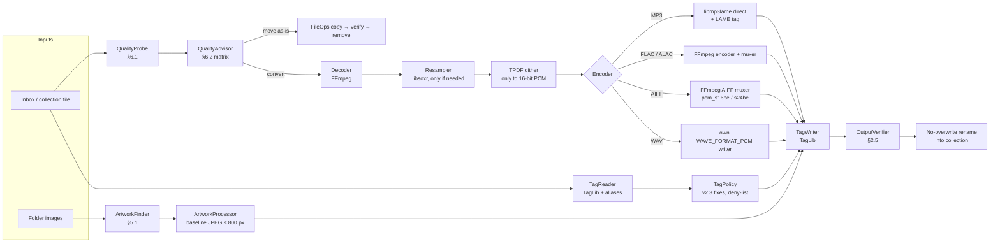

# Conversion and metadata — research note

> Status: **complete v1** (2026-10-19), research only — inputs for ADR-003 and milestone M6, not decisions.
> Confidence: **H** = verified in source code, a spec or an official manual; **M** = several consistent secondary
> sources or a credible reverse-engineering source; **L** = single forum report, memory or inference.
> Source snapshots read for this note (shallow clones, read-only): TagLib `5fb1099` (2.3.2+, 2026-10-19), FFmpeg
> `f91b54f` (master, 2026-10-19), LAME svn-trunk mirror `lameproject/lame@1f5cc94` (3.100.1 "under construction"),
> beets `18967aa`, mediafile `faaf744`, Picard `84862c5`, picard-docs `2a6193e`, mutagen `ada28b2`.

## TL;DR

- **Pipeline:** decode with FFmpeg → resample with **libsoxr** (only when the target can't carry the source rate) →
  TPDF dither (only when reducing to 16-bit PCM) → encode (**libmp3lame called directly** for MP3; FFmpeg's native
  FLAC/ALAC encoders; FFmpeg's AIFF muxer with big-endian PCM; Selecta's own plain-PCM header writer for WAV) → **write every tag and the artwork with TagLib 2.x
  from Selecta's own metadata model**. Never let FFmpeg copy metadata: it turns BPM, key, ISRC, label and track totals
  into `TXXX` frames and ignores folder artwork (H, `libavformat/id3v2enc.c`).
- **Default filing format (CONV-2):** MP3, LAME 3.100, CBR 320 kbps, joint stereo, 44.1 kHz (48 kHz sources stay
  48 kHz), genuine LAME "Info" tag, **ID3v2.3** (the brief's "IDFv3"), **UTF-16 text**, one APIC front cover as baseline JPEG ≤ 800 px with a
  Latin-1 description, no ID3v1, no APEv2.
- **Use LAME's own header, not FFmpeg's:** FFmpeg's MP3 muxer writes a `Lavf` Xing/Info frame that Traktor decodes as
  26 ms of audio while rekordbox skips it — the documented "26 ms cue shift" between DJ apps (H code / M effect).
- **TagLib needs help for ID3v2.3:** `save(…, ID3v2::v3)` *drops* TMOO, TSST, TDRL, TDTG, TPRO and writes multiple
  values null-separated; Selecta must remap those fields to `TXXX` and join values before saving (H).
- **rekordbox 7 reads ID3 v1–v2.4 in MP3/AIFF, Vorbis comments in FLAC, MP4 atoms in M4A and only RIFF INFO in WAV**
  (H, manual). WAV therefore loses artwork, label and key in rekordbox → **AIFF is the uncompressed filing format**.
- **Licences are fine:** FFmpeg (Homebrew build is GPL-3.0-or-later), LAME LGPL-2.0+, libsoxr LGPL-2.1+, TagLib
  LGPL-2.1/MPL-1.1 — all compatible with a GPLv3 app. Homebrew's `ffmpeg` has libmp3lame but **not** libsoxr (H).
- **Never improve what can't be improved:** lossy sources are filed as-is; lossy → lossy or lossy → lossless only after
  an explicit confirmation; upsampling never happens automatically (warning matrix in §6).

## Key findings

1. FFmpeg's MP3 muxer writes its own Xing/Info frame whose LAME-style extension carries the encoder string `Lavf`/
   `Lavf lame` and zeroed lowpass/VBR/preset fields (delay/padding are filled). libmp3lame driven directly
   (`lame_set_bWriteVbrTag(1)` + `lame_get_lametag_frame()`) produces the same header as the `lame` command line (H).
2. The "26 ms problem": Traktor treats `Lavf`/`Lavc` Xing frames (and LAME tags with a zero CRC) as audio while
   rekordbox skips them, so cues differ by one MP3 frame between apps; genuine LAME tags with a valid CRC are read
   consistently. In one sample, 8 of 13 Lavf/Lavc files shifted vs 5 of 122 LAME files (M, dj-data-converter #3).
3. FFmpeg's `libmp3lame` wrapper has no default bitrate (`b=0` → LAME's default compression ratio 11.025 = 128 kbps), only sets `-q` when asked (LAME
   default `-q 3`), forces `out_samplerate = in_samplerate`, and marks LAME init as not thread-safe (H).
4. LAME's CBR lowpass table: 320 kbps → 20.5 kHz, 256 → 19.7, 224 → 19.4, 192 → 18.6, 160 → 17.5, 128 → 17.0 kHz
   (`libmp3lame/lame.c`, `optimum_bandwidth`) — a reference for spectral-cutoff heuristics (H).
5. rekordbox 7: tags are read once, at import ("Reload Tag" otherwise); `TKEY` is stored verbatim, label comes from
   `TPUB` (FLAC: `LABEL`/`ORGANIZATION`, key `INITIALKEY`), BPM is never read from tags (M, third-party disassembly
   of 7.2.19; tag formats H from the manual). Artwork images: JPEG or PNG (H).
6. FFmpeg's WAV muxer always writes `WAVE_FORMAT_EXTENSIBLE` for > 16-bit or > 48 kHz PCM, with no override (H); the
   DJ community traces "CDJ refuses a supported 24-bit WAV" to that header (M/L). FFmpeg's AIFF muxer writes no ID3
   chunk unless `write_id3v2=1`, and AIFF-C (`sowt`) for little-endian PCM (H).
7. CDJ manuals: embedded artwork must be JPEG and ≤ 800 × 800 to display; hi-res support stops at 96 kHz/24-bit
   (CDJ-3000/NXS2), 48 kHz on older and XDJ models; no Pioneer player handles 176.4/192 kHz (H old manuals / M table).
8. TagLib 2.x offers a format-independent artwork API (`complexProperties("PICTURE")`), writes text frames created
   from properties as UTF-8 → rendered UTF-16 with BOM in v2.3, and writes APIC descriptions as Latin-1 — matching the
   Engine DJ community's "APIC must be ISO-8859-1" advice (H for TagLib; L for Engine).
9. libswresample never dithers unless asked (`dither_method` default none) and uses soxr only when FFmpeg was built
   with it (`precision` default 20 bits) (H).

## 1. Libraries and licences

| Component | Role in Selecta | Licence (SPDX) | GPLv3-compatible | Notes |
|---|---|---|---|---|
| FFmpeg 9.x (libavformat, libavcodec, libavutil, libswresample) | Decode everything; encode FLAC/PCM/ALAC; mux; sample-format conversion | LGPL-2.1-or-later by default; GPL-2.0-or-later with `--enable-gpl`; `--enable-version3` turns these into LGPL-3.0/GPL-3.0-or-later. Homebrew's formula declares `GPL-3.0-or-later` | Yes — never `--enable-nonfree` (e.g. libfdk_aac) | Homebrew `ffmpeg` 9.0.2: `--enable-gpl --enable-version3 --enable-libmp3lame --enable-audiotoolbox`, **no `--enable-libsoxr`** (H, formula read 2026-10-19). Bundling obligations covered in `qt-app-architecture.md`. |
| LAME (libmp3lame) | MP3 encoding | LGPL-2.0-or-later (`COPYING` = LGPL v2 "Library GPL", headers say "or any later version") | Yes | Last release 3.100 (2017); svn trunk is "3.100.1 under construction". Homebrew `lame`. (H) |
| libsoxr | High-quality sample-rate conversion | LGPL-2.1-or-later (`LICENCE`, © robs 2007-18; optional `pffft.c` carries its own permissive licence) | Yes | Use directly (simple C API) rather than through `swr` `resampler=soxr`, which Homebrew's FFmpeg lacks. Homebrew `libsoxr`. (H) |
| libFLAC | Optional reference FLAC encoder | BSD-3-Clause (library); GPL-2.0-or-later for the command-line tools | Yes | Not needed: FFmpeg's native FLAC encoder computes the STREAMINFO MD5 itself (`flacenc.c` uses `AVMD5`) (H code / M licence). |
| libsndfile | Alternative PCM I/O | LGPL-2.1-or-later | Yes | Not needed (L: writes RIFF INFO strings, no ID3 chunk). |
| TagLib 2.3.x | All tag reading/writing | LGPL-2.1-only **or** MPL-1.1 (dual; `COPYING.LGPL` 2.1 + `COPYING.MPL` 1.1) | Yes (LGPL-2.1 is GPLv3-compatible) | 2.0 (Jan 2024) → 2.3.2 (Sep 2026). C++17. Writes ID3v2.3 via `ID3v2::v3`; unified `PICTURE` complex property; RIFF RF64/BW64 (2.3.2); BEXT/iXML (2.3). (H) |
| AudioToolbox (macOS) | Optional: Apple AAC/ALAC encoders, SRC | System framework | Yes (system-library exception) | Not needed for P0 formats; would only matter for AAC output (not in CONV-1). |

**Recommendation:** FFmpeg (decode, FLAC/ALAC encode, mux) + libmp3lame (direct) + libsoxr (direct) + TagLib. All
four are Homebrew formulae (`ffmpeg`, `lame`, `libsoxr`, `taglib`); package names for vcpkg/Conan are for the qt note
to confirm (L: vcpkg `ffmpeg[mp3lame]`, `mp3lame`, `soxr`, `taglib`).

## 2. Encoding best practice

### 2.1 MP3 with LAME

| Setting | LAME CLI | libmp3lame API | Via FFmpeg CLI | Notes |
|---|---|---|---|---|
| CBR 320 | `-b 320` (CBR is the default mode) | `lame_set_brate(gfp, 320)`, `VBR = vbr_off` | `-c:a libmp3lame -b:a 320k` | Lowpass 20.5 kHz automatically (H). |
| CBR 256 / 192 | `-b 256` / `-b 192` | idem | `-b:a 256k` | Lowpass 19.7 / 18.6 kHz (H). |
| VBR V0 / V2 | `-V 0` / `-V 2` | `lame_set_VBR(gfp, vbr_default)` (= `vbr_mtrh`), `lame_set_VBR_quality(gfp, 0)` | `-q:a 0` / `-q:a 2` | V0 ≈ 245 kbps, V2 ≈ 190 kbps average; HA calls V0–V2 "normally transparent" and `-b 320` the lowest-risk MP3 setting (M, Hydrogenaudio wiki). |
| Algorithm quality | `-q 0…9`, default 3 | `lame_set_quality`; default `LAME_DEFAULT_QUALITY = 3` | `-compression_level` | For `vbr_mtrh`, any `-q` < 5 is mapped to 0 (`lame.c`) (H). Keep the default: Hydrogenaudio's recommended settings are plain `-b 320` / `-V 0`, without `-q` or lowpass overrides (M). |
| Stereo mode | joint stereo (default) | `JOINT_STEREO` | `joint_stereo=1` (default) | Keep joint stereo. |
| Input samples | — | `lame_encode_buffer_ieee_float` / `_int` | wrapper accepts s32p, fltp, s16p | Feed float or 32-bit: never truncate a 24-bit source to 16 bit before LAME (H). |
| Sample rate | — | `in = out` rate; LAME *can* resample internally, but don't | wrapper forces `out = in` | MPEG-1 Layer III: 32 / 44.1 / 48 kHz only. Resample hi-res first (§2.2). |
| Info/LAME tag | written by default | `lame_set_bWriteVbrTag(1)`, then `lame_get_lametag_frame()` after `lame_encode_flush()` and overwrite the first frame | FFmpeg writes its *own* Xing/Info frame (`write_xing=1`) | See finding 1. |

**Pitfalls when using FFmpeg for MP3 (H, `libavcodec/libmp3lame.c`, `libavformat/mp3enc.c`):**
- No `-b:a`/`-q:a` → LAME default 128 kbps CBR.
- The muxer writes ID3v2.**4** unless `-id3v2_version 3`; ID3v1 off by default (`write_id3v1=0`).
- The Xing/Info frame's encoder field is `Lavf`/`Lavf lame`; FFmpeg's own demuxer accepts `LAME`, `Lavf` and `Lavc`
  for gapless trimming, other decoders may only trust `LAME` (L).

**Decision for Selecta:** encode MP3 by calling libmp3lame directly (encoder thread: decoded float frames → LAME →
file), write the LAME tag via `lame_get_lametag_frame()`, then add ID3v2.3 with TagLib. It is ~200 lines more than
going through libavcodec, removes the dependency on how FFmpeg was built, and yields byte-for-byte the same stream
layout as `lame -b 320` (the reference everyone tests against).

### 2.2 Resampling and dither

- **When to resample:** only when the target format cannot carry the source rate: MP3 (max 48 kHz), or a user-chosen
  "hardware compatibility" profile (§4.3). Never upsample automatically.
- **Target rate:** 88.2 / 176.4 kHz → 44.1 kHz (integer ratio). 96 / 192 kHz → 48 kHz keeps an integer ratio, but
  44.1 kHz is the CD/DJ norm and, with a modern resampler, the ratio does not matter for quality (M); proposed default
  **44.1 kHz for MP3 output**, 48 kHz sources kept at 48 kHz (decision D-4 in §9).
- **Engine:** libsoxr, quality `SOXR_VHQ` (28-bit precision) or `SOXR_HQ` (20-bit); both far beyond what MP3 needs.
  FFmpeg's `swr` with `resampler=soxr` uses `precision=20` by default (H) but needs an FFmpeg built with libsoxr.
  FFmpeg's native swr resampler (`filter_size=32` default) is acceptable as a fallback (L: not measured here; measure with a sweep test, §10).
- **Dither:** only when reducing word length to integer PCM (24 → 16-bit WAV/AIFF/FLAC). Use TPDF
  (`dither_method=triangular` in swr, or Selecta's own ±1 LSB TPDF after soxr). Never dither before MP3 (LAME takes
  float). libswresample default is *no dither* (`dither_method` default 0; H). Noise-shaped variants (`shibata`,
  `f_weighted`…) exist in swr but plain TPDF is the safe default for material that may be processed again.
- **Order:** decode → (float) → resample → (gain = 0) → dither + quantise (PCM targets only) → encode.

### 2.3 WAV vs AIFF for DJs

**Verdict: AIFF is the uncompressed format for a DJ library; WAV is a fallback for tag-less use.** Both carry the same
PCM, but only AIFF carries usable tags and artwork in rekordbox.

| Aspect | WAV (RIFF) | AIFF |
|---|---|---|
| Tags read by rekordbox | **RIFF `LIST/INFO` only** (manual: "When a WAVE file is added to [Collection], its tag information may not be displayed"; third-party disassembly of rekordbox 7.2.19: the `id3 ` chunk is ignored, no label, no key) (M) | ID3v2 (v2.2/2.3/2.4) in the `ID3 ` chunk, same fields as MP3 incl. `TPUB` label and `TKEY` key (H manual; M field detail) |
| Artwork in rekordbox | None (INFO has no picture; the ID3-chunk picture is ignored) (M) | Yes (APIC in the ID3 chunk) |
| INFO fields available | title `INAM`, artist `IART`, album `IPRD`, comment `ICMT`, genre `IGNR`, date `ICRD`, track `IPRT`/`ITRK` (no album artist, label, key, BPM) | — |
| CDJ playback caveat | "All players up to and including CDJ-3000 may have issues playing some WAV files" — community-traced to the `WAVE_FORMAT_EXTENSIBLE` header (M/L: GitHub `joeselway/Pioneer-DJ-File-Formats`, Reddit r/DJs) | Plain AIFF (not AIFF-C) is required; compressed AIFF-C is not playable (M) |
| Byte order | little-endian | big-endian (`FORM/AIFF`); little-endian `sowt` = AIFF-C (avoid) |
| Max size | 4 GiB (RF64/BW64 beyond; TagLib 2.3.2 reads them) | 4 GiB |

**Writer implications (H for the code facts):**
- FFmpeg's AIFF muxer writes `FORM/AIFF` for big-endian PCM (`pcm_s16be`, `pcm_s24be`) and `FORM/AIFC` for anything
  else (e.g. `pcm_s16le` → `sowt`) — always use big-endian codecs (`libavformat/aiffenc.c`).
- FFmpeg's WAV muxer always writes `WAVE_FORMAT_EXTENSIBLE` for > 16-bit PCM, > 48 kHz or non-mono/stereo layouts
  (`libavformat/riffenc.c`) and has no option to force plain `WAVEFORMATEX`. → **Selecta writes WAV headers itself**
  (≈ 100 lines: `RIFF`/`WAVE`/`fmt ` with `WAVE_FORMAT_PCM` = 1 for 16/24-bit mono/stereo, `data`), then TagLib adds
  `LIST/INFO` (and optionally an `ID3 ` chunk for other apps).
- TagLib writes the WAV ID3 chunk as `ID3 ` (upper case), reads both `ID3 ` and `id3 `, and writes `LIST/INFO`; AIFF
  gets an `ID3 ` chunk (`riff/wav/wavfile.cpp`, `riff/aiff/aifffile.cpp`). `RIFF::WAV::File::save(tags, strip,
  ID3v2::v3)` and `RIFF::AIFF::File::save(ID3v2::v3)` take the ID3 version.
- Never write 32-bit float WAV/AIFF for DJ use: rekordbox and CDJs accept only 16/24-bit integer PCM (H, rekordbox 7
  manual table; M for CDJs).

### 2.4 Lossless outputs (FLAC, AIFF, WAV, ALAC)

- **Keep the source's word length.** FFmpeg's FLAC encoder treats any `S32` input as 24-bit unless told otherwise
  ("encoding as 24 bits-per-sample", `flacenc.c`) — a 16-bit source pushed through a 32-bit pipeline silently becomes a
  zero-padded "24-bit" file, the very fake-hi-res artefact §6 warns about. Feed `S16` for 16-bit sources and `S32` with
  `bits_per_raw_sample = 24` for 24-bit sources (H).
- FLAC: FFmpeg's native encoder (STREAMINFO MD5 included); ALAC (P1): FFmpeg `alac` encoder (`S16P`/`S32P`) in the
  `ipod` muxer (`.m4a`) (H); AIFF: FFmpeg's AIFF muxer with `pcm_s16be`/`pcm_s24be`; WAV: Selecta's own header (§2.3).
- Tags are always added afterwards with TagLib (FLAC: strip any ID3v1/ID3v2 that some tools prepend to FLAC files).

### 2.5 Verification (CONV-7, DL-6)

1. **Write safely:** encode into a temporary file in the *destination directory* (same volume), `fsync`, then
   publish it with a no-overwrite rename (`renamex_np(tmp, final, RENAME_EXCL)` on macOS; `link()` + `unlink()` or
   `QFile::rename` + existence check elsewhere). A crash leaves only a temp file, never a half file under the final name,
   and an existing file is never replaced (DL-5).
2. **Decode fully** with FFmpeg: no decoder errors; count output samples.
3. **Length:** lossless → exactly the source's sample count (after any resampling ratio); MP3 with a valid LAME tag →
   FFmpeg trims delay/padding, so the count should match exactly; accept ± 1152 samples (one frame) to be robust.
4. **Content:** lossless at unchanged rate/depth → compare an MD5 of decoded PCM with the source's (FLAC's STREAMINFO
   MD5 can serve when present) — bit-exact or fail.
5. **Stream facts:** sample rate, channels, bit depth as requested; MP3: every frame at 320 kbps for CBR 320; first
   frame `Info` with a `LAME` version string and valid CRC-16 (§4.4).
6. **Tags:** reopen with TagLib, compare the property map with what Selecta intended *after* its v2.3 transformations;
   exactly one front-cover picture whose bytes decode with `QImage` at the intended size.
7. Only then report success, register the file in the library index, and (when filing) remove the Inbox source.

Note for the worker pool (CONV-8): FFmpeg marks its libmp3lame wrapper `FF_CODEC_CAP_NOT_INIT_THREADSAFE` (H) →
serialise `lame_init()`/`lame_init_params()` behind a mutex; encoding itself runs in parallel, one LAME instance per
job.

## 3. Metadata mapping

Selecta's internal model uses **TagLib property keys** (upper case) as canonical names; TagLib translates them to each
format. Rows marked ⚠ need Selecta-side handling. **AIFF (`ID3 ` chunk) and WAV (`ID3 `/`id3 ` chunk) carry a complete
ID3v2 tag, so they follow the ID3v2.3/2.4 columns**; WAV additionally gets the RIFF INFO column (the only one rekordbox
reads). Sources: TagLib `mpeg/id3v2/id3v2frame.cpp` (`frameTranslation`),
`frames/textidentificationframe.cpp` (`txxxFrameTranslation`), `mp4/mp4itemfactory.cpp`, `riff/wav/infotag.cpp`;
Picard tag-mapping appendix (`picard-docs/appendices/tag_mapping.rst`); beets `mediafile/__init__.py`.

| Field | TagLib key | Vorbis comment (FLAC, Ogg, Opus) | ID3v2.3 | ID3v2.4 | MP4 / M4A | RIFF INFO (WAV) | Notes |
|---|---|---|---|---|---|---|---|
| Title | `TITLE` | `TITLE` | `TIT2` | `TIT2` | `©nam` | `INAM` | |
| Artist | `ARTIST` | `ARTIST` (may repeat) | `TPE1` | `TPE1` (null-separated multi) | `©ART` | `IART` | ⚠ v2.3: join multiple values into one string. |
| Album | `ALBUM` | `ALBUM` | `TALB` | `TALB` | `©alb` | `IPRD` | |
| Album artist | `ALBUMARTIST` | `ALBUMARTIST`; read also `ALBUM ARTIST`, `ALBUM_ARTIST` (mediafile) | `TPE2` | `TPE2` | `aART` | — | TPE2 is "band/orchestra" in the spec; every player uses it as album artist. |
| Track no. / total | `TRACKNUMBER` (`n/N`) | `TRACKNUMBER` + `TRACKTOTAL`; read also `TOTALTRACKS` | `TRCK` `n/N` | `TRCK` | `trkn` (n, N) | TagLib `IPRT`; Picard `ITRK` | ⚠ Combine total into `n/N`; ⚠ FFmpeg would write `TXXX:TRACKTOTAL`. |
| Disc no. / total | `DISCNUMBER` | `DISCNUMBER` + `DISCTOTAL`; read also `TOTALDISCS` | `TPOS` `n/N` | `TPOS` | `disk` | — | |
| Date | `DATE` | `DATE` (`YYYY` or `YYYY-MM-DD`) | `TYER` (`YYYY`) + `TDAT` (`DDMM`) [+ `TIME` `HHMM`] | `TDRC` | `©day` | `ICRD` | TagLib converts TDRC → TYER/TDAT/TIME when saving v2.3 (H). |
| Original date | `ORIGINALDATE` | `ORIGINALDATE`; read `ORIGINALYEAR` | `TORY` (year only) | `TDOR` | `----:com.apple.iTunes:ORIGINALDATE` | — | TagLib converts TDOR → TORY (H). |
| Release date | `RELEASEDATE` | `RELEASEDATE` | ⚠ `TXXX:RELEASEDATE` | `TDRL` | `----:com.apple.iTunes:RELEASEDATE` | — | TagLib *drops* TDRL on v2.3 save (H). |
| Genre | `GENRE` | `GENRE` | `TCON` (`(nn)Text` refs) | `TCON` (null-separated) | `©gen` (legacy `gnre`) | `IGNR` | TagLib builds v2.3 `(nn)` references itself (H). |
| Composer | `COMPOSER` | `COMPOSER` | `TCOM` | `TCOM` | `©wrt` | TagLib `IMUS` | |
| Lyricist | `LYRICIST` | `LYRICIST` | `TEXT` | `TEXT` | `----:com.apple.iTunes:LYRICIST` | TagLib `IWRI` | |
| Remixer | `REMIXER` | `REMIXER` | `TPE4` | `TPE4` | `----:com.apple.iTunes:REMIXER` | TagLib `IEDT` | DJ-relevant (remix credits). |
| Conductor | `CONDUCTOR` | `CONDUCTOR` | `TPE3` | `TPE3` | `----:com.apple.iTunes:CONDUCTOR` | — | ⚠ FFmpeg maps its `performer` key to TPE3. |
| BPM | `BPM` | `BPM` | `TBPM` | `TBPM` | `tmpo` (16-bit int) | TagLib `IBPM` (non-standard) | ID3 v2.3 spec: integer string. ⚠ Copy the source string unchanged (DJ tools write decimals such as `127.98`); MP4 `tmpo` rounds. rekordbox ignores it anyway (analysis). |
| Musical key | `INITIALKEY` | read `INITIALKEY` (mediafile, rekordbox) and `KEY` (Picard); **write `INITIALKEY`** | `TKEY` | `TKEY` | read `----:com.apple.iTunes:initialkey` (Picard/mediafile) and `…:KEY`; write `----:com.apple.iTunes:KEY` for rekordbox (M) | — | ID3 spec: ≤ 3 chars, e.g. `Dbm`, `o` = off key; DJ tools write Camelot (`8A`) or Open Key (`1m`). rekordbox stores the text verbatim → copy verbatim, never normalise. |
| Label | `LABEL` | `LABEL`; read `ORGANIZATION` (Vorbis spec), `PUBLISHER` (Traktor, per mediafile) | `TPUB` | `TPUB` | `----:com.apple.iTunes:LABEL` | TagLib `IPUB` | |
| ISRC | `ISRC` | `ISRC` | `TSRC` | `TSRC` | `----:com.apple.iTunes:ISRC` | TagLib `ISRC` | |
| Catalogue no. | `CATALOGNUMBER` | `CATALOGNUMBER`; read `CATALOGID`, `DISCOGS_CATALOG` | `TXXX:CATALOGNUMBER` | `TXXX:CATALOGNUMBER` | `----:com.apple.iTunes:CATALOGNUMBER` | — | |
| Comment | `COMMENT` | `COMMENT`; read `DESCRIPTION` | `COMM` (lang `eng`, empty description) | `COMM` | `©cmt` | `ICMT` | ⚠ Skip iTunes-internal COMM frames (`iTunNORM`, `iTunSMPB`, `iTunPGAP`) when copying. |
| Lyrics | `LYRICS` | `LYRICS`; read `UNSYNCEDLYRICS` | `USLT` | `USLT` | `©lyr` | — | |
| Compilation | `COMPILATION` | `COMPILATION` = `1` | `TCMP` = `1` (iTunes, non-standard) | `TCMP` | `cpil` | — | |
| Grouping | `GROUPING` | `GROUPING` | `TIT1` (classic) / `GRP1` (iTunes ≥ 12.5) | idem | `©grp` | — | ⚠ TagLib maps TIT1 → `WORK` and GRP1 → `GROUPING`; write `TIT1` (what most DJ tools read as grouping; L) unless the source used `GRP1`; verify in rekordbox (§10). |
| Subtitle / mix | `SUBTITLE` | `SUBTITLE` | `TIT3` | `TIT3` | `----:com.apple.iTunes:SUBTITLE` | — | |
| Mood | `MOOD` | `MOOD` | ⚠ `TXXX:MOOD` | `TMOO` | `----:com.apple.iTunes:MOOD` | — | TagLib *drops* TMOO on v2.3 save (H). |
| Disc subtitle | `DISCSUBTITLE` | `DISCSUBTITLE` | ⚠ `TXXX:DISCSUBTITLE` | `TSST` | `----:com.apple.iTunes:DISCSUBTITLE` | TagLib `PRT1` | TagLib drops TSST on v2.3 save (H). |
| Encoded by | `ENCODEDBY` | `ENCODEDBY` | `TENC` | `TENC` | `©enc` | TagLib `ITCH` | |
| Encoder / settings | `ENCODING` | `ENCODER` / `ENCODERSETTINGS` | `TSSE` | `TSSE` | `©too` | `ISFT` | Selecta writes e.g. `LAME3.100 -b 320` (and `TENC` = `Selecta <version>`); never copy the source's value. |
| Copyright | `COPYRIGHT` | `COPYRIGHT` | `TCOP` | `TCOP` | `cprt` | `ICOP` | |
| Sort names | `ARTISTSORT`, `ALBUMSORT`, `TITLESORT`, `ALBUMARTISTSORT`, `COMPOSERSORT` | same keys | `TSOP`, `TSOA`, `TSOT` (iTunes extension in v2.3, kept by TagLib), `TSO2`, `TSOC` | `TSOP`, `TSOA`, `TSOT` (standard), `TSO2`, `TSOC` | `soar`, `soal`, `sonm`, `soaa`, `soco` | — | mutagen's `update_to_v23()` deletes TSOA/TSOP/TSOT; TagLib keeps them unless built with `NO_ITUNES_HACKS` (H). |
| ReplayGain | `REPLAYGAIN_TRACK_GAIN`, `…_PEAK`, `REPLAYGAIN_ALBUM_GAIN`, `…_PEAK` | same | `TXXX:REPLAYGAIN_TRACK_GAIN` … | idem | `----:com.apple.iTunes:REPLAYGAIN_TRACK_GAIN` … | — | ⚠ Values describe the *source* encoding; after lossy encoding the gain is still approximately right but the peak is not. Proposed: drop all ReplayGain tags when transcoding (DJ apps use their own auto-gain; stale values are worse than none), keep them when a file is moved as-is (decision D-7 in §9). |
| MusicBrainz IDs | `MUSICBRAINZ_TRACKID`, `MUSICBRAINZ_ALBUMID`, … | same | `UFID:http://musicbrainz.org` + `TXXX:MusicBrainz Album Id` … | idem | `----:com.apple.iTunes:MusicBrainz Track Id` … | — | Copy verbatim (TagLib handles the TXXX names). |
| Artwork | `PICTURE` (complex property) | FLAC: native `PICTURE` metadata block; Ogg/Opus: `METADATA_BLOCK_PICTURE` (base64) | `APIC` (type 3 = front cover, MIME `image/jpeg`) | `APIC` | `covr` (data type 13 = JPEG, 14 = PNG; no picture type) | — (no artwork in INFO) | WAV/AIFF artwork only via the ID3 chunk. |
| DJ-app private data | — | Serato: base64 `SERATO_*` comments | `GEOB` "Serato Markers2", "Serato BeatGrid"…; `PRIV` "TRAKTOR4" | idem | `----:com.serato.dj:*` atoms | — | ⚠ **Drop on conversion**: cue/beatgrid offsets are tied to the source encoding (encoder delay differs). Files moved as-is keep them untouched. |

**Multi-value rule for ID3v2.3 (H):** TagLib renders a text frame with several values null-separated even when saving
v2.3 (`TextIdentificationFrame::renderFields`), which v2.3 readers show as only the first value. mutagen joins with
`/` (`v23_sep='/'`); Picard has a "join with" setting (default `/`). Selecta should avoid `/`, which occurs inside
names (e.g. "AC/DC"): proposed `", "` for ARTIST-type fields and `"; "` elsewhere (decision D-6 in §9).

**Text encoding (H):** frames that TagLib creates from properties (`setProperties()` →
`FrameFactory::createFrameForProperty`) are UTF-8 internally, and `Frame::checkTextEncoding` renders UTF-8 frames as
**UTF-16 with BOM** whenever the tag is saved as v2.3 — the same result Picard produces for v2.3. Frames kept from a
parsed tag stay Latin-1 only if every value is Latin-1-representable. `FrameFactory::setDefaultTextEncoding()` affects
only frames *parsed* from files, so it is not needed if Selecta builds each output tag fresh from its model (recommended:
strip, then write). APIC frames default to Latin-1 for their (empty) description (`attachedpictureframe.cpp`).

## 4. ID3v2.3 vs ID3v2.4, and what DJ software reads

### 4.1 Format differences (spec: id3.org v2.3.0 and v2.4.0, copies in TagLib `mpeg/id3v2/*.txt`)

| Aspect | ID3v2.3 (1999) | ID3v2.4 (2000) |
|---|---|---|
| Text encodings | ISO-8859-1, UCS-2/UTF-16 with BOM | + UTF-16BE without BOM, UTF-8 |
| Multiple values | Not supported (convention: `/` in TPE1/TCOM/TEXT/TOLY/TOPE) | Null-separated values in any text frame |
| Dates | `TYER`, `TDAT`, `TIME`, `TRDA`, `TORY` | `TDRC`, `TDOR`, `TDRL`, `TDEN`, `TDTG` (ISO 8601) |
| New in 2.4 | — | `TMOO`, `TPRO`, `TSST`, `TIPL`/`TMCL` (replace `IPLS`), `TSOA`/`TSOP`/`TSOT`, `SEEK`, `ASPI`, `SIGN`, `EQU2`, `RVA2` |
| Frame size field | plain 32-bit integer | sync-safe 28-bit integer (iTunes historically wrote non-sync-safe sizes in 2.4; TagLib tolerates) |
| Unsynchronisation | whole tag | per frame |
| Tag location | start of file | start, or end with footer |

### 4.2 DJ software support

| Software | Reads | Writes | What matters for Selecta | Confidence |
|---|---|---|---|---|
| **rekordbox 7** | "ID3 tag (v1, v1.1, v2.2.0, v2.3.0, and v2.4.0) of MP3 and AIFF files, the meta tag of M4A files, RIFF INFO of WAVE files, and Vorbis Comment of FLAC files" (manual, identical wording since 5.x). Artwork images: JPEG or PNG. | Its own database (not the file) unless the user edits tags; tags are read **at import** — later changes need "Reload Tag". | Tags must be complete *before* filing (rekordbox imports once). Third-party disassembly of 7.2.19 (rbxport PR #231, Oct 2026): MP3/AIFF key from `TKEY` stored **verbatim**, label from `TPUB`; FLAC key from `INITIALKEY`, label from `LABEL`/`ORGANIZATION`; M4A key from `----:com.apple.iTunes:KEY` (lower-case `initialkey` ignored); **BPM is never read from tags** (analysis only); if an MP3 has ID3v2, ID3v1 is not used for title/artist. | H (manual) / M (PR) |
| **CDJ / XDJ (USB, rekordbox export)** | Metadata and artwork come from rekordbox's export database; exported thumbnails are 80×80 and 240×240 JPEG (`PIONEER/Artwork/…/a{id}.jpg`, `a{id}_m.jpg`). | — | Embedded tags matter only through rekordbox. | M |
| **CDJ (USB browsing without rekordbox data)** | ID3 v1, v1.1, v2.2, v2.3, v2.4; embedded **JPEG** artwork only; "files larger than 800 × 800 dots cannot be displayed" (CDJ-2000, CDJ-2000NXS, CDJ-900NXS manuals). | — | Embedded art: baseline JPEG ≤ 800×800. | H (old manuals), L for CDJ-3000 |
| **Serato DJ Pro** | ID3v2.2–2.4 (L). | GEOB frames (`Serato Markers2`, `Serato BeatGrid`, `Serato Overview`, …) in the existing ID3 tag; a reverse-engineering dump shows an ID3v2.3 tag (with RVAD, a v2.3-only frame) after Serato wrote to it → Serato appears to keep the file's version. FLAC: `SERATO_*` Vorbis comments; MP4: `----:com.serato.dj:*` atoms. | Copy nothing Serato-specific into converted files. | M (Holzhaus/serato-tags) |
| **Traktor Pro 3/4** | ID3v2.3/2.4; community reports say Traktor "prefers 2.4". | `PRIV` frame "TRAKTOR4" in ID3v2.3 or 2.4 MP3s; `NITR` chunk in WAV; older versions rewrote MP3 tags as v2.4. | Traktor misreads MP3s whose Xing/Info frame is FFmpeg's "Lavf/Lavc" reduced tag → 26 ms cue shift (§4.4). | L–M (forums) |
| **Engine DJ (Denon)** | ID3v2.3/2.4; converts embedded art to PNG blobs in its database. | — | Community fix for missing art: APIC with **ISO-8859-1** text encoding and a ~500–600 px baseline JPEG; re-import needed after tag changes. | L (forum) |
| **Windows Explorer / WMP (bystanders)** | ID3v2.3; v2.4 poorly supported | — | One more reason for v2.3. | M |

**Conclusion:** ID3v2.3 + UTF-16 text + Latin-1 APIC description + baseline JPEG ≤ 800 px is readable by every DJ
application and player above. ID3v2.4 is read by all of them too, but v2.3 is what Mp3tag/XLD/dBpoweramp users and the
DJ community standardise on, and what the maintainer asked for. Keep v2.4 as an option (CONV-4).

### 4.3 Hardware playback constraints (sample rate, bit depth, container)

From the rekordbox 7 manual (H) and Pioneer manuals compiled by `joeselway/Pioneer-DJ-File-Formats` (M):

| Target | MP3 | AAC (M4A) | WAV / AIFF | FLAC | ALAC |
|---|---|---|---|---|---|
| rekordbox 7 (software) | MPEG-1 L3 32/44.1/48 kHz, 32–320 kbps CBR/VBR; MPEG-2 L3 16–24 kHz | AAC-LC 16–48 kHz, 8–320 kbps | 16/24-bit, 44.1/48/88.2/96/192 kHz (no 176.4 listed, no 32-bit float) | same as WAV | same as WAV |
| CDJ-3000, CDJ-2000NXS2, CDJ-TOUR1, OPUS-QUAD | all | 44.1/48 kHz, 16-bit | ≤ 96 kHz / 24-bit | ≤ 96 kHz / 24-bit | ≤ 96 kHz / 24-bit |
| XDJ-1000MK2 | all | ≤ 48/16 | ≤ 48 kHz / 24-bit | ≤ 48/24 | ≤ 48/24 |
| XDJ-XZ, XDJ-RX3 | all | ≤ 48/16 | ≤ 48/24 | ≤ 48/24 | — |
| CDJ-2000NXS, CDJ-2000, CDJ-900(NXS), XDJ-1000, XDJ-RX/RX2/RR | all | ≤ 48/16 | ≤ 48/24 | — | — |

**Implication:** a "DJ-safe" profile for lossless filing is **16/24-bit integer, 44.1 or 48 kHz**, AIFF (or FLAC for
NXS2/3000-only setups). Hi-res (88.2/96 kHz) only plays on the newest players; 176.4/192 kHz plays nowhere on Pioneer
hardware. MP3 output is always ≤ 48 kHz anyway.

### 4.4 The "26 ms problem": which MP3 header to write

DJ-data converters (dj-data-converter issue #3, 2019; Lexicon, Rekordcloud) document that cue points on the same MP3
differ by one MPEG frame (1152 samples ≈ 26 ms at 44.1 kHz) between apps depending on the first frame:

| First frame of the MP3 | Traktor | rekordbox | Shift between them |
|---|---|---|---|
| No Xing/Info frame | — | — | none |
| Xing/Info frame, **FFmpeg "Lavf/Lavc" reduced tag** | decodes the frame as 26 ms of audio | skips it as a control frame | **26 ms** |
| LAME tag with invalid (zero) CRC | decodes as audio | skips | **26 ms** |
| Genuine LAME tag with valid CRC | skips | skips | none |

In that project's sample, 8 of 13 Lavf/Lavc-encoded files shifted vs 5 of 122 LAME-encoded files (M). **Selecta must
therefore write a genuine LAME tag (libmp3lame's own `lame_get_lametag_frame()`), not FFmpeg's muxer header** — this is
the decisive argument for driving libmp3lame directly (§2.1). Verify with a test: encode, then check that the first
frame is `Info`, the version string starts with `LAME`, and the tag CRC-16 is valid.

## 5. Cover art

### 5.1 Discovery (CONV-5) — where the folder image comes from

Reference rules (H, source read):
- **beets fetchart** (filesystem source): only the album directory itself (not subfolders); images sorted by the
  position of the first matching name in `cover_names = [cover, front, art, album, folder]`; a name matches as a whole
  word (`(\b|_)(name)(\b|_)`, case-insensitive) → "exact" candidate; otherwise the first remaining image is a fallback
  unless `cautious: yes`.
- **Picard** local files: regex `^(?:cover|folder|albumart)(.*)\.(?:jpe?g|png|gif|tiff?|webp)$` (case-insensitive);
  the suffix is split into words to detect cover types (`front`, `back`, `medium`, …); default type `front`.

**Proposed Selecta ranking** (album folder first, then a `Scans/`, `Artwork/`, `Covers/` subfolder one level down):
1. Exact basenames: `cover`, `folder`, `front` (+ `.jpg/.jpeg/.png/.webp`), case-insensitive.
2. Names containing a whole word `front`, `cover`, `folder`, `albumart` (e.g. `AlbumArt_{GUID}_Large.jpg`,
   `Artist - Album - Front.jpg`), excluding `back`, `cd`, `disc`, `inlay`, `inside`, `tray`, `booklet`, `label`.
3. Otherwise, if exactly one image is present, use it; if several, prefer the largest roughly square one (aspect within
   0.8–1.25) and mark the result "guessed" (shown for confirmation, per CONV-5).
4. Embedded art in the source file always wins over folder images; folder art is only *supplemented* when the source
   has none.

**Soulseek specifics:** album downloads must include the remote folder's images (DL-3). For singles, the remote
folder's `cover.jpg` is a separate file from the same peer — fetching it costs one more queued transfer, so it should be
**opt-in** ("also fetch folder artwork for singles") and counted by the governor like any file (cross-reference
`network-etiquette-and-safe-development.md`).

### 5.2 Embedding per target format

| Target | Container field | Selecta writes |
|---|---|---|
| MP3 / AIFF / WAV-ID3 | `APIC`, picture type 3 (front cover), MIME `image/jpeg`, empty description, description encoding Latin-1 | Exactly one APIC (front). |
| FLAC | native `PICTURE` metadata block, type 3, width/height/depth filled | One PICTURE block. |
| M4A (ALAC, P1) | `covr` atom, data type 13 (JPEG) | One image. |
| WAV for rekordbox | — (rekordbox ignores pictures in WAV) | Nothing; warn that art is lost (or suggest AIFF). |

TagLib: `file.setComplexProperties("PICTURE", {{{"data", bytes}, {"mimeType", "image/jpeg"}, {"description", ""},
{"pictureType", "Front Cover"}}})` works for every format; it replaces all existing pictures of that tag (H,
`id3v2tag.cpp`: `removeFrames("APIC")` then adds).

### 5.3 Size and format constraints → resize policy

| Constraint | Value | Source / confidence |
|---|---|---|
| CDJ embedded-art display (USB browsing) | JPEG only; > 800 × 800 not displayed | CDJ-2000/NXS/900NXS manuals (H for those models) |
| rekordbox library artwork | JPEG or PNG; makes 80×80 and 240×240 thumbnails on export | manual (H); export analysis (M) |
| Engine DJ | baseline JPEG ~500–600 px helps; Latin-1 APIC description | forum (L) |
| Progressive / CMYK JPEG | refused by some devices (shows nothing) | tagging guides (L) |
| Very large images | multi-MB tags slow imports; "above about 4 MB some hardware stalls loading the track" | Mixgraph (L) |

**Proposed default (decision for the maintainer):** when filing/converting, if the chosen art is not a baseline RGB
JPEG, or is larger than **800 px** on its longest side, or larger than 500 KB, re-encode it as baseline sRGB JPEG,
quality 90, max 800 × 800, preserving the aspect ratio (optionally centre-crop to square when the ratio is within
0.9–1.1, as XLD offers). Never upscale. The original image file stays in the album folder untouched. Setting: "Embedded
artwork max size: 600 / 800 / 1000 / 1400 px / original". Implement with `QImage` (JPEG via Qt's image plugins;
baseline is Qt's default; strip EXIF/ICC after converting to sRGB).

## 6. Quality warning matrix and true-quality detection

### 6.1 Establishing the *true* quality of a source (input to the advisor)

| Check | How | Catches | Cost | Confidence |
|---|---|---|---|---|
| Container/codec facts | FFmpeg stream info: codec, sample rate, bit depth (`bits_per_raw_sample`), channels, duration | basic class (lossy/lossless, hi-res) | trivial | H |
| Real MP3 bitrate & mode | scan MPEG frame headers (or packet sizes): all frames 320 → CBR 320; mixed → VBR; read Xing/Info + LAME tag (encoder string, VBR method, lowpass, preset) | "320" claims that are really VBR or lower; encoder identity | < 50 ms | H |
| Spectral cutoff | from the audio module's analysis (PREV-9): highest frequency with sustained energy vs time; LAME CBR lowpass reference: 128 → 17.0 kHz, 160 → 17.5, 192 → 18.6, 224 → 19.4, 256 → 19.7, 320 → 20.5 kHz (`lame.c` `freq_map`, H); other encoders differ (FhG/iTunes 128 often ~16 kHz, L) | lossless or "320" files transcoded from low-bitrate lossy | shared with waveform analysis | M (heuristic; false positives on dark masters, old recordings) |
| Fake 24-bit | while decoding, OR together the low 8 bits of every 24-bit sample; zero → effectively 16-bit (FLAC exposes the same as "wasted bits") | 16-bit masters padded to 24 | free during decode | H (exact) |
| Fake hi-res | no energy above ~22 kHz (or ~24 kHz) in an 88.2/96/192 kHz file | 44.1/48 kHz material upsampled | shared with spectrum | M |
| Size plausibility | bytes ÷ duration vs declared bitrate (SRCH-7) | mislabelled results before download | trivial | H |

Combine into a `SourceQuality` record: `{codec, lossless, sampleRate, bitDepth, effectiveBitDepth, realBitrate, cbr,
encoder, cutoffHz, verdict ∈ {genuine, likelyTranscode(fromKbps), upsampled, padded24, unknown}}`. Spectral verdicts are
always worded as "likely", never as fact.

### 6.2 Source → target matrix (CONV-6)

Rows = what the source *really* is (after §6.1); columns = requested output. ✓ = proceed silently; ℹ = proceed with an
info note; ⚠ = warning, needs explicit confirmation (CONV-6 "no-gain conversions need explicit confirmation"); ⛔ =
not offered by the filing pipeline (manual converter only, behind ⚠).

| Source ↓ / Target → | MP3 320 CBR | MP3 V0 / V2 / ≤ 256 | Lossless, same rate & depth | Lossless, lower rate / depth | Lossless, higher rate / depth |
|---|---|---|---|---|---|
| **Lossless 16/44.1–48 (genuine)** | ✓ | ✓ | ✓ (verify bit-exact) | ℹ I-DITHER / I-RESAMPLE | ⚠ W-UPSAMPLE / W-UPDEPTH |
| **Lossless hi-res (24-bit and/or > 48 kHz)** | ℹ I-RESAMPLE (→ 44.1 kHz) | ℹ I-RESAMPLE | ✓ (+ ⚠ W-HW-RATE if the hardware profile can't play it) | ℹ I-DITHER / I-RESAMPLE | ⚠ W-UPSAMPLE |
| **Lossless but likely transcode / padded / upsampled** | ⚠ W-SUSPECT ("result is a 2nd-generation lossy file") | ⚠ W-SUSPECT | ℹ W-SUSPECT shown, conversion harmless | ℹ (reducing padded 24 → 16 is lossless; say so) | ⚠ W-UPSAMPLE |
| **MP3 320 CBR / V0** | ✓ **file as-is, no re-encode** (CONV-2) | ⚠ W-GENERATION | ⚠ W-LOSSY-TO-LOSSLESS | ⚠ W-LOSSY-TO-LOSSLESS | ⛔ |
| **MP3 ≤ 256 / V2…** | ⛔ in filing: file as-is + "below target" badge (CONV-2); manual: ⚠ W-LOSSY-UP | ⚠ W-GENERATION (lower) or ⚠ W-LOSSY-UP (higher) | ⚠ W-LOSSY-TO-LOSSLESS | ⚠ W-LOSSY-TO-LOSSLESS | ⛔ |
| **AAC / M4A (rekordbox plays it)** | ⛔ in filing: file as-is + "format differs from target" badge; manual: ⚠ W-GENERATION | ⚠ W-GENERATION | ⚠ W-LOSSY-TO-LOSSLESS | ⚠ W-LOSSY-TO-LOSSLESS | ⛔ |
| **Ogg Vorbis / Opus / WMA (rekordbox can't play)** | ⚠ W-NOT-PLAYABLE + W-GENERATION (offered: this or AIFF) | ⚠ idem | ⚠ W-NOT-PLAYABLE + W-LOSSY-TO-LOSSLESS (no further loss, large) | ⚠ idem | ⛔ |
| **Other lossless (APE, WavPack, DSD)** | ✓ (+ W-NOT-PLAYABLE explains why) | ✓ | ✓ → AIFF/FLAC | ℹ (DSD → PCM needs a low-pass; P2) | ⛔ |

Size factors for messages: PCM 16/44.1 stereo = 1411 kbps; FLAC typically 50–70 % of PCM; so MP3 320 → AIFF ≈ 4.4×,
→ FLAC ≈ 2.5–3×; MP3 192 → AIFF ≈ 7.3×. Compute from the actual numbers instead of quoting constants.

### 6.3 Warning texts (UI copy, short form + detail)

| ID | Short text | Detail |
|---|---|---|
| W-LOSSY-TO-LOSSLESS | "No quality gain — about {N}× larger" | "{src} is a lossy file. Converting it to {dst} keeps exactly the sound of the {src} file; it cannot restore what the lossy encoding removed." |
| W-LOSSY-UP | "No quality gain — generation loss" | "{src} at {kbps} kbps cannot become better at {dstKbps} kbps. Re-encoding adds a second round of compression artefacts. Selecta files it as-is and marks it 'below target'." |
| W-GENERATION | "Generation loss" | "Re-encoding a lossy file to another lossy format loses quality each time. Keep the original if you can." |
| W-UPSAMPLE | "No quality gain — larger file" | "Raising {srcRate} to {dstRate} adds no information; the file becomes {N}× larger." |
| W-UPDEPTH | "No quality gain" | "Converting {srcBits}-bit to {dstBits}-bit only pads with zeros." |
| W-SUSPECT | "Source is probably not what it claims" | "Its spectrum stops at about {cutoff} kHz, typical of a {kbps} kbps MP3. Converting it cannot improve it." / "This 24-bit file contains only 16 bits of real data." / "This {rate} kHz file has no content above {cutoff} kHz; it was probably upsampled." |
| W-NOT-PLAYABLE | "rekordbox can't play {fmt}" | "rekordbox 7 plays MP3, AAC, WAV, AIFF, FLAC and ALAC. Choose MP3 320 (small, one more lossy generation) or AIFF (no further loss, large)." |
| W-HW-RATE | "May not play on your players" | "{rate} kHz / {bits}-bit exceeds {profile} (max {maxRate} kHz / {maxBits}-bit)." |
| W-WAV-TAGS | "Tags limited in WAV" | "rekordbox reads only basic RIFF INFO from WAV: no artwork, label or key. Use AIFF to keep them." |
| I-RESAMPLE | "Resampled to {rate} kHz" | "{fmt} cannot store {srcRate} kHz; Selecta uses a high-quality SoX resampler." |
| I-DITHER | "Reduced to 16-bit with dither" | "TPDF dither avoids quantisation distortion when reducing bit depth." |

## 7. Naming templates and filename sanitisation

### 7.1 Templates

Tokens (values come from the *output* tags after mapping): `{artist}`, `{albumartist}`, `{title}`, `{album}`,
`{year}`, `{track}` / `{track:02}`, `{disc}`, `{disctotal}`, `{label}`, `{catalognumber}`, `{key}`, `{bpm}`, `{ext}`,
plus conditional sections `[…]` dropped when a token inside is empty (Picard/beets-style). Proposed defaults:

| Item | Template | Example |
|---|---|---|
| Single (OQ-11) | `{artist} - {title}.{ext}` | `Kerri Vale - Night Shift (Original Mix).mp3` (fictional) |
| Album folder (DL-3/DL-5) | `{albumartist} - {album}[ ({year})]` | `Kerri Vale - Night Shift EP (2024)` |
| Album track | `[{disc}-]{track:02} {artist} - {title}.{ext}` (disc prefix only when `disctotal` > 1) | `03 Kerri Vale - Night Shift (Dub).mp3` |

Missing values: fall back to the parsed remote path (library module), then `Unknown Artist` / `Untitled`; never
produce an empty component.

### 7.2 Sanitisation (untrusted input: tags and paths come from peers)

| Step | Rule | Why |
|---|---|---|
| 1. Normalise | Unicode **NFC** (`QString::normalized(NormalizationForm_C)`) for every generated component | APFS stores names as given (normalization-*preserving*, normalization-*insensitive* lookups, H Apple APFS FAQ); HFS+ forces its NFD variant; peers on macOS/HFS+ send NFD. NFC everywhere keeps Selecta's DB keys, rekordbox paths and other OSes consistent. |
| 2. Strip dangerous code points | C0/C1 controls, U+007F, bidi controls U+200E/F, U+202A–U+202E, U+2066–U+2069, U+FEFF | invisible names, extension spoofing (U+202E makes `x\u202Egpj.mp3` display as `x3pm.jpg`) |
| 3. Replace separators | `/` and `\` → `-` (e.g. `AC/DC` → `AC-DC`); a component equal to `.` or `..` → `_` | path separators and traversal |
| 4. Replace reserved | `:` → ` -` (collapse spaces), `?` `*` `"` `<` `>` `\|` → `_` (beets uses `_` for all) | Windows, FAT32 and exFAT forbid them (USB sticks, SMB); Finder displays a POSIX `:` as `/` |
| 5. Edges | trim whitespace; strip trailing `.` and spaces; leading `.` → `_`; leading `-` → `_` | hidden files on macOS; Windows/FAT ignore trailing dots; CLI ambiguity (beets rules) |
| 6. Reserved names | `CON`, `PRN`, `AUX`, `NUL`, `COM1`–`COM9`, `LPT1`–`LPT9` (with or without extension) → append `_` | Windows/FAT |
| 7. Length | component ≤ **200 UTF-8 bytes** (beets' cap; APFS limit is 255 bytes, FAT/exFAT 255 UTF-16 units) incl. extension; cut at a grapheme boundary (`QTextBoundaryFinder`), shorten `title` first, then `artist`; full path ≤ 1 000 bytes (macOS `PATH_MAX` = 1024) | leaves room for ` (2)` suffixes and copies to other filesystems |
| 8. Collisions | compare candidate names **case-insensitively and normalization-insensitively** (APFS default) against the directory and against pending jobs; append ` (2)`, ` (3)`; never overwrite (DL-5) | APFS default volume is case-insensitive |
| 9. Re-check | run steps 2–6 again after truncation (beets does up to three rounds) | truncation can expose a trailing space/dot |

An "ASCII-only" option (transliterate) is not needed for rekordbox and is left out of v1.

## 8. Reference implementations

### 8.1 beets `convert` plugin (`beetsplug/convert.py`, `beets/config_default.yaml`) (H)

- Shells out to `ffmpeg` per format; MP3 default `ffmpeg -i $source -y -vn -aq 2 $dest` (= LAME V2), FLAC
  `-acodec flac`, ALAC `-acodec alac`, AAC `-acodec aac -aq 1`, Opus `-ab 96k`. `-vn` drops artwork in the transcode;
  tags and art are then re-written by beets itself (`embed: yes`, `album_art_maxwidth`), not by FFmpeg.
- Transcode decision (`should_transcode`): skip when the item matches `no_convert`, or when
  `never_convert_lossy_files` is on and the source is lossy (`LOSSLESS_FORMATS = ape, flac, alac, wave, aiff`);
  transcode when bitrate ≥ `max_bitrate`, or when the format differs. Options to link/hardlink untranscoded files.
- Path legalisation defaults (`replace:`): `[<>:\?\*\|]` → `_`, `"` → `_`, `[\\/]` → `_`, leading `.` → `_`, trailing
  `.` → `_`, control chars → `_`, leading `-` → `_`, leading/trailing whitespace stripped. `max_filename_length: 0`
  (= query `statvfs`, capped at 200 bytes), truncation preserves the extension and never splits a UTF-8 sequence;
  sanitise → truncate → re-sanitise, at most three rounds. `asciify_paths: false` (when on, macOS paths are NFD).
  `id3v23: no` by default (mediafile then calls mutagen `update_to_v23()`).

### 8.2 FFmpeg as a one-shot converter — pitfalls (H unless noted)

1. Metadata keys: FFmpeg's generic keys map only a handful of ID3 frames (`ff_id3v2_34_metadata_conv`); FLAC's `BPM`,
   `INITIALKEY`, `ISRC`, `LABEL`, `TRACKTOTAL`, `DISCTOTAL` become `TXXX:<key>` frames (`id3v2enc.c` fallback).
2. v2.3 mode splits `date` into `TYER` + `TDAT`, but `compilation`, sort keys and `grouping` are only converted for v2.4.
3. Artwork from FLAC is an "attached picture" video stream; it must be mapped explicitly (`-map 0:v -c:v copy`) or it
   is dropped/re-encoded; folder images are ignored unless added as a second input.
4. MP3 defaults: ID3v2.4, no ID3v1, Xing/Info frame on, 128 kbps if no rate given.
5. AIFF: no ID3 chunk unless `-write_id3v2 1`; WAV: RIFF `LIST/INFO` only, no artwork.
6. Dither: none unless `-af aresample=...:dither_method=triangular` (or `-dither_method`).
7. FFmpeg tags its own name into `TSSE`/`encoder` unless `-fflags +bitexact` / `-metadata encoder=` (L).

### 8.3 Picard, mutagen, XLD, dBpoweramp

- Picard: canonical cross-format mapping (used in §3); v2.3 is a user option with a "join multiple values with"
  separator. Defaults (`picard/options.py`): ID3v2.4 (`write_id3v23=False`), UTF-8, ID3v1 on, join `/`; choosing v2.3
  disables UTF-8 and switches the encoding to UTF-16 (`ui/options/tags_compatibility_id3.py`) (H).
- mutagen `update_to_v23()`: converts TDOR → TORY, TDRC → TYER/TDAT/TIME, TIPL/TMCL → IPLS, deletes v2.4-only frames
  including TSOA/TSOP/TSOT/TSST/TMOO; `save(v2_version=3, v23_sep='/')` joins multi-values with `/` (H).
- **XLD** (macOS; official changelog): MP3 tags are ID3v2.3 with UCS-2 text (since 2006), date written as `TYER` +
  `TDAT` (2015), PCM outputs resample with libsoxr (2014), LAME 3.100 bundled (2018), embedded-art scaling and
  crop-to-square options. A good model for Selecta's defaults (M).
- **dBpoweramp** (Windows/macOS, closed): ID3v2.4 writing only since R14.3; community instructions configure
  "ID3v2 version 2.3, text encoding Unicode 16"; its author argued that v2.4 harms cross-compatibility. DSP chain
  recommended by the author: bit depth → float, resample, bit depth → 16 with **TPDF** dither; dither is "not needed"
  for MP3 output (M, forum).

## 9. Implications for Selecta

### 9.1 Module design (`convert/` in PLAN.md)

| Component | Responsibility | Key rules from this note |
|---|---|---|
| `MetadataModel` | Canonical tags (TagLib property keys → `QStringList`), pictures, provenance per field (embedded / folder / filename / user) | Provenance drives the "shown for confirmation" UI of CONV-5. |
| `TagReader` | TagLib `FileRef::properties()` + `complexProperties("PICTURE")`, plus an alias table | Aliases: `ALBUM ARTIST`/`ALBUM_ARTIST` → `ALBUMARTIST`; `TOTALTRACKS`/`TRACKTOTAL`, `TOTALDISCS`/`DISCTOTAL` → `n/N`; `KEY` → `INITIALKEY`; `ORGANIZATION`/`PUBLISHER` → `LABEL`; `DESCRIPTION` → `COMMENT`; `UNSYNCEDLYRICS` → `LYRICS`. |
| `TagPolicy` | Decide what is written per target | Deny-list on transcode: Serato GEOB/`SERATO_*`, `PRIV:TRAKTOR4`, iTunes `COMM:iTunNORM/iTunSMPB/iTunPGAP`, `TLEN`, `RVAD`/`RVA2`, `ReplayGain_*`, `TSSE`/`TENC` (re-set), `MCDI`. ID3v2.3: TMOO/TSST/TDRL/TDTG/TPRO → `TXXX:MOOD/DISCSUBTITLE/RELEASEDATE/…`; join multi-values (D-6). Copy unknown `TXXX`/Vorbis fields otherwise. |
| `TagWriter` | Write via the format-specific TagLib classes | MP3: `MPEG::File::save(MPEG::File::ID3v2, File::StripOthers, ID3v2::v3, File::DoNotDuplicate)` (strips ID3v1/APE). AIFF: `RIFF::AIFF::File::save(ID3v2::v3)`. WAV: INFO (for rekordbox) + ID3 chunk (for other apps), `save(…, ID3v2::v3)`. FLAC: Xiph comment + PICTURE block, strip ID3. One front cover only. |
| `QualityProbe` / `QualityAdvisor` | §6.1 facts → §6.2 decision: move as-is / convert / needs confirmation, with warnings | Spectral verdicts come from the audio module's analysis cache (shared with PREV-9). |
| `ArtworkFinder` / `ArtworkProcessor` | §5.1 ranking; §5.3 resize/re-encode with `QImage` | Never upscale; keep originals; Latin-1 empty description. |
| `Transcoder` | Decode → resample → dither → encode → mux, cancellable, progress | One LAME instance per job; serialise LAME init; feed float. |
| `PcmWavWriter` | Minimal RIFF/WAVE writer with `WAVE_FORMAT_PCM` | Avoids FFmpeg's `WAVE_FORMAT_EXTENSIBLE` (§2.3). |
| `OutputVerifier` | §2.5 checks | Failure → delete temp file, keep source, report. |
| `PathBuilder` | §7 templates and sanitiser | Collision check case/normalisation-insensitive; never overwrite. |
| `ConversionQueue` | Worker pool (CONV-8) | L: start with (performance cores − 1) workers; measure. |

### 9.2 Proposed defaults

| Setting | Proposed default | Why |
|---|---|---|
| Filing preset | MP3 CBR 320, joint stereo, LAME default `-q 3` | PRD D7/CONV-2; HA "lowest-risk MP3 setting" |
| MP3 header | genuine LAME "Info" tag (libmp3lame) | consistent cue positions across DJ apps (§4.4) |
| MP3 sample rate | keep 44.1/48 kHz; > 48 kHz → 44.1 kHz (D-4) | MP3 limit; CD/DJ norm |
| Resampler | libsoxr VHQ | quality; independent of FFmpeg build |
| Dither | TPDF, only when writing 16-bit integer PCM | standard practice (XLD, dBpoweramp) |
| Lossless preset (when chosen) | AIFF, source bit depth, ≤ 96 kHz (D-3) | rekordbox reads AIFF ID3 + art; CDJ-3000/NXS2 limit |
| WAV output | plain `WAVE_FORMAT_PCM` + RIFF INFO + ID3 chunk, with W-WAV-TAGS warning | rekordbox reads INFO only |
| ID3 version / encoding | v2.3, UTF-16 text, Latin-1 APIC description; v2.4 (UTF-8) as an option | maintainer's "IDFv3"; widest compatibility |
| ID3v1 / APEv2 | not written; stripped from outputs | rekordbox uses ID3v2 when present (M); APE is noise |
| Artwork | one front cover; embedded art > folder image; re-encode to baseline sRGB JPEG q90, ≤ 800 px, when larger, non-JPEG, progressive or > 500 KB (D-2) | CDJ 800 × 800 JPEG limit |
| Folder art for singles | off (opt-in, counted by the governor) (D-8) | costs an extra transfer from the peer |
| Multi-value join (v2.3) | `", "` for ARTIST-type fields, `"; "` otherwise (D-6) | `/` collides with names like AC/DC |
| ReplayGain, DJ-app private data | dropped on transcode, untouched when moved as-is (D-7) | values tied to the source encoding |
| Lossy source vs MP3 320 target | filed as-is with "below target"/"format differs" badge (CONV-2) | no-gain conversions need confirmation |
| Ogg/Opus/WMA sources | ask: MP3 320 (generation loss) or AIFF (large) (D-5) | rekordbox can't play them |
| Lossless originals after MP3 filing | kept in `~/Music/Selecta/Originals/` (PRD OQ-2) | re-encode later without re-downloading |
| Naming | §7.1 templates; NFC; ≤ 200-byte components | portability, rekordbox path stability |
| Verification | always on (§2.5) | CONV-7, DL-6 |

### 9.3 Decisions for the maintainer

| # | Question | Proposal |
|---|---|---|
| D-1 | ID3v2.3 + UTF-16 as the only default for MP3/AIFF/WAV (v2.4 as an option)? | Yes |
| D-2 | Embedded artwork size: 600 / 800 / 1000 px / original? Crop near-square images to square? | 800 px, crop only when ratio within 0.9–1.1 |
| D-3 | Which players must lossless output play on (CDJ-3000/NXS2 → ≤ 96/24; older/XDJ → ≤ 48/24)? | ≤ 96 kHz / 24-bit |
| D-4 | Hi-res → MP3: always 44.1 kHz, or 48 kHz for 96/192 kHz sources? | always 44.1 kHz |
| D-5 | Ogg/Opus/WMA sources: default MP3 320 (with warning) or AIFF? | ask each time; remember the choice |
| D-6 | Separator when joining multiple artists in ID3v2.3? | `", "` |
| D-7 | Drop ReplayGain tags when transcoding? | Yes |
| D-8 | Fetch the remote folder's cover image when downloading a single? | opt-in, off by default |
| D-9 | File AAC/M4A downloads as-is (rekordbox plays them) rather than converting to MP3? | as-is, with badge |
| D-10 | Write `TENC` = "Selecta x.y" in converted files? | Yes (helps debugging; no personal data) |
| D-11 | Strip the uploader's DJ-app data (Serato GEOB frames, Traktor `PRIV`, `SERATO_*` comments) from downloads at filing, even when the audio is kept as-is? These are *someone else's* cues and grids. | Yes for the maintainer's rekordbox-only setup; make it a setting |

### 9.4 Two filing paths, one tag policy

- **Re-encode path** (lossless → MP3 320, etc.): §2 pipeline, fresh tag written from the model.
- **Audio-preserving path** ("file as-is", CONV-2): the audio bytes are copied untouched, but the Inbox copy still gets
  the filing tag policy *before* it is published — ID3v2.4 → v2.3 conversion, folder-art supplement, alias cleanup,
  D-11 stripping — because Selecta may modify Inbox files but never filed ones (PRD principle 2). TagLib edits in place
  and may rewrite the whole file when the tag grows, so apply it to the temp copy inside the copy → verify → publish
  sequence (§2.5), never to the Inbox original before verification. Verification for this path: decoded-PCM MD5 of
  source and output must match (tags changed, audio identical).

**Security note:** every downloaded file is untrusted input to TagLib and FFmpeg. Require TagLib ≥ 2.3.2 (its
changelog lists hardening "to prevent resource exhaustion, denial of service attacks and out of range conversions by
crafted input" across formats, H) and current FFmpeg; cap picture sizes (e.g. reject embedded images > 20 MB or
> 10 000 px before decoding with `QImageReader::setAllocationLimit`); consider running probing/conversion in a helper
process so a parser crash cannot take down the app (decision for ADR-003; L).

### 9.5 Test corpus additions (for PLAN's synthetic corpus)

FLAC with `KEY` vs `INITIALKEY`; `ALBUM ARTIST` spelling; `TRACKTOTAL` and `TOTALTRACKS`; two `ARTIST` values;
`MOOD`/`DISCSUBTITLE`/`RELEASEDATE` (v2.3 compensation); PNG, progressive-JPEG, CMYK-JPEG and 3000 px covers; `cover.jpg`
+ `back.jpg` + `cd.jpg` folders; 24/96 and 24/44.1-with-zero-low-byte ("fake 24-bit") FLAC; 96 kHz upsampled from
44.1 kHz; MP3 encoded by FFmpeg (`Lavf` header) vs LAME CLI; MP3 192 labelled 320 in its filename; Ogg Vorbis and Opus;
WAV with only an ID3 chunk; titles with `/`, `:`, `?`, trailing dots, emoji, NFD accents, RLO characters, 300-byte
names, `CON`.

## 10. Open questions and experiments

All experiments are local (no network). "Manual" = needs the maintainer's rekordbox/hardware.

| # | Question | How to settle it | Who |
|---|---|---|---|
| E-1 | Does rekordbox 7 show every field we write (title, artist, album, album artist, genre, label, key, comment, year from `TYER`+`TDAT`, track no., remixer, composer, artwork) for ID3v2.3/UTF-16 MP3 and AIFF? Which grouping frame (`TIT1`/`GRP1`) does it show? | Import a sample set, compare with the intended tags (PRD success criterion) | Manual |
| E-2 | Does the 26 ms shift disappear with Selecta's LAME header? | Same source encoded by `lame -b 320`, FFmpeg CLI and Selecta; compare first-transient positions in rekordbox, Mixxx and (if available) Traktor/Serato | Manual + dev |
| E-3 | Do CDJs (maintainer's model) reject 24-bit `WAVE_FORMAT_EXTENSIBLE` WAVs and accept plain PCM? Show 800 px vs 1000 px embedded art when browsing USB folders? | USB stick test | Manual |
| E-4 | Is FFmpeg's native swr resampler good enough as a fallback? | Sweep/impulse tests swr default vs soxr VHQ (aliasing, passband) | Dev |
| E-5 | Encode speed: LAME CBR 320 `-q 3` per core on Apple Silicon; whole pipeline for a 6-min FLAC | Benchmark in CI and locally | Dev |
| E-6 | Spectral-cutoff thresholds and false-positive rate | Synthetic encodes at each bitrate/encoder (with the audio note's analyser) | Dev |
| E-7 | rekordbox key/label in M4A (`----:com.apple.iTunes:KEY` vs `initialkey`) — only from third-party disassembly | Import ALAC test files (P1) | Manual |
| E-8 | Does rekordbox read FLAC `ALBUMARTIST` and `ALBUM ARTIST`? `TRACKTOTAL`? | Import test FLACs | Manual |
| E-9 | Do Engine DJ / Serato need anything beyond §4.2 (e.g. APIC Latin-1)? | Only if the maintainer uses them | Optional |

Unverified or weakly sourced claims in this note: rekordbox field-level behaviour (third-party disassembly, M); the
WAV-extensible CDJ problem (community, M/L); Engine DJ artwork advice (forum, L); Traktor/Serato tag-version behaviour
(forums/reverse engineering, L–M); artwork size limits for CDJ-3000 specifically (only older manuals state 800 × 800).

## 11. Sources

Accessed 2026-10-19. Source code was read in shallow clones under `local/research-clones/conversion/` (not built or
run).

**Source code**
- TagLib — https://github.com/taglib/taglib @ `5fb1099`: `taglib/mpeg/id3v2/id3v2frame.cpp` (frame ↔ property table),
  `id3v2tag.cpp` (`downgradeFrames`, v2.3 rendering, PICTURE complex property), `frames/textidentificationframe.cpp`
  (TXXX table, multi-value rendering), `id3v2framefactory.cpp` (default encodings), `mp4/mp4itemfactory.cpp`,
  `riff/wav/infotag.cpp`, `riff/wav/wavfile.{h,cpp}`, `riff/aiff/aifffile.{h,cpp}`, `mpeg/mpegfile.h`, `fileref.h`,
  `CHANGELOG.md`, `COPYING.LGPL`, `COPYING.MPL`.
- FFmpeg — https://github.com/FFmpeg/FFmpeg @ `f91b54f`: `libavcodec/libmp3lame.c`, `libavcodec/flacenc.c`,
  `libavformat/mp3enc.c`, `libavformat/mp3dec.c`, `libavformat/id3v2enc.c`, `libavformat/id3v2.c`,
  `libavformat/aiffenc.c`, `libavformat/wavenc.c`, `libavformat/riffenc.c`, `libswresample/options.c`,
  `libswresample/swresample.c`.
- LAME — https://github.com/lameproject/lame @ `1f5cc94` (mirror of svn trunk 3.100.1): `libmp3lame/lame.c`
  (default quality, lowpass tables), `libmp3lame/presets.c`, `libmp3lame/version.h`, `include/lame.h`
  (`lame_get_lametag_frame`), `COPYING`, `doc/html/history.html`.
- beets — https://github.com/beetbox/beets @ `18967aa`: `beetsplug/convert.py`, `beets/config_default.yaml`,
  `beets/util/__init__.py` (path legalisation), `beetsplug/fetchart.py` (local art ranking).
- mediafile — https://github.com/beetbox/mediafile @ `faaf744`: `mediafile/__init__.py` (cross-format field styles).
- Picard — https://github.com/metabrainz/picard @ `84862c5`: `picard/const/defaults.py`, `picard/options.py`,
  `picard/formats/id3.py`, `picard/ui/options/tags_compatibility_id3.py`, `picard/coverart/providers/local.py`.
- Picard docs — https://github.com/metabrainz/picard-docs @ `2a6193e`: `appendices/tag_mapping.rst` (mapping table).
- mutagen — https://github.com/quodlibet/mutagen @ `ada28b2`: `mutagen/id3/_tags.py` (`update_to_v23`),
  `mutagen/id3/_file.py` (`v23_sep`).
- Homebrew ffmpeg formula — https://github.com/Homebrew/homebrew-core/blob/HEAD/Formula/f/ffmpeg.rb (version 9.0.2,
  licence, configure flags).
- libsoxr licence — https://sourceforge.net/p/soxr/code/ci/master/tree/LICENCE

**Official documentation**
- rekordbox 7.0.0 Instruction Manual — https://cdn.rekordbox.com/files/20240509141437/rekordbox7.0.0_manual_EN.pdf
  (tag formats per file type, WAVE note, artwork JPEG/PNG, Reload Tag; text extracted locally with `pdftotext`).
- rekordbox 7.0.7 Introduction — https://cdn.rekordbox.com/files/20241213141709/rekordbox7.0.7_introduction_EN.pdf
  (supported formats, sample rates, bit depths).
- Pioneer CDJ-2000NXS manual p. 7 (manualslib) — https://www.manualslib.com/manual/712075/Pioneer-Cdj-2000nxs.html?page=7
  (ID3 versions, JPEG artwork ≤ 800 × 800); CDJ-2000 manual —
  https://www.manualslib.com/manual/130120/Pioneer-Cdj-2000.html?page=20 (embedded JPEG shown as jacket).
- Apple APFS Guide FAQ —
  https://developer.apple.com/library/archive/documentation/FileManagement/Conceptual/APFS_Guide/FAQ/FAQ.html
  (normalisation-preserving / -insensitive names).
- ID3v2.3.0 and v2.4.0 specifications (copies in TagLib `taglib/mpeg/id3v2/id3v2.3.0.txt`, `id3v2.4.0-*.txt`).
- XLD official page — https://tmkk.undo.jp/xld/index_e.html (ID3v2.3/UCS-2, TYER+TDAT, libsoxr, art scaling).
- Hydrogenaudio LAME wiki — https://wiki.hydrogenaudio.org/index.php?title=LAME and forum thread
  https://hydrogenaudio.org/index.php/topic,126770.0.html (recommended settings, V0/V2 averages).

**Reverse engineering, community and third-party (lower confidence)**
- chrisle/rbxport PR #231 (rekordbox 7.2.19 tag reading, Oct 2026) — https://github.com/chrisle/rbxport/pull/231
- dj-data-converter issue #3 ("26 ms problem") — https://github.com/digital-dj-tools/dj-data-converter/issues/3
- joeselway/Pioneer-DJ-File-Formats (player format table, WAV issue) — https://github.com/joeselway/Pioneer-DJ-File-Formats
- M-Igashi/baken issue #235 (rekordbox export artwork 80/240 px) — https://github.com/M-Igashi/baken/issues/235
- Holzhaus/serato-tags (Serato GEOB/Vorbis/MP4 storage) — https://github.com/Holzhaus/serato-tags
- dBpoweramp forum and help — https://forum.dbpoweramp.com/forum/other-topics/how-do-i/27660-id-tags ,
  https://doc.dbpoweramp.com/dmc/en/dsp.htm , https://versions.dbpoweramp.com/?appid=2
- Engine DJ community (APIC encoding, art size) — https://community.enginedj.com/t/album-art-for-bandcamp-mp3s-workaround/20580
- DJ TechTools forum (Traktor tag versions, PRIV/NITR) — https://forum.djtechtools.com/showthread.php?t=28112
- Lexicon DJ manual (WAV artwork in rekordbox) — https://www.lexicondj.com/manual/all
- bliss blog (CDJ artwork rules) — https://www.blisshq.com/music-library-management-blog/2020/03/03/pioneer-cdj-album-art/
- Mixgraph tag editor notes (large artwork stalls) — https://www.mixgraph.io/tools/mp3-metadata-editor
- editmp3tags.com (progressive/CMYK JPEG) — https://editmp3tags.com/guides/album-art-not-showing/
