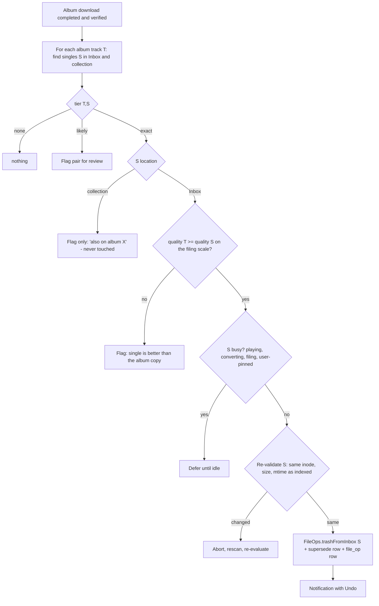

# Library matching and organisation

> Research note for Selecta (PRD LIB-1…8, SRCH-11, BATCH-3/5, DL-3…11; PLAN M4, ADR-005, ADR-008).
> Status: **draft in progress** — sections marked `TODO` are not yet verified against primary sources.
> Accessed/written: 2026-10-19.

## TL;DR

- A Soulseek search result gives us only a **remote path** (`@@share\Artist\Album\01 - Title.flac`, Windows-style
  backslashes), a **size**, and optional **attributes** (bitrate, duration in seconds, VBR flag, sample rate, bit
  depth). No tags. Every "do I already have this?" answer is therefore a *guess from a path*, and Selecta must say how
  confident it is (PRD LIB-3: exact / likely / none).
- Matching = **parse** the path (folder + filename) into artist / title / version / album / track number / year,
  **normalise** every string into comparison keys, **retrieve** candidates from an in-memory index of the collection,
  Inbox and history, then **score** with title/artist similarity, a version check and a duration check.
- Existing tools converge on the same recipe (TODO: verify constants): beets/Lidarr use a weighted *distance* over
  fields with a duration grace window; slsk-batchdl uses hard "path must contain title/artist" checks plus a length
  tolerance; Picard uses per-word edit distance. None of them parse Soulseek paths into fields as a first step for
  "already owned" detection — that part is Selecta's own design.
- Version (Original / Extended / Radio Edit / remix-by-X) is the main precision trap for a DJ library: two files with
  the same artist and title can be different tracks. Version mismatch must block "exact".
- Speed is not a problem at 50k–200k tracks if keys are precomputed: exact-key hash lookups are O(1) and fuzzy
  candidate retrieval through a token index stays well under 1 ms per result (TODO: benchmark numbers).
- Supersede (DL-7/DL-8) must be conservative: trash an Inbox single only on an *exact* match against a *verified,
  completed* album track of equal-or-better quality; everything else is a flag. Trash goes through the macOS Trash
  with Undo and an audit log; filed files are never touched.

## Key findings

TODO — filled in once the detailed sections are verified.

---

## 1. What we know about a remote file

Attribute codes verified in Nicotine+ `pynicotine/slskmessages.py` (`class FileAttribute`, commit f3b9d4d); full wire
details belong to `references/soulseek-protocol.md`.

| Field | Source | Notes for matching |
|---|---|---|
| Full virtual path | FileSearchResponse / share list / folder contents | Backslash-separated by convention whatever the peer's OS. The first component(s) are a share root chosen by the peer's client (an alias or a share name; some old clients leak real local prefixes). |
| Size (bytes) | always present | uint64. **Byte-identical copies propagate across the network**, so (size, basename) is a strong "same file" key for history matching (Nicotine+ uses exactly that to decide a file "is already downloaded", `pynicotine/downloads.py` `get_complete_download_file_path`). Useless against re-tagged or converted collection files. |
| Extension | separate protocol field | Often empty or inconsistent: re-derive from the filename, case-insensitively. |
| Bitrate (kbps) | attribute 0 `BITRATE` | Optional. Average or nominal for VBR depending on the client. |
| Duration (s) | attribute 1 `LENGTH` | Optional, integer seconds, sometimes 0 → treat 0 as missing. |
| VBR flag | attribute 2 `VBR` | Optional. (Attribute 3 `ENCODER` is obsolete.) |
| Sample rate (Hz) | attribute 4 `SAMPLE_RATE` | Optional, mostly lossless. |
| Bit depth | attribute 5 `BIT_DEPTH` | Optional, mostly lossless. |

Consequences:
- Every matcher input is `(path, size, duration?, quality?)`. There are no tags, no ISRC, no MusicBrainz IDs.
- The **parent folder** is a strong hint (artist, album, year, catalogue number, format), and **sibling files in the
  same response** help a lot: a shared numbering sequence, a constant artist across files, the track count.
- Duration is the only acoustic evidence before download, and it is integer-rounded and optional.
- After a *preview* download Selecta has the real audio and its tags, so a second, much stronger matching pass is
  possible on the cached file (tags + exact duration + optionally a fingerprint, §11).

## 2. Remote path conventions and pitfalls

Practitioner knowledge, cross-checked against the patterns that beets, Picard, Lidarr and Sockseek hard-code (§3).
Frequencies are not measured — **TODO: measure on a corpus of recorded search results from the local test network and,
later, from the maintainer's manual live sessions.**

### 2.1 Common layouts

| # | Example (virtual path) | What it tells us |
|---|---|---|
| L1 | `Music\Artist\Album (2019)\01 - Title.flac` | Artist from grand-parent, album/year from parent, title from file. Filename has no artist. |
| L2 | `share\Artist - Album (2019) [FLAC 16-44]\01. Artist - Title.flac` | Folder carries artist/album/year/quality; file repeats artist. |
| L3 | `DJ\Techno\2024\Artist - Title (Original Mix).mp3` | Beatport-style single: version always spelled out. Genre/year folders are noise. |
| L4 | `mp3\Artist-Album-WEB-2019-GRP\01-artist-title.mp3` | Scene naming: hyphens, lowercase, underscores, source tag (`WEB`, `CD`, `VINYL`), group suffix. |
| L5 | `Bandcamp\Artist - Album\Artist - Album - 01 Title.flac` | Bandcamp download naming: artist and album repeated in every file. |
| L6 | `iTunes Media\Music\Compilations\Album\1-01 Title.m4a` | iTunes/Music layout: `disc-track` prefix, VA under `Compilations`. |
| L7 | `Album\CD1\01 Title.flac`, `Album\Disc 2\...` | Disc sub-folders: the album is the grand-parent. |
| L8 | `Artist - Album [LP]\A1 Title.flac`, `B2. Title.flac` | Vinyl side/position instead of a number. |
| L9 | `VA - Compilation (2020)\03 - Artist - Title.mp3` | Various artists: artist varies per file. |
| L10 | `Mixes\Artist - Live @ Venue 2019-05-01.mp3` | Continuous mix / DJ set: one long file, not a track. |
| L11 | `Rips\Track 01.wav`, `AudioTrack 01.wav` | Untagged CD rip: no usable name at all. |
| L12 | `[LABEL042] Artist - Title.mp3`, `Artist - Title [LABEL042].mp3` | Catalogue numbers in brackets. |
| L13 | `Artist - Title (Official Video) [HQ].mp3`, `www.site.com - Artist - Title.mp3` | Web/YouTube junk to strip (Lidarr has website prefix/suffix regexes). |

### 2.2 Pitfalls that cause wrong matches

| Pitfall | Example | Mitigation |
|---|---|---|
| Hyphen is both separator and part of names | `Jay-Z`, `A-ha`, `Ne-Yo`, `Run-DMC`; `Artist-Title` in scene names | Split on spaced dashes (` - `, ` – `, ` — `) first; only fall back to bare `-` when the folder looks scene-style (no spaces, group suffix). |
| Artist/title order reversed | `Title - Artist.mp3` | Folder consistency (constant part across siblings = artist, the beets `fromfilename` trick) and a dictionary of known artists from the collection. |
| Numbers that are not track numbers | `1999`, `7 Seconds`, `808 State`, `2 Unlimited`, `50 Cent`, `10cc` | Strip a leading number only when followed by a separator and plausible as a track number (1–3 digits, optional `disc-`); confirm with siblings forming a sequence. Sockseek's `TrackNumStartRegex` requires 2–3 digits or a `N. ` / `N - ` form. |
| Featured artists | `ft.`, `feat.`, `featuring`, `(feat. X)`, `with`, `vs.`, ` x `, `&` | Extract into a secondary-artist set; never part of the primary key. `&`, `and`, `x`, `vs` are ambiguous in artist fields (`Simon & Garfunkel`, `Above & Beyond`): treat as splitters only for *matching sets*, never for display. |
| Remixer inside the title | `Title (Bicep Remix)` | The remixer is an artist name; it must go to the version field, not match the artist index. |
| Version spelling | `(Extended Mix)`, `[Extended Mix]`, `- Extended Mix`, `Extended Version`, `(Extended)` | Version extractor over `()`, `[]` and a trailing ` - ` segment; canonical classes (§5). |
| Characters illegal on Windows replaced | `AC_DC`, `AC-DC`, `ACDC` for `AC/DC`; `Title - Subtitle` for `Title: Subtitle`; `Whats` for `What's` | Normalise punctuation to spaces and compare on alphanumeric tokens; also compare a "squashed" key with all separators removed. |
| Unicode | `Röyksopp`/`Royksopp`, `Sigur Rós`, NFD vs NFC (macOS peers), full-width forms, curly quotes | NFKC + case-fold + diacritic folding + a small transliteration table for letters that do not decompose (`ø`, `æ`, `ß`, `ł`, `đ`, `þ`). |
| Mojibake | `Röyksopp` | Detect common UTF-8-read-as-Latin-1 sequences and repair before normalising (P1; low priority). |
| Generic folders | `Music`, `MP3`, `Shared`, `Downloads`, `complete`, `Singles`, `Albums`, `A`, `#`, `0-9`, years, genres | Stop-list of generic folder names; never infer artist/album from them. |
| Truncated names | Windows MAX_PATH truncation, `...` | Prefix-tolerant comparison (token containment) and lower confidence. |
| Quality tags in names | `[FLAC 24-96]`, `(320)`, `[V0]`, `WEB`, `Vinyl` | Strip into a `quality_hint` field; useful to cross-check attributes. |
| Mixed compilations | `(Mixed)`, segued tracks | Durations differ from the original; down-weight duration, mark "mixed". |
| Non-audio files | `cover.jpg`, `.nfo`, `.m3u`, `.cue`, `.log`, `.url`, `.sfv` | Not tracks; they are companion files (§14). |

## 3. Existing parsers and matchers

None of the tools below parses Soulseek paths into fields for "do I already own this?" across a whole collection;
Selecta has to combine their ideas. Code read at the commits listed in Sources.

| Tool (licence) | Purpose | Technique worth borrowing |
|---|---|---|
| **beets** (MIT) | Tag files against MusicBrainz | Weighted *distance* over fields, Levenshtein string distance with "intuitive" tweaks, duration grace window, Hungarian track assignment, filename patterns validated across a whole folder. |
| **MusicBrainz Picard** (GPL-2.0-or-later) | Tag files against MusicBrainz | Per-word similarity (`similarity2`), weighted linear combination, **multiplicative discriminators** for contradicting evidence (artist mismatch, gross length mismatch), path-based album/artist inference. |
| **Sockseek** (formerly `sldl` / `slsk-batchdl`; **AGPL-3.0**) | Batch Soulseek downloader | Boolean "strict" checks (title in filename, artist in path, album in folder) with boundary-aware containment, 3 s length tolerance, bracket check against unwanted versions, lexicographic ranking, query-guided filename parsing, "skip if already in music dir". |
| **soularr** (GPL-3.0) | Bridge Lidarr wanted list → slskd | `difflib` ratio between expected title and remote filename with "strip leading junk" retries; album accepted only if every track matches ≥ 0.8. |
| **Lidarr** (GPL-3.0) | Album manager / importer | Release-name parser (folder regexes incl. scene names), a C# port of beets' distance with its own thresholds, folder-based release grouping, multi-disc folder detection, AcoustID fallback. |
| **Nicotine+** (GPL-3.0-or-later) | Soulseek client | "Already downloaded" = same basename **and** same byte size in the download folder. |
| **rapidfuzz-cpp** (MIT, v3.3.4) | String similarity library | Header-only C++17 implementations of Levenshtein/Indel/Jaro-Winkler and `fuzz::ratio/partial_ratio/token_sort_ratio/token_set_ratio/WRatio`, with cached one-to-many scorers. TODO: confirm API names in §6. |

### 3.1 beets (`beets/autotag/distance.py`, `match.py`, `config_default.yaml`, `beetsplug/fromfilename.py`)

- **String distance** (`string_dist`): lower-case; move trailing `, the` / `, a` / `, an` to the front; `&` → `and`;
  base distance = Levenshtein on `unidecode`-transliterated, lower-cased, alphanumeric-only strings, divided by the
  longer length. Then, for each "reduced weight" pattern, the part is deleted from both strings and only a fraction of
  the distance it caused is kept as a penalty: `^the ` 0.1, `(ep|single)` 0.0, `feat/ft/featuring …` 0.1,
  `(…)` 0.3, `[…]` 0.3, `, pt./part …` 0.2. Effect: a difference inside parentheses costs 30 % of what it would in the
  main title. (Selecta must *not* copy this blindly: for DJs a parenthesised version is identity, see §5.)
- **Distance object**: each penalty in [0, 1] is multiplied by a weight; total = Σ(penalty·weight) / Σ(weight of
  applied penalties). Default weights: `artist 3.0`, `album 3.0`, `track_title 3.0`, `track_artist 2.0`,
  `track_length 2.0`, `track_index 1.0`, `tracks 2.0`, `missing_tracks 0.9`, `unmatched_tracks 0.6`, `year 1.0`,
  `media 1.0`, `mediums 1.0`, `label/catalognum/country/albumdisambig 0.5`, `album_id/track_id 5.0`,
  `data_source 2.0`, `medium 1.0`.
- **Duration**: `penalty = clamp(|Δ| − track_length_grace, 0, track_length_max) / track_length_max` with grace = 10 s and
  max = 30 s; i.e. free up to 10 s, linear to full penalty at 40 s.
- **Recommendation**: strong if best distance < 0.04, medium if ≤ 0.25, else low only if there is a single candidate or
  the gap to the second candidate ≥ 0.25, otherwise none. Penalties like `missing_tracks` cap the recommendation at
  "medium".
- **Track assignment** inside an album: Hungarian algorithm (`lap.lapjv`) over a track-distance cost matrix.
- **Filename patterns** (`fromfilename`): tried from most to least specific, and a pattern is accepted only if **all
  files of the folder** match it; if `artist` is constant across files it is the artist, if instead `title` is constant
  the two are swapped. Patterns: `^(?P<track>\d+)\.?\s*-\s*(?P<artist>.+?)\s*-\s*(?P<title>.+?)(\s*-\s*(?P<tag>.*))?$`,
  `^(?P<artist>.+?)\s*-\s*(?P<title>.+?)(\s*-\s*(?P<tag>.*))?$`, `^(?P<track>\d+)\.?[\s_-]+(?P<title>.+)$`,
  `^(?P<title>.+) by (?P<artist>.+)$`, `^(track ?)?(?P<track>\d+).*$`, `^(?P<title>.+)$`.
- **Featured-artist tokens** (`beets/plugins.py` `feat_tokens`): `ft`, `featuring`, `feat`, `feat.`, `ft.`, plus for
  artist fields `with`, `vs`, `and`, `con`, `&`, matched only at word boundaries or after `(`/`[`.
- Plugins: `duplicates` (group by configurable key fields), `fuzzy` (SequenceMatcher, threshold 0.7), `chroma`
  (AcoustID).

### 3.2 MusicBrainz Picard (`picard/similarity.py`, `picard/metadata.py`, `picard/matching.py`, `picard/util/__init__.py`)

- `similarity2(a, b)`: split both strings into words (`\W+`), for each word of the shorter list take the best
  `astrcmp` (1 − Levenshtein/max length) against the other list; a word with score > 0.6 is consumed; result =
  Σ best / (words in shorter + 0.4 × unconsumed words in longer). Word-order-insensitive and tolerant to typos.
- `Metadata.compare` weights: `title 22`, `album 12`, `artist 6`, `tracknumber 6`, `totaltracks 5`, `discnumber 5`,
  `totaldiscs 4`, plus `length 8` → weighted mean (`linear_combination_of_weights`).
- Length score: `1 − min(|Δ|, 30 s)/30 s` (linear, zero at 30 s). New in `matching.py`: a separate multiplicative
  **length discriminator** ramps from 1.0 at 60 s difference to 0.3 at 600 s, so a gross length mismatch can veto a
  partial title match.
- **Artist discriminator**: when the album title matches (≥ 0.8) but the artist clearly does not (< 0.4), the
  similarity is multiplied by 0.6 (0.5 if the track count also contradicts). Lesson: *contradicting evidence should
  multiply, not just average*.
- Thresholds: `track_matching_threshold` 0.4, `match_min_similarity` 0.25, `match_min_margin` 0.02.
- `album_artist_from_path`: drop a trailing `CD n` / `DVD n` / `Disc n` folder; album = last folder; if it contains
  ` - `, split once into artist and album; else artist = the folder above.

### 3.3 Sockseek / sldl / slsk-batchdl (`Sockseek.Core/Matching/Conditions/FileConditions.cs`, `Search/Searcher.cs`, `Search/SearchProjection/ResultSorter.cs`, `Files/TrackSkipper.cs`)

- **Strict checks** (`--strict-title`, `--strict-artist`, `--strict-album`): after preprocessing (`_` and
  Windows-illegal `: | ? > < * "` → space, diacritics removed for non-ASCII, whitespace collapsed, case-insensitive)
  the **filename without extension must contain the title**, the **full path must contain the artist**, the
  **folder path must contain the album** — as boundary-aware substrings (`ContainsWithBoundary`).
- **Length tolerance**: default **3 s** for both required and preferred conditions; a missing length is accepted
  (`AcceptNoLength = true`).
- **Defaults** (`Settings/SearchSettings.cs`): preferred = mp3, 200–2500 kbps, ≤ 48 kHz, strict title, strict album;
  required = any common audio format + 3 s tolerance.
- **Bracket check** (`CheapBracketCheck`): if the wanted title contains no `(…)`/`[…]`, prefer files whose name has
  none either (after removing `feat.` and a leading bracketed track number). A cheap guard against remixes/edits.
- **Ranking** is lexicographic over booleans, not a weighted score. Order: peer reliability, required conditions,
  preferred user conditions, has length, bracket check, strict title, fuzzy title, strict album, fuzzy album, strict
  artist, fuzzy artist, length within tolerance, format, bitrate, sample rate, bit depth, all preferred satisfied, free
  slot; then speed buckets, inferred track count, bitrate, and a deterministic hash tie-breaker. Comment in the code:
  "Identity beats quality preferences".
- **Query-guided parsing** (`InferSongQuery`): strips track numbers (`^(?:(?:[0-9][-\.])?\d{2,3}[. -]|\b\d\.\s|\b\d\s-\s)`,
  plus mid-string forms like ` - 03 `), splits on ` - `, and uses the *wanted* artist/title to decide which part is
  which (and flags `ArtistMaybeWrong`, e.g. when the artist only appears inside `(Artist Remix)`).
- **Skip existing** (`TrackSkipper`): *name* mode = local filename contains the title and the relative path contains
  the artist; *tag* mode = equal titles (lower-cased, spaces removed) and local artist contains the wanted artist.
  Implemented as a linear scan per lookup — fine for a CLI, too slow for per-result badges.
- Licence is AGPL-3.0: ideas only, no code copying into Selecta (GPLv3 §13 permits combination, but we have no reason to).

### 3.4 soularr (`soularr.py`)

- For each expected track (Lidarr title + extension) and each remote filename: `difflib.SequenceMatcher.ratio()`; if
  below the threshold, retry on the **last N words** of the remote name (N = words in the expected title, splitting on
  space or `_`) and with the album name prepended. Accept an album only when **every** expected track reaches
  `minimum_filename_match_ratio` (0.8 in the shipped `config.ini`), plus a track-count check. Simple, but shows that
  "strip leading junk, compare the tail" recovers many names.

### 3.5 Lidarr (`src/NzbDrone.Core/Parser/Parser.cs`, `MediaFiles/TrackImport/Identification/*`, `…/Specifications/*`)

- **Folder/release regexes** (`ReportAlbumTitleRegex`): `Artist - Album (Year)`, `Artist - Album - Year`,
  `Artist-Album-(Version)-WEB|CD-…-Year` (scene), `Artist - Year - Album`, discographies (`Artist - Discography
  (1990-2010)`), plus website prefix/suffix and release-group cleanup.
- **Normalisation**: `CleanArtistName` removes `a/an/the/and/or/of` (except at the start), all non-word characters,
  lower-cases and removes accents; `CleanTrackTitle` removes `feat./ft./produced by …` and bracketed
  `version|limited|deluxe|single|clean|album|special|bonus|promo|remaster(ed)` (again: right for album identity, wrong
  for DJ versions).
- **Distance**: a port of beets with weights `artist 3`, `album 3`, `track_title 3`, `track_artist 2`,
  `track_length 2`, `track_index 1`, `tracks 2`, `missing_tracks 0.6`, `unmatched_tracks 0.9`, `recording_id 10`
  (MBID or AcoustID), same 10 s grace / 30 s max for length.
- **Acceptance**: album distance ≤ 0.20 and every track ≤ 0.40 (`CloseAlbumMatchSpecification`,
  `CloseTrackMatchSpecification`); fingerprinting is triggered when album distance > 0.15, worst track > 0.40, or there
  are extra/missing tracks (`IdentificationService.ShouldFingerprint`).
- **Grouping files into releases** (`TrackGroupingService`): first by folder, accepted if `LooksLikeSingleRelease`
  (album tag: at most 25 % distinct values after merging values with Levenshtein coefficient > 0.9); fallback to
  album tag, then artist+album. VA when no artist covers ≥ 75 %. Multi-disc folders: sibling folders whose names match
  `^(?<root>.*(dis[ck]|cd)[\W_]*)\d` with the same root are merged into one release.

### 3.6 What none of them do (Selecta's own design work)

1. Blind parsing (no query) of arbitrary result paths into fields, with a confidence per field.
2. Per-result ownership lookup against 50k–200k tracks fast enough to badge results as they stream in.
3. DJ-grade version semantics (Original vs Extended vs Radio Edit vs remix-by-X are different tracks).
4. Matching against three sources with different evidence: collection (tags), Inbox (tags + origin), history
   (remote path + size of what was downloaded).

## 4. Normalisation pipeline

Two stages with separate tests: **parse** (remote path → fields, §4.1) and **normalise** (any field → comparison
keys, §4.2). Stage 2 is the *same function* for remote fields, local tags and filenames, otherwise keys drift apart.
Every stored key carries a `norm_version`; bumping the rules triggers a background re-keying (cheap: no file I/O).

### 4.1 Remote path → `ParsedRemote`

1. **Split** on `\` (fall back to `/` if there is no backslash). Last component = filename; extension = text after the
   last dot if it is 1–5 alphanumerics; audio if in the known list (`mp3 flac wav aif aiff m4a alac aac ogg opus wma ape
   wv`), compared case-insensitively.
2. **Classify folders**, deepest first: *disc* folder (`^(cd|dis[ck]|dvd)[\W_]*\d+$`, also `^(cd|disc) ?\d+ ?- ?.+` with a
   title), *generic* (stop-list: `music`, `mp3`, `flac`, `audio`, `shared`, `share`, `downloads`, `complete`,
   `incoming`, `soulseek`, `singles`, `albums`, `various`, `new`, `misc`, year `^(19|20)\d\d$`, letter buckets
   `^([a-z]|#|0-9)$`, and genre words), *album* folder (first non-disc, non-generic parent), *artist* folder (the
   next non-generic parent, only if the album folder name has no ` - `).
3. **Pre-clean** each name: NFC; `_` → space when the name has no spaces (or ≥ 2 underscores); dots-as-spaces when
   there are no spaces and ≥ 2 dots; all dash variants (`–`, `—`, `‒`, `−`) → `-`; curly quotes → `'`; strip website
   prefixes/suffixes (`www.x.com - `), web junk (`(Official Video)`, `(Official Audio)`, `[HQ]`, `(Lyrics)`,
   `[Free Download]`, `(Premiere)`); extract-and-strip quality tags (`[FLAC]`, `[FLAC 24-96]`, `(320)`, `[V0]`, `WEB`,
   `Vinyl`, `CD`), catalogue numbers (`[ABC123]`, `(ABC 123)`: letters+digits in brackets), years (`(2019)`, `[2019]`).
4. **Track/disc prefix**: `^(?:(\d{1,2})[-.](\d{1,3})|(\d{1,3}))(?:\s*[-.)_]\s*|\s+)` → (disc, track); vinyl
   `^([A-H])(\d{1,2})(?:\s*[-.)_]\s*|\s+)` → side/position. Strip only if (a) siblings form a sequence, or (b) the number
   is followed by a separator *and* the remainder still has ≥ 1 word. Keep numeric titles (`1999.mp3`, `22 - …`
   with no siblings) — see tests T10/T11.
5. **Segment** the body on spaced dashes (` - `). Candidate patterns, most specific first, validated across the
   folder's siblings like beets' `fromfilename` (§3.1): `artist - title`; `artist - album - title`
   (Bandcamp: the middle segment equals the folder album); `title` (artist from folder); scene `artist-title` (split on
   bare `-` only for scene-style folders).
6. **Order artist vs title** when there are two segments: (a) the segment constant across ≥ 3 siblings is the artist;
   (b) the segment matching the folder's artist is the artist; (c) exactly one segment matches a known collection
   artist key → artist; (d) default `Artist - Title`. Record which rule fired (it feeds confidence).
7. **Featured artists**: pull `(feat. X)`, `[ft. X]`, ` feat. X`, ` featuring X` out of both artist and title into
   `feat[]`. Split primary artists on ` & `, `, `, ` and `, ` x `, ` vs. ` **only into a matching set** (keep the raw
   string for display).
8. **Version**: from trailing `(…)`/`[…]` groups and a trailing ` - … Mix|Edit|Remix|Version|Dub` segment → §5.
9. Output: `ParsedRemote { artist?, artists_set, title, version{class, by?, raw}, feat[], album?, album_artist?, year?,
   disc?, track?, catalogue?, quality_hint?, is_va, rule_ids[], field_confidence }`.

### 4.2 Field → keys (shared by remote and local)

| Step | Rule | Why / example |
|---|---|---|
| 1 | Unicode NFKC | Full-width forms, ligatures (`fi`), superscripts. |
| 2 | Case-fold (`QString::toCaseFolded`) | `DJ` = `dj`; ß handled in step 4. |
| 3 | Diacritics: NFD, drop non-spacing marks, recompose | `Röyksopp` → `royksopp`, `Beyoncé` → `beyonce`. |
| 4 | Transliteration table for letters that do not decompose | `ø→o`, `æ→ae`, `œ→oe`, `ß→ss`, `ł→l`, `đ/ð→d`, `þ→th`, `ı→i`. Cyrillic/Greek/CJK kept as is (P2: transliteration). |
| 5 | Symbols | `&`, `+` → ` and `; `$` → `s` (`Ke$ha`, `A$AP`); apostrophes removed without a space (`What's` → `whats`); dots between single letters removed (`A.T.F.C.` → `atfc`); every other non-alphanumeric → space. |
| 6 | Tokenise on whitespace | |
| 7 | Artist-only: drop a leading `the` (unless it is the only token) and `, the` suffix forms | `The Prodigy` = `Prodigy, The` = `Prodigy`. |
| 8 | Light canonicalisation | `pt`/`pt.` → `part`, `vol` → `volume`, `&` already `and`; roman numerals → digits only after `part`/`volume`/`chapter`. |
| 9 | Keys | `artist_key` (primary artists, tokens joined), `artist_set` (each primary artist's key, sorted), `title_key` (title without version and feat.), `version_key` (class + remixer key), `squash(x)` = key without spaces (`daft punk` ≡ `daftpunk`, `ac dc` ≡ `acdc`), `exact_key` = `artist_key ␟ title_key ␟ version_key`, `loose_key` = `squash(first artist) ␟ squash(title_key)`. |

Aliases that no normaliser can derive (`P!nk` vs `Pink`, `Mø` vs `MO`, `KRS-One` vs `KRS One` is fine) go into a
user-editable alias table (and come from user corrections, LIB-6).

## 5. Version handling

For a DJ, *Original Mix*, *Extended Mix*, *Radio Edit* and *X Remix* are **different tracks** with different
durations. Album-oriented taggers deliberately discount parentheses (beets weight 0.3, Lidarr strips
`version|single|…` brackets), which is right for album identity and wrong for Selecta. Selecta keeps the version as a
first-class field.

| Class | Recognised forms (case-insensitive, in `()`/`[]` or after ` - `) | Notes |
|---|---|---|
| `UNSPECIFIED` | no version text | Most non-Beatport files. |
| `ORIGINAL` | Original Mix, Original Version, Original, Main Mix, Album Version | Beatport's default label. |
| `EXTENDED` | Extended Mix/Version/Edit, Extended, Club Mix, 12" / 12 Inch Mix/Version, Long Version, Full Length | Typically 5–8 min. |
| `RADIO` | Radio Edit/Mix/Version, Edit (no name before it), Short Edit, Single Version/Edit, 7" Version | Typically 2.5–4 min. |
| `REMIX(by)` | `<X> Remix`, `<X> Mix` (X not a class word), `<X> Rework`, `<X> Re-Edit`/`<X> Edit`, `<X> Refix`, `<X> Flip`, `<X> Bootleg`, `<X> Reconstruction`, `<X> Rerub`, `<X> Version`, `<X> Dub` | `by` = remixer key; `X Edit` by a named artist is a remix-class edit. |
| `VIP` | VIP, VIP Mix, `<X> VIP` | Artist's own variant. |
| `DUB` / `INSTRUMENTAL` / `VOCAL` / `ACAPELLA` | Dub, Dub Mix; Instrumental (Mix); Vocal Mix; Acapella / A Cappella | Distinct DJ tools. |
| `LIVE` / `ACOUSTIC` / `DEMO` | Live, Live at …, Live Version; Acoustic, Unplugged; Demo | |
| `REMASTER` (attribute) | Remaster(ed), `<year>` Remaster, Remastered `<year>` | **Not** a version: same recording; recorded as a flag, never blocks a match. |
| other bracket text | anything else (`(Intro)`, `(Part 2)`, `(Interlude)`) | Kept in `title_extra`; compared, and a mismatch prevents "exact". |

Compatibility (result vs owned item):

| Pair | Same track? | Tier ceiling |
|---|---|---|
| Same class and same remixer (or both `UNSPECIFIED`) | yes | exact |
| `UNSPECIFIED` vs `ORIGINAL` | probably | exact if duration within the exact tolerance, else likely |
| `UNSPECIFIED` vs `EXTENDED`/`RADIO`/`REMIX` | unknown | likely if duration within tolerance of that version, else none |
| Different explicit classes, or remix by X vs by Y | **no** | none, but report the relation "other version owned" |
| Only `REMASTER` differs | yes | exact |

Recommendation: add an informational badge **"Other version in collection"** (e.g. you own the Radio Edit, the
result is the Extended Mix). It is not a duplicate warning — decision for the maintainer (open question Q3).

## 6. Similarity measures

| Measure | Behaviour | Use in Selecta |
|---|---|---|
| Exact key equality | O(1) hash lookup; catches most real duplicates once normalised | First pass: `exact_key`, `loose_key`. |
| Normalised Levenshtein / Indel ratio (`fuzz::ratio`) | Typos, small spelling differences | Title and album similarity. |
| Token-sort ratio | Word order (`Title - Artist` mistakes, `Prodigy, The`) | Max with `ratio` for titles; artists. |
| Token-set ratio | Ignores extra words in one string — **dangerous**: `Love` vs `Love Story` = 100 | Only with a length-ratio guard (shorter ≥ 70 % of the longer), never alone for titles. |
| `partial_ratio` | Best substring alignment — same danger | Not for titles; OK for "artist appears somewhere in the path" checks. |
| Per-word Levenshtein (Picard `similarity2`) | Order-insensitive and typo-tolerant | Equivalent quality to token-sort + ratio; pick one implementation. |
| Jaro-Winkler | Prefix-weighted, good for short names | Short artist names (≤ 6 chars) as a secondary signal. |
| Trigram overlap (FTS5 `trigram`) | Retrieval of fuzzy candidates | Candidate generation only (§10). |
| Boundary-aware containment (Sockseek) | "Title words appear in the filename" | Fallback when parsing failed (unparsed filename vs owned title). |

Implementation: **rapidfuzz-cpp** (MIT, header-only, `cxx_std_11` interface target, v3.3.4) provides
`fuzz::ratio`, `partial_ratio`, `token_sort_ratio`, `token_set_ratio`, `token_ratio`, `WRatio`, `QRatio` and cached
one-to-many variants (`fuzz::CachedRatio`, `CachedTokenSortRatio`, …) plus `distance::Levenshtein`, `Indel`,
`JaroWinkler`, `DamerauLevenshtein`, `OSA`, `LCSseq` (`rapidfuzz/fuzz.hpp`, `rapidfuzz/distance/*`). It is
GPL-compatible and avoids writing our own bit-parallel Levenshtein. It works on any character sequence, so feed it the
already-normalised keys as `std::u32string` or UTF-16 code units. SIMD paths are x86 (SSE2/AVX2); on Apple Silicon
the scalar bit-parallel path is used — still microseconds for short strings (TODO: benchmark).

Proposed field similarities (all in [0, 1]):
- `s_title = max(ratio(t1, t2), token_sort_ratio(t1, t2)) / 100`, forced to 1.0 if `squash(t1) == squash(t2)`.
- `s_artist`: compare artist **sets**: 1.0 if the sets are equal; 0.95 if one set contains the other (`A & B` vs `A`);
  else max pairwise `max(ratio, token_sort_ratio)/100`; 1.0 if `squash` keys are equal. If the remote artist is
  unknown (title-only filename), `s_artist` is *missing*, not 0.
- `s_album`: ratio on album keys after stripping edition junk (`Deluxe`, `Expanded`, `Remastered`, `Bonus Tracks`,
  `Anniversary Edition`).

## 7. Duration tolerance

| Source | Rule | Context |
|---|---|---|
| Sockseek | `|Δ| ≤ 3 s`, missing length accepted | Spotify/YouTube metadata vs Soulseek files; README suggests 10 s for CD rips. |
| beets / Lidarr | free up to 10 s, then linear to full penalty at +30 s (40 s) | Album identification against MusicBrainz. |
| Picard | linear 1 → 0 over 30 s; extra multiplier 1 → 0.3 between 60 s and 600 s | Same. |

Selecta's comparison is remote **integer seconds** (rounding varies by client; VBR MP3s without a Xing/VBRI header can
have badly wrong durations if the peer's client estimated them) vs an exact local duration (TagLib). Versions differ
by minutes, edits by seconds. Proposal:

```
Δ        = |d_remote − d_local|            (seconds; missing or 0 on either side → s_dur = unknown)
t_exact  = 2 + max(1, 0.01 · d_local)      (1 s for integer rounding; ≈ 3.5 s for a 6-min track)
t_likely = max(6, 0.03 · d_local)          (≈ 11 s for 6 min)
t_far    = max(15, 0.08 · d_local)         (≈ 29 s for 6 min)
s_dur    = 1                         if Δ ≤ t_exact
         = 1 − 0.5·(Δ−t_exact)/(t_likely−t_exact)   if Δ ≤ t_likely   (1 → 0.5)
         = 0.5·(t_far−Δ)/(t_far−t_likely)            if Δ ≤ t_far      (0.5 → 0)
         = 0                         otherwise
veto     = Δ > max(60, 0.25 · d_local) → not the same track (a different edit, a mix, or a wrong file)
```

Files longer than 20 min are treated as mixes/sets: no track matching, only exact-history matching.

## 8. Album-level matching

Used for (a) ownership of a remote **folder** (the grouped results view), (b) DL-7/DL-8 supersede, (c) DL-11 duplicate
guard ("this single is on an album you own").

1. **Remote folder → album candidate**: parse the folder name with Lidarr-style patterns (`Artist - Album (Year)`,
   `Artist - Year - Album`, scene `Artist-Album-WEB-Year-GRP`, `[CAT] Artist - Album`); merge disc sub-folders into
   their parent (Lidarr's `(dis[ck]|cd)[\W_]*\d` sibling rule, Picard's `CD|DVD|Disc n` rule); artist from the
   constant file segment if the folder has none; VA if no artist covers ≥ 75 % of files (Lidarr).
2. **Retrieve** local albums by `album_key = artist_key ␟ album_title_key` (exact), else by album-title tokens.
3. **Map tracks**: cost = track distance (§9 without album term) + 0.1 if track numbers differ; solve with the
   Hungarian algorithm (beets `lap.lapjv`, Lidarr `Munkres.cs`). n ≤ 40, so an O(n³) implementation is trivial.
4. **Album score**: weighted like beets — artist 3, album title 3, year 1 (±1 year free), track mapping mean 2,
   missing 0.9 and extra 0.6 per track — normalised to a distance.
5. **Report coverage**, which matters more to a DJ than a single verdict: "owned 7/12 (3 as singles)". The album is
   "In collection" when distance ≤ 0.20 and ≥ 90 % of remote tracks map to owned tracks with tier ≥ likely
   (Lidarr's album/track thresholds 0.20/0.40 are a sane starting point).

## 9. Confidence tiers and scoring formula

Per (remote result R, local candidate L) after retrieval (§10). Missing evidence is *skipped* (its weight leaves the
denominator), never scored as 0 — the beets/Picard convention.

```
base = (0.45·s_title + 0.30·s_artist + 0.20·s_dur + 0.05·s_album) / Σ(weights of available terms)

multipliers (Picard-style discriminators for contradicting evidence):
  version conflict (§5 "no")                          → × 0    (record relation "other version")
  s_title ≥ 0.9 and s_artist < 0.5 (artist known)     → × 0.5  (same title, different artist: covers, namesakes)
  Δ > t_far                                           → × 0.4
  duration veto                                       → × 0
  R parsed by fallback rule only (no segment split)   → × 0.9

score = base × Π multipliers
```

| Tier | Rule (initial values — tune on the labelled corpus) |
|---|---|
| **Exact** | `exact_key` hit with version compatibility "same", **and** duration within `t_exact` (or duration unknown on one side *and* both versions explicit and equal); or score ≥ 0.97 with `s_title ≥ 0.97`, `s_artist ≥ 0.95`, `s_dur = 1`. History only: same (size, basename) or same (peer, remote path) as a past download is exact regardless of text. |
| **Likely** | score ≥ 0.85, `s_title ≥ 0.85`, and `s_artist ≥ 0.70` (or artist unknown in R but the folder artist or album matches L); no version conflict. |
| **None** | everything else. |
| Ambiguity | If the two best candidates are both ≥ likely but different versions, cap at likely (beets' "gap" idea). |

**Upgrade** (LIB-4): tier ≥ likely and `quality_rank(R) > quality_rank(L)`, where R's quality is *established*
(strict-mode attributes present and plausible, SRCH-6/7). Initial rank: lossless ≥ 24-bit (6) > lossless 16-bit (5)
> MP3 320 CBR / AAC ≥ 256 (4) > MP3 V0 / 256 (3) > V2 / 192 (2) > < 192 (1). An upgrade to a format above the
filing target (e.g. FLAC when the collection is MP3 320) is still shown, labelled "lossless source".

Badge precedence on a result (several can show; the first is the headline): In collection (exact) → Upgrade → Likely
in collection → In Inbox → Queued → Downloaded this session → Downloaded in a past session → Other version owned.

## 10. Speed: indexing 50k–200k tracks

TODO: SQLite FTS5 (unicode61 / trigram tokenizer), Qt's bundled SQLite build flags, in-memory key maps.

## 11. Acoustic fingerprints (Chromaprint / AcoustID)

TODO.

## 12. Library scanning

TODO: TagLib 2.x, FSEvents (event IDs, renames, offline volumes), file identity, moves/renames.

## 13. SQLite schema draft

Draft for ADR-005 (library part only; search cache, peers and transfers belong to other notes). Conventions: integer
Unix-epoch milliseconds, paths stored NFC and **relative to their root**, keys tagged with `norm_version`, WAL mode,
foreign keys on. One writer thread (PLAN §2.3); the matcher reads an in-memory snapshot, not these tables.

```sql
-- Volumes and roots ---------------------------------------------------------
CREATE TABLE volume (
  id             INTEGER PRIMARY KEY,
  uuid           TEXT NOT NULL UNIQUE,          -- NSURLVolumeUUIDStringKey
  name           TEXT,                          -- last seen volume name
  mount_path     TEXT,                          -- last seen mount point
  fsevents_uuid  TEXT,                          -- FSEventsCopyUUIDForDevice: detects a reset event history
  last_event_id  INTEGER,                       -- FSEvents "sinceWhen" to resume after a restart
  online         INTEGER NOT NULL DEFAULT 0,
  last_seen_at   INTEGER
);

CREATE TABLE root (
  id             INTEGER PRIMARY KEY,
  kind           TEXT NOT NULL CHECK (kind IN ('collection','inbox')),
  volume_id      INTEGER NOT NULL REFERENCES volume(id),
  rel_path       TEXT NOT NULL,                 -- relative to the volume root (survives mount-point changes)
  singles_dir    TEXT,                          -- LIB-1: name of the Singles folder
  albums_dir     TEXT,                          -- LIB-1: name of the Albums folder
  enabled        INTEGER NOT NULL DEFAULT 1,
  last_full_scan_at INTEGER,
  UNIQUE (volume_id, rel_path)
);

-- Files and tracks ----------------------------------------------------------
CREATE TABLE file (
  id             INTEGER PRIMARY KEY,
  root_id        INTEGER NOT NULL REFERENCES root(id),
  rel_path       TEXT NOT NULL,                 -- NFC, relative to the root
  dir_rel        TEXT NOT NULL,                 -- parent folder (album grouping)
  inode          INTEGER,                       -- file id: rename/move detection
  size           INTEGER NOT NULL,
  mtime_ns       INTEGER NOT NULL,
  partial_hash   BLOB,                          -- e.g. XXH3-128 of size + first/last 64 KiB
  audio_hash     BLOB,                          -- optional, lazy: hash of the audio payload without tags
  state          TEXT NOT NULL DEFAULT 'present' CHECK (state IN ('present','offline','missing')),
  first_seen_at  INTEGER NOT NULL,
  last_seen_at   INTEGER NOT NULL,
  scan_error     TEXT,
  UNIQUE (root_id, rel_path)
);
CREATE INDEX file_inode ON file(root_id, inode);
CREATE INDEX file_size  ON file(size);

CREATE TABLE album (                            -- a local album folder (collection or Inbox), disc folders merged
  id             INTEGER PRIMARY KEY,
  root_id        INTEGER NOT NULL REFERENCES root(id),
  dir_rel        TEXT NOT NULL,
  title TEXT, artist TEXT, year INTEGER,
  is_va          INTEGER NOT NULL DEFAULT 0,
  track_count    INTEGER,
  album_key      TEXT,                          -- artist_key ␟ album_title_key
  norm_version   INTEGER NOT NULL,
  UNIQUE (root_id, dir_rel)
);
CREATE INDEX album_key ON album(album_key);

CREATE TABLE track (                            -- 1:1 with an audio file
  file_id        INTEGER PRIMARY KEY REFERENCES file(id) ON DELETE CASCADE,
  album_id       INTEGER REFERENCES album(id),
  -- display values as read
  title TEXT, artist TEXT, album TEXT, album_artist TEXT,
  track_no INTEGER, track_total INTEGER, disc_no INTEGER, disc_total INTEGER,
  year INTEGER, genre TEXT, label TEXT, catalog_no TEXT, isrc TEXT, bpm REAL, musical_key TEXT,
  mb_recording_id TEXT,
  meta_source    TEXT NOT NULL CHECK (meta_source IN ('tags','filename','mixed')),
  -- audio properties
  codec TEXT NOT NULL, duration_ms INTEGER, bitrate_kbps INTEGER, is_vbr INTEGER,
  sample_rate INTEGER, bit_depth INTEGER, channels INTEGER,
  quality_rank   INTEGER NOT NULL,              -- §9
  -- match keys (§4.2)
  norm_version   INTEGER NOT NULL,
  artist_key TEXT, artist_set TEXT, title_key TEXT, title_extra_key TEXT,
  version_class TEXT NOT NULL, version_by_key TEXT, is_remaster INTEGER NOT NULL DEFAULT 0,
  exact_key TEXT, loose_key TEXT
);
CREATE INDEX track_exact ON track(exact_key);
CREATE INDEX track_loose ON track(loose_key);
CREATE INDEX track_album ON track(album_id);

-- UI search over the library (not on the matching hot path)
CREATE VIRTUAL TABLE track_fts USING fts5(
  title, artist, album, content='track', content_rowid='file_id',
  tokenize='unicode61 remove_diacritics 2');

-- Sessions and download history (DL-9) ---------------------------------------
CREATE TABLE session (id INTEGER PRIMARY KEY, started_at INTEGER NOT NULL, ended_at INTEGER, app_version TEXT);

CREATE TABLE album_download (                   -- an explicit "download whole folder"
  id             INTEGER PRIMARY KEY,
  session_id     INTEGER NOT NULL REFERENCES session(id),
  peer           TEXT NOT NULL,
  remote_folder  TEXT NOT NULL,
  expected_audio INTEGER NOT NULL,
  state          TEXT NOT NULL CHECK (state IN ('in_progress','complete','partial','failed','cancelled')),
  inbox_album_id INTEGER REFERENCES album(id),
  completed_at   INTEGER
);

CREATE TABLE download (
  id             INTEGER PRIMARY KEY,
  session_id     INTEGER NOT NULL REFERENCES session(id),
  peer           TEXT NOT NULL,
  remote_path    TEXT NOT NULL,                 -- virtual path exactly as received
  remote_size    INTEGER NOT NULL,
  remote_attrs   TEXT,                          -- JSON {bitrate, length, vbr, sample_rate, bit_depth}
  basename_key   TEXT NOT NULL,                 -- case-folded NFC basename: (size, basename) identity
  kind           TEXT NOT NULL CHECK (kind IN ('single','album_track','preview_kept')),
  album_download_id INTEGER REFERENCES album_download(id),
  state          TEXT NOT NULL,                 -- queued/transferring/completed/failed/cancelled
  completed_at   INTEGER,
  -- parsed remote fields + keys (same definitions as track)
  p_artist TEXT, p_title TEXT, p_album TEXT, p_version TEXT,
  norm_version INTEGER, artist_key TEXT, title_key TEXT, version_class TEXT, exact_key TEXT, loose_key TEXT,
  -- where the file is now
  location       TEXT NOT NULL DEFAULT 'none' CHECK (location IN ('none','inbox','filed','trashed','deleted')),
  file_id        INTEGER REFERENCES file(id),   -- current Inbox or collection file, when known
  content_hash   BLOB                           -- hash of the completed download (before any conversion)
);
CREATE INDEX download_size_name ON download(remote_size, basename_key);
CREATE INDEX download_peer_path ON download(peer, remote_path);
CREATE INDEX download_exact     ON download(exact_key);

-- Matching support -------------------------------------------------------------
CREATE TABLE match_correction (                 -- LIB-6
  id             INTEGER PRIMARY KEY,
  remote_key     TEXT NOT NULL,                 -- exact_key of the parsed result (or loose_key)
  file_id        INTEGER REFERENCES file(id),   -- NULL = "not in my collection"
  verdict        TEXT NOT NULL CHECK (verdict IN ('same','different')),
  created_at     INTEGER NOT NULL
);
CREATE INDEX match_correction_key ON match_correction(remote_key);

CREATE TABLE artist_alias (
  alias_key      TEXT PRIMARY KEY,
  canonical_key  TEXT NOT NULL,
  source         TEXT NOT NULL CHECK (source IN ('builtin','user'))
);

-- Supersede and file-operation audit (DL-7, DL-8, PLAN §2.4) --------------------
CREATE TABLE supersede (
  id               INTEGER PRIMARY KEY,
  album_download_id INTEGER REFERENCES album_download(id),
  album_track_file_id INTEGER NOT NULL REFERENCES file(id),
  single_file_id   INTEGER NOT NULL REFERENCES file(id),
  single_location  TEXT NOT NULL CHECK (single_location IN ('inbox','collection')),
  tier             TEXT NOT NULL CHECK (tier IN ('exact','likely')),
  action           TEXT NOT NULL CHECK (action IN ('trashed','flagged','dismissed','undone')),
  reason           TEXT NOT NULL,               -- e.g. 'exact+quality>=' or 'single better quality'
  file_op_id       INTEGER REFERENCES file_op(id),
  created_at       INTEGER NOT NULL,
  resolved_at      INTEGER
);

CREATE TABLE file_op (                          -- append-only audit log, also mirrored to a text log
  id             INTEGER PRIMARY KEY,
  at             INTEGER NOT NULL,
  session_id     INTEGER REFERENCES session(id),
  op             TEXT NOT NULL CHECK (op IN ('create_in_collection','move_in_inbox','trash_from_inbox',
                                            'trash_from_cache','restore_from_trash')),
  src_path       TEXT, dst_path TEXT, trash_path TEXT,  -- trash_path = resultingItemURL from the Trash call
  size           INTEGER, inode INTEGER, mtime_ns INTEGER, content_hash BLOB,
  reason         TEXT NOT NULL,                 -- 'supersede:<id>', 'user', 'filing:<id>' …
  undo_of        INTEGER REFERENCES file_op(id),
  result         TEXT NOT NULL                  -- 'ok' or an error message
);
```

Notes:
- `match_cache` is deliberately absent: matching is fast enough to recompute (§10); cached search results store
  parsed fields and keys so re-annotation after a library change is just a re-score.
- History rows are never deleted when files move: `location`/`file_id` are updated (FSEvents + inode reconciliation).
- Downloads also feed FAIR/peer statistics; those columns are owned by the transfers schema, not here.

## 14. Album detection for downloads, naming templates, companion files

**Album or single?** The user's action decides (PRD glossary): "download whole folder" = album download; anything
else = single. Helpers:
- DL-12: when ≥ 2 files of one remote folder are queued as singles, offer "Download the whole folder as an album"; when
  the user has downloaded ≥ 80 % of a folder's audio files as singles, offer to regroup them as an album in the Inbox.
- A folder with disc sub-folders (`CD1`, `Disc 2`, §8) is one album download; filing flattens it with a disc prefix
  (`1-01 …`) when `disc_total > 1` (keeps rekordbox-friendly flat folders; TODO confirm with the maintainer).
- Folder downloads with only 1–2 audio files (a digital single "Title" + "Title (Extended)") are still albums if the
  user chose "download folder"; no auto-reclassification (open question Q5).

**Album identity for naming** (`Inbox/Albums/<Artist> - <Album> (<Year>)/`, DL-3): before download, from the parsed
folder name; after download, from **majority vote over the files' tags** (album, album artist, year), which beats the
folder name. VA → `Various Artists - <Album> (<Year>)`. Missing year → drop ` (<Year>)`. The Inbox folder can be
renamed freely (it is Selecta's), so a later rename after tags are read is safe.

**Naming templates** (OQ-11 default `<Artist> - <Title>.<ext>`): include the version, i.e. the title tag usually
already contains `(Extended Mix)`; if the version came from the filename only, append ` (<Version>)`. Collision →
` (2)`, never overwrite (DL-5). Sanitisation (details in `references/conversion-and-metadata.md`): replace `/` and `\`
with `-`, `:` with ` -`, drop `* ? " < > |` and control characters, trim trailing dots/spaces, no leading `.`, NFC, cap
each component at 255 UTF-8 bytes by shortening the title (keep the extension and any ` (2)` suffix).

**Companion files** (Inbox album folders):

| Files | Download? | At filing (to MP3 320) |
|---|---|---|
| `cover/folder/front.(jpg|png)`, other root-level images ≤ 10 MB | yes | Embed as APIC (CONV-5); also copy `cover.jpg` into the album folder. |
| `Scans/`, `Artwork/` sub-folders, `.pdf` booklets | optional (setting, default off) | Keep with the lossless original (OQ-2). |
| `.cue`, `.log` (EAC/XLD), `.accurip`, `.ffp/.md5/.sfv/.st5` | yes for lossless | Keep with the lossless original; they describe the rip, not the MP3s. |
| `.m3u/.m3u8`, `.nfo`, `.txt` | yes (small) | Drop (or keep with the original). |
| `Thumbs.db`, `desktop.ini`, `.DS_Store`, `._*`, `AlbumArtSmall.jpg`, `AlbumArt_{…}.jpg` | no | — |
| `.url`, `.lnk`, `.exe`, `.bat`, `.scr`, `.app`, `.dmg`, `.pkg`, scripts, archives | **never** | — (security: never fetched, never executed; NFR-4) |
| video files, anything > 50 MB that is not audio | no (opt-in) | — |

## 15. The Inbox supersede rule

PRD: DL-7 (trash an Inbox single superseded by a completed album download, with notification and Undo; uncertain →
flag), DL-8 (filed singles: flag only), principle 2 (never touch filed files), DL-6 (crash safety). Design:

**Trigger.** `AlbumDownloadCompleted(album_download_id)`: every expected audio file has completed **and passed
verification** (P0: final size equals the remote size and TagLib reads a duration > 0; P1 DL-10: full decode and
duration within tolerance of the search result). A `partial`/`failed` album never trashes anything; it can only flag.
Re-run on: completion of a late retry, user "re-check", and a single completing *after* its album is present (that
case is flag-only: the user overrode the DL-11 warning).

**Matching.** Local-vs-local, so evidence is strong: tags on both sides, exact durations. Stricter rules than for
search results: `exact` requires equal `title_key` and artist set (or alias), version "same" (§5), and |Δ| ≤ 2 s.
P2: Chromaprint similarity (§11) as an extra guard.



**Safety rules (each one a test):**
1. Only `FileOps.trashFromInbox` can remove a file, and it refuses any path whose canonical form (symlinks resolved,
   NFC) is outside the Inbox root; supersede additionally checks `root.kind = 'inbox'` and `single_location = 'inbox'`.
2. Trash, never unlink: macOS Trash via `NSFileManager trashItemAtURL:resultingItemURL:error:`; keep the resulting URL
   in `file_op.trash_path` for Undo. If trashing fails (volume without a Trash), flag instead — never fall back to delete.
3. Undo = move `trash_path` back to `src_path` (suffix if occupied), logged as `restore_from_trash`. Available from the
   notification and from a "Recently removed by Selecta" list in the Library view (30 days). If the Trash was emptied,
   Undo is shown as unavailable.
4. Circuit breaker: more than 10 trashes for one album event, or more than 30 % of the Inbox singles, requires an
   explicit confirmation sheet (protects against matcher bugs, e.g. a VA album matching everything).
5. Quality guard: never trash a single that is better than the album copy (lossless single vs MP3 album, 320 vs 192).
6. Version guard: a Radio Edit single is not superseded by an album's Original Mix (§5).
7. TOCTOU guard: re-stat the single right before trashing; compare (inode, size, mtime) with the index.
8. Crash safety: write the `supersede` and `file_op` rows (state "pending") *before* the trash call and complete them
   after; on start-up, reconcile pending rows by checking where the file is.
9. Setting "Ask before removing superseded singles" (default **off**, per DL-7's automatic trash + Undo); a dry-run
   mode for tests.

Risk to raise with the maintainer: if he ever imports Inbox files directly into rekordbox, trashing breaks those links.
Recommendation: document "import into rekordbox only from the collection" and show the Inbox path in the Inbox view.

## 16. rekordbox (future option only)

Out of scope for v1 (PRD D1, LIB-8). TODO: one paragraph on rekordbox XML export vs `master.db`.

---

## Implications for Selecta

TODO.

## Edge-case test table (≥ 25)

TODO.

## Open questions and experiments

TODO.

## Sources

TODO (all accessed 2026-10-19).
