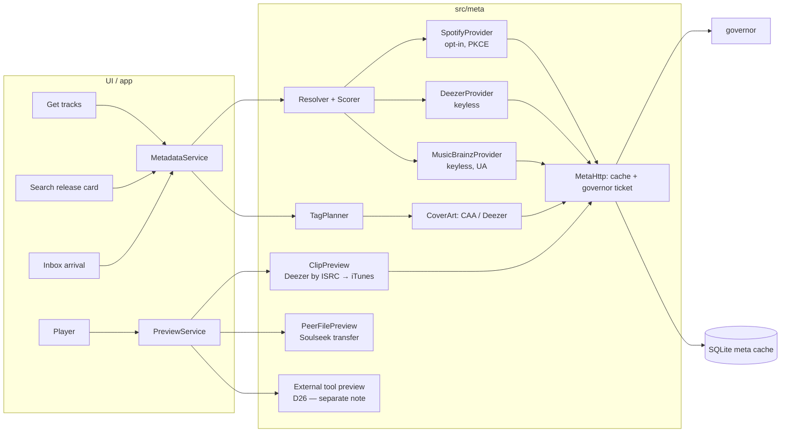
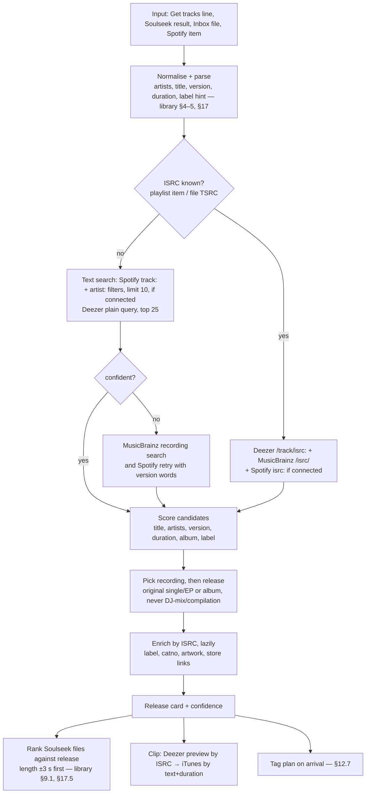

# Metadata matching and quick-preview services

> Status: **draft — research in progress** (all sources accessed 2026-10-19). Items marked **TODO(verify)** come from
> memory or second-hand sources and have not been checked against a primary source; do not turn them into constants
> until verified. Source repos are read at the commits listed in §14.
>
> Scope: canonical track metadata (Spotify and alternatives), matching a Soulseek result or a batch line to a
> catalogue entry, and 30-second previews from official sources. **Out of scope by decision (PRD D20):** downloading or
> ripping audio from YouTube, YouTube Music, Spotify or any other streaming service. spotDL is described only at the
> level of "where metadata comes from, where audio comes from", plus its matching and tagging logic.
>
> Manual requests made for this note (all public, unauthenticated, one-off): Deezer 6 (2 searches that failed, 1 search,
> 1 track, 1 ISRC lookup, 1 album) + 1 HEAD on a preview; iTunes Search 1 + 1 HEAD; MusicBrainz 3 (one rejected for a bad
> `inc`); Cover Art Archive 1. No Spotify request was made and no Spotify credentials were used.

## 1. TL;DR

- **Spotify's Web API is now a 5-user sandbox for apps like Selecta.** Extended quota is reserved for registered
  organisations with ≥ 250k monthly users (since 2025-05-15). Development Mode (2026) requires the app owner to have
  **Premium**, allows **5 users**, caps search at **10 results**, removed batch lookups, album `label`, `popularity`
  and genres, limits playlist reading to the user's **own or collaborative playlists**, and refresh tokens now expire
  after **6 months**. ISRCs (`external_ids`) survived (restored March 2026). `preview_url` is gone since 2024-11.
  → Spotify works for the maintainer (he has Premium) through **PKCE with a user-owned Client ID**; it cannot be a
  feature that "just works" for other users.
- **Spotify's terms conflict with a Soulseek client** (quotes in §4): no use of Spotify Content in an app that
  "facilitates … the illegal or unauthorized use or sharing of audio" (Terms §IV); no product "integrated with streams
  or content from another service" (Policy §III.5); no storing Spotify Content "indefinitely", only "temporary caching
  of metadata and cover art", and no functionality that makes "permanent copies of Spotify Content" (Terms §IV) —
  which is what **writing Spotify tags and artwork into MP3s** does; attribution with the Spotify logo and a link back
  wherever Spotify data shows (Policy §II.4). The realistic consequence is revocation of the user's developer app or
  API access, not a lawsuit — but it is a real, named risk for D29 (MQ1).
- **Recommended split:** use Spotify (opt-in) to *match and display*; write file tags from **MusicBrainz** (CC0
  core data, built for tagging) and artwork from **Deezer** (1000 px) or the **Cover Art Archive** (1200 px), keyed by
  the ISRC. Keep "Spotify-first tags" as an explicit maintainer setting with a `WOAS` link-back.
- **Deezer is the best keyless source** and the default clip source: search hits already carry the ISRC, albums carry
  label + UPC + 1000-px covers, tracks carry BPM, and `preview` is a **30-s MP3 at 128 kbps** behind a URL signed for
  ~15 minutes. Its terms carry the same P2P-association clause and forbid storing audio → stream clips from memory.
  **iTunes** is the fallback clip (30-s AAC ~256 kbps, no ISRC, ~20 calls/min, promo-only terms with a store badge).
- **MusicBrainz** turns an ISRC into recordings and releases with **label, catalogue number, barcode and direct store
  links** (Bandcamp, Beatport, Traxsource, Spotify, Deezer); 1 request/s with a contact User-Agent. **Discogs** adds
  styles and catalogue numbers (token, 60/min, 6-hour freshness rule). **Beatport** (partner-only API),
  **Traxsource** (no API) and **Bandcamp** (API for labels only; scraping forbidden) are deep links and purchase
  sources, with purchases imported into the Inbox.
- **No C++ Spotify library fits:** spotify-qt's `lib` is GPL-3.0 and active but uses a client secret, misses ISRCs
  and is tied to its app; the others are stale MIT/libcurl code. Write a small Qt client on
  `QOAuth2AuthorizationCodeFlow` (PKCE since Qt 6.8; Qt Network Authorization is GPLv3/commercial).
- **spotDL** (MIT) searches by ISRC first, then "artists - title"; scores with RapidFuzz on slugified, token-sorted
  strings; drops candidates with title ≤ 60, artists < 70 or a duration score `100·exp(−0.1·Δs)` < 25; and tags
  ID3v2.3 (with the label wrongly in `TENC`). Since March 2026 its default Spotify backend is an **unofficial**
  web-player client — not an option for Selecta (D21).
- **Matching:** identifiers before text, but an **ISRC is not a release** (one ISRC sat on 20 MusicBrainz releases;
  Deezer's ISRC lookup returned the album copy); reject DJ-mix "(Mixed)" segments and derivative junk; the chosen
  release's duration drives the ±3 s Soulseek ranking (D23).

## 2. Key findings

| # | Finding | Confidence | Source |
|---|---|---|---|
| K1 | Dev mode (2026): owner Premium, 5 users per app, search `limit` ≤ 10, no batch endpoints, no album `label`, playlist items only for own/collab playlists. | High (official changelog + migration guide) | Spotify Feb 2026 changelog |
| K2 | Extended quota: organisations only, ≥ 250k MAU, since 2025-05-15. | High | Spotify quota-modes page |
| K3 | `external_ids` (ISRC, UPC) remain available (removal reverted March 2026). | High | Spotify March 2026 changelog |
| K4 | Refresh tokens expire 6 months after authorisation (PKCE included); refreshing does not extend them. | High | Spotify blog 2026-06-18 |
| K5 | Spotify Terms prohibit Spotify Content in apps that facilitate unauthorised sharing of audio, integration with content from other services, indefinite storage, and permanent copies; Spotify Content includes metadata and cover art. | High (verbatim); application to Selecta is inference | Developer Terms v10, Policy (2025-05-15) |
| K6 | `preview_url` deprecated/null for new apps; no official Spotify preview remains. | High | Spotify blog 2024-11-27, reference pages |
| K7 | Deezer keyless: search hits include `isrc`; album has `label`, `upc`, `cover_xl` 1000 px; preview = 30-s MP3 128 kbps, URL signed ~15 min. | High (observed) | Manual requests |
| K8 | Deezer terms: no association with unauthorised download/sharing; non-commercial, private use; no local audio storage; logo required. | High (verbatim) | developers.deezer.com terms + guidelines |
| K9 | iTunes Search: 30-s AAC ~256 kbps clips, no ISRC/label, ~20 calls/min; previews only to promote purchases, stream-only, with badge and attribution. | High | Manual request; Apple Search API page |
| K10 | MusicBrainz: ISRC → recordings → releases with label, catalogue number, barcode and store URLs; core data CC0; 1 req/s per IP; UA with contact. | High | Manual requests; MB docs |
| K11 | Discogs: search needs a token; 60/min; CC0 catalogue data but a 6-hour display-freshness and no-longer-than-needed caching rule; mandatory notices. | High (archived terms of 2025-05-27) | Discogs API ToU |
| K12 | spotify-qt `lib`: GPL-3.0, active (2026-10-05), secret-based auth, no ISRC parsing, coupled to the app. Other C++ clients are MIT and stale. | High | Source read |
| K13 | spotDL thresholds and formula as in §7.3; default metadata backend since 2026 is the unofficial SpotipyFree. | High | Source read @ `cd4a420`; PR #2626 |
| K14 | Beatport API v4 is partner-only; Traxsource has no API; Bandcamp's API serves labels/merch partners only and its policy forbids scraping. | Medium–high | Beatport discussion, Bandcamp developer page and policy |
| K15 | Beatport site previews are 2 minutes from the middle of the track. | Medium (third-party, consistent) | Proton Radio, Label Engine; Beatport support (length only) |
| K16 | One ISRC maps to many releases (and a recording can carry several ISRCs); an ISRC lookup does not pick the original release. | High (observed on one track; general pattern known) | MusicBrainz + Deezer requests |

## 3. Spotify Web API (state on 2026-10-19)

### 3.1 Access tiers after the 2024–2026 restrictions

Spotify narrowed third-party access four times in two years. The result matters more than any endpoint detail:
**a Soulseek client can only use the Web API in Development Mode, and Development Mode is now a 5-user sandbox that
requires the app owner to pay for Premium.**

| Date | Change | Who is affected | Source |
|---|---|---|---|
| 2024-11-27 | Removed for new use cases: Related Artists, Recommendations, Audio Features, Audio Analysis, Featured Playlists, Category's Playlists, "30-second preview URLs, in multi-get responses", "Algorithmic and Spotify-owned editorial playlists". | New apps, and dev-mode apps without a pending extension request. Extended-quota apps unaffected. | Spotify blog 2024-11-27 |
| 2025-04-09 / 2025-11 | Redirect URIs must be HTTPS, or a loopback IP literal (`http://127.0.0.1:PORT`, `http://[::1]:PORT`); `localhost` is rejected. Enforced for new apps from 2025-04-09, all apps by November 2025. Implicit grant is marked deprecated. | All apps | Redirect URI concept page |
| 2025-05-15 | Extended quota only for organisations: "Established Business Entity", "active, and Launched Service", "at least 250k MAUs", key markets, commercial viability; "Spotify only accepts applications from organizations (not individuals)". | Anyone applying | Quota modes page |
| 2026-02-11 (new apps) / 2026-03-09 (existing) | Dev mode: owner needs **Premium** ("If the owner's Premium subscription lapses, the app will stop working"); **5 users** per app (was 25; existing extra users grandfathered); 1 Client ID per developer; reduced endpoint set (§3.3); `GET /search` `limit` max 50 → **10**, default 20 → 5; batch "get several" endpoints removed; playlist contents only for playlists the user owns or collaborates on; fields removed: track `popularity`, `available_markets`, `linked_from`; album `label`, `popularity`, `album_group`; artist `followers`, `popularity`; user `email`, `country`, `product`. `external_ids` (ISRC/UPC) was removed, then **restored in March 2026**. On 2026-03-09 Spotify postponed the *endpoint* restriction for existing integrations (Premium, user cap and Client-ID cap went ahead). | Dev-mode apps | Spotify blog 2026-02-06, Feb 2026 changelog + migration guide, March 2026 changelog |
| 2026-06-18 / 2026-07-20 | Refresh tokens expire **6 months after the user's authorisation**; refreshing does not extend them; expiry returns `400 invalid_grant`, and the app must send the user through sign-in again. Applies to Authorization Code and PKCE, not Client Credentials. | New apps from 2026-06-18, existing from 2026-07-20 | Spotify blog 2026-06-18 |
| 2026-07-23 | Client IDs per developer 1 → 25; dev-mode quota counted **per developer account** (all its Client IDs share one bucket); quota 429s carry `"reason": "QUOTA_EXCEEDED"`. | Dev-mode apps | Spotify blog 2026-07-23, July 2026 changelog |

| | Development mode (what Selecta can get) | Extended quota mode |
|---|---|---|
| Eligibility | Any Spotify account linked to a developer account; **owner must have Premium** | Registered organisation with ≥ 250k MAU (individuals excluded since 2025-05-15) |
| Users | **5 allow-listed users per app**; others get 403 | Unlimited |
| Rate limit | Unpublished; "much" lower than extended | Unpublished |
| Quota | Per developer account, shared across its Client IDs | Higher |
| Endpoints | 43 endpoints (§3.3), field removals apply | Full API |

**Consequence for Selecta (high confidence):** a Client ID shipped with Selecta would serve at most 5 people and stop
working if the maintainer's Premium lapses. The only workable model is **bring-your-own Client ID**: each user registers
an app on developer.spotify.com (which now requires their own Premium), registers Selecta's loopback redirect URI, and
pastes the Client ID into Selecta. spotify-qt works this way (§6), and so does spotDL's official-API mode (§7).

### 3.2 Auth flows for a desktop app

| Flow | Secret needed | User context | Fit for Selecta |
|---|---|---|---|
| Client Credentials | Yes | No (catalogue only: search, tracks, albums, artists, playlist metadata) | Poor. The secret cannot be protected in a distributed binary (Developer Terms §VI: Security Codes must be embedded "in a secure manner not accessible by third parties"). With BYO credentials the secret is the user's own, but PKCE avoids holding one at all. No access to the user's playlists. |
| **Authorization Code + PKCE** | No | Yes | **Recommended.** Native-app flow; one browser consent; refresh token stored in the Keychain; re-consent at least every 6 months. |
| Authorization Code (with secret) | Yes | Yes | What spotify-qt does (user supplies ID + secret). Works, but PKCE is strictly better for a public client. |
| Implicit grant | No | Yes | Deprecated; do not use. |

Redirect URI: register `http://127.0.0.1/callback` **without a port**; loopback IP literals may use a dynamic port that
is added in the authorisation request ("The only exception is for loopback IP literals, which can dynamically be
assigned ports"). `localhost` is not accepted.

Scopes, requested only when the feature is first used (Spotify's compliance tips ask for minimal, just-in-time scopes):

| Feature | Scopes |
|---|---|
| Catalogue lookups (search, track, album, artist) | none (any user token works) |
| Import the user's playlists | `playlist-read-private`, `playlist-read-collaborative` |
| Import Liked Songs | `user-library-read` |
| Play a track in the user's Spotify app (§5) | `user-modify-playback-state`, `user-read-playback-state` |

Qt support: `QOAuth2AuthorizationCodeFlow` (Qt Network Authorization) supports PKCE via `setPkceMethod(S256)` since
Qt 6.8, token refresh via `QAbstractOAuth2::refreshTokens()` (6.9+). `QOAuthHttpServerReplyHandler` listening on
`QHostAddress::LocalHost` builds an `http://127.0.0.1:{port}/{path}` callback ("the IP literals (127.0.0.1 and ::1)
are used"); `setCallbackHost()` exists since 6.9. The module is licensed **Commercial or GPLv3** (not LGPL), which is
fine for GPL-3.0-or-later Selecta but is worth recording in the dependency table.

### 3.3 Endpoints Selecta would use (Development Mode, 2026)

| Endpoint | Use in Selecta | Notes (dev mode) |
|---|---|---|
| `GET /v1/search?q=…&type=track` | Match a batch line or result to a catalogue track | `limit` 0–10 (default 5), `offset` ≤ 1000. Field filters: `track`, `artist`, `album`, `year` (single or range `1955-1960`), `isrc` (tracks only), `genre`; albums also `upc`, `tag:new`, `tag:hipster`. `market` is overridden by the user's country when a user token is used. |
| `GET /v1/search?q=isrc:GBCFB1700229&type=track` | ISRC → Spotify track (e.g. ISRC from MusicBrainz/Deezer or from a file's `TSRC`) | Documented filter; one request per ISRC (no batch). |
| `GET /v1/tracks/{id}` | Canonical track data | `name`, `artists[]`, `album` (simplified), `duration_ms`, `explicit`, `disc_number`, `track_number`, `external_ids.isrc`, `external_urls.spotify`, `is_local`. `popularity`, `available_markets`, `linked_from` removed; `preview_url` deprecated (null). |
| `GET /v1/albums/{id}` | Album-level tags and artwork | `name`, `album_type` (`album`/`single`/`compilation`), `total_tracks`, `release_date` + `release_date_precision` (`year`/`month`/`day`), `images` ("widest first"; sizes not specified; the largest is "typically 640x640px jpeg" per Exportify's docs — below D29's 800×800 target), `copyrights` (`C`/`P`), `external_ids` (`upc`/`ean`), paged `tracks`. **`label` removed in dev mode**; `genres` "is always empty"; `popularity` removed. |
| `GET /v1/albums/{id}/tracks` | Disc count, track total | Paged. |
| `GET /v1/artists/{id}` | Artist images/name | `genres` deprecated; `followers`, `popularity` removed. |
| `GET /v1/me/playlists`, `GET /v1/playlists/{id}` | List the user's playlists | Metadata for any playlist. |
| `GET /v1/playlists/{id}/items` | Import a playlist into Batch | Replaces `/tracks`. "Only accessible for playlists owned by the current user or playlists the user is a collaborator of"; others → 403. `limit` ≤ 50, `fields` filter, `is_local` entries carry no ID. |
| `GET /v1/me/tracks` | Import Liked Songs | Paged. |
| `GET /v1/me/player/devices`, `PUT /v1/me/player/play` | Full-length listening in the user's app (§5) | Premium only. |

Removed or unavailable to a new app: `GET /tracks?ids=`, `/albums?ids=`, `/artists?ids=` (batch), `/artists/{id}/top-tracks`,
`/browse/new-releases`, `/browse/categories*`, `/users/{id}`, `/users/{id}/playlists`, `/markets`, audio features and
analysis, recommendations, related artists, Spotify editorial/algorithmic playlists.

What this means for each maintainer goal:

| Goal | Feasible in dev mode? |
|---|---|
| Canonical title/artists/album/date/track+disc numbers/ISRC/duration/artwork | Yes, one track request + one album request per track (no batching any more). |
| Label | **No** (removed). Catalogue number and genre were never available. Both matter to DJs → need Deezer/MusicBrainz/Discogs anyway (§9). |
| Improve matching of Soulseek results | Indirectly: Spotify gives the canonical title, version string and duration to match against (§12). |
| Import Spotify playlists into Batch | Only the user's **own or collaborative** playlists and Liked Songs. Editorial playlists and other users' public playlists return 403. |
| Previews | **No** (`preview_url` deprecated). |

### 3.4 Rate limits and quotas

- The rate limit is computed "in a rolling 30 second window"; numbers are not published; dev mode gets a lower limit.
  A 429 "will normally include a Retry-After header with a value in seconds".
- Quotas are a separate mechanism (dev mode only); since 2026-07-23 a quota 429 carries `reason: QUOTA_EXCEEDED`. The
  quota size and reset period are not published (TODO(verify) experimentally with the maintainer's own app).
- Developer Terms §IV forbid "making excessive service calls that are not strictly required for the proper functioning
  of your SDA" and using "any robot, spider … or other tool to retrieve, duplicate, or index any portion of the Spotify
  Service or Spotify Content (which includes playlist data)". Batch matching of a 200-line tracklist is therefore both a
  rate-limit and a terms question: keep it user-initiated, cached and slow.
- Proposed governor budget (no published number to anchor on, so conservative): steady 1 request/s, burst 5, honour
  `Retry-After` (+ jitter), and on `QUOTA_EXCEEDED` stop all Spotify calls for 1 h then retry once (TODO(verify) the
  actual reset period).

### 3.5 Preview URLs

`preview_url` on track objects is marked deprecated in the current reference. Spotify's 2024-11-27 post only named
"multi-get responses (SimpleTrack object)", but developers report `null` on single-track GETs, search and player
endpoints for affected apps (community forum; medium confidence). Spotify has not restored it. Third-party
"workarounds" scrape the web player or embed pages; Selecta must not use them (Developer Terms §IV "Improper use", and
outside the scope rule).

## 4. Spotify Developer Terms and Developer Policy vs a Soulseek client

Documents: **Spotify Developer Terms, "Version 10, effective as of 15 May, 2025"** and **Spotify Developer Policy,
"Effective as of 15 May, 2025"** (the Policy is incorporated into the Terms), plus the Design Guidelines and Compliance
Tips. Spotify Content is defined broadly: "any content, data, information or material made available through the
Spotify Platform … sound recordings, … cover art, … metadata, playlists, and user data". **Metadata and cover art are
Spotify Content.**

### 4.1 Clauses that conflict with Selecta's intended uses

| # | Clause (verbatim) | Where | What it hits in Selecta | Conflict |
|---|---|---|---|---|
| S1 | "Do not use the Spotify Platform, Spotify Content, Spotify Service, or Spotify Marks in any way to promote or distribute an application … including any SDA that: is associated with, promotes, features, encourages, facilitates, or condones (a) illegal activity or the illegal or unauthorized use or sharing of audio and/or audiovisual content" | Terms §IV "Liability and reputation" | Selecta's purpose is downloading and sharing audio over a P2P network where most content is unlicensed. Any Spotify feature inside it is Spotify Content used in an SDA that "facilitates … sharing of audio". | **High** — goes to the nature of the app, not to a feature. |
| S2 | "Do not create any product or service which is integrated with streams or content from another service." | Policy §III.5 | Spotify metadata displayed next to, and used to select, Soulseek files. | **High** |
| S3 | "you may not store, aggregate or create compilations or databases of Spotify Content, other than as strictly necessary to operate your SDA … Do not store Spotify Content indefinitely." and "Do not locally cache any Spotify Content, except as strictly necessary … limited to the temporary caching of: metadata and cover art" | Terms §IV "Storing Spotify Content" | **Tagging files** with Spotify metadata and embedding Spotify artwork stores Spotify Content permanently, in files that leave Spotify's control (they are shared back on Soulseek by default — PRD D12). A SQLite metadata cache with a long TTL is also a "database of Spotify Content". | **High** for tagging/embedding; low for a short-TTL cache. |
| S4 | "facilitating 'stream ripping' or other functionalities that make it easier for users to capture or otherwise make permanent copies of Spotify Content." | Terms §IV "Unauthorized access" | Aimed at audio, but the definition of Spotify Content includes metadata and cover art: writing them into files is "making permanent copies". | **Medium** (wording fits; intent is audio) |
| S5 | "If you display any Spotify Content you must clearly attribute the content as being supplied and made available by Spotify, by using the Spotify Marks" and "Metadata, cover art and Audio Preview Clips must be accompanied by a link back to the applicable album, content or playlist on the Spotify Service." | Policy §II.4 | Every UI surface showing Spotify-sourced fields needs the Spotify logo and a link back. Tags read later by rekordbox carry no attribution. | **Medium** (doable in Selecta's UI; impossible in files) |
| S6 | "Don't manipulate any content or metadata." / "Track, artist, playlist, and album titles must always be presented with the metadata provided by Spotify." / artwork "must be kept in its original form", "Don't crop the artwork" | Design Guidelines | Selecta's normalisation (version strings, `feat.` handling), and resizing artwork for DJ hardware (CONV-5). (The Terms do allow "You may adjust the size of metadata or cover art as necessary".) | **Medium** |
| S7 | "Do not build an SDA that enables the transfer of data to another service, except for the purpose of enabling a user to transfer their personal data, or the metadata of the user's playlists to another service." | Policy §III.9 | Playlist → Batch import moves playlist metadata into a search on another service. The exception covers "the metadata of the user's playlists"; arguably fine on its own, but S1/S2 still apply to the app. | **Low–medium** |
| S8 | "Do not permit any device or system to segue, mix, re-mix, or overlap any Spotify Content with any other audio content"; Compliance Tips list "DJ/Mixes" as a disallowed use case. | Policy §III.7; Compliance Tips | Only if Selecta plays Spotify audio (§5): it must never overlap Spotify playback with its own preview player. | Low (avoidable) |
| S9 | "Streaming SDA" includes "using the Spotify Platform to control a background Spotify application"; then "there shall be no playback of Spotify Content without showing relevant cover art and metadata in your SDA". | Terms §II; Policy §II.5 | `PUT /me/player/play` (§5) makes Selecta a Streaming SDA. | Low (UI obligations) |
| S10 | License to develop and distribute SDAs "(i) for private personal use"; "Do not analyze the Spotify Content … for any purpose, including … creating new or derived … functionality"; "Do not use the Spotify Platform or any Spotify Content to train a machine learning or AI model". | Terms §III; Policy §III.13–14 | Matching scores are "analysis" in a loose reading; no ML planned. | Low |

Other notes:
- Spotify's Terms reserve review and revocation: access "may be revoked if the review process indicates that your SDA
  breaches our terms and policies". With bring-your-own Client IDs, **the risk lands on each user's developer account
  and on the Spotify account linked to it**, not on the Selecta project. Selecta must say so before the user connects.
- No clause names Soulseek or P2P explicitly; S1 is the general "illegal or unauthorized … sharing of audio" clause.
  Whether a given user's Soulseek use is unauthorised is a fact question per file; Spotify does not need to show that to
  revoke access.
- Deezer's developer terms contain the same kind of clause (§8.1, D-T1), and Apple's iTunes promo terms restrict use to
  promoting purchases (§8.2). **No commercial catalogue API is clean for a P2P client.** MusicBrainz (CC0 core data) is
  the exception (§9.1).

### 4.2 Reading for Selecta (inference, not legal advice)

1. **Tagging filed files with Spotify metadata or artwork is the clearest conflict** (S3 + S4 + S5, on top of S1).
   Recommendation: never write Spotify-sourced text or artwork into files. Tag from MusicBrainz/Cover Art Archive (and,
   at the user's explicit choice, Discogs/Deezer — with their own terms caveats, §9).
2. **Spotify as a lookup aid** (resolve a line to a canonical title/version/duration/ISRC for matching, show it in the
   UI with attribution and a link back, keep it in a short-TTL cache) is less exposed but still within S1/S2.
3. **Playlist import** is the use the Policy itself half-allows (S7 exception), limited by dev mode to the user's own
   playlists and Liked Songs.
4. Make every Spotify feature **opt-in, off by default, behind a BYO Client ID**, with a plain-language warning. Offer
   the non-API routes first: "Open in Spotify" deep links (§10) and importing an exported CSV (§12.6).

## 5. Full-length listening through the user's own Spotify app

The maintainer wants a legitimate way to hear the whole track before downloading. Three options, from least to most
coupling:

| Option | How | Requirements | Notes |
|---|---|---|---|
| **A. Deep link (recommended default)** | `QDesktopServices::openUrl(QUrl("spotify:track:<id>"))`, or `https://open.spotify.com/track/<id>` (opens the app if installed, else the web player). Without an ID: `https://open.spotify.com/search/<url-encoded query>` (TODO(verify) the `spotify:search:` URI form still works). | Spotify app installed (Free or Premium). No API, no Client ID. | The Design Guidelines ask integrations to "always link to the Spotify app … The Spotify app is the default playback mechanism", with link text "OPEN SPOTIFY", "PLAY ON SPOTIFY" or "LISTEN ON SPOTIFY". Selecta pauses its own player first. |
| **B. Web API playback** | `GET /v1/me/player/devices` → `PUT /v1/me/player/play?device_id=…` with `{"uris": ["spotify:track:…"], "position_ms": N}` | Premium ("This API only works for users who have Spotify Premium"), scope `user-modify-playback-state` (+ `user-read-playback-state` for devices), a running Spotify client (desktop app or any Connect device), a dev-mode app the user owns (§3.1). | Can start at a position (e.g. jump past the intro). "The order of execution is not guaranteed when you use this API with other Player API endpoints." Turns Selecta into a Streaming SDA (S9): show cover art + metadata + Spotify logo while it plays, link to the app. Common failure: no active device (TODO(verify) exact status/body; the reference page lists only 204/401/403/429). |
| C. macOS AppleScript | `tell application "Spotify" to play track "spotify:track:<id>"`; `set player position to N` | Spotify desktop app; macOS Automation (TCC) consent: `NSAppleEventsUsageDescription` in Info.plist. | Not part of the Web API (no Client ID, works with Free on desktop per community reports, Feb 2026). Unsupported: past app updates broke it silently (2015 `play track` no-op). Medium confidence; experiment only. |

Recommendation: ship **A** in P1 (zero terms surface beyond linking). Offer **B** only inside the opt-in Spotify
integration. Keep **C** as a lab experiment for the maintainer.

Selecta never plays Spotify audio itself, never records it, and never overlaps it with its own preview audio (S8).

## 6. C++/Qt libraries for the Spotify Web API

| Library | Language / deps | Licence (SPDX) | Activity | Auth | Coverage vs Selecta's needs | Verdict |
|---|---|---|---|---|---|---|
| **kraxarn/spotify-qt `lib/`** ("spotify-qt-lib" 4.0.0) | C++17, Qt Core + Network, nlohmann/json (MIT), doctest (MIT) | **GPL-3.0** (repo licence; no "or later" wording found in the readme or headers, so treat as GPL-3.0-only) | Active: last commit 2026-10-05 (`c20be07`), ~1.5k stars | Authorization Code **with user-supplied client secret**, loopback `http://127.0.0.1:<port>` via `QTcpServer`; no PKCE | Player, library (`/me/library` — already migrated), playlists (switches `/tracks` ↔ `/items`), search, albums, artists. Still calls removed endpoints (`artists/{id}/top-tracks`, `related-artists`). Track/album models do not parse `external_ids` (ISRC). Coupled to spotify-qt's `lib::settings`, logging and `HttpClient` abstractions; uses `std::string` + nlohmann rather than Qt types. | Licence-compatible (Selecta's combined binary would then be GPL-3.0). Reuse means vendoring and patching; not worth it for the ~8 endpoints Selecta needs. Good reference for the loopback auth server and the player calls. |
| Harry-Skerritt/SpotifyCPP | C++17, libcurl, nlohmann/json, cpp-httplib | MIT | v0.9.6, last push 2026-01-16 (before the Feb 2026 changes), 9 stars | Auth code with client secret, built-in local server | Typed models for "all" responses | Blocking libcurl design; not Qt; pre-2026 endpoints. No. |
| smaltby/spotify-api-plusplus | C++, libcurl | MIT | Last push 2017 | Refresh-token based | Old API | No. |
| dydil/Qtify | Qt | MIT | Last push 2018, 1 star | — | Old API | No. |
| lucianIrsigler/spotifyAPICpp | C++14, curl, jsoncpp | MIT | Last push 2024-01 | — | Old API | No. |

**Recommendation: write a minimal client** (estimated 600–900 lines including tests). Sketch:

```cpp
// SPDX-License-Identifier: GPL-3.0-or-later
// selecta/metadata/spotify/SpotifyClient.h — sketch, not final API
class SpotifyClient : public QObject {
    Q_OBJECT
public:
    // Configured with the user's own Client ID (Keychain), never a bundled one.
    explicit SpotifyClient(NetGovernor *governor, MetadataCache *cache, QObject *parent = nullptr);

    // Auth (QOAuth2AuthorizationCodeFlow + PKCE S256 + QOAuthHttpServerReplyHandler on 127.0.0.1)
    void connectAccount(const QStringList &scopes);   // opens the browser
    void disconnectAccount();                          // revoke locally, wipe tokens + cached Spotify data
    bool isConnected() const;

    // Catalogue (each call: cache lookup → governor ticket → QNetworkRequest → parse)
    QFuture<QList<SpTrack>> searchTracks(const SpQuery &q, int limit = 10); // field filters, limit ≤ 10
    QFuture<std::optional<SpTrack>> trackByIsrc(const QString &isrc);
    QFuture<SpTrack> track(const QString &id);
    QFuture<SpAlbum> album(const QString &id);

    // Playlists (own/collaborative only in dev mode)
    QFuture<QList<SpPlaylist>> myPlaylists();
    QFuture<QList<SpPlaylistItem>> playlistItems(const QString &playlistId);   // pages of 50
    QFuture<QList<SpPlaylistItem>> likedSongs();

    // Playback (Premium) — optional
    QFuture<QList<SpDevice>> devices();
    QFuture<void> play(const QString &trackUri, std::optional<int> positionMs, const QString &deviceId = {});

signals:
    void authStateChanged();
    void quotaExceeded(QDateTime retryAfter);   // 429 with reason QUOTA_EXCEEDED
};

struct SpTrack {   // only what Selecta displays/matches; never written to files (§4.2)
    QString id, name, isrc, albumId, albumName, albumType, releaseDate, releaseDatePrecision;
    QStringList artists;
    int durationMs = 0, trackNumber = 0, discNumber = 0;
    bool explicitContent = false;
    QUrl spotifyUrl;   // link-back required next to any displayed field
    QList<SpImage> albumImages;
};
```

Implementation notes: one `QNetworkAccessManager` per service thread; `QJsonDocument` parsing with strict type checks
(every field optional — Spotify removes fields without versioning); treat 401 → refresh once → re-auth; 429 → governor
backoff; 403 on playlist items → "not your playlist" message; per-request timeout 15 s.

## 7. spotDL: architecture, matching and tagging

Repository `spotDL/spotify-downloader`, **MIT** licence, read at v4.5.2 (`cd4a420`, 2026-07-20). MIT code can be ported
into GPL-3.0-or-later Selecta with attribution (keep the copyright notice).

### 7.1 Architecture (high level only)

| Concern | Where it comes from in spotDL |
|---|---|
| Metadata (title, artists, album, dates, ISRC, artwork URL, label, copyright) | Spotify. Since the 2026 restrictions the **default backend is "SpotipyFree"**, a third-party drop-in that talks to Spotify's private web-player endpoints instead of the Web API (PR #2626, March 2026, "Replaced spotipy with a non-api library"); the official Web API (spotipy) is used only with `--use-official-api` or user auth. spotDL also ships a shared Client ID/secret in its default config. |
| Audio | Not Spotify: it searches other platforms (default provider YouTube Music; others selectable) and takes the best match. **Not documented further here (out of scope).** |
| Lyrics | Genius, AZLyrics, Musixmatch. |
| Tags | mutagen, from the Spotify metadata (§7.4). |

Lessons: (1) spotDL's own trajectory shows that the official Web API is no longer enough for "anyone can use it"
tools; (2) the unofficial-endpoint route is not acceptable for Selecta (Terms §IV "Improper use" and "Unauthorized
access"; brittle).

### 7.2 Turning a Spotify track into queries (`spotdl/providers/audio/base.py`, `utils/formatter.py`)

1. **ISRC first.** If the track has an ISRC and the provider supports ISRC search, search the bare ISRC string.
   - Exactly one result and it is "verified" (an official catalogue "song" entry, not a user video) → accept without
     scoring ("What's the chance of it being wrong?").
   - Otherwise score the ISRC results and accept the best if its score > 80.
2. **Text query**: `"{artists joined with ', '} - {title}"`, lower-cased (`create_song_title`), or a user template
   with `{artist}`, `{title}`, `{album}`, `{isrc}`, etc.
3. Query the "songs" category first, then "videos" (50 results each). Return immediately if the best result is
   verified and scores ≥ 80; otherwise keep collecting and return the overall best.
4. A plain text input (not a Spotify URL) is resolved with a Spotify search and **the first hit is taken without
   scoring** (`Song.from_search_term`) — a weak spot for batch lines.

### 7.3 Scoring (`spotdl/utils/matching.py`, `order_results`)

Strings are normalised with `slugify` (python-slugify: ASCII-fold, lower-case, non-alphanumerics → `-`; Japanese is
romanised with pykakasi), split into tokens and sorted; similarity is RapidFuzz `fuzz.ratio` (0–100).

| Step | Rule |
|---|---|
| Pre-filter | Drop a candidate if no word of the title appears in it. |
| Main artist | `ratio(song.artists[0], best result artist)`; if < 50 and several artists, best ratio over the first two of each. If the song has several artists but the candidate one, add `100/len(artists)` per song artist contained in the candidate's artist string. |
| Other artists | Average ratio of the remaining artists (zip, sorted); artists score = (main + others) / 2 when the song has several artists. |
| Artist fix-ups | Unverified candidates: fall back to channel-name match, then "artist names contained in the candidate title", then token-level ratio. Verified: +5 per extra artist found in the title; fall back to ratio of artist lists with title words removed. Multi-artist song vs single-artist candidate: average with `ratio(title, "artist - song")` if ≥ 80. |
| Title | `ratio(sorted tokens)`; if ≤ 75, retry with "artists – title" strings in which missing artist names are filled in on both sides; take the max. |
| Forbidden words | −15 per word present in the candidate but not in the Spotify title: `bassboosted, remix, remastered, remaster, reverb, bassboost, live, acoustic, 8daudio, concert, acapella, slowed, instrumental, cover`. |
| Album | `ratio(album, candidate album)`; used only for verified, non-ISRC candidates, and only when ≤ 80 (it can only lower the score). |
| Duration | `time = 100 · exp(−0.1 · |Δs|)` → Δ 3 s = 74, Δ 7 s = 50, Δ 14 s = 25. |
| Hard thresholds | Drop if title ≤ 60, artists < 70, time < 25, or (time < 50 and average < 75). |
| Combination | `avg = (artists + title) / 2`; if not an ISRC search and `avg ≤ 85`: `avg = (avg + time) / 2` and −5 on explicit-flag mismatch. Cap 100. |
| Tie-break | Keep candidates within 8 points of the best; add 0–15 points by relative popularity; take the max. |

### 7.4 Tags and artwork written by spotDL (`spotdl/utils/metadata.py`)

MP3 saved as **ID3v2.3**: `TIT2` title; `TPE1` all artists (joined with `/` in v2.3); `TPE2` album artist; `TALB`;
`TDRC` date + `TYER` year; `TCON` first genre (title-cased); `TRCK` n/N; `TPOS` n/N; `TSRC` ISRC; `TCOP` copyright
(first album copyright line); **`TENC` = label** (a misuse — `TENC` is "encoded by"; the label belongs in `TPUB`);
`WOAS` = Spotify track URL; `COMM` = audio source URL; `POPM` from popularity; `APIC` type 3 "Cover" = the largest
Spotify album image (JPEG); `USLT` lyrics. FLAC/Opus/Vorbis get the equivalent Vorbis comments plus
`METADATA_BLOCK_PICTURE`; M4A gets iTunes atoms and freeform `----:spotdl:WOAS` / `----:spotdl:ISRC`.

### 7.5 What transfers to Selecta

| spotDL idea | Transfer? | How, for Soulseek results and previews |
|---|---|---|
| ISRC-first lookup | **Yes, for catalogue hops** (Spotify/MusicBrainz → Deezer preview, file `TSRC` → catalogue). Soulseek results carry no ISRC. | Prefer ISRC equality over any text score; still verify duration (an ISRC can be reused across edits by mistake). |
| Slugify + token sort + `fuzz.ratio` | **Yes.** rapidfuzz-cpp (MIT) gives the same scorers in C++. | Use `token_sort_ratio`/`token_set_ratio` on normalised artist and title separately (see `library-matching-and-organization.md`). |
| Exponential duration score | **Yes**, with Soulseek's optional length attribute. | `exp(−0.1·Δ)` is right for "same master"; DJ versions (Extended vs Radio Edit) differ by minutes, so compare durations only after the version string matches. |
| Forbidden-word penalty | **Invert it for DJs.** "remix", "extended", "dub", "edit", "VIP", "instrumental" are versions the user may want. | Parse the version descriptor on both sides and require equality (or show "different version") instead of penalising words. Keep penalties for junk only: "slowed", "reverb", "8d", "bass boosted", "sped up", "nightcore". |
| "Verified" candidates | Partly. | Soulseek analogue: a result inside a release-like folder (track numbers, cover, consistent names) gets a small bonus; a lone file with a junk name gets none. |
| Popularity tie-break | No (no Spotify popularity in dev mode; peer fairness and quality are Selecta's tie-breakers, BATCH-5). | — |
| Tag set | Mostly. | Same frames, but label → `TPUB`, provenance URL → `WXXX`/`WOAS` of the *metadata source actually used*, no `POPM`. Values from MusicBrainz, not Spotify (§4.2). Mapping details: `conversion-and-metadata.md`. |

## 8. Official 30-second preview sources

### 8.1 Deezer (keyless "Simple API")

Verified by manual requests on 2026-10-19 (Bicep — "Glue", ISRC `GBCFB1700229`):

| Item | Observed / documented |
|---|---|
| Access | No key, no login for catalogue endpoints (`api.deezer.com/search`, `/track/{id}`, `/track/isrc:{ISRC}`, `/album/{id}`). OAuth app creation has been closed since at least mid-2026 ("We're not accepting new application creation at this time", per developers' reports) — irrelevant for keyless endpoints. |
| Search | `GET /search?q=bicep glue` → `{data[], total, next}`; each track already carries **`isrc`**, `duration` (s), `title`, `title_short`, `title_version` (e.g. `(Mixed)`), `rank`, `explicit_lyrics`, `preview`, `artist`, `album` (with `cover_small…cover_xl`). The documented advanced syntax (`artist:"…" track:"…"`) returned **0 results in two attempts** that day while the plain query worked — treat it as unreliable (TODO(verify)). |
| ISRC lookup | `GET /track/isrc:GBCFB1700229` → one track. It returned the **album** version (id 373789461), not the single (389034231) that shares the ISRC: Deezer picks one release; Selecta must choose the release itself. |
| Track | `bpm` (130.01 — Deezer's own analysis; often 0 for less common tracks, TODO(verify) rate), `gain`, `release_date`, `track_position`, `disk_number`, `contributors[]` with roles, `available_countries`, `link`. |
| Album | **`label`** ("Ninja Tune"), **`upc`**, `genres` (coarse: "Electro"), `record_type` (`single`/`ep`/`album`/`compile`), `release_date`, `nb_tracks`, `cover_xl` **1000×1000 JPEG**. |
| Preview | `preview` = **MP3, 30 s, 128 kbps** (HEAD: `audio/mpeg`, 479,827 bytes ≈ 128 kbit/s × 30 s), served by a CDN with `Accept-Ranges: bytes`. The URL is **signed and expires ~15 minutes** after the API response (`hdnea=exp=…`; observed exp − now ≈ 900 s). Store the track ID, re-resolve the URL at play time. |
| Rate limit | "50 requests / 5 seconds" per IP (quoted second-hand from the old docs page, which now requires login; medium confidence). Errors come back as HTTP 200 with `{"error": {"type", "message", "code"}}`; code 4 = quota (third-party clients; TODO(verify)). |
| Terms | Developer Terms (BLOGMUSIK/Deezer, French law): **D-T1** "Will not use the Services in any way or on any website that is associated or promotes in whatever manner the illegal or unauthorized use, streaming, download, or sharing of music and associated elements content" (§III.6); strictly non-commercial, "limited to a strictly private use within a family scope" (§IV); "Local Storage/Offline Storage of audio data is strictly forbidden" (Guidelines); "Each application using Deezer API/SDKs must have to include a clearly visible Deezer Logo" (Logo guidelines). |

### 8.2 iTunes Search API (keyless)

Verified by one request (`/search?term=bicep+glue&media=music&entity=song&country=FR`):

| Item | Observed / documented |
|---|---|
| Fields | `trackName`, `artistName`, `collectionName`, `trackTimeMillis`, `releaseDate`, `primaryGenreName`, `trackNumber`/`trackCount`, `discNumber`, `trackExplicitness`, `previewUrl`, `artworkUrl30/60/100`, `trackViewUrl` (music.apple.com), `country`. **No ISRC, no label.** Lookup by iTunes ID, UPC/EAN (`upc=`), AMG IDs; not by ISRC. |
| Preview | `…/mzaf_….plus.aac.p.m4a`: **AAC ≈ 256 kbps, 30 s** (HEAD: 1,004,701 bytes; `Content-Type: audio/x-m4p`, plain AAC in MP4), unsigned stable URL, `Cache-Control: max-age=31536000`, `Accept-Ranges: bytes`. Whether `moov` precedes `mdat` (progressive start) is TODO(verify). |
| Artwork | `artworkUrl100` (100×100). Replacing `100x100bb` with a larger size works in practice but is undocumented. |
| Rate limit | "approximately 20 calls per minute (subject to change)". |
| Terms | Promo content may be used "only to promote store content and not for entertainment purposes"; must be "proximate to a store badge" linking to the purchase page; song previews must carry "provided courtesy of iTunes" and be "streamed only, and not downloaded, saved, cached, or synchronized with video"; Apple may demand removal. The page is written for websites; nothing addresses desktop apps. |

### 8.3 Other preview sources

| Source | Status for Selecta |
|---|---|
| **Spotify** `preview_url` | Deprecated/null for new apps (§3.5). The Spotify iFrame embed still plays previews, but needs a web view (Qt WebEngine ≈ Chromium) and falls under the Widgets terms. Not recommended. |
| **Apple Music API** | Catalogue songs carry `isrc` and `previews[]`, with ISRC filtering (`/v1/catalog/{storefront}/songs?filter[isrc]=…`, up to 25 per request per third-party docs — TODO(verify)). Needs a developer token signed with a private key from a paid Apple Developer Program membership ($99/yr). A key cannot ship in an open-source app; every user would need their own membership. Not practical. |
| **Beatport** | The best electronic catalogue (BPM, key, genre, label, catalogue number, mix names) and DJ-friendly **2-minute previews taken from the middle of the track** (third-party sources: Proton Radio, Label Engine; Beatport support confirms 2-minute previews but not the position). API v4 (`api.beatport.com/v4`, OAuth 2.0) is **partner-only**: apply through the Beatport partner portal, which issues a client ID/secret for a given callback (Music Assistant discussion, Nov 2025). Community plugins (beets-beatport4) borrow the docs front-end's client ID — not acceptable. A 2015 embeddable player (`embed.beatport.com/player/?id=…&type=track`) existed; its current status is unknown. → **Deep link only**, unless the maintainer applies for partner access (open question). |
| **Traxsource** | No public API (third-party listings agree). Track pages offer an embeddable player (iframe). → **Deep link only.** |
| **Bandcamp** | The official API serves labels and merch partners only (Account, Sales Report, Merch Orders APIs; "Labels and merchandise fulfillment partners … contact us"). No catalogue or search API. The Acceptable Use policy (incorporated in the Terms, 2026-06-10) forbids scraping and data mining. Embedded player (iframe) and oEmbed exist; tracks stream in full when the artist allows it. spotDL's Bandcamp provider uses undocumented mobile-app endpoints — not acceptable. → **Deep link only.** |

### 8.4 Suitability for electronic music (estimates — verify with experiment X5)

| Source | Coverage of DJ electronic catalogue | Clip | Quality | Latency to first audio | Use inside a third-party desktop app |
|---|---|---|---|---|---|
| Deezer | High for distributed digital releases (most Beatport labels also distribute to DSPs); low for Bandcamp-only, white labels, vinyl-only | 30 s; position not documented (some distributors let labels pick the clip start; TODO(verify) X6) | MP3 128 kbps | 1 API call + ~480 KB | Allowed for "Personal Applications", non-commercial, logo required; **P2P association clause D-T1** |
| iTunes | High (same distribution) | 30 s; position not documented (X6) | AAC ~256 kbps | 1 call + ~1 MB | Only to promote purchase, badge + attribution; written for websites |
| Spotify | High | none (deprecated) | — | — | — |
| Beatport | Highest | 2 min, middle of track | (site previews; not via API) | — | Partner agreement needed |
| Traxsource / Bandcamp | Medium / long tail | site/embed | — | — | Embeds only (web view) |

## 9. Alternative and complementary metadata sources

### 9.1 MusicBrainz + Cover Art Archive

Verified by manual requests:

| Item | Observed / documented |
|---|---|
| ISRC lookup | `GET /ws/2/isrc/GBCFB1700229?inc=artist-credits&fmt=json` → **2 recordings**: "Glue" (269,066 ms; ISRCs `ES8741707116`, `GBCFB1700229`, `GBCFB1700271`) and a soundtrack edit "Glue – 'There Are 80,000 Native Irish Speakers'" (265,000 ms). ISRC ↔ recording is many-to-many in practice. |
| Releases + labels | `GET /ws/2/release?recording={mbid}&inc=labels+release-groups+media+url-rels` (note: `labels` is not a valid `inc` on `/recording`) → 20 releases (single, EP, album, compilations, a bootleg), each with **label + catalogue number** (e.g. Ninja Tune `ZENDNLS466X`), barcode, status, release-group type, and **URL relationships** to Spotify, Deezer, Apple Music, Tidal, **Bandcamp, Beatport, Traxsource, Discogs** pages. |
| Search | Lucene query on `/ws/2/recording?query=…`; 31 fields including `recording`, `artist`, `artistname`, `isrc`, `dur` ("the recording duration in milliseconds"), `qdur` (duration / 2000, for fuzzy duration matching), `release`, `status`, `primarytype`, `secondarytype`, `firstreleasedate`, `tnum`. Results carry a 0–100 `score`. `limit` ≤ 100 (default 25). |
| Rate limit | "on average 1 request per second" per source IP; global 300/s; anonymous/generic User-Agents capped together at 50/s; over the limit → **503**. Required User-Agent "`Application name/<version> ( contact-url )`" or with a contact e-mail. Responses carry `X-RateLimit-Limit/Remaining/Reset` headers (observed; not explained on the policy page). |
| Licence | **Core data CC0** ("effectively placing the data into the Public Domain"); supplementary data CC BY-NC-SA 3.0. Purpose-built for tagging (Picard). No clause about P2P use. |
| Cover Art Archive | `/release/{mbid}/` → JSON index (via 307 to archive.org); `/release/{mbid}/front[-250|-500|-1200]` and `/release-group/{mbid}/front[-…]` redirect to the image; thumbnails 250/500/1200 px plus the original. "There are currently no rate limiting rules in place" (yet 503 is documented). Images remain the rights holders' property; the API carries no licence field (same position as every tagger that uses CAA). |
| C++ client | **libmusicbrainz5**: LGPL-2.1-or-later (source headers), XML only, depends on neon + libxml2, last release 5.1.0 (2014-11-13), occasional commits (last push 2025-07-12). Not worth it: a JSON client on `QNetworkAccessManager` is ~300 lines. |
| Electronic coverage | Good for artist albums and well-known labels; patchy for Beatport-only singles, small digital labels, white labels (community-maintained; medium confidence — measure in X5). |

### 9.2 Discogs API

| Item | Documented |
|---|---|
| Auth | None (25 req/min, no image URLs); consumer key/secret or **personal access token** (60 req/min); OAuth 1.0a for user data. **`/database/search` requires authentication** ("Authentication (as any user) is required"; since 2014-08-15, when Discogs staff cited floods of anonymous requests from "brute-force mp3 taggers"). Search parameters include `artist`, `track`, `label`, `catno`, `barcode`, `style`, `year`, `format`. Unique User-Agent required; generic agents get harsher limits. |
| Rate limit | Moving 60-s window per source IP; `X-Discogs-Ratelimit`, `-Used`, `-Remaining` headers; 429 over the limit. "Circumventing the rate-limit may result in a temporary or permanent ban." |
| Data DJs value | Labels and **catalogue numbers**, **styles** (e.g. "Deep House", finer than Deezer's genres), formats (vinyl/digital), credits (remixers), master/release versions, year. Strongest for vinyl/physical electronic releases. |
| Terms (API Terms of Use, last updated 2025-05-27; read via the Wayback copy of 2026-05-30 because the live page blocks automated reads) | **CC0 Data**: "Release titles, notes, dates, format, track listings, barcodes and other identifiers, credits, versions, URL links …", artist names, label names. **Restricted Data**: user data, marketplace data, images (user-contributed under public domain/CC0/fair-use bases). "You may not display in any format or to any audience the Content if it is more than six (6) hours older than the information on Our online properties … You may not cache or store the Content longer than is necessary to provide a service to Your application's users." Required notices: "This application uses Discogs' API but is not affiliated with, sponsored or endorsed by Discogs. 'Discogs' is a trademark of Zink Media, LLC." (prominent, may be in the docs/terms) and "Data provided by Discogs." next to Discogs data, hyperlinked, no `nofollow`. Prohibited: "Use Our API or the Content for illegal purposes"; commercial uses such as "Using Our API or the Content with the intent to drive traffic to other non-Discogs websites or services". No P2P-specific clause. |

### 9.3 Deezer as a metadata source

Deezer is the best **keyless** match for Spotify's catalogue: same distributors, ISRC in every search hit, label and
UPC on albums, 1000-px covers, BPM, and the preview in the same response. Its terms carry the same P2P-association
clause as Spotify's (D-T1) but no clause on storing metadata (only audio).

### 9.4 Comparison of metadata sources for Selecta

| | Spotify (dev mode) | Deezer | MusicBrainz + CAA | Discogs | iTunes Search |
|---|---|---|---|---|---|
| Key / account | BYO Client ID + **Premium** (owner) | none | none (UA with contact) | token (free account) for full use | none |
| Title / artists / version | excellent | excellent (`title_version`) | good (community) | good | good |
| ISRC | yes (`external_ids`) | yes (search hits) | yes (lookup by ISRC) | sometimes (identifiers) | no |
| Label / cat. no. | **no / no** | yes / no | yes / yes | yes / yes | no / no |
| Genre / style | no (empty) | coarse genre | community genres/tags | **styles** | primary genre |
| Release date, track/disc numbers | yes | yes | yes | yes (year mostly) | yes |
| Artwork | ≤ 640 px (Exportify: "typically 640x640px jpeg") | 1000 px | 250/500/1200 + original | auth only; restricted | 100 px (larger undocumented) |
| BPM | no (audio-features removed) | yes (often 0) | no | no | no |
| Preview | no | 30 s MP3 128 | no | no (YouTube video links only) | 30 s AAC 256 |
| Playlist import | own/collab playlists, Liked Songs | user playlists via OAuth (app creation closed) | — | — | — |
| Rate limit | unpublished, per account quota | 50 / 5 s (2nd-hand) | 1 / s | 60 / min | ~20 / min |
| Storage terms | temporary cache only; never indefinitely | audio never stored | CC0 — none | ≤ 6 h; no longer than needed | previews stream only |
| P2P-context clause | **yes (S1, S2)** | **yes (D-T1)** | no | "illegal purposes" only | promo-only use |
| DJ relevance | matching, playlists, deep link to full track | matching, label, cover, preview | identifiers, label/catno, links to stores | catno, styles, vinyl | preview |

## 10. Deep links and purchases into the Inbox

Deep links need no API, carry no terms beyond linking, and give the maintainer full-length listening (in the
store's or service's own player) and a path to buying. Use `QDesktopServices::openUrl`; build query strings with
`QUrlQuery` (percent-encoding). Formats below are the sites' current public URL shapes (TODO(verify) each once in a
browser; Selecta does not fetch them):

| Action | URL | Needs |
|---|---|---|
| Open track in Spotify | `spotify:track:<id>` (app) / `https://open.spotify.com/track/<id>` | Spotify ID (from match or MusicBrainz url-rel) |
| Search in Spotify | `https://open.spotify.com/search/<query>` | — |
| Search in YouTube Music | `https://music.youtube.com/search?q=<query>` | — |
| Search on Beatport | `https://www.beatport.com/search?q=<query>` | — |
| Search on Bandcamp | `https://bandcamp.com/search?q=<query>&item_type=t` | — |
| Search on Traxsource | `https://www.traxsource.com/search?term=<query>` | — |
| Search on Discogs | `https://www.discogs.com/search/?q=<query>&type=all` | — |
| Open in Apple Music / Deezer | `trackViewUrl` from iTunes / `link` from Deezer | match |
| Direct store page | MusicBrainz release url-rels: "purchase for download" (Bandcamp, Beatport, Traxsource, iTunes), "free streaming" (Spotify, Deezer) | MB release |

Prefer a **direct page** when MusicBrainz has one (exact release), else a search with "artist title version".

**Purchases into the Inbox (OQ-12, D20).** Bandcamp and Beatport deliver purchases as browser downloads (Bandcamp:
a ZIP for albums, single files for tracks, in the format chosen at download time; Beatport: individual files or a
download manager — TODO(verify) current Beatport flow). Proposed flow:

1. "Buy on Bandcamp/Beatport" opens the store page and remembers a **pending purchase** (release, time, store).
2. Selecta watches the user's Downloads folder (FSEvents, read-only) for new `.zip`/audio files for 2 hours after
   such a click, and offers "Import into Inbox?" for files whose names match the pending release. It never moves
   anything without that confirmation; it also offers a plain "Import files…" and drag-and-drop onto the Inbox.
3. ZIPs are extracted into `Inbox/Albums/<Artist> - <Album> (<Year>)/` (album) or `Inbox/Singles/` (single track),
   then the normal on-arrival pipeline runs (convert to the Inbox format, tag from the matched release, embed the
   cover; DL-3, META-4). Lossless purchases follow D11 at filing.
4. The History records the source as "Purchase (Bandcamp)" rather than a peer, so per-peer counters and the ratio
   are unaffected; the item can still be matched against the pending purchase's release for tags.

## 11. Comparison table (all services)

| Service | Metadata | Preview | Auth | Rate limit | Electronic coverage | Terms risk in a Soulseek client | Role in Selecta |
|---|---|---|---|---|---|---|---|
| Spotify Web API | Strong, but no label/genre in dev mode | None | PKCE, BYO Client ID, owner Premium, 5 users | Unpublished; per-account quota | High | **High** (S1–S5) | Optional matcher, playlist import, deep links/playback |
| Deezer Simple API | Strong; label, UPC, ISRC, BPM, 1000-px art | 30 s MP3 128k | None | 50/5 s (2nd-hand) | High | **Medium–high** (D-T1; audio never stored) | Default keyless matcher + preview |
| iTunes Search API | Good; no ISRC/label | 30 s AAC 256k | None | ~20/min | High | Medium (promo-only, badge, stream-only) | Preview fallback + store link |
| Apple Music API | Strong; ISRC | 30 s | Paid membership + private key | Unpublished | High | Medium | Not used |
| MusicBrainz + CAA | Good; label/catno/barcodes, store links | None | None (UA) | 1/s | Medium | **Low** (CC0) | Tag source of record, identifiers, store links, artwork |
| Discogs | Good for vinyl; catno, styles | None | Token | 60/min | Medium–high (vinyl) | Low–medium (6-h freshness, notices) | P2 enrichment (catno, style) |
| Beatport | Best for DJs | 2 min (site) | Partner only | — | Highest | Needs partner agreement | Deep link, purchase |
| Traxsource | Good for house | Site/embed | None (no API) | — | High (house) | — | Deep link |
| Bandcamp | Long tail | Embed | Labels only | — | Long tail | Scraping forbidden | Deep link, purchase |

## 12. Implications for Selecta

Inputs to ADR-011 and to the `src/meta/` module (PLAN). PRD state at the time of writing: v0.4 (D19–D29, META-1…8).
The full-track preview runner of D26 is a separate provider behind the same `PreviewService` interface; this note
does not cover it (scope rule).

### 12.1 Recommended decisions

| # | Recommendation | Why |
|---|---|---|
| R1 | **Keyless first.** Default chain without any account: Deezer (match, ISRC, label, cover, clip) → MusicBrainz (identifiers, label/catno, store links, CAA artwork) → iTunes (clip fallback). Spotify is an optional, opt-in matcher when the user has connected their own app. | Works for everyone with no Premium and no Client ID; least terms exposure; Deezer's catalogue is close to Spotify's. |
| R2 | **Spotify via PKCE with a user-owned Client ID** (META-1). Personal builds may pre-fill the maintainer's Client ID (it is not a secret), but it serves at most 5 allow-listed users and needs the owner's Premium; public builds ask for the user's own. No client secret in releases. | §3.1, §3.2. |
| R3 | **File tags come from open data by default:** MusicBrainz (CC0) for text and identifiers, Deezer/CAA for artwork, keyed by the ISRC found through any source. Writing **Spotify-sourced text or artwork into files** is a maintainer decision with a named risk (§4, S3–S5): if chosen (D29 as worded), make it an explicit setting, add a `WOAS` link-back to the Spotify track, and keep it to personal builds. | Spotify Terms forbid indefinite storage and permanent copies of Spotify Content; MusicBrainz data is public domain and built for tagging. In practice the strings are usually identical. |
| R4 | **Clips are streamed, never stored.** Play Deezer/iTunes clips from memory (`QBuffer` or `QMediaPlayer` on the URL); derive the 30-s waveform in memory; do not put clip audio in the preview cache. Show the source logo/attribution and a store/"Open in" link next to the player. | Deezer forbids local storage of audio; Apple requires stream-only + badge + "provided courtesy of iTunes". |
| R5 | **Every meta request through the governor** with per-host buckets, compile-time ceilings, the global pause switch, and an activity-log line per request (META-7, SAFE-1/4/5). | §12.3. |
| R6 | **Release-first resolution** uses identifiers before text, rejects DJ-mix segments and derivative junk, and hands the chosen release's duration to the Soulseek ranker (D23, `library-matching-and-organization.md` §9.1/§17.5). | §12.5. |
| R7 | **Playlist import** = (a) Spotify own/collab playlists, Liked Songs and any album link via the API; (b) for other playlists, tell the user to add them to a playlist they own in the Spotify app, or import an Exportify CSV; (c) plain text as today. | Dev-mode 403 on others' playlists (§3.3). |
| R8 | **Full-length listening** = deep links (P1, no API); Web API playback only inside the opt-in Spotify integration (P2); Selecta pauses its own player first and never overlaps audio. | §5, S8/S9. |
| R9 | **No unofficial endpoints** (Spotify web-player APIs à la SpotipyFree, Beatport docs client ID, Bandcamp mobile API, preview scrapers). | Terms; brittleness; D21. |
| R10 | Write a **small in-house client per service** (Spotify ~800 lines, Deezer ~300, MusicBrainz+CAA ~400, iTunes ~150) on `QNetworkAccessManager` + `QJsonDocument`, with recorded HTTP fixtures for tests. Reuse no Spotify C++ library. | §6; testability (PLAN `meta/` agent). |

### 12.2 Module design (`src/meta/`)



```cpp
// SPDX-License-Identifier: GPL-3.0-or-later — sketch for ADR-011, not final
namespace selecta::meta {

enum class Source { Spotify, Deezer, MusicBrainz, Discogs, ITunes, CoverArtArchive, File, User };
enum class Confidence { None, Ambiguous, Likely, Confident, Exact };

struct ReleaseTrack {                // "Release" in the PRD glossary
    Source source; QString sourceId; QUrl sourceUrl;          // link-back
    QString isrc, title, version, album, albumArtist, label, catalogNumber, releaseDate;
    QStringList artists;
    std::optional<int> durationMs, trackNo, trackTotal, discNo, discTotal;
    QString releaseType;             // single / ep / album / compilation / dj-mix
    QList<QUrl> artwork;             // largest first
    QHash<QString, QUrl> links;      // spotify, deezer, musicbrainz, beatport, bandcamp, traxsource, discogs
};

struct Query {                       // from a Get tracks line, a parsed remote path or an Inbox file
    QStringList artists; QString title; QString version; QString albumHint, labelHint;
    std::optional<int> durationMs; QString isrc;               // ISRC from a file's TSRC or a playlist item
};

struct Match { ReleaseTrack best; Confidence confidence; double score; QList<ReleaseTrack> alternatives;
               QStringList reasons; };   // shown in the inspector ("ISRC agrees on Deezer and MusicBrainz", …)

class MetadataService : public QObject {
    Q_OBJECT
public:
    QFuture<Match> resolve(const Query &q, ResolvePolicy policy);   // release-first (SRCH-17, META-2)
    QFuture<ReleaseTrack> enrich(const ReleaseTrack &t);             // label, catno, artwork, links via ISRC
    QFuture<QList<Query>> importSpotify(const QUrl &playlistOrAlbum); // META-3
    QFuture<QList<Query>> importCsv(const QString &path);            // Exportify / generic CSV
    TagPlan planTags(const ReleaseTrack &t, TagPolicy policy) const;  // META-4; terms-aware source choice
};

class PreviewService : public QObject {
    Q_OBJECT
public:
    QFuture<PreviewHandle> clip(const ReleaseTrack &t);  // Deezer by ISRC → iTunes by text+duration; memory only
    // peer-file and external-tool previews live in their own providers (PREV-1…12)
};
}
```

Threading: one meta worker thread owning the `QNetworkAccessManager` and the SQLite cache connection; results
delivered as `QFuture` continuations on the UI thread. Every parser treats every JSON field as optional (Spotify
removed fields without versioning in 2026).

### 12.3 Governor budgets (proposed)

Ceilings are `constexpr` (SAFE-2); defaults are what ships; settings can only lower them. Each host has its own
bucket; all meta traffic stops with "Pause network activity" (SAFE-5).

| Host | Documented limit | Ceiling | Default | Concurrency | Back-off |
|---|---|---|---|---|---|
| `api.spotify.com` | rolling 30 s, unpublished; quota per developer account | 2 req/s, burst 10 | 1 req/s, burst 5 | 2 | 429: `Retry-After` + jitter (default 5 s if absent); `QUOTA_EXCEEDED`: stop Spotify for 1 h, then one probe; 401: refresh once, then re-auth |
| `accounts.spotify.com` | — | 1 req/10 s | on demand | 1 | `invalid_grant` → drop tokens, ask to reconnect |
| `api.deezer.com` | 50 / 5 s per IP (2nd-hand) | 5 req/s | 2 req/s | 2 | error code 4 (quota) → pause 5 s, ×2 up to 5 min |
| `cdnt-preview.dzcdn.net`, `audio-ssl.itunes.apple.com` | — | 2 req/s | 1 clip at a time | 1 | 403 on Deezer URL → re-resolve once (expired signature) |
| `itunes.apple.com` | ~20 / min | 20 / min | 10 / min | 1 | 403/429 → pause 60 s, ×2 |
| `musicbrainz.org` | 1 / s average per IP | 1 req/s | 1 req/s (start 1.1 s apart) | 1 | 503 → 2 s, ×2 up to 60 s |
| `coverartarchive.org` (+ archive.org redirects) | none stated, 503 documented | 2 req/s | 1 req/s | 2 | 503 → as MusicBrainz |
| `api.discogs.com` | 60/min authenticated, 25/min not (60-s moving window) | 60 / min | 30 / min | 1 | 429 → wait for `X-Discogs-Ratelimit-Remaining` to recover |

Budget check for a 100-line Get tracks list: Spotify ≤ 2 searches/line ≈ 200 calls ≈ 3–4 min at 1/s; Deezer 1
search/line ≈ 1 min; MusicBrainz enrichment ≈ 2 calls per *chosen* line, done lazily at arrival ≈ 3–4 min spread over
the downloads. Matching stays well ahead of Soulseek searches, which the Soulseek governor paces far more slowly.

### 12.4 Caching and TTLs

| Data | Store | TTL | Why |
|---|---|---|---|
| Spotify search results, track/album objects | SQLite meta cache | 24 h; wiped on "Disconnect Spotify" | Terms allow only temporary caching "strictly necessary to enhance the performance"; Policy §I.2 requires deletion on disconnect. |
| Spotify-derived fields on a downloaded item (History) | IDs only: Spotify track ID, ISRC, URL | permanent (IDs are references, not content) | Re-fetch display text when needed; avoids a "database of Spotify Content". |
| Spotify tokens | Keychain | refresh token ≤ 6 months (Spotify's limit) | §3.1. |
| Deezer search / entities | SQLite | 24 h / 7 days | No metadata storage clause; keep it fresh anyway. |
| Deezer preview URL | memory | ≤ 10 min (signature expires ~15 min) | Observed `exp`. |
| Clip audio (Deezer, iTunes) | memory only | playback session | Deezer: no local audio storage; Apple: stream only. |
| iTunes search | SQLite | 24 h | Apple suggests caching search and lookup requests. |
| MusicBrainz lookups / searches | SQLite | 30 days / 7 days | CC0; the data changes slowly; spares the 1/s budget. |
| Cover art (CAA, Deezer) | disk artwork cache | 30 days, LRU 500 MB | Needed at arrival/tagging; small. |
| Discogs | SQLite | ≤ 6 h | Terms: no display of content older than 6 h. |
| "No match" results | SQLite | 24 h | Avoids re-querying unresolvable lines. |
| Spotify/Deezer/iTunes 429/quota state | memory | until reset | — |

### 12.5 Matching pipeline (line or result → release → ISRC → clip)



**Candidate score** (same conventions as `library-matching-and-organization.md` §9: missing evidence leaves the
denominator; similarities from §17's token-level OSA):

```
s_title  = similarity of base titles (version text stripped)
s_artist = 0.7 · main-artist similarity + 0.3 · set similarity of the other artists ("feat." folded in on both sides)
s_dur    = 1 if |Δ| ≤ 3 s; 1 − (|Δ| − 3)/12 for 3 s < |Δ| ≤ 15 s; 0 beyond        (only if the input has a duration)
s_album  = similarity to the album hint (album downloads, Inbox folders)
s_label  = 1 if the label hint matches the release label

base = (0.40·s_title + 0.30·s_artist + 0.20·s_dur + 0.05·s_album + 0.05·s_label) / Σ(available weights)

multipliers
  version conflict (library §5 "no")                               × 0   (kept as "other version" alternative)
  DJ-mix segment: Deezer title_version "(Mixed)", Spotify " - Mixed",
    MusicBrainz secondary type "DJ-mix" — unless the input asks for it × 0.3
  derivative junk: slowed, sped up, nightcore, 8D, reverb, karaoke,
    "in the style of", tribute, cover — unless in the input        × 0.2
  same title, different artist (s_title ≥ 0.9, s_artist < 0.5)       × 0.5

identifier rules (before text)
  ISRC equal to a known ISRC and (|Δ| ≤ 3 s or a duration is missing) and s_title ≥ 0.6   → Exact
  two independent sources agree on the ISRC of the best text candidate                    → +1 tier (max Confident)
```

| Tier | Rule (initial; tune on the labelled corpus of experiment X5) | UI |
|---|---|---|
| Exact | identifier rule above | release chosen automatically |
| Confident | score ≥ 0.92 and ≥ 0.05 above the best candidate of a *different* recording or version | chosen automatically; eligible for "Approve all confident" (BATCH-6) |
| Likely | score ≥ 0.80 | chosen, marked for a glance |
| Ambiguous | best ≥ 0.60 | user picks from the alternatives |
| None | best < 0.60 | "not found", deep links offered |

Rules learned from spotDL and from the requests made for this note:
- Identifiers beat text (spotDL accepts a lone verified ISRC hit without scoring), but **ISRC is not a release key**:
  one ISRC sat on the single, the album, an EP and ~17 compilations in MusicBrainz, and Deezer's ISRC lookup returned
  the album copy. Choose the recording by ISRC, then the release by rules (original single/EP for a single line,
  the album for album downloads; never a compilation or DJ-mix release for tags).
- Without a duration on the input (most text lines), the release's duration becomes the reference for the Soulseek
  ranker; if candidates of one version disagree on duration by > 3 s, show both lengths.
- spotDL's forbidden words are inverted for DJs: "remix", "extended", "dub", "instrumental" are versions, not noise.
- spotDL takes the first Spotify hit for plain text; Selecta never does — it scores every hit.

### 12.6 Playlist import (META-3)

| Source | Works in dev mode? | What a line carries |
|---|---|---|
| The user's own or collaborative Spotify playlist; Liked Songs | Yes (scopes `playlist-read-private`, `playlist-read-collaborative`, `user-library-read`) | Spotify ID, title, artists, album, duration, ISRC |
| Spotify album link | Yes (`/albums/{id}` + `/albums/{id}/tracks`, any album) | same (track-level ISRC needs `/tracks/{id}` per track, one request each) |
| Someone else's or an editorial playlist | **No (403)** for apps under the 2026 rules (TODO(verify) X3 for an app created before 2026-02-11) | — → tell the user to add the tracks to a playlist they own in Spotify, or import a CSV |
| Exportify CSV (MIT web app, exportify.app) | n/a (user runs it) | Columns include "Track Name", "Artist Name(s)", "Album Name", "Track Duration (ms)", "ISRC", "Track URI" |
| Plain text | n/a | parsed line |

`is_local` playlist entries (local files in Spotify) carry no ID or ISRC — import them as text lines.

### 12.7 Tag plan on arrival (META-4, DL-3)

Two policies; the default is the left column (R3). The mapping to frames follows `conversion-and-metadata.md`.

| Field | Default policy "open data" (source order) | Opt-in policy "Spotify first" (D29 as worded) | Frame (ID3v2.3) |
|---|---|---|---|
| Title, version | MusicBrainz → Deezer | Spotify → MusicBrainz → Deezer | `TIT2` (version in the title, Beatport style "Title (Extended Mix)") |
| Artists, album artist | MusicBrainz → Deezer | Spotify → … | `TPE1` (`/`-separated in v2.3), `TPE2` |
| Album, track/disc n/N, date | chosen release (MB → Deezer) | Spotify release → … | `TALB`, `TRCK`, `TPOS`, `TYER` (+`TDAT`) |
| Label | MusicBrainz label-info → Deezer `label` | same (Spotify has none in dev mode) | `TPUB` (not `TENC` as spotDL does) |
| Catalogue number | MusicBrainz → Discogs (P2) | same | `TXXX:CATALOGNUMBER` |
| ISRC | any source (an identifier) | same | `TSRC` |
| Genre | none by default; Discogs style (P2) or Deezer genre on request | same | `TCON` |
| BPM, key | not written (rekordbox analyses; Deezer BPM is often 0) | same | — |
| Artwork | Deezer `cover_xl` (1000 px) or CAA front-1200 → JPEG ≤ 800×800 (D29) | Spotify (≤ 640 px: never upscaled) → Deezer/CAA | `APIC` type 3 |
| Provenance | `WOAS` = source page of the release; `TXXX:MusicBrainz Track Id`/`Release Id` (Picard names) | `WOAS` = Spotify track URL (link-back) | `WOAS`, `TXXX` |

### 12.8 Privacy: what leaves the machine

| Service | Sent | Tied to an identity? | Mitigation |
|---|---|---|---|
| Spotify | Search terms (artist/title of every line and every identified result), ISRCs, track/playlist IDs, playback commands | **Yes — the user's Spotify account** (user token); also the developer account (Client ID) | Opt-in; per-feature scopes; disconnect = delete tokens + Spotify cache; inspector shows each request (META-7) |
| Deezer | Search terms, ISRCs; clip downloads | IP only | Keyless; HTTPS |
| iTunes | Search terms; clip downloads; storefront country | IP only | Fallback only |
| MusicBrainz / CAA | Search terms, ISRCs, MBIDs; User-Agent with a contact | IP + UA | UA contact = project URL, not the user's e-mail |
| Discogs | Search terms | Discogs account (token) | Opt-in |
| Deep links | Query in the opened URL | the browser/app session | User-initiated |

Never sent to any of them: Soulseek usernames, peer names, raw remote paths, local paths, file lists or download
history. Queries derived from a Soulseek result are rebuilt from the parsed artist/title/version, never from the raw
path (paths can contain peer usernames and private folder names). No telemetry (PRD NFR-5).

### 12.9 Terms and legal risk

| Service | Selecta use | Relevant clause | Risk | Mitigation |
|---|---|---|---|---|
| Spotify | Any use inside a P2P client | Terms §IV "illegal or unauthorized … sharing of audio" (S1); Policy §III.5 "integrated with … content from another service" (S2) | **High** — revocation of the user's developer app and possibly of the linked account's API access | Opt-in, BYO Client ID, warning text before connecting, personal builds by default |
| Spotify | Writing metadata/artwork into files | "Do not store Spotify Content indefinitely"; temporary caching only; "permanent copies of Spotify Content" (S3, S4); attribution + link-back (S5) | **High** | Default R3 (open data in files); Spotify-first only as an explicit maintainer setting, with `WOAS` link-back |
| Spotify | Matching + display in the UI | S1/S2; attribution (S5); "Don't manipulate … metadata" (S6) | Medium | Spotify logo + link next to Spotify data; show Spotify's strings unmodified on the release card |
| Spotify | Playlist import | Policy §III.9 exception for "the metadata of the user's playlists" (S7) | Low–medium | Own playlists only (API reality anyway) |
| Spotify | Playback via Web API | Streaming SDA duties (S9); no overlap with other audio (S8) | Low | Pause Selecta's player; show cover art + metadata + logo |
| Spotify | Unofficial endpoints | Terms §IV "Improper use", "Unauthorized access" | **Prohibited** | Never (R9) |
| Deezer | Keyless matching, label/cover, clips | §III.6 "associated or promotes … unauthorized … download, or sharing of music" (D-T1); non-commercial; no local audio storage; logo required | **Medium–high** | Stream clips only; Deezer logo next to Deezer data/clips; non-commercial project |
| Apple (iTunes) | Clip fallback | Promo-only; badge linking to purchase; "provided courtesy of iTunes"; stream only | Medium | Badge/link + attribution in the player; no caching |
| MusicBrainz / CAA | Identifiers, tags, artwork | CC0 core data; UA + 1/s | **Low** | Respect rate limit; credit MusicBrainz in About |
| Discogs | Catno, styles (P2) | 6-h freshness; notices; "illegal purposes" | Low–medium | 6-h cache; notices in About and next to data |
| Beatport / Bandcamp / Traxsource | Deep links, purchases | Site terms; Bandcamp forbids scraping | Low | Links only; purchases enter via the user's own downloads |

Overall: **every commercial catalogue API forbids association with unauthorised sharing; only MusicBrainz is clean.**
The practical consequence is not legal action against a personal tool but loss of API access for the account that
owns the key; Selecta should be designed so that losing any one commercial source degrades features (no clip, fewer
fields) rather than breaking Get tracks.

### 12.10 Proposed defaults

| Setting | Default |
|---|---|
| Metadata sources | Deezer + MusicBrainz on; Spotify off until connected; Discogs off (P2) |
| Tag policy | "Open data" (R3); "Spotify first" available as an explicit choice |
| Clip source | Deezer by ISRC → iTunes; never stored |
| Artwork | Deezer 1000 px or CAA 1200 → JPEG ≤ 800×800, quality 90; never upscale |
| Confidence for auto-pick | Confident (≥ 0.92, margin 0.05) or Exact |
| Duration tolerance vs release | ±3 s (D23) |
| Meta cache TTLs | §12.4 |
| Governor budgets | §12.3 |
| MusicBrainz User-Agent | `Selecta/<version> ( https://github.com/usr-ein/selecta )` (TODO: final repo URL) |

## 13. Open questions and things to verify

### 13.1 Questions for the maintainer

| # | Question | Default until answered |
|---|---|---|
| MQ1 | D29 asks for "metadata from spotify in the mp3 id3v2, cover in there too". Spotify's Developer Terms forbid storing Spotify Content indefinitely and making permanent copies of it, and require attribution (§4, S3–S5). Accept that risk for personal builds ("Spotify first" tag policy), or tag from MusicBrainz/Deezer by ISRC and use Spotify only to match and display? | "Open data" tags (R3); Spotify used for matching and display |
| MQ2 | Is the Spotify integration for personal builds only (your Client ID pre-filled, ≤ 5 users, your Premium), or should public builds ask every user for their own Client ID? | Personal builds pre-fill nothing; Settings field (META-1) |
| MQ3 | Deezer's terms forbid association with unauthorised sharing (D-T1) too. Use Deezer keylessly for matching and clips anyway? | Yes, clips streamed only, Deezer logo shown |
| MQ4 | Apply for Beatport partner API access (best electronic data and 2-min middle clips)? A P2P client is an unlikely candidate. | No; deep links only |
| MQ5 | Discogs (catalogue numbers, styles) with a personal token, P2? | Off |
| MQ6 | Genre and BPM tags: write Deezer genre/BPM or Discogs style, or leave them to rekordbox? | Not written |
| MQ7 | Was your existing Spotify app created before 2026-02-11? (Its endpoint restrictions were postponed; Premium and the 5-user cap apply anyway.) | Treat as a new app |
| MQ8 | Purchases: may Selecta watch `~/Downloads` for 2 h after a "Buy on Bandcamp/Beatport" click (read-only, confirm before import)? | Ask on first use |

### 13.2 Things to verify (none of these touch the Soulseek network)

| # | Experiment | How | Feeds |
|---|---|---|---|
| X1 | Spotify dev-mode limits | Log every 429 (`Retry-After`, `reason`) during normal manual use with the maintainer's app; do not try to exhaust the quota. | §12.3 budget |
| X2 | Spotify fields for the maintainer's app | One `GET /albums/{id}`: is `label` present (app age, MQ7)? Image sizes? | §3.3, §12.7 |
| X3 | Playlist access | `GET /playlists/{id}/items` on an editorial playlist and on a friend's public playlist → 403? | §12.6 |
| X4 | Spotify search behaviour | Recall of `limit=10` with and without version words (`track:"Glue" artist:"Bicep"` vs `… extended`), on 20 lines with known versions. | §12.5 query plan |
| X5 | Coverage and agreement | Run 100–200 lines from the maintainer's real tracklists through Spotify, Deezer, MusicBrainz, iTunes (and Discogs), at the governor's defaults; record hit rate per tier and ISRC agreement; label the correct release by hand. This is the labelled corpus for tuning §12.5. | weights, thresholds, source order |
| X6 | Clip positions | For ~30 owned tracks, fetch the Deezer and iTunes clips into memory and cross-correlate with the local file to find each clip's offset (store only the offsets). | Whether clips show the drop; waveform UX |
| X7 | Deezer details | Preview URL lifetime, behaviour after expiry (403?), advanced search syntax status, quota error body, how often `bpm` is 0. | §8.1, §12.3 |
| X8 | iTunes clip container | Is `moov` before `mdat` (progressive start)? | PREV-1 streaming |
| X9 | Spotify AppleScript | `play track` + `set player position` with the current macOS app; TCC prompt text. | §5 option C |
| X10 | MusicBrainz release choice | On X5's corpus, how often the "original single/EP" rule picks the release the maintainer would file. | §12.5 |

## 14. Sources

All accessed 2026-10-19.

**Spotify**

| Source | Use |
|---|---|
| https://developer.spotify.com/terms | Developer Terms v10 (effective 2025-05-15): definitions, §III licence, §IV restrictions, storing/caching, §VI security codes and quotas |
| https://developer.spotify.com/policy | Developer Policy (effective 2025-05-15): attribution, prohibited applications, streaming, preview clips, quotas |
| https://developer.spotify.com/compliance-tips | Disallowed use cases (DJ/mixes), streaming apps list, scopes advice |
| https://developer.spotify.com/documentation/design | Design & branding: attribution logo, artwork/metadata rules, linking to the app |
| https://developer.spotify.com/blog/2024-11-27-changes-to-the-web-api | November 2024 restrictions |
| https://developer.spotify.com/documentation/web-api/concepts/quota-modes | Dev mode (5 users, owner Premium) vs extended quota criteria (organisations, 250k MAU, 2025-05-15) |
| https://developer.spotify.com/blog/2026-02-06-update-on-developer-access-and-platform-security | February 2026 dev-mode changes, March 9 postponement note |
| https://developer.spotify.com/documentation/web-api/tutorials/february-2026-migration-guide | Endpoint/field changes, search limit, playlist `/items` |
| https://developer.spotify.com/documentation/web-api/references/changes/february-2026 | Changelog + list of 43 endpoints still available |
| https://developer.spotify.com/documentation/web-api/references/changes/march-2026 | `external_ids` restored |
| https://developer.spotify.com/documentation/web-api/references/changes/may-2026 | `account_id` on the user object |
| https://developer.spotify.com/documentation/web-api/references/changes/july-2026 | 25 Client IDs, per-account quota, `QUOTA_EXCEEDED` |
| https://developer.spotify.com/blog/2026-07-23-web-api-quota-updates | Same, blog post |
| https://developer.spotify.com/blog/2026-06-18-refresh-token-expiration | 6-month refresh tokens |
| https://developer.spotify.com/documentation/web-api/concepts/redirect_uri | Loopback redirect rules, `localhost` rejected, dynamic ports |
| https://developer.spotify.com/documentation/web-api/concepts/rate-limits | Rolling 30-s window, `Retry-After` |
| https://developer.spotify.com/documentation/web-api/reference/search | `q` field filters, `limit` 0–10, deprecations |
| https://developer.spotify.com/documentation/web-api/reference/get-an-album | Album fields (label/genres deprecated, images, copyrights, external_ids) |
| https://developer.spotify.com/documentation/web-api/reference/get-playlists-items | Owner/collaborator restriction, paging |
| https://developer.spotify.com/documentation/web-api/reference/start-a-users-playback | Premium-only playback, body fields |
| https://techcrunch.com/2026/02/06/spotify-changes-developer-mode-api-to-require-premium-accounts-limits-test-users/ | Secondary confirmation of Feb 2026 changes |
| https://community.spotify.com/t5/Spotify-for-Developers/Preview-URLs-MP3-no-longer-exist-all-tracks/m-p/6712864 | `preview_url` null reports (community) |
| https://github.com/spotDL/spotify-downloader/pull/2626 | spotDL's switch to an unofficial client (SpotipyFree), March 2026 |
| https://pypi.org/project/spotipyFree/ | What SpotipyFree is (wrapper over SpotAPI, no official API) |
| https://community.spotify.com/t5/Desktop-Mac/applescript-play-track-command-still-not-working/td-p/1052047 | Past AppleScript breakage |

**Libraries and prior art**

| Source | Use |
|---|---|
| https://github.com/spotDL/spotify-downloader @ `cd4a420` (v4.5.2, 2026-07-20): `spotdl/utils/matching.py`, `spotdl/providers/audio/base.py`, `spotdl/providers/audio/ytmusic.py` (result fields only), `spotdl/utils/formatter.py`, `spotdl/types/song.py`, `spotdl/utils/spotify.py`, `spotdl/utils/config.py`, `spotdl/utils/metadata.py`, `pyproject.toml`, `LICENSE` (MIT) | Query building, scoring, thresholds, tagging, metadata backend |
| https://github.com/kraxarn/spotify-qt @ `c20be07` (2026-10-05): `lib/CMakeLists.txt`, `lib/include/lib/spotify/api.hpp`, `lib/src/spotifyapi/*.cpp`, `lib/src/spotify/auth.cpp`, `src/spotify/authserver.cpp`, `license` | Licence, coverage, auth flow |
| https://github.com/Harry-Skerritt/SpotifyCPP, https://github.com/smaltby/spotify-api-plusplus, https://github.com/dydil/Qtify, https://github.com/lucianIrsigler/spotifyAPICpp (GitHub API metadata + READMEs) | Other C++ Spotify clients: licence, activity, deps |
| https://doc.qt.io/qt-6/qoauth2authorizationcodeflow.html, https://doc.qt.io/qt-6/qoauthhttpserverreplyhandler.html | PKCE (6.8), refresh (6.9), loopback callback host, module licence (Commercial/GPLv3) |
| https://github.com/fiso64/slsk-batchdl (Sockseek) @ `ff9a3ac` (2026-10-15), `README.md` | Prior art: Spotify input needs an own dev app with Premium; CSV fallback |
| https://github.com/watsonbox/exportify (README) | CSV export columns (incl. ISRC), image size |
| https://github.com/metabrainz/libmusicbrainz (GitHub API; `src/Query.cc` header) | Licence LGPL-2.1-or-later, activity |
| https://www.freshports.org/audio/libmusicbrainz5, https://musicbrainz.org/doc/libmusicbrainz | Last release 5.1.0 (2014) |

**Deezer, Apple, MusicBrainz, Discogs, stores**

| Source | Use |
|---|---|
| https://api.deezer.com/search, `/track/{id}`, `/track/isrc:{isrc}`, `/album/{id}` (manual requests) + one HEAD on a preview | Field names, ISRC behaviour, preview format/size/expiry, label/UPC/cover |
| https://developers.deezer.com/termsofuse | Deezer developer terms (§III.6, §IV, §V) |
| https://developers.deezer.com/guidelines, https://developers.deezer.com/guidelines/logo | No local audio storage, streaming URL privacy, logo requirement |
| https://pypi.org/project/deezer-oauth-cli/, https://en.deezercommunity.com/troubleshooting-46/index4.html | App creation closed (developer reports) |
| https://community.home-assistant.io/t/request-for-deezer-streaming-services/58684 | Second-hand quote of "50 requests / 5 seconds" |
| https://itunes.apple.com/search (manual request) + one HEAD on a preview | Fields, preview format/size |
| https://performance-partners.apple.com/search-api | Rate limit, promo-content terms |
| https://developer.apple.com/documentation/applemusicapi/get-multiple-catalog-songs-by-isrc, https://sonovault.now/apple-music-api | Apple Music API ISRC filter (details second-hand) |
| https://musicbrainz.org/ws/2/isrc/…, `/ws/2/release?recording=…` (manual requests) | ISRC → recordings, releases with labels/catno/url-rels |
| https://coverartarchive.org/release/… (manual request) | CAA JSON index, thumbnails |
| https://musicbrainz.org/doc/MusicBrainz_API/Rate_Limiting | 1 req/s, UA format, 503 |
| https://musicbrainz.org/doc/MusicBrainz_API/Search | Recording search fields, limits |
| https://musicbrainz.org/doc/About/Data_License | CC0 core data, CC BY-NC-SA supplementary |
| https://musicbrainz.org/doc/Cover_Art_Archive/API | CAA endpoints, sizes, rate-limit statement |
| https://web.archive.org/web/20260530143749/https://support.discogs.com/hc/en-us/articles/360009334593-API-Terms-of-Use | Discogs API Terms (2025-05-27): CC0 vs Restricted Data, 6-h rule, notices, prohibited uses |
| https://www.discogs.com/developers (via search snippets), https://www.discogs.com/forum/thread/399958 | Rate limits, search requires auth (2014) |
| https://github.com/asuteau/sillon/issues/43 | Another project's reading of the Discogs and Deezer terms (cross-check) |
| https://bandcamp.com/developer | Bandcamp API scope (labels/merch partners) |
| https://get.bandcamp.help/hc/en-us/articles/23020649597335-Does-Bandcamp-have-an-API, https://get.bandcamp.help/en/articles/15263124-bandcamp-s-acceptable-use-and-moderation-policy | API existence; anti-scraping policy |
| https://github.com/orgs/music-assistant/discussions/4039, https://pypi.org/project/beets-beatport4/ | Beatport v4 partner access; unofficial workaround (not to use) |
| https://intercom.help/proton-radio/en/articles/4474941-the-2-minute-preview-on-beatport-ways-around-it-for-djs-music-labels-and-artists, https://support.beatport.com/hc/en-us/articles/4412322748820-Why-can-t-I-play-some-tracks-in-full | Beatport 2-minute previews, position |
| https://gist.github.com/9re/5939575, https://www.billboard.com/pro/beatport-embeddable-streaming-music-player-pays-artists/ | Beatport embed player (2015) |
| https://parse.bot/marketplace/0123da1a-5d2d-4970-bf6f-398f792855a1/traxsource-com-api | No official Traxsource API (third-party statement) |
