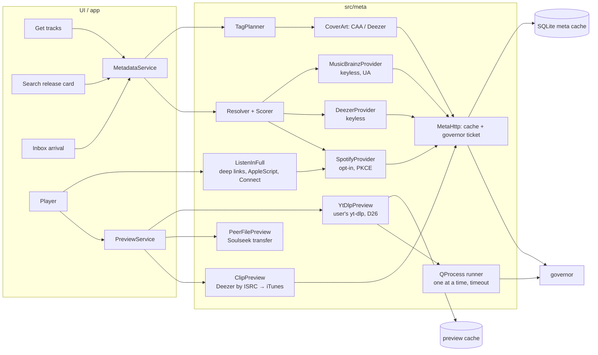

# Metadata matching and quick-preview services

> Status: **complete draft for review** (all sources accessed 2026-10-19). Items marked **TODO(verify)** come from
> second-hand sources or need an experiment; do not turn them into constants until verified. Source repos are read at
> the commits listed in §16.
>
> Scope (PRD v0.4): canonical track metadata (Spotify first, D29), matching a Soulseek result or a Get tracks line to a
> release, official 30-second clips, full-length listening in official players, and **preview audio through the
> user's own installed yt-dlp (D26, §12)**. **Out of scope (D20):** ripping or keeping files from streaming services —
> everything Selecta keeps (Inbox, collection, shares) comes from Soulseek peers; yt-dlp audio stays in the preview
> cache and is never filed, shared, converted or tagged. This note does not cover circumvention of any access control
> (signature/PO-token internals, cookies, web-player tokens, DRM). spotDL is described only at the level of "where
> metadata comes from, where audio comes from", plus its matching and tagging logic.
>
> Manual requests made for this note (all public, unauthenticated, one-off), 2026-10-19/20: Deezer 6 (2 searches that
> failed, 1 search, 1 track, 1 ISRC lookup, 1 album) + 1 HEAD on a preview; iTunes Search 1 + 1 HEAD; MusicBrainz 3 (one
> rejected for a bad `inc`); Cover Art Archive 1; Spotify oEmbed 1 (no credentials); coverage check on 4 club tracks
> (§4.4): Deezer 12 (search + track + album each) and MusicBrainz 4 (ISRC lookups). No Spotify Web API request was made
> and no Spotify credentials were used. yt-dlp: no query was run; only the locally installed binary's offline
> `--version` (2025.07.21). Spotify's AppleScript dictionary was read from the installed app bundle, not executed.

## 1. TL;DR

- **Spotify's Web API is now a 5-user sandbox for apps like Selecta.** Extended quota is reserved for registered
  organisations with ≥ 250k monthly users (since 2025-05-15). Development Mode (2026) requires the app owner to have
  **Premium**, allows **5 users**, caps search at **10 results**, removed batch lookups, album `label`, `popularity`
  and genres, limits playlist reading to the user's **own or collaborative playlists**, and refresh tokens expire
  after **6 months**. ISRCs (`external_ids`) survived (restored March 2026); `preview_url` is gone since 2024-11.
  Spotify still gives a new app what D29 needs except the label (§3.6).
- **Secret-free access = Authorization Code with PKCE** (§4.2): only a client ID, loopback redirect
  `http://127.0.0.1/callback` (no `localhost`), 1-hour access tokens, 6-month refresh tokens. It works today for the
  maintainer, who has Premium; public users would each need their own app and Premium. **spotDL's "no setup"** was a
  client ID *and secret* hard-coded in `spotdl/utils/config.py`, shared by every user (24-hour "rate/request limit"
  lockouts in Jan 2026); since v4.5.0 its default is an unofficial web-player client instead. Spotify's terms forbid
  disclosing Security Codes; **Selecta ships no secret, ever** (§4.1). Spotify oEmbed resolves a pasted link
  without sign-in only to a track title and a 300-px cover — no artist (§4.3).
- **Spotify's terms conflict with a Soulseek client** (quotes in §5): no Spotify Content in an app that "facilitates
  … the illegal or unauthorized use or sharing of audio"; no product "integrated with streams or content from another
  service"; no storing Spotify Content "indefinitely" and no "permanent copies of Spotify Content" — which is what
  **D29's Spotify tags and cover in the MP3s** do; logo and link-back wherever Spotify data shows. The realistic
  consequence is losing the developer app or API access, not a lawsuit. D29 stands; MQ1 asks the maintainer to
  confirm the risk for personal builds, with "Deezer first" tags as the alternative.
- **Keyless default = Deezer, enriched by MusicBrainz** (§4.4, §9, §10): Deezer search hits carry the ISRC and a
  30-s 128 kbps MP3 clip (signed URL, ~15 min; never store the audio); albums carry label, UPC and 1000-px covers. In a
  4-track club sample Deezer found 3, but DJ-mix "(Mixed)" segments and many versions crowd the results;
  **MusicBrainz knew only 1 of 4 ISRCs**, so it enriches (catalogue numbers, store links) rather than tags. iTunes is
  the fallback clip (AAC ~256 kbps, promo-only terms).
- **Listen in full** (§6): deep links first; then the **Spotify desktop app via AppleScript** (dictionary read from
  the installed app: `play track`, read/write `player position`, `player state`; one macOS Automation prompt; Free
  accounts expected to work, unverified); Connect playback needs a sign-in and Premium; embedded players (YouTube
  IFrame, Spotify Web Playback SDK) only in a **WKWebView**, and only as P2 experiments: QtWebEngine has no Widevine,
  YouTube requires a visible ≥ 200-px player with a proper Referer, and Google blocks sign-in (so no Premium) in
  embedded views. None of these gives Selecta the audio, so no waveform.
- **yt-dlp previews (D26)** (§12): discover the user's binary (explicit Homebrew paths), check its date version and
  Deno; search with `ytsearch10:` + `--flat-playlist -J` (entries carry duration and channel; flat YouTube Music
  search entries do not); pick ±3 s, preferring "Artist - Topic" channels; fetch `bestaudio[ext=m4a]` into the
  preview cache with `--no-part --fixup never` and fixed safety flags (`--ignore-config`, no cookies, no plugins);
  don't pass `--max-downloads` (success then exits 101); pause 60 min on rate-limit or bot-check texts; test with a
  stub. **The installed yt-dlp here is 2025.07.21 without Deno — expect failures until `brew upgrade yt-dlp`.**
- **No C++ Spotify library fits** (§7); write small Qt clients (PKCE via `QOAuth2AuthorizationCodeFlow`, Qt 6.8+).
  **spotDL's matching** (§8: ISRC first, RapidFuzz on slugs, `100·exp(−0.1·Δs)` duration score, hard thresholds)
  transfers with version handling inverted for DJs. **Matching** (§14.5): identifiers before text, but an ISRC is not
  a release; reject DJ-mix segments and junk; the release's duration drives the ±3 s Soulseek ranking (D23).

## 2. Key findings

| # | Finding | Confidence | Source |
|---|---|---|---|
| K1 | Dev mode (2026): owner Premium, 5 users per app, search `limit` ≤ 10, no batch endpoints, no album `label`, playlist items only for own/collab playlists. | High (official changelog + migration guide) | Spotify Feb 2026 changelog |
| K2 | Extended quota: organisations only, ≥ 250k MAU, since 2025-05-15. | High | Spotify quota-modes page |
| K3 | `external_ids` (ISRC, UPC) remain available (removal reverted March 2026). | High | Spotify March 2026 changelog |
| K4 | Refresh tokens expire 6 months after authorisation (PKCE included); refreshing does not extend them. | High | Spotify blog 2026-06-18 |
| K5 | Spotify Terms prohibit Spotify Content in apps that facilitate unauthorised sharing of audio, integration with content from other services, indefinite storage, and permanent copies; Spotify Content includes metadata and cover art. | High (verbatim); application to Selecta is inference | Developer Terms v10, Policy (2025-05-15) |
| K6 | `preview_url` deprecated/null for new apps; no official Spotify preview remains. | High | Spotify blog 2024-11-27, reference pages |
| K7 | Deezer keyless: search hits include `isrc`; album has `label`, `upc`, `cover_xl` 1000 px; preview = 30-s MP3 128 kbps, URL signed ~15 min. | High (observed) | Manual requests |
| K8 | Deezer terms: no association with unauthorised download/sharing; non-commercial, private use; no local audio storage; logo required. | High (verbatim) | developers.deezer.com terms + guidelines |
| K9 | iTunes Search: 30-s AAC ~256 kbps clips, no ISRC/label, ~20 calls/min; previews only to promote purchases, stream-only, with badge and attribution. | High | Manual request; Apple Search API page |
| K10 | MusicBrainz: ISRC → recordings → releases with label, catalogue number, barcode and store URLs; core data CC0; 1 req/s per IP; UA with contact. | High | Manual requests; MB docs |
| K11 | Discogs: search needs a token; 60/min; CC0 catalogue data but a 6-hour display-freshness and no-longer-than-needed caching rule; mandatory notices. | High (archived terms of 2025-05-27) | Discogs API ToU |
| K12 | spotify-qt `lib`: GPL-3.0, active (2026-10-05), secret-based auth, no ISRC parsing, coupled to the app. Other C++ clients are MIT and stale. | High | Source read |
| K13 | spotDL thresholds and formula as in §8.3; default metadata backend since 2026 is the unofficial SpotipyFree. | High | Source read @ `cd4a420`; PR #2626 |
| K14 | Beatport API v4 is partner-only; Traxsource has no API; Bandcamp's API serves labels/merch partners only and its policy forbids scraping. | Medium–high | Beatport discussion, Bandcamp developer page and policy |
| K15 | Beatport site previews are 2 minutes from the middle of the track. | Medium (third-party, consistent) | Proton Radio, Label Engine; Beatport support (length only) |
| K16 | One ISRC maps to many releases (and a recording can carry several ISRCs); an ISRC lookup does not pick the original release. | High (observed on one track; general pattern known) | MusicBrainz + Deezer requests |
| K17 | spotDL hard-codes a client ID and secret (`SPOTIFY_OPTIONS`, spread into `DEFAULT_CONFIG`); shared use produced 24-hour "rate/request limit" lockouts; since v4.5.0 the default backend is the unofficial SpotipyFree. | High | Source @ `cd4a420`; release notes; issues #2585/#2596 |
| K18 | PKCE needs no secret; access tokens last 1 h; refresh tokens 6 months and may not rotate; redirect must be HTTPS, a loopback IP literal (any port) or a custom scheme — not `localhost`. | High | Spotify PKCE, refreshing-tokens, redirect-URI pages; 2025-02-12 post |
| K19 | Spotify oEmbed (no auth) returns only the title and a 300-px thumbnail for a track — no artist. | High (one request + docs) | oEmbed |
| K20 | Club-track sample: Deezer found 3 of 4 (ISRC + preview on every hit, label on every album checked, BPM 2 of 3); MusicBrainz knew 1 of 4 ISRCs. | Medium (n = 4) | Manual requests 2026-10-20 |
| K21 | Spotify's macOS app still ships an AppleScript dictionary (`play track`, read/write `player position`, `player state`, current-track fields). | High (read from 1.3.0.277) | `Spotify.sdef` |
| K22 | Spotify embeds play full tracks only with encrypted media and a logged-in session; otherwise < 30 s. The Web Playback SDK requires Premium. | High (docs) / medium (login detail) | Embeds troubleshooting; SDK page |
| K23 | QtWebEngine ships no Widevine; WKWebView has FairPlay. YouTube embeds need a visible ≥ 200-px player and a Referer (error 153 since 2025-07-09); official search is capped at 100 `search.list` calls/day/project. | High | Qt docs; YouTube RMF, quota page |
| K24 | yt-dlp flat `ytsearch` entries carry `duration` and `channel`; flat YouTube Music search entries carry only `id`/`title`. | High (source) | yt-dlp `_tab.py` @ `8973412` |
| K25 | yt-dlp: `--fixup never` avoids a post-download rewrite of DASH m4a; `--max-downloads 1` turns success into exit 101; YouTube rate limits are reported as "rate-limited by YouTube for up to an hour". | High (source) | `YoutubeDL.py`, `_video.py` |
| K26 | The maintainer's installed yt-dlp is 2025.07.21 without Deno; Homebrew's current yt-dlp (2026.8.19) depends on Deno. | High | `yt-dlp --version`; `brew info` |

## 3. Spotify Web API (state on 2026-10-19)

### 3.1 Access tiers after the 2024–2026 restrictions

Spotify narrowed third-party access repeatedly between November 2024 and July 2026. The result matters more than any
endpoint detail:
**a Soulseek client can only use the Web API in Development Mode, and Development Mode is now a 5-user sandbox that
requires the app owner to pay for Premium.**

| Date | Change | Who is affected | Source |
|---|---|---|---|
| 2024-11-27 | Removed for new use cases: Related Artists, Recommendations, Audio Features, Audio Analysis, Featured Playlists, Category's Playlists, "30-second preview URLs, in multi-get responses", "Algorithmic and Spotify-owned editorial playlists". | New apps, and dev-mode apps without a pending extension request. Extended-quota apps unaffected. | Spotify blog 2024-11-27 |
| 2025-04-09 / 2025-11 | Redirect URIs must be HTTPS, or a loopback IP literal (`http://127.0.0.1:PORT`, `http://[::1]:PORT`); `localhost` is rejected. Enforced for new apps from 2025-04-09, all apps by November 2025. Implicit grant is marked deprecated. | All apps | Redirect URI concept page |
| 2025-05-15 | Extended quota only for organisations: "Established Business Entity", "active, and Launched Service", "at least 250k MAUs", key markets, commercial viability; "Spotify only accepts applications from organizations (not individuals)". | Anyone applying | Quota modes page |
| 2026-02-11 (new apps) / 2026-03-09 (existing) | Dev mode: owner needs **Premium** ("If the owner's Premium subscription lapses, the app will stop working"); **5 users** per app (was 25; existing extra users grandfathered); 1 Client ID per developer; reduced endpoint set (§3.3); `GET /search` `limit` max 50 → **10**, default 20 → 5; batch "get several" endpoints removed; playlist contents only for playlists the user owns or collaborates on; fields removed: track `popularity`, `available_markets`, `linked_from`; album `label`, `popularity`, `album_group`; artist `followers`, `popularity`; user `email`, `country`, `product`. `external_ids` (ISRC/UPC) was removed, then **restored in March 2026**. On 2026-03-09 Spotify postponed the *endpoint* restriction for existing integrations (Premium, user cap and Client-ID cap went ahead). | Dev-mode apps | Spotify blog 2026-02-06, Feb 2026 changelog + migration guide, March 2026 changelog |
| 2026-06-18 / 2026-07-20 | Refresh tokens expire **6 months after the user's authorisation**; refreshing does not extend them; expiry returns `400 invalid_grant`, and the app must send the user through sign-in again. Applies to Authorization Code and PKCE, not Client Credentials. | New apps from 2026-06-18, existing from 2026-07-20 | Spotify blog 2026-06-18 |
| 2026-07-23 | Client IDs per developer 1 → 25; dev-mode quota counted **per developer account** (all its Client IDs share one bucket); quota 429s carry `"reason": "QUOTA_EXCEEDED"`. | Dev-mode apps | Spotify blog 2026-07-23, July 2026 changelog |

| | Development mode (what Selecta can get) | Extended quota mode |
|---|---|---|
| Eligibility | Any Spotify account linked to a developer account; **owner must have Premium** | Registered organisation with ≥ 250k MAU (individuals excluded since 2025-05-15) |
| Users | **5 allow-listed users per app**; others get 403 | Unlimited |
| Rate limit | Unpublished; "much" lower than extended | Unpublished |
| Quota | Per developer account, shared across its Client IDs | Higher |
| Endpoints | 43 endpoints (§3.3), field removals apply | Full API |

**Consequence for Selecta (high confidence):** a Client ID shipped with Selecta would serve at most 5 people and stop
working if the maintainer's Premium lapses. The only workable model is **bring-your-own Client ID**: each user registers
an app on developer.spotify.com (which now requires their own Premium), registers Selecta's loopback redirect URI, and
pastes the Client ID into Selecta. spotify-qt (§7) and Sockseek/slsk-batchdl ("The Spotify account that owns the
application must have an active Premium subscription") work this way; spotDL instead ships a shared Client ID/secret
and, since 2026, defaults to an unofficial client (§8).

### 3.2 Auth flows for a desktop app

| Flow | Secret needed | User context | Fit for Selecta |
|---|---|---|---|
| Client Credentials | Yes | No (catalogue only: search, tracks, albums, artists, playlist metadata) | Poor. The secret cannot be protected in a distributed binary (Developer Terms §VI: Security Codes must be embedded "in a secure manner not accessible by third parties"). With BYO credentials the secret is the user's own, but PKCE avoids holding one at all. No access to the user's playlists. |
| **Authorization Code + PKCE** | No | Yes | **Recommended.** Native-app flow; one browser consent; refresh token stored in the Keychain; re-consent at least every 6 months. |
| Authorization Code (with secret) | Yes | Yes | What spotify-qt does (user supplies ID + secret). Works, but PKCE is strictly better for a public client. |
| Implicit grant | No | Yes | Deprecated; do not use. |

Redirect URI: register `http://127.0.0.1/callback` **without a port**; loopback IP literals may use a dynamic port that
is added in the authorisation request ("The only exception is for loopback IP literals, which can dynamically be
assigned ports"). `localhost` is not accepted.

Scopes, requested only when the feature is first used (Spotify's compliance tips ask for minimal, just-in-time scopes):

| Feature | Scopes |
|---|---|
| Catalogue lookups (search, track, album, artist) | none (any user token works) |
| Import the user's playlists | `playlist-read-private`, `playlist-read-collaborative` |
| Import Liked Songs | `user-library-read` |
| Play a track in the user's Spotify app (§6) | `user-modify-playback-state`, `user-read-playback-state` |

Qt support: `QOAuth2AuthorizationCodeFlow` (Qt Network Authorization) supports PKCE via `setPkceMethod(S256)` since
Qt 6.8, token refresh via `QAbstractOAuth2::refreshTokens()` (6.9+). `QOAuthHttpServerReplyHandler` listening on
`QHostAddress::LocalHost` builds an `http://127.0.0.1:{port}/{path}` callback ("the IP literals (127.0.0.1 and ::1)
are used"); `setCallbackHost()` exists since 6.9. The module is licensed **Commercial or GPLv3** (not LGPL), which is
fine for GPL-3.0-or-later Selecta but is worth recording in the dependency table.

### 3.3 Endpoints Selecta would use (Development Mode, 2026)

| Endpoint | Use in Selecta | Notes (dev mode) |
|---|---|---|
| `GET /v1/search?q=…&type=track` | Match a batch line or result to a catalogue track | `limit` 0–10 (default 5), `offset` ≤ 1000. Field filters: `track`, `artist`, `album`, `year` (single or range `1955-1960`), `isrc` (tracks only), `genre`; albums also `upc`, `tag:new`, `tag:hipster`. `market` is overridden by the user's country when a user token is used. |
| `GET /v1/search?q=isrc:GBCFB1700229&type=track` | ISRC → Spotify track (e.g. ISRC from MusicBrainz/Deezer or from a file's `TSRC`) | Documented filter; one request per ISRC (no batch). |
| `GET /v1/tracks/{id}` | Canonical track data | `name`, `artists[]`, `album` (simplified), `duration_ms`, `explicit`, `disc_number`, `track_number`, `external_ids.isrc`, `external_urls.spotify`, `is_local`. `popularity`, `available_markets`, `linked_from` removed; `preview_url` deprecated (null). |
| `GET /v1/albums/{id}` | Album-level tags and artwork | `name`, `album_type` (`album`/`single`/`compilation`), `total_tracks`, `release_date` + `release_date_precision` (`year`/`month`/`day`), `images` ("widest first"; sizes not specified; the largest is "typically 640x640px jpeg" per Exportify's docs — below D29's 800×800 target), `copyrights` (`C`/`P`), `external_ids` (`upc`/`ean`), paged `tracks`. **`label` removed in dev mode**; `genres` "is always empty"; `popularity` removed. |
| `GET /v1/albums/{id}/tracks` | Disc count, track total | Paged. |
| `GET /v1/artists/{id}` | Artist images/name | `genres` deprecated; `followers`, `popularity` removed. |
| `GET /v1/me/playlists`, `GET /v1/playlists/{id}` | List the user's playlists | Metadata for any playlist. |
| `GET /v1/playlists/{id}/items` | Import a playlist into Batch | Replaces `/tracks`. "Only accessible for playlists owned by the current user or playlists the user is a collaborator of"; others → 403. `limit` ≤ 50, `fields` filter, `is_local` entries carry no ID. |
| `GET /v1/me/tracks` | Import Liked Songs | Paged. |
| `GET /v1/me/player/devices`, `PUT /v1/me/player/play` | Full-length listening in the user's app (§6) | Premium only. |

Removed or unavailable to a new app: `GET /tracks?ids=`, `/albums?ids=`, `/artists?ids=` (batch), `/artists/{id}/top-tracks`,
`/browse/new-releases`, `/browse/categories*`, `/users/{id}`, `/users/{id}/playlists`, `/markets`, audio features and
analysis, recommendations, related artists, Spotify editorial/algorithmic playlists.

What this means for each maintainer goal:

| Goal | Feasible in dev mode? |
|---|---|
| Canonical title/artists/album/date/track+disc numbers/ISRC/duration/artwork | Yes, one track request + one album request per track (no batching any more). |
| Label | **No** (removed). Catalogue number and genre were never available. Both matter to DJs → need Deezer/MusicBrainz/Discogs anyway (§10). |
| Improve matching of Soulseek results | Indirectly: Spotify gives the canonical title, version string and duration to match against (§14). |
| Import Spotify playlists into Batch | Only the user's **own or collaborative** playlists and Liked Songs. Editorial playlists and other users' public playlists return 403. |
| Previews | **No** (`preview_url` deprecated). |

### 3.4 Rate limits and quotas

- The rate limit is computed "in a rolling 30 second window"; numbers are not published; dev mode gets a lower limit.
  A 429 "will normally include a Retry-After header with a value in seconds".
- Quotas are a separate mechanism (dev mode only); since 2026-07-23 a quota 429 carries `reason: QUOTA_EXCEEDED`. The
  quota size and reset period are not published (TODO(verify) experimentally with the maintainer's own app).
- Developer Terms §IV forbid "making excessive service calls that are not strictly required for the proper functioning
  of your SDA" and using "any robot, spider … or other tool to retrieve, duplicate, or index any portion of the Spotify
  Service or Spotify Content (which includes playlist data)". Batch matching of a 200-line tracklist is therefore both a
  rate-limit and a terms question: keep it user-initiated, cached and slow.
- Proposed governor budget (no published number to anchor on, so conservative): steady 1 request/s, burst 5, honour
  `Retry-After` (+ jitter), and on `QUOTA_EXCEEDED` stop all Spotify calls for 1 h then retry once (TODO(verify) the
  actual reset period).

### 3.5 Preview URLs

`preview_url` on track objects is marked deprecated in the current reference. Spotify's 2024-11-27 post only named
"multi-get responses (SimpleTrack object)", but developers report `null` on single-track GETs, search and player
endpoints for affected apps (community forum; medium confidence). Spotify has not restored it. Third-party
"workarounds" scrape the web player or embed pages; Selecta must not use them (Developer Terms §IV "Improper use", and
outside the scope rule).

### 3.6 Spotify as the primary metadata source: what a new dev-mode app gets (October 2026)

Spotify ranks first for matching and tags (D29, SRCH-17). For a Development Mode app created after 2026-02-11 the
usable data comes from two requests per track — `GET /tracks/{id}` and `GET /albums/{id}` (cache albums by ID; the
batch endpoints are gone):

| Field | Spotify (new dev-mode app) | Where | Fill from |
|---|---|---|---|
| Title (Spotify writes versions as "Title - Extended Mix") | yes | track `name` | — |
| Artists, in credited order | yes | track `artists[]` | — |
| Album, album artist, album type | yes (`album`/`single`/`compilation`) | track `album`, album | MusicBrainz release-group type to tell EP from single |
| Track number / disc number | yes | track | Track total: album `total_tracks`; disc total: `disc_number` of the album's last track (spotDL does this) |
| Release date | yes, with `release_date_precision` (`year`/`month`/`day`) | album | The DSP date can postdate a vinyl original (§4.4); MusicBrainz `first-release-date` when present |
| Duration | yes (`duration_ms`) | track | — |
| ISRC | yes (`external_ids.isrc`, restored March 2026) | track | — |
| UPC / EAN | yes (`external_ids`) | album | — |
| Explicit | yes | track | — |
| Artwork | yes; largest image typically 640 × 640 JPEG | album `images` (widest first) | Fits D29's ≤ 800 × 800 without upscaling; Deezer `cover_xl` (1000 px) or CAA 1200 if a larger source is wanted |
| Copyright lines (℗/©) | yes | album `copyrights` | The ℗ line often names the label ("℗ 2017 Ninja Tune"), sometimes the distributor — a hint, not a label field |
| **Label** | **no** (removed Feb 2026) | — | Deezer album `label` → MusicBrainz label-info |
| Catalogue number | no (never offered) | — | MusicBrainz → Discogs (P2) |
| Genre | no (`genres` "always empty") | — | Deezer genre (coarse), Discogs style (P2), or none |
| BPM / key | no (audio features removed 2024-11) | — | Deezer `bpm` (often 0); rekordbox analyses anyway |
| Popularity | no | — | — |
| Preview clip | no | — | Deezer (by ISRC) → iTunes (§9) |

An app created *before* 2026-02-11 may still see the old endpoint set (Spotify postponed that part for existing
integrations); whether it still gets `label` is to be checked (X2).

## 4. Secret-free Spotify access and keyless defaults

The maintainer wants Spotify metadata without handing Selecta an API secret, "like spotDL". This section separates
what spotDL actually does from the official secret-free path.

### 4.1 What spotDL's "no setup" really is (master `cd4a420`, v4.5.2; `dev` `e016715` selects backends the same way)

- **A bundled key.** `spotdl/utils/config.py` hard-codes a literal client ID **and client secret** in
  `SPOTIFY_OPTIONS` (lines 309–311); `DEFAULT_CONFIG` spreads `SPOTIFY_OPTIONS` (line 387–388). The values are not
  reproduced here. In official-API mode, `_OfficialSpotifyClient.init` (`spotdl/utils/spotify.py`) passes them to
  spotipy's `SpotifyClientCredentials`, or to `SpotifyOAuth` (authorization code *with* the secret,
  `redirect_uri="http://127.0.0.1:9900/"`, scopes `user-library-read,user-follow-read,playlist-read-private`) when
  `--user-auth` is set.
- **Not the default any more.** Since v4.5.0 (2026-05-16): "Due to Spotify API changes, spotDL now defaults to the
  lighter `SpotipyFree` library … If you have Spotify Premium and provide a client ID and client secret, pass
  `--use-official-api`." `SpotifyClient.init` picks SpotipyFree unless `--use-official-api`, `--user-auth`,
  `--auth-token` or `--use-cache-file` is given. SpotipyFree wraps SpotAPI, which emulates the web player's private
  endpoints — the zero-setup path is now unofficial access, which Selecta will not use (D21, §5 "Improper use").
- **What a shared key costs.** Every user of the bundled key draws on one app's rate limit and (since 2026-07-23) one
  developer account's quota. spotDL users hit "Your application has reached a rate/request limit. Retry will occur
  after: 86400" — a 24-hour `Retry-After` — in January 2026 (issues #2585, #2596; earlier #2420). Under the 2026
  rules the key also stops working whenever its owner's Premium lapses, and user sign-ins beyond the 5 allow-listed
  accounts get 403. A user who brings their own Premium-backed key can still be throttled for a day on a large sync
  (issue #2710, June 2026; cause not confirmed).
- **What Spotify's terms say about credentials** (Developer Terms §VI "Security Codes"): the Security Code "must be
  embedded in your SDA … in a secure manner not accessible by third parties"; "You may not sell, transfer, sublicense
  or otherwise disclose your account or Security Codes to any other party"; "You are responsible for maintaining the
  confidentiality of your account and Security Codes"; "You must use a separate Security Code for each SDA. You may not
  use more than one Security Code for each SDA." A secret committed to a public repository is disclosed by definition;
  using another project's key means using a Security Code issued to someone else. (Google's YouTube policies say it
  outright: never "embed your API Credentials in open source projects".)

**Selecta ships no client secret — neither the maintainer's nor anyone else's — and never reuses spotDL's.** A secret
typed into Settings (META-1, client-credentials development use) stays in the Keychain and is never logged or written
to settings files.

### 4.2 The official secret-free path: Authorization Code with PKCE

| Topic | Fact (sources: PKCE tutorial, refreshing-tokens page, redirect-URI concept page, 2025-02-12 security post) | For Selecta |
|---|---|---|
| What is needed | Authorize: `client_id`, `response_type=code`, `redirect_uri`, `code_challenge_method=S256`, `code_challenge`, `scope`, `state`. Token: `grant_type=authorization_code`, `code`, `redirect_uri`, `client_id`, `code_verifier` — **no secret**. Refresh: `grant_type=refresh_token`, `refresh_token`, `client_id` ("Only required for the PKCE extension"). PKCE is "recommended … where the client secret can't be safely stored". | Only a client ID. |
| Is the client ID secret? | No — it appears in the authorisation URL the browser opens. | It *could* live in the source, but the maintainer asked to keep his credentials uncommitted: personal builds inject it at configure time from `local/secrets.env`; otherwise it is a Settings field. |
| Redirect URI | HTTPS, or HTTP only for loopback IP literals `http://127.0.0.1:PORT` / `http://[::1]:PORT`; `localhost` is not accepted ("`http://localhost:3000` could be migrated to `http://127.0.0.1:3000`"); a loopback URI registered without a port accepts any port; custom schemes "will still be supported" (`com.example://callback`). Enforced for new apps from 2025-04-09, all apps from November 2025. | Register `http://127.0.0.1/callback`; listen on an ephemeral port with `QOAuthHttpServerReplyHandler` on `QHostAddress::LocalHost`. A custom scheme (`selecta://…`) would need `CFBundleURLTypes` and can be claimed by any other app; loopback avoids both. |
| Access token | "limited lifespan (1 hour)"; `expires_in` describes the access token only. | Refresh ~5 min before expiry. |
| Refresh token | 6 months from the user's authorisation; "Refreshing an access token does not extend the refresh token's lifetime"; responses "might not include a new refresh token" — keep the old one then; expiry → `invalid_grant` → discard and re-authorise. | Store `authorised_at` with the token in the Keychain; warn two weeks before the 6-month mark; one-click reconnect. |
| Who can sign in | Dev mode: the app owner (must have Premium) plus up to 5 allow-listed accounts (Dashboard → User Management); others get 403. Extended quota: organisations with ≥ 250k MAU only. | **"Me first":** the maintainer's own app, his own account allow-listed — works today. **Public release:** every user registers their own app (with their own Premium) and pastes its Client ID; there is no shared-ID option. |
| Endpoints a user token reaches (dev mode) | `GET /search` (≤ 10 results), `/tracks/{id}`, `/albums/{id}`, `/albums/{id}/tracks`, `/artists/{id}`, `/artists/{id}/albums`, `/me`, `/me/playlists`, `/playlists/{id}` (metadata), `/playlists/{id}/items` (own or collaborative playlists only), `/me/tracks`, `/me/library`, `/me/top/{type}`, the `/me/player/*` endpoints. | Everything Get tracks needs except other people's playlists (§14.6). |

### 4.3 Resolving a pasted Spotify link without sign-in: oEmbed

`GET https://open.spotify.com/oembed?url=<URL-encoded open.spotify.com link>` needs no authentication. One request for
a track link returned: `title` (**track name only**, e.g. "Blinding Lights"), `thumbnail_url` (300 × 300 cover),
`thumbnail_width/height`, `html` (iframe), `iframe_url` (present although absent from the documented example),
`width`, `height`, `version`, `provider_name`, `provider_url`, `type: "rich"`. **No artist, album, duration or ISRC.**

So oEmbed alone cannot resolve a link to "artist – title". Without a Spotify sign-in Selecta can: show the oEmbed
title and thumbnail and let the user confirm a keyless (Deezer) search on that title; for album links, look the album
URL up in MusicBrainz (`/ws/2/url?resource=…&inc=release-rels`; MusicBrainz stores Spotify album URLs as release
relationships — coverage TODO(verify)); for playlists, ask for an Exportify CSV. With a sign-in, `GET /tracks/{id}`
answers everything. Using oEmbed means accepting the Developer Terms ("By using Spotify Embeds, you accept the Spotify
Developer Terms of Service"), so the title and thumbnail carry the usual attribution. Obtaining web-player tokens or
calling Spotify's internal APIs is out of scope (§5, D21).

### 4.4 Keyless default without a Spotify sign-in: Deezer + MusicBrainz, checked on club tracks

Without a sign-in, Selecta resolves releases from Deezer (search with ISRC in every hit, track for BPM, album for label,
date and cover) and enriches from MusicBrainz by ISRC. A coverage check on four club tracks (one plain
"artist title" Deezer search each, then track + album + MusicBrainz ISRC lookup; 2026-10-20):

| Line | Deezer search (top hits) | Deezer track / album fields | MusicBrainz by ISRC |
|---|---|---|---|
| DJ Boring – Winona | Found: 511 s, ISRC `USQY51621229`, EP "Winona"; also a 245-s "Winona (Mixed)" from a Defected radio compilation | BPM **0**; label "E-Beamz"; UPC; `record_type` ep; date 2017-06-09; genres "Electro, Techno/House"; 1000-px cover; preview | 1 recording (511 s) |
| Ross From Friends – Talk To Me You'll Understand | Found (1 hit): 417 s, ISRC `UKA2G1608004` | BPM 126.05; label "Distant Hawaii"; EP; date 2017-02-10; cover; preview | **404 — ISRC unknown** |
| Floorplan – Never Grow Old | Top 6 of 121 hits: only a 175-s "Never Grow Old (Mixed)" DJ-mix segment; **no unmixed original** | (not checked; the script's fallback picked another Floorplan track, whose album had label "Classic Music Company") | that other track's ISRC: 404 |
| Kerri Chandler – Rain | Six versions in the top 6, each with its own ISRC: "(Mood EP Version)" 471 s, "(Dub)" 478 s, "(Dense & Pika Remix)" 385 s, "(Vocal Remix Harry Romero Edit)" 370 s, "(Old School Acoustic Mix)" 540 s, "(Old School Vocal Remix)" 490 s | First: BPM 124.9; label "Nervous Records"; album "Kerri Chandler's Nervous Tracks" (2007-05-22); cover; preview | **404** |

What it shows (small sample; X5 measures it properly):
- Deezer is a usable keyless identity source for club music: ISRC, preview and cover on every hit; label on every
  album checked; BPM present on 2 of 3 tracks checked.
- The traps are real: DJ-mix "(Mixed)" segments can outrank the original or be the only hit, and a bare "artist –
  title" line can match half a dozen versions → the version rules and duration checks of §14.5 are not optional.
- Dates are those of the streaming release, which may postdate a vinyl original.
- **MusicBrainz knew only 1 of 4 ISRCs.** It is an enrichment source (catalogue numbers, store links) when it has the
  track, not a primary source for club singles. This weakens the "open data tags" idea of the first draft: without
  Spotify, tags realistically come from Deezer (§14.7).

## 5. Spotify Developer Terms and Developer Policy vs a Soulseek client

Documents: **Spotify Developer Terms, "Version 10, effective as of 15 May, 2025"** and **Spotify Developer Policy,
"Effective as of 15 May, 2025"** (the Policy is incorporated into the Terms), plus the Design Guidelines and Compliance
Tips. Spotify Content is defined broadly: "any content, data, information or material made available through the
Spotify Platform … sound recordings, … cover art, … metadata, playlists, and user data". **Metadata and cover art are
Spotify Content.**

### 5.1 Clauses that conflict with Selecta's intended uses

| # | Clause (verbatim) | Where | What it hits in Selecta | Conflict |
|---|---|---|---|---|
| S1 | "Do not use the Spotify Platform, Spotify Content, Spotify Service, or Spotify Marks in any way to promote or distribute an application … including any SDA that: is associated with, promotes, features, encourages, facilitates, or condones (a) illegal activity or the illegal or unauthorized use or sharing of audio and/or audiovisual content" | Terms §IV "Liability and reputation" | Selecta's purpose is downloading and sharing audio over a P2P network where most content is unlicensed. Any Spotify feature inside it is Spotify Content used in an SDA that "facilitates … sharing of audio". | **High** — goes to the nature of the app, not to a feature. |
| S2 | "Do not create any product or service which is integrated with streams or content from another service." | Policy §III.5 | Spotify metadata displayed next to, and used to select, Soulseek files. | **High** |
| S3 | "you may not store, aggregate or create compilations or databases of Spotify Content, other than as strictly necessary to operate your SDA … Do not store Spotify Content indefinitely." and "Do not locally cache any Spotify Content, except as strictly necessary … limited to the temporary caching of: metadata and cover art" | Terms §IV "Storing Spotify Content" | **Tagging files** with Spotify metadata and embedding Spotify artwork stores Spotify Content permanently, in files that leave Spotify's control (they are shared back on Soulseek by default — PRD D12). A SQLite metadata cache with a long TTL is also a "database of Spotify Content". | **High** for tagging/embedding; low for a short-TTL cache. |
| S4 | "facilitating 'stream ripping' or other functionalities that make it easier for users to capture or otherwise make permanent copies of Spotify Content." | Terms §IV "Unauthorized access" | Aimed at audio, but the definition of Spotify Content includes metadata and cover art: writing them into files is "making permanent copies". | **Medium** (wording fits; intent is audio) |
| S5 | "If you display any Spotify Content you must clearly attribute the content as being supplied and made available by Spotify, by using the Spotify Marks" and "Metadata, cover art and Audio Preview Clips must be accompanied by a link back to the applicable album, content or playlist on the Spotify Service." | Policy §II.4 | Every UI surface showing Spotify-sourced fields needs the Spotify logo and a link back. Tags read later by rekordbox carry no attribution. | **Medium** (doable in Selecta's UI; impossible in files) |
| S6 | "Don't manipulate any content or metadata." / "Track, artist, playlist, and album titles must always be presented with the metadata provided by Spotify." / artwork "must be kept in its original form", "Don't crop the artwork" | Design Guidelines | Selecta's normalisation (version strings, `feat.` handling), and resizing artwork for DJ hardware (CONV-5). (The Terms do allow "You may adjust the size of metadata or cover art as necessary".) | **Medium** |
| S7 | "Do not build an SDA that enables the transfer of data to another service, except for the purpose of enabling a user to transfer their personal data, or the metadata of the user's playlists to another service." | Policy §III.9 | Playlist → Batch import moves playlist metadata into a search on another service. The exception covers "the metadata of the user's playlists"; arguably fine on its own, but S1/S2 still apply to the app. | **Low–medium** |
| S8 | "Do not permit any device or system to segue, mix, re-mix, or overlap any Spotify Content with any other audio content"; Compliance Tips list "DJ/Mixes" as a disallowed use case. | Policy §III.7; Compliance Tips | Only if Selecta plays Spotify audio (§6): it must never overlap Spotify playback with its own preview player. | Low (avoidable) |
| S9 | "Streaming SDA" includes "using the Spotify Platform to control a background Spotify application"; then "there shall be no playback of Spotify Content without showing relevant cover art and metadata in your SDA". | Terms §II; Policy §II.5 | `PUT /me/player/play` (§6) makes Selecta a Streaming SDA. | Low (UI obligations) |
| S10 | License to develop and distribute SDAs "(i) for private personal use"; "Do not analyze the Spotify Content … for any purpose, including … creating new or derived … functionality"; "Do not use the Spotify Platform or any Spotify Content to train a machine learning or AI model". | Terms §III; Policy §III.13–14 | Matching scores are "analysis" in a loose reading; no ML planned. | Low |

Other notes:
- Spotify's Terms reserve review and revocation: access "may be revoked if the review process indicates that your SDA
  breaches our terms and policies". With bring-your-own Client IDs, **the risk lands on each user's developer account
  and on the Spotify account linked to it**, not on the Selecta project. Selecta must say so before the user connects.
- No clause names Soulseek or P2P explicitly; S1 is the general "illegal or unauthorized … sharing of audio" clause.
  Whether a given user's Soulseek use is unauthorised is a fact question per file; Spotify does not need to show that to
  revoke access.
- Deezer's developer terms contain the same kind of clause (§9.1, D-T1), and Apple's iTunes promo terms restrict use to
  promoting purchases (§9.2). **No commercial catalogue API is clean for a P2P client.** MusicBrainz (CC0 core data) is
  the exception (§10.1).

### 5.2 Reading for Selecta (inference, not legal advice)

1. **Tagging downloaded files (on arrival, D29) with Spotify metadata or artwork is the clearest conflict** (S3 + S4 +
   S5, on top of S1), and the tagged files are later shared on Soulseek from the collection (D12). D29 decides to do it
   anyway; the exposure is the user's own developer app and Spotify API access. Keep it to personal builds with the
   user's own Client ID, add a `WOAS` link-back, and offer "Deezer first" tags as the alternative (§14.7, MQ1).
2. **Spotify as a lookup aid** (resolve a line to a canonical title/version/duration/ISRC for matching, show it in the
   UI with attribution and a link back, keep it in a short-TTL cache) is less exposed but still within S1/S2.
3. **Playlist import** is the use the Policy itself half-allows (S7 exception), limited by dev mode to the user's own
   playlists and Liked Songs.
4. Make every Spotify feature **opt-in, behind the user's own Client ID** (§4.2), with a plain-language note on these
   terms in Settings. The non-API routes stay available: "Open in Spotify" deep links (§11), oEmbed for pasted links
   (§4.3) and importing an exported CSV (§14.6).

## 6. Listen in full: official players

The maintainer wants to hear a track from Spotify or YouTube Music before committing to a Soulseek download. Through
an official player Selecta only **controls** playback: it never receives the audio, so these paths give no waveform,
no 3-band analysis and nothing to keep (the waveform comes from the peer's file or the D26 preview, §12). Options
below go from least to most integration; §6.6 recommends an order.

### 6.1 Spotify desktop app via AppleScript (macOS)

Dictionary read from the installed app (Spotify 1.3.0.277, `Spotify.app/Contents/Resources/Spotify.sdef`, 137 lines,
2026-10-20):

| Kind | Name | Notes |
|---|---|---|
| Command | `play track <URI> [in context <URI>]` | "Start playback of a track in the given context." Accepts `spotify:track:…`; a context (album/playlist URI) is optional. |
| Commands | `play`, `pause`, `playpause`, `next track`, `previous track` | Transport. |
| Property (app) | `player state` (read-only) | `stopped` / `playing` / `paused`. |
| Property (app) | `player position` (read-write, real) | "The player's position within the currently playing track in seconds" — setting it seeks. |
| Property (app) | `sound volume` (0–100), `repeating`, `shuffling` | — |
| Property (app) | `current track` (read-only) | `name`, `artist`, `album`, `album artist`, `duration` (the dictionary says seconds; widely reported to return milliseconds — check in X9), `id` (`spotify:track:…`), `spotify url`, `artwork url`, `track number`, `disc number`, `popularity`, `played count`, `starred`. |

```applescript
tell application "Spotify"
    play track "spotify:track:<id>"
    set player position to 95.0          -- jump to the drop
    get {player state, player position, id of current track}
end tell
```

From C++, send these through `NSAppleScript` (Objective-C++, compiled once and reused) on a worker thread, not by
spawning `osascript` per poll.

| Question | Answer | Confidence |
|---|---|---|
| Free accounts? | Expected to work: AppleScript drives the desktop app directly and does not go through the Premium-gated Web API, and the desktop app plays on demand for Free users (with ads). No source confirms `play track` on Free specifically. | Medium (X9) |
| Position polling latency | One Apple event round trip to a running app is typically milliseconds to a few tens of ms (estimate). Poll `player position` at 4–10 Hz and interpolate between polls; poll `player state` at 1–2 Hz. Community tools also listen to the app's `com.spotify.client.PlaybackStateChanged` distributed notification to avoid polling (undocumented). | Medium (measure in X9) |
| Permissions (TCC) | First use shows the macOS Automation prompt ("“Selecta” wants access to control “Spotify”…") with the app's `NSAppleEventsUsageDescription` text ("This key is required if your app uses APIs that send Apple events"). The choice lives in System Settings › Privacy & Security › Automation. | High |
| Hardened runtime | A hardened-runtime (notarised) build needs the `com.apple.security.automation.apple-events` entitlement ("whether the app may prompt the user for permission to send Apple events to other apps"; Xcode: Hardened Runtime › Resource Access › Apple Events). Selecta is not sandboxed (no App Store), so no `scripting-targets` entitlement. Consent is tied to the code signature: ad-hoc re-signed builds may re-prompt after each build (OQ-8). | High (Apple docs) |
| Officially supported and stable? | The dictionary ships in the current app, but Spotify documents no AppleScript interface on its developer site, and past updates broke it silently (2015: `play track` became a no-op; a later update broke `current track` name/artist under Connect). Treat it as best-effort. | Medium |
| Terms | The Developer Terms cover the "Spotify Platform" ("developer tools … (e.g. APIs, SDKs, Widgets) and documentation described on our Developer Website"); the scripting dictionary is not among them, so this is the user driving their own app. The Policy's no-overlap rule (S8) is still good practice: Selecta pauses its own player first. | Medium (inference) |

### 6.2 Spotify Web API playback (Spotify Connect)

`GET /v1/me/player/devices` → `PUT /v1/me/player/play?device_id=…` with `{"uris": ["spotify:track:…"],
"position_ms": N}`; `PUT /v1/me/player/seek?position_ms=…`, `PUT /v1/me/player/pause`, and `GET /v1/me/player` for
`progress_ms`/`is_playing`. All are among the 43 endpoints left to dev-mode apps.

- **Premium for the listening user** ("This API only works for users who have Spotify Premium"); without it the call
  fails with 403 "Player command failed: Premium required" (`PREMIUM_REQUIRED`, community reports). Scopes
  `user-modify-playback-state`, `user-read-playback-state`.
- Needs a running Connect device (desktop app, phone, speaker). No device → an error (community reports a 404
  `NO_ACTIVE_DEVICE`; the reference page lists only 204/401/403/429 — check in X13).
- Dev-mode limits apply (owner Premium, 5 users, per-account quota). Every position poll costs quota; when the target
  is the local desktop app, read the position through AppleScript instead.
- "The order of execution is not guaranteed when you use this API with other Player API endpoints." Latency is a
  network round trip plus Connect propagation (hundreds of ms; estimate).
- It makes Selecta a **Streaming SDA** (S9): show cover art, metadata and the Spotify logo while it plays; no overlap
  with Selecta's own audio (S8).

### 6.3 Embedded official players inside Selecta

**Spotify Embed / iFrame API.** The embed (`https://open.spotify.com/embed/track/<id>`, also `iframe_url` in oEmbed)
is driven by the iFrame API: `window.onSpotifyIframeApiReady(IFrameAPI)` → `IFrameAPI.createController(element,
{uri|url, width, height}, callback)` → `EmbedController.loadEntity(uriOrUrl, preferVideo, startAt)` (`loadUri` is
legacy), `play()`, `togglePlay()`, `resume()`, `seek(seconds)`; events `ready` and `playback_update`
(`playingURI`, `isPaused`, `isBuffering`, `duration` and `position` in ms).
- Full tracks only with encrypted media and a logged-in Spotify session in that web view; otherwise "the Embed will
  only stream a preview clip of less than 30 seconds" ("Spotify was not able to play encrypted media"; keep
  `allow="encrypted-media"`; supported browsers "Chrome, Firefox, Edge, Opera and Safari"). Logged-in Free accounts
  reportedly get full tracks on desktop; embeds inside desktop apps commonly fall back to previews because the web view
  has no Spotify session (secondary sources).
- Terms: the Widget Terms (v2.0, 2014) license display "on any website or webpage controlled by you" — a desktop app
  view is not obviously that — and repeat the "illegal or unauthorized use or sharing of audio" clause, "You shall
  not create any product or service by integrating the Spotify Platform … with … streams from another service", and
  "You may not use a Widget to locally cache any Spotify Content".

**Spotify Web Playback SDK** (a Connect device inside a web page): "requires a Spotify Premium subscription";
"supported by most web browsers (Chrome, Firefox, Safari and Microsoft Edge)"; "must not be used in commercial projects
without Spotify's prior written approval". Audio plays inside Selecta's web view, still DRM-protected (no audio
access). A third-party macOS 26 client (Spotiglass, Oct 2026) reports SDK playback in a `WKWebView`; Selecta would show
the player rather than hide it (S9). Uses the PKCE token of §4.2.

**YouTube IFrame Player API.**
- Player rules (YouTube API Services "Required Minimum Functionality"): "Embedded players must have a viewport that is
  at least 200px by 200px"; no overlays or actions on hover; the client must identify itself through the HTTP
  Referer, and in native apps "use one of the OS-provided WebView types when available" (`WKWebView` on Apple
  platforms), loading the player with an HTTPS base URL whose domain is the app identifier. Since 2025-07-09 the player
  shows **error 153** when no Referer arrives (WKWebView apps loading `about:blank`/custom schemes hit it).
- Developer Policies (updated 2026-10-15): no "background player, meaning a player that is not displayed in the page,
  tab, or screen that the user is viewing"; must not "separate, isolate, or modify the audio or video components"; must
  not "download, import, backup, cache, or store copies of YouTube audiovisual content". → A **visible** video panel,
  never a hidden audio-only player.
- Finding the video officially needs the YouTube Data API v3 `search.list`: an API key from a Google Cloud project;
  "default quota allocation of 100 search.list calls … per day" (1 unit per call, own bucket; page updated
  2026-10-15). Keys must not be embedded "in open source projects", so each user would need their own project — or
  Selecta reuses the video ID that the D26 yt-dlp search already found (§12.3), with no API at all.
- Some videos disallow embedding (player errors 101/150) → fall back to a deep link.
- YouTube Premium (ad-free) needs a signed-in Google session in the web view. Google blocks sign-in from embedded
  browser frameworks (2019 policy; reported for QtWebEngine-based browsers, CEF and Electron), and sign-in inside other
  apps' `WKWebView`s is generally refused too — expect signed-out behaviour, ads possible (medium confidence).

### 6.4 Which web engine: QtWebEngine or WKWebView (macOS 26/27)

| | QtWebEngine (Homebrew `qtwebengine` 6.11.2) | WKWebView (system WebKit) |
|---|---|---|
| Cost | Chromium-based module, a large binary addition (size to measure) | Ships with macOS |
| Proprietary codecs (H.264, AAC, MP3) | The Homebrew formula builds with `-DFEATURE_webengine_proprietary_codecs=ON` | System codecs |
| DRM | "The Widevine plugin is not shipped with Qt WebEngine"; found in "well-known locations, like the default Google Chrome installation directory" or via `--widevine-path`. macOS reports of Spotify failing under QtWebEngine (qutebrowser #4505; Qt forum, Qt 6.8) | FairPlay through WebKit EME (Safari is a supported Spotify browser); third-party report of Web Playback SDK working in a macOS `WKWebView`; Widevine unavailable |
| Spotify full tracks | Unlikely | Plausible — experiment X11 |
| YouTube IFrame player | Works for normal (non-DRM) videos; not an OS web view | Works with a proper Referer; YouTube asks for OS web views |
| Google sign-in (YouTube Premium) | Blocked | Likely blocked |
| Qt integration | `QWebEngineView` (Widgets) | Qt WebView (QML `WebView`, uses "the system web view" on macOS; LGPLv3/GPLv2) inside a `QQuickWidget`, or a `WKWebView` created in Objective-C++ and hosted with `QWidget::createWindowContainer(QWindow::fromWinId(...))` — the latter can set the Referer/base URL that YouTube requires |

Recommendation: if Selecta embeds a player at all, use **WKWebView** through Objective-C++; do not add QtWebEngine for
this feature.

### 6.5 Deep links (zero-risk fallback)

No API, no account linking, nothing to grant (formats in §11): `spotify:track:<id>` (opens the desktop app;
`https://open.spotify.com/track/<id>` as the web fallback), `https://open.spotify.com/search/<query>`,
`https://music.youtube.com/watch?v=<id>` when the D26 search found an ID, else
`https://music.youtube.com/search?q=<query>` (opens in the browser; YouTube Music has no macOS app). Spotify's Design
Guidelines ask integrations to "always link to the Spotify app" with the text "OPEN SPOTIFY", "PLAY ON SPOTIFY" or
"LISTEN ON SPOTIFY".

### 6.6 Recommendation for "Listen in full"

| Order | Build | Needs | The user sees |
|---|---|---|---|
| 1 (P1) | **Deep links**: "Open in Spotify" / "Open in YouTube Music" next to the release card | nothing | the other app opens |
| 2 (P1) | **Spotify desktop control via AppleScript**: play the matched track, seek to Selecta's playhead (e.g. the drop), mirror Spotify's position on a plain progress bar labelled "Playing in Spotify"; Space pauses it | Spotify app installed (Free or Premium, to verify) | one macOS Automation prompt ("Selecta wants access to control Spotify") |
| 3 (P2) | **Web API Connect playback** to another device | the Spotify sign-in of §4.2 + Premium | Spotify's consent page in the browser, listing the playback scopes |
| 4 (P2, experiments) | **Embedded players in a WKWebView**: YouTube IFrame player (visible ≥ 200 × 200, ads possible) for tracks missing on Spotify; Spotify Web Playback SDK (Premium) | the video ID from D26's search, or the user's own YouTube Data API key; the PKCE token for the SDK | a video/player panel inside Selecta |

Limits shared by every option: no audio access, so no waveform, no 3-band analysis, no spectrum check, nothing to keep
or tag; position and state only; Selecta pauses its own player first and never plays two sources at once (S8). The
waveform keeps coming from the peer preview (PREV-1) or the D26 preview (§12).

## 7. C++/Qt libraries for the Spotify Web API

| Library | Language / deps | Licence (SPDX) | Activity | Auth | Coverage vs Selecta's needs | Verdict |
|---|---|---|---|---|---|---|
| **kraxarn/spotify-qt `lib/`** ("spotify-qt-lib" 4.0.0) | C++17, Qt Core + Network, nlohmann/json (MIT), doctest (MIT) | **GPL-3.0** (repo licence; no "or later" wording found in the readme or headers, so treat as GPL-3.0-only) | Active: last commit 2026-10-05 (`c20be07`), ~1.5k stars | Authorization Code **with user-supplied client secret**, loopback `http://127.0.0.1:<port>` via `QTcpServer`; no PKCE | Player, library (`/me/library` — already migrated), playlists (switches `/tracks` ↔ `/items`), search, albums, artists. Still calls removed endpoints (`artists/{id}/top-tracks`, `related-artists`). Track/album models do not parse `external_ids` (ISRC). Coupled to spotify-qt's `lib::settings`, logging and `HttpClient` abstractions; uses `std::string` + nlohmann rather than Qt types. | Licence-compatible (Selecta's combined binary would then be GPL-3.0). Reuse means vendoring and patching; not worth it for the ~8 endpoints Selecta needs. Good reference for the loopback auth server and the player calls. |
| Harry-Skerritt/SpotifyCPP | C++17, libcurl, nlohmann/json, cpp-httplib | MIT | v0.9.6, last push 2026-01-16 (before the Feb 2026 changes), 9 stars | Auth code with client secret, built-in local server | Typed models for "all" responses | Blocking libcurl design; not Qt; pre-2026 endpoints. No. |
| smaltby/spotify-api-plusplus | C++, libcurl | MIT | Last push 2017 | Refresh-token based | Old API | No. |
| dydil/Qtify | Qt | MIT | Last push 2018, 1 star | — | Old API | No. |
| lucianIrsigler/spotifyAPICpp | C++14, curl, jsoncpp | MIT | Last push 2024-01 | — | Old API | No. |

**Recommendation: write a minimal client** (estimated 600–900 lines including tests). Sketch:

```cpp
// SPDX-License-Identifier: GPL-3.0-or-later
// src/meta/spotify/SpotifyClient.h — sketch, not final API
class SpotifyClient : public QObject {
    Q_OBJECT
public:
    // Client ID from Settings/Keychain (META-1); a personal build may pre-fill the maintainer's (not a secret).
    explicit SpotifyClient(NetGovernor *governor, MetadataCache *cache, QObject *parent = nullptr);

    // Auth (QOAuth2AuthorizationCodeFlow + PKCE S256 + QOAuthHttpServerReplyHandler on 127.0.0.1)
    void connectAccount(const QStringList &scopes);   // opens the browser
    void disconnectAccount();                          // revoke locally, wipe tokens + cached Spotify data
    bool isConnected() const;

    // Catalogue (each call: cache lookup → governor ticket → QNetworkRequest → parse)
    QFuture<QList<SpTrack>> searchTracks(const SpQuery &q, int limit = 10); // field filters, limit ≤ 10
    QFuture<std::optional<SpTrack>> trackByIsrc(const QString &isrc);
    QFuture<SpTrack> track(const QString &id);
    QFuture<SpAlbum> album(const QString &id);

    // Playlists (own/collaborative only in dev mode)
    QFuture<QList<SpPlaylist>> myPlaylists();
    QFuture<QList<SpPlaylistItem>> playlistItems(const QString &playlistId);   // pages of 50
    QFuture<QList<SpPlaylistItem>> likedSongs();

    // Playback (Premium) — optional
    QFuture<QList<SpDevice>> devices();
    QFuture<void> play(const QString &trackUri, std::optional<int> positionMs, const QString &deviceId = {});

signals:
    void authStateChanged();
    void quotaExceeded(QDateTime retryAfter);   // 429 with reason QUOTA_EXCEEDED
};

struct SpTrack {   // only what Selecta displays/matches; never written to files (§5.2)
    QString id, name, isrc, albumId, albumName, albumType, releaseDate, releaseDatePrecision;
    QStringList artists;
    int durationMs = 0, trackNumber = 0, discNumber = 0;
    bool explicitContent = false;
    QUrl spotifyUrl;   // link-back required next to any displayed field
    QList<SpImage> albumImages;
};
```

Implementation notes: one `QNetworkAccessManager` per service thread; `QJsonDocument` parsing with strict type checks
(every field optional — Spotify removes fields without versioning); treat 401 → refresh once → re-auth; 429 → governor
backoff; 403 on playlist items → "not your playlist" message; per-request timeout 15 s.

## 8. spotDL: architecture, matching and tagging

Repository `spotDL/spotify-downloader`, **MIT** licence, read at v4.5.2 (`cd4a420`, 2026-07-20). MIT code can be ported
into GPL-3.0-or-later Selecta with attribution (keep the copyright notice).

### 8.1 Architecture (high level only)

| Concern | Where it comes from in spotDL |
|---|---|
| Metadata (title, artists, album, dates, ISRC, artwork URL, label, copyright) | Spotify. Since the 2026 restrictions the **default backend is "SpotipyFree"**, a third-party drop-in that talks to Spotify's private web-player endpoints instead of the Web API (PR #2626, March 2026, "Replaced spotipy with a non-api library"); the official Web API (spotipy) is used only with `--use-official-api` or user auth. spotDL also ships a shared Client ID/secret in its default config. |
| Audio | Not Spotify: it searches other platforms (default provider YouTube Music; others selectable) and takes the best match. **Not documented further here (out of scope).** |
| Lyrics | Genius, AZLyrics, Musixmatch. |
| Tags | mutagen, from the Spotify metadata (§8.4). |

Lessons: (1) spotDL's own trajectory shows that the official Web API is no longer enough for "anyone can use it"
tools; (2) the unofficial-endpoint route is not acceptable for Selecta (Terms §IV "Improper use" and "Unauthorized
access"; brittle).

### 8.2 Turning a Spotify track into queries (`spotdl/providers/audio/base.py`, `utils/formatter.py`)

1. **ISRC first.** If the track has an ISRC and the provider supports ISRC search, search the bare ISRC string.
   - Exactly one result and it is "verified" (an official catalogue "song" entry, not a user video) → accept without
     scoring ("What's the chance of it being wrong?").
   - Otherwise score the ISRC results and accept the best if its score > 80.
2. **Text query**: `"{artists joined with ', '} - {title}"`, lower-cased (`create_song_title`), or a user template
   with `{artist}`, `{title}`, `{album}`, `{isrc}`, etc.
3. Query the "songs" category first, then "videos" (50 results each). Return immediately if the best result is
   verified and scores ≥ 80; otherwise keep collecting and return the overall best.
4. A plain text input (not a Spotify URL) is resolved with a Spotify search and **the first hit is taken without
   scoring** (`Song.from_search_term`) — a weak spot for batch lines.

### 8.3 Scoring (`spotdl/utils/matching.py`, `order_results`)

Strings are normalised with `slugify` (python-slugify: ASCII-fold, lower-case, non-alphanumerics → `-`; Japanese is
romanised with pykakasi), split into tokens and sorted; similarity is RapidFuzz `fuzz.ratio` (0–100).

| Step | Rule |
|---|---|
| Pre-filter | Drop a candidate if no word of the title appears in it. |
| Main artist | `ratio(song.artists[0], best result artist)`; if < 50 and several artists, best ratio over the first two of each. Special case: song with several artists vs candidate with one — score = `100/len(artists)` for each *secondary* song artist contained in the candidate's artist string (the main artist is not compared). |
| Other artists | Average ratio of the remaining artists (zip, sorted); artists score = (main + others) / 2 when the song has several artists. |
| Artist fix-ups | Unverified candidates: fall back to channel-name match, then "artist names contained in the candidate title", then token-level ratio. Verified: +5 per extra artist found in the title; fall back to ratio of artist lists with title words removed. Multi-artist song vs single-artist candidate: average with `ratio(title, "artist - song")` if ≥ 80. |
| Title | `ratio(sorted tokens)`; if ≤ 75, retry with "artists – title" strings in which missing artist names are filled in on both sides; take the max. |
| Forbidden words | −15 per word present in the candidate but not in the Spotify title: `bassboosted, remix, remastered, remaster, reverb, bassboost, live, acoustic, 8daudio, concert, acapella, slowed, instrumental, cover`. |
| Album | `ratio(album, candidate album)`; averaged in only for verified, non-ISRC candidates and only when ≤ 80 — a poor album match pulls the score down, a good one is ignored. |
| Duration | `time = 100 · exp(−0.1 · |Δs|)` → Δ 3 s = 74, Δ 7 s = 50, Δ 14 s = 25. |
| Hard thresholds | Drop if title ≤ 60, artists < 70, time < 25, or (time < 50 and average < 75). |
| Combination | `avg = (artists + title) / 2`; if not an ISRC search and `avg ≤ 85`: `avg = (avg + time) / 2` and −5 on explicit-flag mismatch. Cap 100. |
| Tie-break | Keep candidates within 8 points of the best; add 0–15 points by relative popularity; take the max. |

### 8.4 Tags and artwork written by spotDL (`spotdl/utils/metadata.py`)

MP3 saved as **ID3v2.3**: `TIT2` title; `TPE1` all artists (joined with `/` in v2.3); `TPE2` album artist; `TALB`;
`TDRC` date + `TYER` year; `TCON` first genre (title-cased); `TRCK` n/N; `TPOS` n/N; `TSRC` ISRC; `TCOP` copyright
(first album copyright line); **`TENC` = label** (a misuse — `TENC` is "encoded by"; the label belongs in `TPUB`);
`WOAS` = Spotify track URL; `COMM` = audio source URL; `POPM` from popularity; `APIC` type 3 "Cover" = the largest
Spotify album image (JPEG); `USLT` lyrics. FLAC/Opus/Vorbis get the equivalent Vorbis comments plus
`METADATA_BLOCK_PICTURE`; M4A gets iTunes atoms and freeform `----:spotdl:WOAS` / `----:spotdl:ISRC`.

### 8.5 What transfers to Selecta

| spotDL idea | Transfer? | How, for Soulseek results and previews |
|---|---|---|
| ISRC-first lookup | **Yes, for catalogue hops** (Spotify/MusicBrainz → Deezer preview, file `TSRC` → catalogue). Soulseek results carry no ISRC. | Prefer ISRC equality over any text score; still verify duration (an ISRC can be reused across edits by mistake). |
| Slugify + token sort + `fuzz.ratio` | **Yes, upgraded.** rapidfuzz-cpp (MIT) has the same scorers in C++. | Score artist and title separately with the token-level, typo-tolerant OSA similarity of `library-matching-and-organization.md` §17 (D28), which subsumes token sorting. |
| Exponential duration score | **Yes**, with Soulseek's optional length attribute. | `exp(−0.1·Δ)` is right for "same master"; DJ versions (Extended vs Radio Edit) differ by minutes, so compare durations only after the version string matches. |
| Forbidden-word penalty | **Invert it for DJs.** "remix", "extended", "dub", "edit", "VIP", "instrumental" are versions the user may want. | Parse the version descriptor on both sides and require equality (or show "different version") instead of penalising words. Keep penalties for junk only: "slowed", "reverb", "8d", "bass boosted", "sped up", "nightcore". |
| "Verified" candidates | Partly. | Soulseek analogue: a result inside a release-like folder (track numbers, cover, consistent names) gets a small bonus; a lone file with a junk name gets none. |
| Popularity tie-break | No (no Spotify popularity in dev mode; peer fairness and quality are Selecta's tie-breakers, BATCH-5). | — |
| Tag set | Mostly. | Same frames, but label → `TPUB`, provenance URL → `WXXX`/`WOAS` of the *metadata source actually used*, no `POPM`. Values from MusicBrainz, not Spotify (§5.2). Mapping details: `conversion-and-metadata.md`. |

## 9. Official 30-second preview sources

### 9.1 Deezer (keyless "Simple API")

Verified by manual requests on 2026-10-19 (Bicep — "Glue", ISRC `GBCFB1700229`):

| Item | Observed / documented |
|---|---|
| Access | No key, no login for catalogue endpoints (`api.deezer.com/search`, `/track/{id}`, `/track/isrc:{ISRC}`, `/album/{id}`). OAuth app creation has been closed since at least mid-2026 ("We're not accepting new application creation at this time", per developers' reports) — irrelevant for keyless endpoints. |
| Search | `GET /search?q=bicep glue` → `{data[], total, next}`; each track already carries **`isrc`**, `duration` (s), `title`, `title_short`, `title_version` (e.g. `(Mixed)`), `rank`, `explicit_lyrics`, `preview`, `artist`, `album` (with `cover_small…cover_xl`). The documented advanced syntax (`artist:"…" track:"…"`) returned **0 results in two attempts** that day while the plain query worked — treat it as unreliable (TODO(verify)). |
| ISRC lookup | `GET /track/isrc:GBCFB1700229` → one track. It returned the **album** version (id 373789461), not the single (389034231) that shares the ISRC: Deezer picks one release; Selecta must choose the release itself. |
| Track | `bpm` (130.01 — Deezer's own analysis; often 0 for less common tracks, TODO(verify) rate), `gain`, `release_date`, `track_position`, `disk_number`, `contributors[]` with roles, `available_countries`, `link`. |
| Album | **`label`** ("Ninja Tune"), **`upc`**, `genres` (coarse: "Electro"), `record_type` (`single`/`ep`/`album`/`compile`), `release_date`, `nb_tracks`, `cover_xl` **1000×1000 JPEG**. |
| Preview | `preview` = **MP3, 30 s, 128 kbps** (HEAD: `audio/mpeg`, 479,827 bytes ≈ 128 kbit/s × 30 s), served by a CDN with `Accept-Ranges: bytes`. The URL is **signed and expires ~15 minutes** after the API response (`hdnea=exp=…`; observed exp − now ≈ 900 s). Store the track ID, re-resolve the URL at play time. |
| Rate limit | "50 requests / 5 seconds" per IP (quoted second-hand from the old docs page, which now requires login; medium confidence). Errors come back as HTTP 200 with `{"error": {"type", "message", "code"}}`; code 4 = quota (third-party clients; TODO(verify)). |
| Terms | Developer Terms (BLOGMUSIK/Deezer, French law): **D-T1** "Will not use the Services in any way or on any website that is associated or promotes in whatever manner the illegal or unauthorized use, streaming, download, or sharing of music and associated elements content" (§III.6); strictly non-commercial, "limited to a strictly private use within a family scope" (§IV); "Local Storage/Offline Storage of audio data is strictly forbidden" (Guidelines); "Each application using Deezer API/SDKs must have to include a clearly visible Deezer Logo" (Logo guidelines). |

### 9.2 iTunes Search API (keyless)

Verified by one request (`/search?term=bicep+glue&media=music&entity=song&country=FR`):

| Item | Observed / documented |
|---|---|
| Fields | `trackName`, `artistName`, `collectionName`, `trackTimeMillis`, `releaseDate`, `primaryGenreName`, `trackNumber`/`trackCount`, `discNumber`, `trackExplicitness`, `previewUrl`, `artworkUrl30/60/100`, `trackViewUrl` (music.apple.com), `country`. **No ISRC, no label.** Lookup by iTunes ID, UPC/EAN (`upc=`), AMG IDs; not by ISRC. |
| Preview | `…/mzaf_….plus.aac.p.m4a`: **AAC ≈ 256 kbps, 30 s** (HEAD: 1,004,701 bytes; `Content-Type: audio/x-m4p`, plain AAC in MP4), unsigned stable URL, `Cache-Control: max-age=31536000`, `Accept-Ranges: bytes`. Whether `moov` precedes `mdat` (progressive start) is TODO(verify). |
| Artwork | `artworkUrl100` (100×100). Replacing `100x100bb` with a larger size works in practice but is undocumented. |
| Rate limit | "approximately 20 calls per minute (subject to change)". |
| Terms | Promo content may be used "only to promote store content and not for entertainment purposes"; must be "proximate to a store badge" linking to the purchase page; song previews must carry "provided courtesy of iTunes" and be "streamed only, and not downloaded, saved, cached, or synchronized with video"; Apple may demand removal. The page is written for websites; nothing addresses desktop apps. |

### 9.3 Other preview sources

| Source | Status for Selecta |
|---|---|
| **Spotify** `preview_url` | Deprecated/null for new apps (§3.5). The Spotify iFrame embed still plays previews, but needs a web view (Qt WebEngine ≈ Chromium) and falls under the Widgets terms. Not recommended. |
| **Apple Music API** | Catalogue songs carry `isrc` and `previews[]`, with ISRC filtering (`/v1/catalog/{storefront}/songs?filter[isrc]=…`, up to 25 per request per third-party docs — TODO(verify)). Needs a developer token signed with a private key from a paid Apple Developer Program membership ($99/yr). A key cannot ship in an open-source app; every user would need their own membership. Not practical. |
| **Beatport** | The best electronic catalogue (BPM, key, genre, label, catalogue number, mix names) and DJ-friendly **2-minute previews taken from the middle of the track** (third-party sources: Proton Radio, Label Engine; Beatport support confirms 2-minute previews but not the position). API v4 (`api.beatport.com/v4`, OAuth 2.0) is **partner-only**: apply through the Beatport partner portal, which issues a client ID/secret for a given callback (Music Assistant discussion, Nov 2025). Community plugins (beets-beatport4) borrow the docs front-end's client ID — not acceptable. A 2015 embeddable player (`embed.beatport.com/player/?id=…&type=track`) existed; its current status is unknown. → **Deep link only**, unless the maintainer applies for partner access (open question). |
| **Traxsource** | No public API (third-party listings agree). Track pages offer an embeddable player (iframe). → **Deep link only.** |
| **Bandcamp** | The official API serves labels and merch partners only (Account, Sales Report, Merch Orders APIs; "Labels and merchandise fulfillment partners … contact us"). No catalogue or search API. The Acceptable Use policy (incorporated in the Terms, 2026-06-10) forbids scraping and data mining. Embedded player (iframe) and oEmbed exist; tracks stream in full when the artist allows it. spotDL's Bandcamp provider uses undocumented mobile-app endpoints — not acceptable. → **Deep link only.** |

### 9.4 Suitability for electronic music (estimates — verify with experiment X5)

| Source | Coverage of DJ electronic catalogue | Clip | Quality | Latency to first audio | Use inside a third-party desktop app |
|---|---|---|---|---|---|
| Deezer | High for distributed digital releases (most Beatport labels also distribute to DSPs); low for Bandcamp-only, white labels, vinyl-only | 30 s; position not documented (some distributors let labels pick the clip start; TODO(verify) X6) | MP3 128 kbps | 1 API call + ~480 KB | Allowed for "Personal Applications", non-commercial, logo required; **P2P association clause D-T1** |
| iTunes | High (same distribution) | 30 s; position not documented (X6) | AAC ~256 kbps | 1 call + ~1 MB | Only to promote purchase, badge + attribution; written for websites |
| Spotify | High | none (deprecated) | — | — | — |
| Beatport | Highest | 2 min, middle of track | (site previews; not via API) | — | Partner agreement needed |
| Traxsource / Bandcamp | Medium / long tail | site/embed | — | — | Embeds only (web view) |

## 10. Alternative and complementary metadata sources

### 10.1 MusicBrainz + Cover Art Archive

Verified by manual requests:

| Item | Observed / documented |
|---|---|
| ISRC lookup | `GET /ws/2/isrc/GBCFB1700229?inc=artist-credits&fmt=json` → **2 recordings**: "Glue" (269,066 ms; ISRCs `ES8741707116`, `GBCFB1700229`, `GBCFB1700271`) and a soundtrack edit "Glue – 'There Are 80,000 Native Irish Speakers'" (265,000 ms). ISRC ↔ recording is many-to-many in practice. |
| Releases + labels | `GET /ws/2/release?recording={mbid}&inc=labels+release-groups+media+url-rels` (note: `labels` is not a valid `inc` on `/recording`) → 20 releases (single, EP, album, compilations, a bootleg), each with **label + catalogue number** (e.g. Ninja Tune `ZENDNLS466X`), barcode, status, release-group type, and **URL relationships** to Spotify, Deezer, Apple Music, Tidal, **Bandcamp, Beatport, Traxsource, Discogs** pages. |
| Search | Lucene query on `/ws/2/recording?query=…`; 31 fields including `recording`, `artist`, `artistname`, `isrc`, `dur` ("the recording duration in milliseconds"), `qdur` (duration / 2000, for fuzzy duration matching), `release`, `status`, `primarytype`, `secondarytype`, `firstreleasedate`, `tnum`. Results carry a 0–100 `score`. `limit` ≤ 100 (default 25). |
| Rate limit | "on average 1 request per second" per source IP; global 300/s; anonymous/generic User-Agents capped together at 50/s; over the limit → **503**. Required User-Agent "`Application name/<version> ( contact-url )`" or with a contact e-mail. Responses carry `X-RateLimit-Limit/Remaining/Reset` headers (observed; not explained on the policy page). |
| Licence | **Core data CC0** ("effectively placing the data into the Public Domain"); supplementary data CC BY-NC-SA 3.0. Purpose-built for tagging (Picard). No clause about P2P use. |
| Cover Art Archive | `/release/{mbid}/` → JSON index (via 307 to archive.org); `/release/{mbid}/front[-250|-500|-1200]` and `/release-group/{mbid}/front[-…]` redirect to the image; thumbnails 250/500/1200 px plus the original. "There are currently no rate limiting rules in place" (yet 503 is documented). Images remain the rights holders' property; the API carries no licence field (same position as every tagger that uses CAA). |
| C++ client | **libmusicbrainz5**: LGPL-2.1-or-later (source headers), XML only, depends on neon + libxml2, last release 5.1.0 (2014-11-13), occasional commits (last push 2025-07-12). Not worth it: a JSON client on `QNetworkAccessManager` is ~300 lines. |
| Electronic coverage | Good for artist albums and well-known labels; patchy for club singles: in a 4-track sample only 1 ISRC was known (§4.4); Beatport-only singles, small digital labels and white labels are often missing (community-maintained; measure in X5). |

### 10.2 Discogs API

| Item | Documented |
|---|---|
| Auth | None (25 req/min, no image URLs); consumer key/secret or **personal access token** (60 req/min); OAuth 1.0a for user data. **`/database/search` requires authentication** ("Authentication (as any user) is required"; since 2014-08-15, when Discogs staff cited floods of anonymous requests from "brute-force mp3 taggers"). Search parameters include `artist`, `track`, `label`, `catno`, `barcode`, `style`, `year`, `format`. Unique User-Agent required; generic agents get harsher limits. |
| Rate limit | Moving 60-s window per source IP; `X-Discogs-Ratelimit`, `-Used`, `-Remaining` headers; 429 over the limit. "Circumventing the rate-limit may result in a temporary or permanent ban." |
| Data DJs value | Labels and **catalogue numbers**, **styles** (e.g. "Deep House", finer than Deezer's genres), formats (vinyl/digital), credits (remixers), master/release versions, year. Strongest for vinyl/physical electronic releases. |
| Terms (API Terms of Use, last updated 2025-05-27; read via the Wayback copy of 2026-05-30 because the live page blocks automated reads) | **CC0 Data**: "Release titles, notes, dates, format, track listings, barcodes and other identifiers, credits, versions, URL links …", artist names, label names. **Restricted Data**: user data, marketplace data, images (user-contributed under public domain/CC0/fair-use bases). "You may not display in any format or to any audience the Content if it is more than six (6) hours older than the information on Our online properties … You may not cache or store the Content longer than is necessary to provide a service to Your application's users." Required notices: "This application uses Discogs' API but is not affiliated with, sponsored or endorsed by Discogs. 'Discogs' is a trademark of Zink Media, LLC." (prominent, may be in the docs/terms) and "Data provided by Discogs." next to Discogs data, hyperlinked, no `nofollow`. Prohibited: "Use Our API or the Content for illegal purposes"; commercial uses such as "Using Our API or the Content with the intent to drive traffic to other non-Discogs websites or services". No P2P-specific clause. |

### 10.3 Deezer as a metadata source

Deezer is the best **keyless** match for Spotify's catalogue: same distributors, ISRC in every search hit, label and
UPC on albums, 1000-px covers, BPM, and the preview in the same response. Its terms carry the same P2P-association
clause as Spotify's (D-T1) but no clause on storing metadata (only audio).

### 10.4 Comparison of metadata sources for Selecta

| | Spotify (dev mode) | Deezer | MusicBrainz + CAA | Discogs | iTunes Search |
|---|---|---|---|---|---|
| Key / account | BYO Client ID + **Premium** (owner) | none | none (UA with contact) | token (free account) for full use | none |
| Title / artists / version | excellent | excellent (`title_version`) | good (community) | good | good |
| ISRC | yes (`external_ids`) | yes (search hits) | yes (lookup by ISRC) | sometimes (identifiers) | no |
| Label / cat. no. | **no / no** | yes / no | yes / yes | yes / yes | no / no |
| Genre / style | no (empty) | coarse genre | community genres/tags | **styles** | primary genre |
| Release date, track/disc numbers | yes | yes | yes | yes (year mostly) | yes |
| Artwork | ≤ 640 px (Exportify: "typically 640x640px jpeg") | 1000 px | 250/500/1200 + original | auth only; restricted | 100 px (larger undocumented) |
| BPM | no (audio-features removed) | yes (often 0) | no | no | no |
| Preview | no | 30 s MP3 128 | no | no (YouTube video links only) | 30 s AAC 256 |
| Playlist import | own/collab playlists, Liked Songs | user playlists via OAuth (app creation closed) | — | — | — |
| Rate limit | unpublished, per account quota | 50 / 5 s (2nd-hand) | 1 / s | 60 / min | ~20 / min |
| Storage terms | temporary cache only; never indefinitely | audio never stored | CC0 — none | ≤ 6 h; no longer than needed | previews stream only |
| P2P-context clause | **yes (S1, S2)** | **yes (D-T1)** | no | "illegal purposes" only | promo-only use |
| DJ relevance | matching, playlists, deep link to full track | matching, label, cover, preview | identifiers, label/catno, links to stores | catno, styles, vinyl | preview |

## 11. Deep links and purchases into the Inbox

Deep links need no API, carry no terms beyond linking, and give the maintainer full-length listening (in the
store's or service's own player) and a path to buying. Use `QDesktopServices::openUrl`; build query strings with
`QUrlQuery` (percent-encoding). Formats below are the sites' current public URL shapes (TODO(verify) each once in a
browser; Selecta does not fetch them):

| Action | URL | Needs |
|---|---|---|
| Open track in Spotify | `spotify:track:<id>` (app) / `https://open.spotify.com/track/<id>` | Spotify ID (from match or MusicBrainz url-rel) |
| Search in Spotify | `https://open.spotify.com/search/<query>` | — |
| Search in YouTube Music | `https://music.youtube.com/search?q=<query>` | — |
| Search on Beatport | `https://www.beatport.com/search?q=<query>` | — |
| Search on Bandcamp | `https://bandcamp.com/search?q=<query>&item_type=t` | — |
| Search on Traxsource | `https://www.traxsource.com/search?term=<query>` | — |
| Search on Discogs | `https://www.discogs.com/search/?q=<query>&type=all` | — |
| Open in Apple Music / Deezer | `trackViewUrl` from iTunes / `link` from Deezer | match |
| Direct store page | MusicBrainz release url-rels: "purchase for download" (Bandcamp, Beatport, Traxsource, iTunes), "free streaming" (Spotify, Deezer) | MB release |

Prefer a **direct page** when MusicBrainz has one (exact release), else a search with "artist title version".

**Purchases into the Inbox (OQ-12, D20).** Bandcamp and Beatport deliver purchases as browser downloads (Bandcamp:
a ZIP for albums, single files for tracks, in the format chosen at download time; Beatport: individual files or a
download manager — TODO(verify) current Beatport flow). Proposed flow:

1. "Buy on Bandcamp/Beatport" opens the store page and remembers a **pending purchase** (release, time, store).
2. Selecta watches the user's Downloads folder (FSEvents, read-only) for new `.zip`/audio files for 2 hours after
   such a click, and offers "Import into Inbox?" for files whose names match the pending release. It never moves
   anything without that confirmation; it also offers a plain "Import files…" and drag-and-drop onto the Inbox.
3. ZIPs are extracted into `Inbox/Albums/<Artist> - <Album> (<Year>)/` (album) or `Inbox/Singles/` (single track),
   then the normal on-arrival pipeline runs (convert to the Inbox format, tag from the matched release, embed the
   cover; DL-3, META-4). Lossless purchases follow D11 at filing.
4. The History records the source as "Purchase (Bandcamp)" rather than a peer, so per-peer counters and the ratio
   are unaffected; the item can still be matched against the pending purchase's release for tags.

## 12. yt-dlp as a preview source (D26)

Decision D26 (maintainer): Selecta may run the user's **own installed** yt-dlp to fetch preview audio for the matched
release (PREV-11, PREV-12). Selecta runs it as an external process (`QProcess`, argument list, no shell), one process
at a time, with a timeout, without cookies or accounts; it never bundles, downloads, updates or reimplements yt-dlp;
the audio stays in the preview cache and is never filed, shared, converted or tagged (D20). Sources: yt-dlp
(Unlicense) README and source at `8973412` (master, 2026-10-10; last release 2026.08.19). No yt-dlp query was run for
this note; output shapes come from the source.

### 12.1 Discovery and version check

- **Where to look**, in order: the path set in Settings → `/opt/homebrew/bin/yt-dlp` → `/usr/local/bin/yt-dlp` →
  `~/.local/bin/yt-dlp` (pipx) → `QStandardPaths::findExecutable("yt-dlp")` on the inherited `PATH`. An app started
  from the Finder inherits launchd's minimal `PATH` (`/usr/bin:/bin:/usr/sbin:/sbin`), so the Homebrew paths must be
  probed explicitly. Never look in the working directory.
- **Validate** the file: regular, executable, not group/world-writable, owned by the user or root; resolve symlinks
  (Homebrew: `/opt/homebrew/bin/yt-dlp → ../Cellar/yt-dlp/<version>/bin/yt-dlp`, a Python script whose shebang is
  Homebrew's own Python).
- **Version**: `yt-dlp --version` prints a date version (`2026.08.19`). Show it in Settings; warn when it is more than
  ~90 days old ("YouTube changes often; run `brew upgrade yt-dlp`"). Selecta never runs `-U`.
- **JavaScript runtime**: the README lists "`yt-dlp-ejs` and a supported JavaScript runtime/engine" as highly
  recommended and "Required for full YouTube support"; only Deno is enabled by default. Homebrew's `yt-dlp` formula
  (2026.8.19) depends on `deno`. Probe `deno` in the same places and pass `--js-runtimes deno:<path>`, because the child
  process may not see Homebrew on its `PATH`. Without it yt-dlp warns that "YouTube extraction without a JS runtime has
  been deprecated, and some formats may be missing".
- **On this machine** (2026-10-20): `/opt/homebrew/bin/yt-dlp` is **2025.07.21** (Homebrew stable is 2026.8.19) and
  Deno is not installed. Expect D26 previews to fail until `brew upgrade yt-dlp`, which also installs Deno.

### 12.2 Searching for candidates without downloading

```sh
yt-dlp <safety flags §12.5> --flat-playlist -J "ytsearch10:<artist> <title> [<remixer> remix]"
```

- `-J` ("Quiet, but print JSON information for each URL … If the URL refers to a playlist, the whole playlist
  information is dumped in a single line") simulates by default; `--flat-playlist` ("Do not extract a playlist's URL
  result entries") keeps it to the search request itself — no per-video extraction, nothing downloaded.
- **`ytsearchN:` entries** (`_extract_video` in `yt_dlp/extractor/youtube/_tab.py`): `id`, `url`
  (`https://www.youtube.com/watch?v=…`), `title`, `duration` (seconds, from the result's length text), `channel`,
  `channel_id`, `channel_url`, `uploader`, `uploader_id`, `view_count`, `thumbnails`, `live_status`, `availability`,
  `_type: "url"`, `ie_key: "Youtube"`. The search uses YouTube's "Videos only" filter
  (`_SEARCH_PARAMS = 'EgIQAfABAQ=='`). Official audio ("Art Tracks") appears as videos on auto-generated
  "`<Artist> - Topic`" channels — the YouTube counterpart of spotDL's "verified" results.
- **`https://music.youtube.com/search?q=…#songs`** (extractor `youtube:music:search_url`; sections `songs`, `videos`,
  `albums`, `artists`, playlists) searches the YouTube Music catalogue, but its flat entries
  (`_music_reponsive_list_entry`) carry only `url` (`music.youtube.com/watch?v=…`), `id` and `title` — **no duration
  and no artist**. Checking ±3 s would need one full extraction per candidate (more requests, slower). → Use
  `ytsearch10:`; keep the music URL as a fallback limited to 3 candidates.
- `--print "%(id)s\t%(duration)s\t%(channel)s\t%(title)s"` is the line-based alternative (it "Implies --quiet.
  Implies --simulate"). The README asks programs to "avoid parsing the normal stdout … Instead, they should use options
  such as `-J`, `--print`, `--progress-template`".

### 12.3 Picking the candidate

Keep entries with a `duration` within **±3 s** of the release (D23, PREV-11); drop live or upcoming entries; apply the
version, DJ-mix and junk rules of §14.5 (no "(Mixed)", "slowed", "nightcore", "1 hour", "live" unless asked); require
the title tokens. Prefer the channel "`<main artist> - Topic`", then a channel named like the artist or the label,
then the highest `view_count`. No candidate → say "No YouTube match within ±3 s" and fall back to the clip or the peer
preview. The chosen ID also feeds "Open in YouTube Music" (§6.5).

### 12.4 Fetching the audio for one ID

```sh
yt-dlp <safety flags §12.5> --no-playlist --abort-on-error \
  -f "bestaudio[ext=m4a]/bestaudio[acodec=opus]/bestaudio" \
  -P "<preview cache>/yt" -o "%(id)s.%(ext)s" --no-part --no-mtime --fixup never \
  -q --progress --newline \
  --progress-template "download:SELECTA-PROGRESS %(progress.downloaded_bytes)s %(progress.total_bytes,progress.total_bytes_estimate)s %(progress.eta)s" \
  --print "before_dl:SELECTA-FORMAT %(format_id)s %(ext)s %(acodec)s %(abr)s %(duration)s" \
  --print "after_move:SELECTA-FILE %(filepath)s" \
  "https://www.youtube.com/watch?v=<id>"
```

- **Format**: `bestaudio` ("Select the best quality audio-only format"), preferring `m4a` (AAC; about 128 kbps for an
  account-less session) over WebM/Opus (about 130–160 kbps): a YouTube DASH m4a begins with its `moov`, which suits
  progressive decoding (audio note §5.2), and both FFmpeg and AudioToolbox decode it. The result is lossy: fine for
  audition and the waveform, **not** for the spectrum check (PREV-9) or any quality judgement; the player labels it
  "YouTube preview (lossy)".
- `--no-playlist` keeps a `watch?v=…&list=…` URL to one video. Pass the full URL, never a bare ID (IDs may begin
  with `-`, which the option parser would take as a flag).
- `--no-part` ("write directly into output file") lets the growing-file reader of the audio note (§5.4) open
  `<id>.m4a` as soon as it appears; with the default `.part` the reader would open `<id>.m4a.part` and see a rename at
  the end.
- `--fixup never`: by default (`detect_or_warn`) yt-dlp runs `FFmpegFixupM4aPP` on DASH m4a
  (`container == 'm4a_dash'`) after the download when ffmpeg is present, rewriting the file under the reader.
- YouTube DASH formats are fetched front to back in 10 MiB HTTP range chunks (`CHUNK_SIZE = 10 << 20`), so the file
  grows sequentially.
- `--print` normally implies `--simulate`, "unless --no-simulate or later stages of WHEN are used"; `before_dl` and
  `after_move` are later stages, so the download still happens (confirm with a real run in X12).
- Timeouts: kill the process when no progress line has arrived for 30 s or after 120 s in total, then delete the
  partial file.

**Streaming to stdout (`-o -`)** works ("To output to stdout use `-o -`"): with one audio-only format the bytes arrive
in file order, so Selecta could write them into its own cache file and reuse the same growing-file reader. Caveats:
the stdout default format becomes `best/bestvideo+bestaudio`, so `-f` must be explicit; `--print` cannot share stdout;
no fixups and no resume; cancelling means closing the pipe (yt-dlp exits on the broken pipe). Recommendation: start
with file mode + `--no-part` (one code path with the Soulseek preview: a growing file in the preview cache); keep `-o -`
as the alternative if file watching proves unreliable.

### 12.5 Flags that keep it quiet and safe (always passed)

| Flag | Why |
|---|---|
| `--ignore-config` | Load no user or system config (it could add cookies, proxies or `--exec`). |
| `--no-plugin-dirs` | Load no third-party plugins. |
| `--no-cookies`, `--no-cookies-from-browser` | No account, ever (D26). |
| `--no-remote-components` | Fetch no JavaScript components at run time; use what the installation ships. |
| `--js-runtimes deno:<path>` | Only when Selecta found Deno (§12.1). |
| `--cache-dir <Selecta caches>/yt-dlp` | yt-dlp caches player data ("client ids and signatures"); a Selecta-owned cache avoids re-fetching it for every preview and is cleared with the preview cache (CACHE-2). `--no-cache-dir` is the stricter alternative at the cost of extra requests. |
| `--color never`, `-q --progress --newline --progress-template …` | Stable, parseable output. |
| `--socket-timeout 15`, `--retries 2`, `--fragment-retries 2` | Fail fast; Selecta handles retries. |
| `--sleep-requests 0.75` | The README's `-t sleep` value for requests during extraction. (That preset's `--sleep-interval 10 --max-sleep-interval 20` would add 10–20 s per preview, so Selecta paces launches itself instead.) |
| Never: `-U`/`--update-to`, `--exec`, `--cookies*`, `--username`/`--password`/`--netrc`, `--config-locations`, `--batch-file`, `--load-info-json`, `--impersonate`, `--extractor-args` | Selecta never updates yt-dlp, runs commands, uses accounts or changes clients. |

Process hygiene: argument list only; a minimal environment (`HOME`, `PATH` including the Homebrew directories,
`LANG=en_US.UTF-8`, `TMPDIR`); working directory = the preview-cache subdirectory; one yt-dlp process at a time (D26).
Governor budget (proposed): one search plus one fetch in flight, ≥ 2 s between launches, ≤ 30 launches per 10 minutes,
previews only on an explicit audition (never prefetched for a whole Get tracks list), and a 60-minute pause after any
rate-limit or bot-check message.

### 12.6 Failure modes and what the UI says

yt-dlp prints `ERROR: …` and `WARNING: …` lines on stderr. Exit codes (`yt_dlp/__init__.py`): 0 success, 1 error
(`DownloadError`), 2 bad options (a Selecta bug: log it), 100 update failure, 101 downloads cancelled. Do not pass
`--max-downloads 1`: `check_max_downloads()` raises after the one successful download, so success would exit with 101
(`yt_dlp/YoutubeDL.py`); a single URL with `--no-playlist` is already one download.

| Detectable text (from the source at `8973412`) | Meaning | UI |
|---|---|---|
| executable missing or not runnable | not installed | "yt-dlp not found. Install it with `brew install yt-dlp`, or set its path in Settings." |
| `--version` older than ~90 days | outdated | "Your yt-dlp is from 2025-07-21. YouTube changes often; update it with `brew upgrade yt-dlp`." |
| "No supported JavaScript runtime could be found. Only deno is enabled by default…" | no Deno | "yt-dlp needs Deno for YouTube. Install it with `brew install deno`." |
| "Signature solving failed: Some formats may be missing" / "n challenge solving failed: Some formats may be missing" | outdated yt-dlp or missing runtime | "yt-dlp couldn't read this YouTube page. Updating yt-dlp usually fixes this." |
| "Requested format is not available" | often the same cause | same message, then try the next candidate once |
| "This content isn't available, try again later. … The current session has been rate-limited by YouTube for up to an hour" | YouTube rate limit | pause yt-dlp previews for 60 min: "YouTube is rate-limiting previews for up to an hour. Using the peer's file instead." |
| `HTTP Error 429: Too Many Requests` | rate limit during download | same pause |
| `HTTP Error 403: Forbidden` during the download | usually outdated yt-dlp | "YouTube refused the audio; yt-dlp may be out of date." |
| a reason containing "Sign in" (e.g. "Sign in to confirm you're not a bot"), followed by yt-dlp's hint to pass cookies | bot check | "YouTube wants a sign-in to prove you're not a bot. Selecta doesn't use accounts, so YouTube previews are paused for an hour." Never follow the cookie hint. |
| "YouTube is requiring a captcha challenge before playback" | bot check | same as above |
| "Sign in to confirm your age" | age-gated | "Age-restricted on YouTube" → next candidate |
| "This video is not available from your location due to geo restriction" (from "The uploader has not made this video available in your country") | region block | "Not available in your region" → next candidate |
| "Video unavailable", "Private video", "This video is DRM protected" | unplayable | next candidate, else "No playable YouTube match" |
| no progress for 30 s / over 120 s | stall | kill the process: "YouTube preview timed out" |

### 12.7 Testing with a fake yt-dlp

Point the "yt-dlp path" setting at a stub, `tests/fixtures/fake-yt-dlp` (POSIX sh), so CI never runs the real tool
(PLAN M5). The stub:
- **checks its arguments**: the §12.5 safety flags must be present and the forbidden ones absent, otherwise it exits
  with code 99 and the test fails;
- answers `--version` with a configurable date;
- answers `--flat-playlist -J ytsearch…` with canned JSON in the §12.2 shape (synthetic IDs, titles, channels and
  durations, including Topic channels, a "(Mixed)" decoy and a ±3 s near-miss);
- in download mode, writes a synthetic test tone (generated by FFmpeg at test setup; NFR-7) to the `-P`/`-o` path in
  chunks with short sleeps, printing `SELECTA-FORMAT`, `SELECTA-PROGRESS` and `SELECTA-FILE` lines;
- with `FAKE_YTDLP_MODE=noruntime|outdated|ratelimit|bot|captcha|age|geo|drm|hang|crash`, prints the exact §12.6
  stderr text with the matching exit code, or hangs to exercise the timeout.

### 12.8 Terms

YouTube's Terms of Service (effective 2023-12-15) say users may not "access, reproduce, download, … any part of the
Service or any Content except: (a) as expressly authorized by the Service; or (b) with prior written permission from
YouTube", nor "access the Service using any automated means (such as robots, botnets or scrapers)", nor "circumvent …
features that (a) prevent or restrict the copying or other use of Content". D26 runs against those terms; the
maintainer accepted that for a personal tool ("Selecta is not breaking any term, it simply calls yt-dlp that is
already on my machine"). With no account involved, the practical exposure is IP-level throttling and bot checks,
which would also hit the maintainer's normal YouTube use from the same address — hence on-demand only, one process at a
time, and the pauses above. (The YouTube API Services policies of §6.3 govern the IFrame player and Data API, not
yt-dlp.)

## 13. Comparison table (all services)

| Service | Metadata | Preview | Auth | Rate limit | Electronic coverage | Terms risk in a Soulseek client | Role in Selecta |
|---|---|---|---|---|---|---|---|
| Spotify Web API | Strong, but no label/genre in dev mode | None | PKCE, own Client ID, owner Premium, 5 users | Unpublished; per-account quota | High | **High** (S1–S5) | Primary matcher when signed in (D29), playlist import, Connect playback |
| Spotify oEmbed | Track title + 300-px cover only | — | None | Unpublished | High | Low (Developer Terms, attribution) | Resolve a pasted link when not signed in |
| Spotify desktop app (AppleScript) | Current track, position | Full track in the Spotify app (no audio access) | macOS Automation consent | — | High | Low (not a Platform tool) | "Listen in full" (P1) |
| Spotify Embed / Web Playback SDK | — | Full track only with session + EME (SDK: Premium); else ≤ 30 s | Spotify login in the web view / PKCE | — | High | Medium–high (Widget Terms, S1/S2) | P2 experiment in WKWebView |
| Deezer Simple API | Strong; label, UPC, ISRC, BPM, 1000-px art | 30 s MP3 128k | None | 50/5 s (2nd-hand) | High (3 of 4 club tracks found, §4.4) | **Medium–high** (D-T1; audio never stored) | Keyless matcher, label/cover fill, default clip |
| iTunes Search API | Good; no ISRC/label | 30 s AAC 256k | None | ~20/min | High | Medium (promo-only, badge, stream-only) | Clip fallback + store link |
| Apple Music API | Strong; ISRC | 30 s | Paid membership + private key | Unpublished | High | Medium | Not used |
| MusicBrainz + CAA | Good when present; label/catno/barcodes, store links | None | None (UA) | 1/s | **Low for club singles** (1 of 4 ISRCs, §4.4) | **Low** (CC0) | Enrichment: catalogue numbers, store links, artwork |
| Discogs | Good for vinyl; catno, styles | None | Token | 60/min | Medium–high (vinyl) | Low–medium (6-h freshness, notices) | P2 enrichment (catno, style) |
| YouTube IFrame player + Data API v3 | Video titles | Full video in a visible ≥ 200-px player (no audio access) | API key for search (100 searches/day) | 100 `search.list`/day/project | High | Medium (RMF, no background or audio-only playback) | P2 "Listen in full" embed |
| yt-dlp (user's install, D26) | Video title, channel, duration | Full track, lossy (~128–160 kbps), into the preview cache | None (no account) | Selecta-paced (§12.5) | High | **High vs YouTube ToS** (accepted by the maintainer, D26) | Waveform preview source |
| Beatport | Best for DJs | 2 min (site) | Partner only | — | Highest | Needs partner agreement | Deep link, purchase |
| Traxsource | Good for house | Site/embed | None (no API) | — | High (house) | — | Deep link |
| Bandcamp | Long tail | Embed | Labels only | — | Long tail | Scraping forbidden | Deep link, purchase |

## 14. Implications for Selecta

Inputs to ADR-011 and to the `src/meta/` module (PLAN). PRD state at the time of writing: v0.4 (D19–D29, META-1…8,
PREV-11/12).

### 14.1 Recommended decisions

| # | Recommendation | Why |
|---|---|---|
| R1 | **Spotify first when signed in (D29); Deezer as the keyless baseline.** With a Spotify sign-in: Spotify resolves the release (title, artists, version, duration, ISRC, numbers, date, cover); Deezer fills the label (and a larger cover if wanted); MusicBrainz adds catalogue numbers and store links when it knows the ISRC. Without a sign-in: Deezer resolves the release, MusicBrainz enriches, iTunes is the clip fallback. | Spotify is the maintainer's trusted source; Deezer covers its gaps (label) and works with no account; MusicBrainz coverage of club singles is thin (§4.4). Get tracks survives losing Spotify access. |
| R2 | **Spotify via PKCE with a user-owned Client ID** (META-1, §4.2). Personal builds may inject the maintainer's Client ID at configure time from `local/secrets.env`; public builds ship the field empty. It serves at most 5 allow-listed users and needs the owner's Premium. **No client secret in any build**; never reuse spotDL's or anyone's key (§4.1). | §3.1, §4. |
| R3 | **Tags on arrival follow D29 (Spotify first)**, with the label from Deezer/MusicBrainz, a `WOAS` link-back to the Spotify track, and no `POPM`. This is where Spotify's terms bite hardest (§5, S3–S5: no indefinite storage, no "permanent copies of Spotify Content", attribution): keep it to personal builds with the user's own Client ID and say so in Settings (MQ1). The alternative policy for users without Spotify — or who prefer lower exposure — is Deezer first (§14.7). | The maintainer's decision; the risk is his developer app/account, not third parties. MusicBrainz alone cannot tag most club singles. |
| R4 | **Clips are streamed, never stored.** Play Deezer/iTunes clips from memory (`QBuffer` or `QMediaPlayer` on the URL); derive the 30-s waveform in memory; do not put clip audio in the preview cache. Show the source logo/attribution and a store/"Open in" link next to the player. | Deezer forbids local storage of audio; Apple requires stream-only + badge + "provided courtesy of iTunes". |
| R5 | **Every meta request through the governor** with per-host buckets, compile-time ceilings, the global pause switch, and an activity-log line per request (META-7, SAFE-1/4/5). | §14.3. |
| R6 | **Release-first resolution** uses identifiers before text, rejects DJ-mix segments and derivative junk, and hands the chosen release's duration to the Soulseek ranker (D23, `library-matching-and-organization.md` §9.1/§17.5). | §14.5. |
| R7 | **Playlist import** = (a) Spotify own/collab playlists, Liked Songs and any album link via the API; (b) for other playlists, tell the user to add them to a playlist they own in the Spotify app, or import an Exportify CSV; (c) plain text as today. | Dev-mode 403 on others' playlists (§3.3). |
| R8 | **"Listen in full"** = deep links (P1, nothing to grant) → Spotify desktop control via AppleScript (P1, one Automation prompt) → Web API Connect playback (P2, sign-in + Premium) → WKWebView embeds (P2 experiments). No audio access in any of them; Selecta pauses its own player first and never overlaps audio. | §6.6, S8/S9. |
| R9 | **No unofficial endpoints** (Spotify web-player APIs à la SpotipyFree, Beatport docs client ID, Bandcamp mobile API, preview scrapers). | Terms; brittleness; D21. |
| R10 | Write a **small in-house client per service** (Spotify ~800 lines, Deezer ~300, MusicBrainz+CAA ~400, iTunes ~150) on `QNetworkAccessManager` + `QJsonDocument`, with recorded HTTP fixtures for tests. Reuse no Spotify C++ library. | §7; testability (PLAN `meta/` agent). |
| R11 | **yt-dlp runner (D26)** exactly as §12: discovery with explicit Homebrew paths, version and Deno checks; `ytsearch10:` flat JSON search; ±3 s pick; m4a `bestaudio` into the preview cache with `--no-part --fixup never`; the fixed safety flags; one process at a time; on-demand only; 60-min pause on rate-limit or bot-check messages; a stub executable for tests. | Least surprise, least load on YouTube, testable without the network. |
| R12 | **oEmbed for pasted Spotify links when not signed in** (title + cover only), confirmed by a Deezer search; with a sign-in, `GET /tracks/{id}`. | §4.3. |

### 14.2 Module design (`src/meta/`)



```cpp
// SPDX-License-Identifier: GPL-3.0-or-later — sketch for ADR-011, not final
namespace selecta::meta {

enum class Source { Spotify, Deezer, MusicBrainz, Discogs, ITunes, CoverArtArchive, File, User };
enum class Confidence { None, Ambiguous, Likely, Confident, Exact };

struct ReleaseTrack {                // "Release" in the PRD glossary
    Source source; QString sourceId; QUrl sourceUrl;          // link-back
    QString isrc, title, version, album, albumArtist, label, catalogNumber, releaseDate;
    QStringList artists;
    std::optional<int> durationMs, trackNo, trackTotal, discNo, discTotal;
    QString releaseType;             // single / ep / album / compilation / dj-mix
    QList<QUrl> artwork;             // largest first
    QHash<QString, QUrl> links;      // spotify, deezer, musicbrainz, beatport, bandcamp, traxsource, discogs
};

struct Query {                       // from a Get tracks line, a parsed remote path or an Inbox file
    QStringList artists; QString title; QString version; QString albumHint, labelHint;
    std::optional<int> durationMs; QString isrc;               // ISRC from a file's TSRC or a playlist item
};

struct Match { ReleaseTrack best; Confidence confidence; double score; QList<ReleaseTrack> alternatives;
               QStringList reasons; };   // shown in the inspector ("ISRC agrees on Deezer and MusicBrainz", …)

class MetadataService : public QObject {
    Q_OBJECT
public:
    QFuture<Match> resolve(const Query &q, ResolvePolicy policy);   // release-first (SRCH-17, META-2)
    QFuture<ReleaseTrack> enrich(const ReleaseTrack &t);             // label, catno, artwork, links via ISRC
    QFuture<QList<Query>> importSpotify(const QUrl &playlistOrAlbum); // META-3
    QFuture<QList<Query>> importCsv(const QString &path);            // Exportify / generic CSV
    TagPlan planTags(const ReleaseTrack &t, TagPolicy policy) const;  // META-4; terms-aware source choice
};

class PreviewService : public QObject {
    Q_OBJECT
public:
    QFuture<PreviewHandle> clip(const ReleaseTrack &t);       // Deezer by ISRC → iTunes by text+duration; memory only
    QFuture<PreviewHandle> fullTrack(const ReleaseTrack &t);  // D26: yt-dlp search (±3 s) + fetch into the preview cache
    // peer-file previews live in their own provider (PREV-1…8); the source order follows PREV-12
};

class YtDlpRunner : public QObject {   // the only place that starts yt-dlp
    Q_OBJECT
public:
    struct Install { QString path, version; QString denoPath; bool stale = false; };
    std::optional<Install> discover() const;                            // §12.1
    QFuture<QList<YtCandidate>> search(const QString &query, int n = 10); // §12.2, flat JSON
    QFuture<QString> fetchAudio(const QString &videoId, const QDir &dir); // §12.4, returns the growing file's path
signals:
    void progress(qint64 downloaded, qint64 total);
    void failed(YtFailure kind, const QString &stderrTail);             // §12.6
};

class ListenInFull : public QObject {  // §6: control official players, never receive audio
    Q_OBJECT
public:
    void openInSpotify(const ReleaseTrack &t);                // deep link
    QFuture<bool> playInSpotifyApp(const QString &trackUri, double startSeconds);  // AppleScript (macOS)
    QFuture<bool> playOnConnectDevice(const QString &trackUri, int positionMs, const QString &deviceId); // Web API
    void openInYouTubeMusic(const ReleaseTrack &t, const QString &videoId = {});
signals:
    void externalPosition(double seconds, bool playing);      // mirrored on a plain progress bar
};
}
```

Threading: one meta worker thread owning the `QNetworkAccessManager` and the SQLite cache connection; results
delivered as `QFuture` continuations on the UI thread. Every parser treats every JSON field as optional (Spotify
removed fields without versioning in 2026).

### 14.3 Governor budgets (proposed)

Ceilings are `constexpr` (SAFE-2); defaults are what ships; settings can only lower them. Each host has its own
bucket; all meta traffic stops with "Pause network activity" (SAFE-5).

| Host | Documented limit | Ceiling | Default | Concurrency | Back-off |
|---|---|---|---|---|---|
| `api.spotify.com` | rolling 30 s, unpublished; quota per developer account | 2 req/s, burst 10 | 1 req/s, burst 5 | 2 | 429: honour `Retry-After` whatever its size (spotDL users saw 86,400 s, §4.1) + jitter, 5 s if absent; `QUOTA_EXCEEDED`: stop Spotify until the `Retry-After` time (1 h if none), then one probe; fall back to Deezer meanwhile; 401: refresh once, then re-auth |
| `accounts.spotify.com` | — | 1 req/10 s | on demand | 1 | `invalid_grant` → drop tokens, ask to reconnect |
| `open.spotify.com/oembed` | unpublished | 1 req/s | on paste only | 1 | 429/5xx → no retry; ask the user for artist/title |
| yt-dlp process (YouTube) | none published; YouTube rate-limits sessions "for up to an hour" | 1 process at a time; ≥ 2 s between launches; 30 launches / 10 min | same | 1 | rate-limit or bot-check text → no yt-dlp for 60 min (§12.6) |
| Spotify app via AppleScript (local) | — | 10 events/s | position 4 Hz while playing, state 1 Hz | 1 | Automation denied (−1743) → stop and show how to allow it |
| `api.deezer.com` | 50 / 5 s per IP (2nd-hand) | 5 req/s | 2 req/s | 2 | error code 4 (quota) → pause 5 s, ×2 up to 5 min |
| `cdnt-preview.dzcdn.net`, `audio-ssl.itunes.apple.com` | — | 2 req/s | 1 clip at a time | 1 | 403 on Deezer URL → re-resolve once (expired signature) |
| `itunes.apple.com` | ~20 / min | 20 / min | 10 / min | 1 | 403/429 → pause 60 s, ×2 |
| `musicbrainz.org` | 1 / s average per IP | 1 req/s | 1 req/s (start 1.1 s apart) | 1 | 503 → 2 s, ×2 up to 60 s |
| `coverartarchive.org` (+ archive.org redirects) | none stated, 503 documented | 2 req/s | 1 req/s | 2 | 503 → as MusicBrainz |
| `api.discogs.com` | 60/min authenticated, 25/min not (60-s moving window) | 60 / min | 30 / min | 1 | 429 → wait for `X-Discogs-Ratelimit-Remaining` to recover |

Budget check for a 100-line Get tracks list: Spotify ≤ 2 searches/line ≈ 200 calls ≈ 3–4 min at 1/s; Deezer 1
search/line ≈ 1 min; MusicBrainz enrichment ≈ 2 calls per *chosen* line, done lazily at arrival ≈ 3–4 min spread over
the downloads. Matching stays well ahead of Soulseek searches, which the Soulseek governor paces far more slowly.

### 14.4 Caching and TTLs

| Data | Store | TTL | Why |
|---|---|---|---|
| Spotify search results, track/album objects | SQLite meta cache | 24 h; wiped on "Disconnect Spotify" | Terms allow only temporary caching "strictly necessary to enhance the performance of your SDA"; Policy §I.2 requires deleting the user's personal data on disconnect (Selecta drops the whole Spotify cache with it). |
| Spotify-derived fields on a downloaded item (History) | IDs only: Spotify track ID, ISRC, URL | permanent (IDs are references, not content) | Re-fetch display text when needed; avoids a "database of Spotify Content". |
| Spotify tokens | Keychain | refresh token ≤ 6 months (Spotify's limit) | §3.1. |
| Deezer search / entities | SQLite | 24 h / 7 days | No metadata storage clause; keep it fresh anyway. |
| Deezer preview URL | memory | ≤ 10 min (signature expires ~15 min) | Observed `exp`. |
| Clip audio (Deezer, iTunes) | memory only | playback session | Deezer: no local audio storage; Apple: stream only. |
| iTunes search | SQLite | 24 h | Apple suggests caching search and lookup requests. |
| MusicBrainz lookups / searches | SQLite | 30 days / 7 days | CC0; the data changes slowly; spares the 1/s budget. |
| Cover art (CAA, Deezer) | disk artwork cache | 30 days, LRU 500 MB | Needed at arrival/tagging; small. |
| oEmbed answers (title, thumbnail URL) | SQLite | 24 h | Spotify Content: temporary only. |
| yt-dlp search candidates | memory / SQLite | 24 h | Avoids repeating a YouTube search for the same release. |
| yt-dlp preview audio | preview cache (PREV-8: 2 GB LRU) | LRU; never moved to the Inbox | D20/D26: preview only. |
| yt-dlp's own cache (`--cache-dir`) | Selecta caches folder | cleared with the preview cache | Fewer requests per preview (§12.5). |
| Discogs | SQLite | ≤ 6 h | Terms: no display of content older than 6 h. |
| "No match" results | SQLite | 24 h | Avoids re-querying unresolvable lines. |
| Spotify/Deezer/iTunes 429/quota state | memory | until reset | — |

### 14.5 Matching pipeline (line or result → release → ISRC → clip)


**Candidate score** (same conventions as `library-matching-and-organization.md` §9: missing evidence leaves the
denominator; similarities from §17's token-level OSA):

```
s_title  = similarity of base titles (version text stripped)
s_artist = 0.7 · main-artist similarity + 0.3 · set similarity of the other artists ("feat." folded in on both sides;
           main artist only when neither side has other artists)
s_dur    = 1 if |Δ| ≤ 3 s; 1 − (|Δ| − 3)/12 for 3 s < |Δ| ≤ 15 s; 0 beyond        (only if the input has a duration)
s_album  = similarity to the album hint (album downloads, Inbox folders)
s_label  = 1 if the label hint matches the release label

base = (0.40·s_title + 0.30·s_artist + 0.20·s_dur + 0.05·s_album + 0.05·s_label) / Σ(available weights)

multipliers
  version conflict (library §5 "no")                               × 0   (kept as "other version" alternative)
  DJ-mix segment: Deezer title_version "(Mixed)", Spotify " - Mixed",
    MusicBrainz secondary type "DJ-mix" — unless the input asks for it × 0.3
  derivative junk: slowed, sped up, nightcore, 8D, reverb, karaoke,
    "in the style of", tribute, cover — unless in the input        × 0.2
  same title, different artist (s_title ≥ 0.9, s_artist < 0.5)       × 0.5

identifier rules (before text)
  ISRC equal to a known ISRC and (|Δ| ≤ 3 s or a duration is missing) and s_title ≥ 0.6   → Exact
  two independent sources agree on the ISRC of the best text candidate                    → +1 tier (max Confident)
```

| Tier | Rule (initial; tune on the labelled corpus of experiment X5) | UI |
|---|---|---|
| Exact | identifier rule above | release chosen automatically |
| Confident | score ≥ 0.92 and ≥ 0.05 above the best candidate of a *different* recording or version | chosen automatically; eligible for "Approve all confident" (BATCH-6) |
| Likely | score ≥ 0.80 | chosen, marked for a glance |
| Ambiguous | best ≥ 0.60 | user picks from the alternatives |
| None | best < 0.60 | "not found", deep links offered |

Rules learned from spotDL and from the requests made for this note:
- Identifiers beat text (spotDL accepts a lone verified ISRC hit without scoring), but **ISRC is not a release key**:
  one ISRC sat on the single, the album, an EP and ~17 compilations in MusicBrainz, and Deezer's ISRC lookup returned
  the album copy. Choose the recording by ISRC, then the release by rules (original single/EP for a single line,
  the album for album downloads; never a compilation or DJ-mix release for tags).
- Without a duration on the input (most text lines), the release's duration becomes the reference for the Soulseek
  ranker; if candidates of one version disagree on duration by > 3 s, show both lengths.
- spotDL's forbidden words are inverted for DJs: "remix", "extended", "dub", "instrumental" are versions, not noise.
- spotDL takes the first Spotify hit for plain text; Selecta never does — it scores every hit.

### 14.6 Playlist import (META-3)

| Source | Works in dev mode? | What a line carries |
|---|---|---|
| The user's own or collaborative Spotify playlist; Liked Songs | Yes (scopes `playlist-read-private`, `playlist-read-collaborative`, `user-library-read`) | Spotify ID, title, artists, album, duration, ISRC |
| Spotify album link | Yes (`/albums/{id}` + `/albums/{id}/tracks`, any album) | same (track-level ISRC needs `/tracks/{id}` per track, one request each) |
| Someone else's or an editorial playlist | **No (403)** for apps under the 2026 rules (TODO(verify) X3 for an app created before 2026-02-11) | — → tell the user to add the tracks to a playlist they own in Spotify, or import a CSV |
| Exportify CSV (MIT web app, exportify.app) | n/a (user runs it) | Columns include "Track Name", "Artist Name(s)", "Album Name", "Track Duration (ms)", "ISRC", "Track URI" |
| Plain text | n/a | parsed line |

`is_local` playlist entries (local files in Spotify) carry no ID or ISRC — import them as text lines.

### 14.7 Tag plan on arrival (META-4, DL-3)

Two policies. D29 ("Spotify first") applies when the user is signed in to Spotify; "Deezer first" applies without a
sign-in, or by choice (MQ1). The mapping to frames follows `conversion-and-metadata.md`.

| Field | "Spotify first" (D29, signed in) | "Deezer first" (no sign-in, or chosen) | Frame (ID3v2.3) |
|---|---|---|---|
| Title, version | Spotify → Deezer | Deezer → MusicBrainz | `TIT2` (version in the title, Beatport style "Title (Extended Mix)"; Spotify's " - Extended Mix" rewritten as "(Extended Mix)") |
| Artists, album artist | Spotify → Deezer | Deezer → MusicBrainz | `TPE1` (`/`-separated in v2.3), `TPE2` |
| Album, track/disc n/N, date | Spotify release (§3.6) | Deezer release → MusicBrainz | `TALB`, `TRCK`, `TPOS`, `TYER` (+`TDAT`) |
| Label | Deezer `label` → MusicBrainz label-info (Spotify has none) | same | `TPUB` (not `TENC` as spotDL does) |
| Catalogue number | MusicBrainz → Discogs (P2) | same | `TXXX:CATALOGNUMBER` |
| ISRC | Spotify `external_ids` | Deezer | `TSRC` |
| Genre | none by default; Deezer genre or Discogs style on request (MQ6) | same | `TCON` |
| BPM, key | not written (rekordbox analyses; Deezer BPM is often 0) | same | — |
| Artwork | Spotify 640 px (fits ≤ 800 × 800, never upscaled) or Deezer 1000 px → 800 | Deezer `cover_xl` → JPEG ≤ 800 × 800 (D29); CAA front-1200 when MusicBrainz has the release | `APIC` type 3 |
| Provenance | `WOAS` = Spotify track URL (link-back) | `WOAS` = Deezer track URL; `TXXX:MusicBrainz Track Id`/`Release Id` when known | `WOAS`, `TXXX` |

### 14.8 Privacy: what leaves the machine

| Service | Sent | Tied to an identity? | Mitigation |
|---|---|---|---|
| Spotify | Search terms (artist/title of every line and every identified result), ISRCs, track/playlist IDs, playback commands | **Yes — the user's Spotify account** (user token); also the developer account (Client ID) | Opt-in; per-feature scopes; disconnect = delete tokens + Spotify cache; inspector shows each request (META-7) |
| Deezer | Search terms, ISRCs; clip downloads | IP only | Keyless; HTTPS |
| iTunes | Search terms; clip downloads; storefront country | IP only | Fallback only |
| MusicBrainz / CAA | Search terms, ISRCs, MBIDs; User-Agent with a contact | IP + UA | UA contact = project URL, not the user's e-mail |
| Discogs | Search terms | Discogs account (token) | Opt-in |
| Spotify oEmbed | The pasted Spotify URL | IP only | Only on paste |
| YouTube via yt-dlp (D26) | Search terms ("artist title"), the chosen video ID, the audio fetch; yt-dlp's own User-Agent | **IP** (no account) — and YouTube may tie it to the user's other YouTube use from the same address | On demand only; one at a time; no cookies; the player says "YouTube preview" |
| Spotify app via AppleScript | Nothing leaves Selecta; the Spotify app then streams as usual | the user's Spotify account (inside the Spotify app) | Local Apple events only |
| Embedded players (P2) | Page loads, playback events, cookies of that web view | Spotify/Google session if the user logs in there | WKWebView with its own data store; "Clear web data" in Settings |
| Deep links | Query in the opened URL | the browser/app session | User-initiated |

Never sent to any of them: Soulseek usernames, peer names, raw remote paths, local paths, file lists or download
history. Queries derived from a Soulseek result are rebuilt from the parsed artist/title/version, never from the raw
path (paths can contain peer usernames and private folder names). No telemetry (PRD NFR-5).

### 14.9 Terms and legal risk

| Service | Selecta use | Relevant clause | Risk | Mitigation |
|---|---|---|---|---|
| Spotify | Any use inside a P2P client | Terms §IV "illegal or unauthorized … sharing of audio" (S1); Policy §III.5 "integrated with … content from another service" (S2) | **High** — revocation of the user's developer app and possibly of the linked account's API access | Opt-in, BYO Client ID, warning text before connecting, personal builds by default |
| Spotify | Writing metadata/artwork into files (D29) | "Do not store Spotify Content indefinitely"; temporary caching only; "permanent copies of Spotify Content" (S3, S4); attribution + link-back (S5) | **High** | Maintainer's decision (MQ1 confirms the risk); personal builds with the user's own Client ID; `WOAS` link-back; "Deezer first" available |
| Spotify | Bundling or reusing a client secret | Terms §VI: Security Codes not "accessible by third parties", not disclosed, one per SDA | **Prohibited** | Never (§4.1) |
| Spotify | Embed / Web Playback SDK in a web view (P2) | Widget Terms: "website or webpage controlled by you", "streams from another service", no local caching; SDK not for commercial projects | Medium–high | Experiment only; visible player with metadata and logo |
| Spotify | Desktop app via AppleScript | Not a Platform tool; no-overlap rule kept as practice | Low | Pause Selecta's player first |
| YouTube | yt-dlp previews (D26) | ToS: no download "except … as expressly authorized"; no "automated means"; no circumvention of copy restrictions | **High (accepted by the maintainer for a personal tool)** | On demand only, one process, no account, 60-min pauses, preview cache only, never filed or shared (§12.8) |
| YouTube | IFrame player + Data API (P2) | RMF: visible ≥ 200 × 200, Referer; policies: no background player, no audio isolation, no caching; keys not in open-source projects | Medium | Visible player only; user's own API key or the D26 video ID |
| Spotify | Matching + display in the UI | S1/S2; attribution (S5); "Don't manipulate … metadata" (S6) | Medium | Spotify logo + link next to Spotify data; show Spotify's strings unmodified on the release card |
| Spotify | Playlist import | Policy §III.9 exception for "the metadata of the user's playlists" (S7) | Low–medium | Own playlists only (API reality anyway) |
| Spotify | Playback via Web API | Streaming SDA duties (S9); no overlap with other audio (S8) | Low | Pause Selecta's player; show cover art + metadata + logo |
| Spotify | Unofficial endpoints | Terms §IV "Improper use", "Unauthorized access" | **Prohibited** | Never (R9) |
| Deezer | Keyless matching, label/cover, clips | §III.6 "associated or promotes … unauthorized … download, or sharing of music" (D-T1); non-commercial; no local audio storage; logo required | **Medium–high** | Stream clips only; Deezer logo next to Deezer data/clips; non-commercial project |
| Apple (iTunes) | Clip fallback | Promo-only; badge linking to purchase; "provided courtesy of iTunes"; stream only | Medium | Badge/link + attribution in the player; no caching |
| MusicBrainz / CAA | Identifiers, tags, artwork | CC0 core data; UA + 1/s | **Low** | Respect rate limit; credit MusicBrainz in About |
| Discogs | Catno, styles (P2) | 6-h freshness; notices; "illegal purposes" | Low–medium | 6-h cache; notices in About and next to data |
| Beatport / Bandcamp / Traxsource | Deep links, purchases | Site terms; Bandcamp forbids scraping | Low | Links only; purchases enter via the user's own downloads |

Overall: **every commercial catalogue API forbids association with unauthorised sharing; only MusicBrainz is clean,
and it covers club singles poorly.** The practical consequence is not legal action against a personal tool but loss of
API access for the account that owns the key, and throttling of the user's IP by YouTube; Selecta should be designed
so that losing any one source degrades features (no clip, no full preview, fewer fields) rather than breaking Get
tracks.

### 14.10 Proposed defaults

| Setting | Default |
|---|---|
| Metadata sources | Spotify first once signed in (D29); Deezer + MusicBrainz always on; Discogs off (P2) |
| Tag policy | "Spotify first" when signed in (D29), else "Deezer first" (§14.7) |
| Preview source (PREV-12) | Automatic: yt-dlp full track when installed and healthy (D26), else the official clip (Deezer by ISRC → iTunes, never stored), with the peer's file one key away |
| Listen in full | "Open in Spotify / YouTube Music" links; Spotify app control via AppleScript when Spotify is installed (asks once for Automation) |
| yt-dlp | Found automatically (§12.1); warn if older than 90 days or Deno missing; budgets §14.3 |
| Artwork | Spotify 640 px as is, or Deezer 1000 px / CAA 1200 → JPEG ≤ 800×800, quality 90; never upscale |
| Confidence for auto-pick | Confident (≥ 0.92, margin 0.05) or Exact |
| Duration tolerance vs release | ±3 s (D23) |
| Meta cache TTLs | §14.4 |
| Governor budgets | §14.3 |
| MusicBrainz User-Agent | `Selecta/<version> ( https://github.com/usr-ein/selecta )` (TODO: final repo URL) |

## 15. Open questions and things to verify

### 15.1 Questions for the maintainer

| # | Question | Default until answered |
|---|---|---|
| MQ1 | D29 writes "metadata from spotify in the mp3 id3v2, cover in there too". Spotify's Developer Terms forbid storing Spotify Content indefinitely and making permanent copies of it, and require attribution (§5, S3–S5); the exposure is your developer app/account. Confirm "Spotify first" tags for personal builds, or switch to "Deezer first" (similar data, no metadata-storage clause, but the same P2P clause)? | D29 as decided, personal builds only, `WOAS` link-back |
| MQ2 | Is the Spotify integration for personal builds only (your Client ID pre-filled, ≤ 5 users, your Premium), or should public builds ask every user for their own Client ID? | Settings field (META-1); a personal build may pre-fill your Client ID from `local/secrets.env`; public builds ship it empty |
| MQ3 | Deezer's terms forbid association with unauthorised sharing (D-T1) too. Use Deezer keylessly for matching and clips anyway? | Yes, clips streamed only, Deezer logo shown |
| MQ4 | Apply for Beatport partner API access (best electronic data and 2-min middle clips)? A P2P client is an unlikely candidate. | No; deep links only |
| MQ5 | Discogs (catalogue numbers, styles) with a personal token, P2? | Off |
| MQ6 | Genre and BPM tags: write Deezer genre/BPM or Discogs style, or leave them to rekordbox? | Not written |
| MQ7 | Was your existing Spotify app created before 2026-02-11? (Its endpoint restrictions were postponed; Premium and the 5-user cap apply anyway.) | Treat as a new app |
| MQ8 | Purchases: may Selecta watch `~/Downloads` for 2 h after a "Buy on Bandcamp/Beatport" click (read-only, confirm before import)? | Ask on first use |
| MQ9 | Your installed yt-dlp is 2025.07.21 and Deno is missing; D26 previews will likely fail until `brew upgrade yt-dlp` (it now pulls in Deno). OK to show that hint in Settings? | Show the hint; never update anything ourselves |
| MQ10 | "Listen in full" via the Spotify desktop app (AppleScript) asks once for macOS Automation permission. Build it in P1? | Yes (P1), after deep links |
| MQ11 | Embedded players (YouTube IFrame, Spotify Web Playback SDK) in a WKWebView: worth a P2 experiment, given ads on YouTube embeds and the Widget/SDK terms? | P2 experiment only |

### 15.2 Things to verify (none of these touch the Soulseek network)

| # | Experiment | How | Feeds |
|---|---|---|---|
| X1 | Spotify dev-mode limits | Log every 429 (`Retry-After`, `reason`) during normal manual use with the maintainer's app; do not try to exhaust the quota. | §14.3 budget |
| X2 | Spotify fields for the maintainer's app | One `GET /albums/{id}`: is `label` present (app age, MQ7)? Image sizes? | §3.3, §14.7 |
| X3 | Playlist access | `GET /playlists/{id}/items` on an editorial playlist and on a friend's public playlist → 403? | §14.6 |
| X4 | Spotify search behaviour | Recall of `limit=10` with and without version words (`track:"Glue" artist:"Bicep"` vs `… extended`), on 20 lines with known versions. | §14.5 query plan |
| X5 | Coverage and agreement | Run 100–200 lines from the maintainer's real tracklists through Spotify, Deezer, MusicBrainz, iTunes (and Discogs), at the governor's defaults; record hit rate per tier and ISRC agreement; label the correct release by hand. This is the labelled corpus for tuning §14.5. | weights, thresholds, source order |
| X6 | Clip positions | For ~30 owned tracks, fetch the Deezer and iTunes clips into memory and cross-correlate with the local file to find each clip's offset (store only the offsets). | Whether clips show the drop; waveform UX |
| X7 | Deezer details | Preview URL lifetime, behaviour after expiry (403?), advanced search syntax status, quota error body, how often `bpm` is 0. | §9.1, §14.3 |
| X8 | iTunes clip container | Is `moov` before `mdat` (progressive start)? Confirm it is unprotected AAC despite the `audio/x-m4p` content type. | PREV-1 streaming |
| X9 | Spotify AppleScript | `play track` + `set player position` on the current app with a Premium and a Free account; units of `duration` (s or ms); round-trip latency of `player position`; the `PlaybackStateChanged` notification; TCC prompt text for ad-hoc vs Developer ID builds. | §6.1 |
| X10 | MusicBrainz release choice | On X5's corpus, how often the "original single/EP" rule picks the release the maintainer would file. | §14.5 |
| X11 | Official players in a WKWebView | YouTube IFrame player with an HTTPS base URL (no error 153; ads?); Spotify Web Playback SDK (Premium) and the Embed with a Spotify login inside the view: full track or 30-s preview? | §6.3, §6.4 |
| X12 | yt-dlp after `brew upgrade` | One manual run by the maintainer of the §12.2 search and §12.4 fetch: confirm the flat-entry fields, that `--print before_dl/after_move` still downloads, the m4a starts with `moov`, and the progress lines. | §12 |
| X13 | Connect playback errors | `PUT /me/player/play` with no active device and with a Free account: status codes and bodies. | §6.2 |
| X14 | oEmbed for albums and playlists; MusicBrainz URL lookup | Fields returned for album/playlist links; how often `/ws/2/url?resource=<Spotify album URL>` finds a release. | §4.3 |

## 16. Sources

All accessed 2026-10-19 or 2026-10-20.

**Spotify**

| Source | Use |
|---|---|
| https://developer.spotify.com/terms | Developer Terms v10 (effective 2025-05-15): definitions, §III licence, §IV restrictions, storing/caching, §VI security codes and quotas |
| https://developer.spotify.com/policy | Developer Policy (effective 2025-05-15): attribution, prohibited applications, streaming, preview clips, quotas |
| https://developer.spotify.com/compliance-tips | Disallowed use cases (DJ/mixes), streaming apps list, scopes advice |
| https://developer.spotify.com/documentation/design | Design & branding: attribution logo, artwork/metadata rules, linking to the app |
| https://developer.spotify.com/blog/2024-11-27-changes-to-the-web-api | November 2024 restrictions |
| https://developer.spotify.com/documentation/web-api/concepts/quota-modes | Dev mode (5 users, owner Premium) vs extended quota criteria (organisations, 250k MAU, 2025-05-15) |
| https://developer.spotify.com/blog/2026-02-06-update-on-developer-access-and-platform-security | February 2026 dev-mode changes, March 9 postponement note |
| https://developer.spotify.com/documentation/web-api/tutorials/february-2026-migration-guide | Endpoint/field changes, search limit, playlist `/items` |
| https://developer.spotify.com/documentation/web-api/references/changes/february-2026 | Changelog + list of 43 endpoints still available |
| https://developer.spotify.com/documentation/web-api/references/changes/march-2026 | `external_ids` restored |
| https://developer.spotify.com/documentation/web-api/references/changes/may-2026 | `account_id` on the user object |
| https://developer.spotify.com/documentation/web-api/references/changes/july-2026 | 25 Client IDs, per-account quota, `QUOTA_EXCEEDED` |
| https://developer.spotify.com/blog/2026-07-23-web-api-quota-updates | Same, blog post |
| https://developer.spotify.com/blog/2026-06-18-refresh-token-expiration | 6-month refresh tokens |
| https://developer.spotify.com/documentation/web-api/concepts/redirect_uri | Loopback redirect rules, `localhost` rejected, dynamic ports |
| https://developer.spotify.com/documentation/web-api/concepts/rate-limits | Rolling 30-s window, `Retry-After` |
| https://developer.spotify.com/documentation/web-api/reference/search | `q` field filters, `limit` 0–10, deprecations |
| https://developer.spotify.com/documentation/web-api/reference/get-an-album | Album fields (label/genres deprecated, images, copyrights, external_ids) |
| https://developer.spotify.com/documentation/web-api/reference/get-playlists-items | Owner/collaborator restriction, paging |
| https://developer.spotify.com/documentation/web-api/reference/start-a-users-playback | Premium-only playback, body fields |
| https://techcrunch.com/2026/02/06/spotify-changes-developer-mode-api-to-require-premium-accounts-limits-test-users/ | Secondary confirmation of Feb 2026 changes |
| https://community.spotify.com/t5/Spotify-for-Developers/Preview-URLs-MP3-no-longer-exist-all-tracks/m-p/6712864 | `preview_url` null reports (community) |
| https://github.com/spotDL/spotify-downloader/pull/2626 | spotDL's switch to an unofficial client (SpotipyFree), March 2026 |
| https://pypi.org/project/spotipyFree/ | What SpotipyFree is (wrapper over SpotAPI, no official API) |
| https://community.spotify.com/t5/Desktop-Mac/applescript-play-track-command-still-not-working/td-p/1052047 | Past AppleScript breakage |
| https://developer.spotify.com/documentation/web-api/tutorials/code-pkce-flow | PKCE parameters, no secret, refresh token may not rotate |
| https://developer.spotify.com/documentation/web-api/tutorials/refreshing-tokens | PKCE refresh request, 1-h access tokens, 6-month refresh tokens, `invalid_grant` |
| https://developer.spotify.com/blog/2025-02-12-increasing-the-security-requirements-for-integrating-with-spotify | Loopback/HTTPS redirects, `localhost` migration example, custom schemes still supported, implicit grant deprecation, PKCE for public clients |
| https://developer.spotify.com/documentation/embeds/reference/oembed + one request (`/oembed?url=…/track/…`) | oEmbed fields; a track returns title and thumbnail only |
| https://developer.spotify.com/documentation/embeds/references/iframe-api, …/tutorials/using-the-iframe-api, …/tutorials/troubleshooting, …/tutorials/creating-an-embed | iFrame API methods/events; previews without encrypted media; supported browsers |
| https://developer.spotify.com/documentation/embeds/terms | Widget Terms of Use v2.0 (2014): website licence, sharing clause, no integration with other streams, no caching |
| https://developer.spotify.com/documentation/web-playback-sdk | Premium requirement, supported browsers, no commercial use without approval |
| https://wordpress.org/documentation/article/spotify-embed/, https://community.spotify.com/t5/Spotify-for-Developers/Embed-code-full-songs-vs-preview/td-p/5514126 | Full tracks in embeds for logged-in users (secondary) |
| https://community.spotify.com/t5/Spotify-for-Developers/Premium-Required-quot-When-Attempting-to-Play-Track-via-API/td-p/6263971 | 403 `PREMIUM_REQUIRED` on player endpoints (community) |
| `/Applications/Spotify.app/Contents/Resources/Spotify.sdef` (Spotify 1.3.0.277, read locally) | AppleScript commands and properties |
| https://lobehub.com/skills/openclaw-skills-spotify-applescript | Third-party report that `play track` works (Feb 2026) |
| https://github.com/isaaclins/spotiglass (README), https://github.com/jnsdls/slopify/issues/22 | Web Playback SDK in a macOS `WKWebView` (third-party claim and test plan) |
| https://github.com/spotDL/spotify-downloader/releases/tag/v4.5.0 | Default switched to SpotipyFree; official API needs own ID/secret + Premium |
| https://github.com/spotDL/spotify-downloader/issues/2585, …/2596, …/2710 | Shared-key "rate/request limit … 86400"; own-key throttling report |

**Libraries and prior art**

| Source | Use |
|---|---|
| https://github.com/spotDL/spotify-downloader @ `cd4a420` (v4.5.2, 2026-07-20): `spotdl/utils/matching.py`, `spotdl/providers/audio/base.py`, `spotdl/providers/audio/ytmusic.py` (result fields only), `spotdl/utils/formatter.py`, `spotdl/types/song.py`, `spotdl/utils/spotify.py`, `spotdl/utils/config.py`, `spotdl/utils/metadata.py`, `pyproject.toml`, `LICENSE` (MIT) | Query building, scoring, thresholds, tagging, metadata backend |
| https://github.com/kraxarn/spotify-qt @ `c20be07` (2026-10-05): `lib/CMakeLists.txt`, `lib/include/lib/spotify/api.hpp`, `lib/src/spotifyapi/*.cpp`, `lib/src/spotify/auth.cpp`, `src/spotify/authserver.cpp`, `license` | Licence, coverage, auth flow |
| https://github.com/Harry-Skerritt/SpotifyCPP, https://github.com/smaltby/spotify-api-plusplus, https://github.com/dydil/Qtify, https://github.com/lucianIrsigler/spotifyAPICpp (GitHub API metadata + READMEs) | Other C++ Spotify clients: licence, activity, deps |
| https://doc.qt.io/qt-6/qoauth2authorizationcodeflow.html, https://doc.qt.io/qt-6/qoauthhttpserverreplyhandler.html | PKCE (6.8), refresh (6.9), loopback callback host, module licence (Commercial/GPLv3) |
| https://github.com/fiso64/slsk-batchdl (Sockseek) @ `ff9a3ac` (2026-10-15), `README.md` | Prior art: Spotify input needs an own dev app with Premium; CSV fallback |
| https://github.com/watsonbox/exportify (README) | CSV export columns (incl. ISRC), image size |
| https://github.com/metabrainz/libmusicbrainz (GitHub API; `src/Query.cc` header) | Licence LGPL-2.1-or-later, activity |
| https://www.freshports.org/audio/libmusicbrainz5, https://musicbrainz.org/doc/libmusicbrainz | Last release 5.1.0 (2014) |
| https://github.com/yt-dlp/yt-dlp @ `8973412` (2026-10-10; release 2026.08.19): `README.md` (options, output template, format selection, "EMBEDDING YT-DLP", dependencies), `yt_dlp/extractor/youtube/_search.py`, `yt_dlp/extractor/youtube/_tab.py` (`_extract_video`, `_music_reponsive_list_entry`), `yt_dlp/extractor/youtube/_video.py` (error and warning texts, `CHUNK_SIZE`), `yt_dlp/YoutubeDL.py` (fixups, `check_max_downloads`), `yt_dlp/__init__.py` (exit codes), `yt_dlp/options.py` (`-t sleep`), `LICENSE` (Unlicense) | §12 |
| `brew info yt-dlp deno qtwebengine` (local Homebrew metadata) and https://github.com/Homebrew/homebrew-core/blob/master/Formula/q/qtwebengine.rb | Installed vs current versions; yt-dlp's Deno dependency; `webengine_proprietary_codecs=ON` |
| https://doc-snapshots.qt.io/qtwebengine/qtwebengine-features.html | Proprietary codecs; Widevine not shipped, discovery, `--widevine-path` |
| https://doc.qt.io/qt-6/qtwebview-index.html | Qt WebView: system web view on macOS, QML and C++ APIs, licensing |
| https://github.com/qutebrowser/qutebrowser/issues/4505, https://forum.qt.io/topic/160275/using-spotify-web-sdk-in-qt6 | Spotify/Widevine failures under QtWebEngine on macOS |

**Deezer, Apple, MusicBrainz, Discogs, stores**

| Source | Use |
|---|---|
| https://api.deezer.com/search, `/track/{id}`, `/track/isrc:{isrc}`, `/album/{id}` (manual requests) + one HEAD on a preview | Field names, ISRC behaviour, preview format/size/expiry, label/UPC/cover |
| https://developers.deezer.com/termsofuse | Deezer developer terms (§III.6, §IV, §V) |
| https://developers.deezer.com/guidelines, https://developers.deezer.com/guidelines/logo | No local audio storage, streaming URL privacy, logo requirement |
| https://pypi.org/project/deezer-oauth-cli/, https://en.deezercommunity.com/troubleshooting-46/index4.html | App creation closed (developer reports) |
| https://community.home-assistant.io/t/request-for-deezer-streaming-services/58684 | Second-hand quote of "50 requests / 5 seconds" |
| https://itunes.apple.com/search (manual request) + one HEAD on a preview | Fields, preview format/size |
| https://performance-partners.apple.com/search-api | Rate limit, promo-content terms |
| https://developer.apple.com/documentation/applemusicapi/get-multiple-catalog-songs-by-isrc, https://sonovault.now/apple-music-api | Apple Music API ISRC filter (details second-hand) |
| https://musicbrainz.org/ws/2/isrc/…, `/ws/2/release?recording=…` (manual requests) | ISRC → recordings, releases with labels/catno/url-rels |
| https://coverartarchive.org/release/… (manual request) | CAA JSON index, thumbnails |
| https://musicbrainz.org/doc/MusicBrainz_API/Rate_Limiting | 1 req/s, UA format, 503 |
| https://musicbrainz.org/doc/MusicBrainz_API/Search | Recording search fields, limits |
| https://musicbrainz.org/doc/About/Data_License | CC0 core data, CC BY-NC-SA supplementary |
| https://musicbrainz.org/doc/Cover_Art_Archive/API | CAA endpoints, sizes, rate-limit statement |
| https://web.archive.org/web/20260530143749/https://support.discogs.com/hc/en-us/articles/360009334593-API-Terms-of-Use | Discogs API Terms (2025-05-27): CC0 vs Restricted Data, 6-h rule, notices, prohibited uses |
| https://www.discogs.com/developers (via search snippets), https://www.discogs.com/forum/thread/399958 | Rate limits, search requires auth (2014) |
| https://github.com/asuteau/sillon/issues/43 | Another project's reading of the Discogs and Deezer terms (cross-check) |
| https://bandcamp.com/developer | Bandcamp API scope (labels/merch partners) |
| https://get.bandcamp.help/hc/en-us/articles/23020649597335-Does-Bandcamp-have-an-API, https://get.bandcamp.help/en/articles/15263124-bandcamp-s-acceptable-use-and-moderation-policy | API existence; anti-scraping policy |
| https://github.com/orgs/music-assistant/discussions/4039, https://pypi.org/project/beets-beatport4/ | Beatport v4 partner access; unofficial workaround (not to use) |
| https://intercom.help/proton-radio/en/articles/4474941-the-2-minute-preview-on-beatport-ways-around-it-for-djs-music-labels-and-artists, https://support.beatport.com/hc/en-us/articles/4412322748820-Why-can-t-I-play-some-tracks-in-full | Beatport 2-minute previews, position |
| https://gist.github.com/9re/5939575, https://www.billboard.com/pro/beatport-embeddable-streaming-music-player-pays-artists/ | Beatport embed player (2015) |
| https://parse.bot/marketplace/0123da1a-5d2d-4970-bf6f-398f792855a1/traxsource-com-api | No official Traxsource API (third-party statement) |
| Deezer `/search`, `/track/{id}`, `/album/{id}` and MusicBrainz `/ws/2/isrc/{isrc}` for four club tracks (manual, 2026-10-20) | Keyless coverage check (§4.4) |

**Apple, YouTube and Google**

| Source | Use |
|---|---|
| https://developer.apple.com/documentation/bundleresources/information-property-list/nsappleeventsusagedescription (JSON data endpoint) | "This key is required if your app uses APIs that send Apple events" |
| https://developer.apple.com/documentation/bundleresources/entitlements/com.apple.security.automation.apple-events (JSON data endpoint) | Hardened-runtime Apple Events entitlement |
| https://developers.google.com/youtube/terms/required-minimum-functionality | Player ≥ 200 × 200, no overlays, Referer identification, OS web views |
| https://developers.google.com/youtube/terms/developer-policies (updated 2026-10-15) | No background player, no audio isolation, no caching of audiovisual content, no credentials in open-source projects |
| https://developers.google.com/youtube/v3/determine_quota_cost (updated 2026-10-15) | 100 `search.list` calls per day per project |
| https://www.youtube.com/static?template=terms (effective 2023-12-15) | Download, automated-access and circumvention restrictions |
| https://github.com/openai/openai-apps-sdk-examples/issues/161, https://teamdynamix.umich.edu/TDClient/30/Portal/KB/Article/14491/Fixing-YouTube-Player-Error-153-with-Referrer-Policy-Settings | IFrame error 153 without a Referer (since 2025-07-09) in WKWebView apps |
| https://news.ycombinator.com/item?id=21853654, https://github.com/tw93/pake/issues/1148 | Google blocks sign-in from embedded browser frameworks (QtWebEngine-based browsers, webviews) |
| https://news.ycombinator.com/item?id=40144199 | YouTube Premium in embeds depends on the Google session cookie (user reports) |
