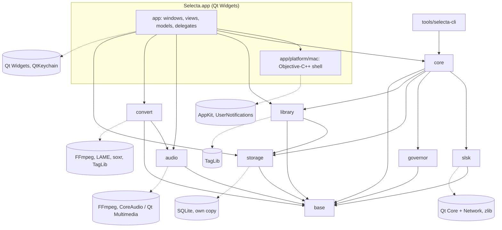

# Qt 6 application architecture for Selecta (toolkit, build, dependencies, CI, packaging, licensing)

> Status: **complete v1** (research 2026-10-19). Items still marked **TODO(verify)** come from prior knowledge and were
> not checked against a primary source. Confidence: **high** = checked in source code or official docs;
> **medium** = consistent secondary sources or strong prior knowledge; **low** = inference.
> Source paths like `qtbase@v6.12.0:src/...` refer to shallow clones in `local/research-clones/qt/` (read only).

## TL;DR

- **Toolkit (ADR-001): Qt Widgets for the whole UI, plus a small Objective-C++ "mac shell"** for what Qt does not
  draw natively: an `NSToolbar` (search field, segmented controls, status items), native context menus
  (`QMenu::toNSMenu()`), notifications, vsync ticks, optionally the sidebar material. **No Qt Quick in v1.**
  Decisive facts (all checked in Qt 6.12 source): Qt Quick has **no accessible table/tree implementation** (VoiceOver
  cannot navigate a Quick `TableView` as a table), and its macOS style has **no header view, toolbar or tab bar**;
  Qt Widgets has mature sortable item views that bridge to `NSAccessibilityTableRole`/`OutlineRole`, and its controls
  are drawn by AppKit, already adapted to **Liquid Glass** metrics in 6.11/6.12. Qt's weak spot on macOS 26/27 is the
  **window chrome** (toolbar, sidebar, menus' material), not the controls — that is where the Objective-C++ goes.
- **Qt version: Qt 6.12 LTS (6.12.0 released 2026-09-30; 6.12.1 planned 2026-11-12).** Open-source users get no LTS
  patch stream beyond the ~6-month standard window (6.12 open-source support ends ≈ 2027-04-01), so plan to move to
  each new minor (6.13 ≈ spring 2027). Qt 6.12 requires **macOS 14.4+** at runtime, **Xcode 16 / macOS 15 SDK+** to
  build, CMake ≥ 3.25. Local machine: Homebrew Qt **6.11.1** (6.11 is already out of open-source support).
- **Liquid Glass:** an app built with the macOS 26+ SDK runs with Liquid Glass; the `UIDesignRequiresCompatibility`
  opt-out only works on macOS 26, and Qt assumes it is ignored on macOS 27 (the maintainer's OS). Design for glass.
  macOS 27 again changes chrome (edge-to-edge sidebars, uniform toolbars) — AppKit chrome follows for free, Qt-drawn
  chrome does not.
- **Build:** CMake ≥ 3.28 + Ninja + `CMakePresets.json` (workflow presets), `qt_standard_project_setup(REQUIRES 6.12)`,
  `QT_ENABLE_STRICT_MODE_UP_TO=0x060C00`, C++20 (23 if CI allows), ASan/UBSan and TSan presets (Apple clang has no
  libFuzzer → fuzz with Homebrew LLVM or on Linux), clang-tidy + clazy from Homebrew, ccache.
- **Dependencies:** Homebrew for local dev only — its FFmpeg/LAME dylibs are built with **`minos 27.0`** and Homebrew
  libavcodec/libavformat link 10 extra Homebrew libraries (x264, x265, SVT-AV1, dav1d, libvpx, opus, LAME, OpenSSL,
  xz) plus their dependencies, so a bundle that copies them is large and runs only on macOS 27+. CI/release: official
  Qt via aqtinstall, an **audio-only FFmpeg + LAME + soxr from vcpkg** (pinned baseline), small CMake deps via
  FetchContent (TagLib, QtKeychain, miniupnpc, libnatpmp, SQLite, test frameworks). Prefer **our own SQLite** over Qt SQL
  (Homebrew's Qt SQL plugin uses the system SQLite; official Qt bundles 3.53.4).
- **CI:** GitHub Actions `macos-26` (arm64, = `macos-latest`) + `ubuntu-24.04` + `windows-2025`; Docker-based
  integration tests on Linux only (no nested virtualization on macOS runners); vcpkg `x-gha` cache is gone.
- **Packaging:** `qt_generate_deploy_app_script` → macdeployqt (ad-hoc signs by default), Icon Composer `.icon` compiled
  by `actool` (else macOS 26+ shows the icon in a grey squircle), DMG. Without a Developer ID: build locally and sign with
  a **stable identity** so Keychain/Local Network/firewall grants survive rebuilds; with one: hardened runtime +
  `notarytool` + staple. The official Homebrew cask repo has refused un-notarised apps since 2026-09-01.
- **Licensing:** Qt Widgets/Core/Gui/Network/Sql/Multimedia are `LGPL-3.0-only OR GPL-2.0-only OR GPL-3.0-only`;
  Qt Canvas Painter, Charts, Graphs and HTTP Server are **`GPL-3.0-only`** for open-source users — fine for a GPLv3 app,
  but it pins distributed binaries to GPLv3 terms (relevant to PRD OQ-7). Never bundle SF Symbols images or SF fonts.

## Key findings

1. **(high) Qt 6.12 LTS is the current release**; Qt 6.12's `.cmake.conf` sets `QT_SUPPORTED_MIN_MACOS_VERSION 14.4`,
   min SDK 15, max SDK 27, min Xcode 16, "max macOS tested" 26 (`qtbase@v6.12.0:.cmake.conf`). Qt 6.11 was macOS 13+.
   The Homebrew Qt 6.11.1 bottle on this machine is built with `minos 14.0` (`otool -l QtCore`).
2. **(high) Liquid Glass detection** lives in `qt_apple_runningWithLiquidGlass()` (`qtbase@v6.12.0:src/corelib/kernel/qcore_mac.mm`):
   true when the binary's SDK ≥ 26 and the OS ≥ 26; the Info.plist opt-out is honoured only below macOS 27
   ("Word on the street is that the opt out will only work for macOS 26"). `QMacStyle` has ~33 Liquid Glass branches
   (button/text-field/tab/slider metrics) in both 6.11.1 and 6.12.0. Qt's official word (blog, 2025-09-05): "most"
   style issues ironed out, glass effects for app developers still "being looked into".
3. **(high) Unified toolbar in Qt 6.12** (`QMainWindow::setUnifiedTitleAndToolBarOnMac`) is now built on
   `Qt::ExpandedClientAreaHint` + `Qt::NoTitleBarBackgroundHint`; before Tahoe Qt adds a titlebar `NSVisualEffectView`,
   on Tahoe+ the title bar is fully transparent with no material (`qmainwindowlayout.cpp`). Toolbar buttons remain
   Qt-drawn `QToolButton`s, so they **do not get the Liquid Glass toolbar capsules** that native `NSToolbar` items get.
   Its doc still warns it is unsupported with OpenGL content "including QOpenGLWidget" (`qmainwindow.cpp`).
4. **(high) Context menus:** `QMenu::popup()/exec()` draws a Qt widget (`PE_PanelMenu` fills `palette.window()` in a
   rounded path — no system material). The menu **bar** is native. Public `QMenu::toNSMenu()` (macOS only) creates the
   platform menu and returns its `NSMenu`, whose items `syncPlatformMenu()` keeps in step with the `QAction`s
   (`qmenu_mac.mm`, `qmenu.cpp`), so native context menus need only a few lines of Objective-C++. Qt Quick's macOS style
   defaults menus to `Popup.Native`.
5. **(high) SF Symbols:** `QIcon::fromTheme(name)` on macOS goes through `QAppleIconEngine`; freedesktop names are mapped
   to SF Symbols and **any other name is passed straight to `+[NSImage imageWithSystemSymbolName:]`**, so
   `QIcon::fromTheme("waveform")` works. Native menu items receive the `NSImage` itself (crisp, AppKit-configured).
6. **(high) Appearance APIs:** `QStyleHints::setColorScheme()/unsetColorScheme()` (in-app light/dark override),
   `QPalette::Accent` = `NSColor.controlAccentColor`, `Highlight` = `selectedContentBackgroundColor` (inactive:
   `unemphasizedSelectedContentBackgroundColor`), `AlternateBase` from `alternatingContentBackgroundColors`
   (`qcocoatheme.mm`). `QGuiApplication::setBadgeNumber()` exists (Dock badge). `QMessageBox` uses `NSAlert`.
7. **(high) Accessibility:** Widgets' `QAccessibleTable`/`QAccessibleTree` (`src/widgets/accessible/itemviews_p.h`)
   are bridged to `NSAccessibilityTableRole`/`OutlineRole` with synthesized rows and cells
   (`qcocoaaccessibilityelement.mm`). `qtdeclarative@v6.12.0:src/quick/accessible/` implements only items, Flickable,
   ListView and text — **no table interface for Quick `TableView`/`TreeView`**.
8. **(high) Qt Quick macOS style** (`qtdeclarative@v6.12.0:src/quickcontrols/macos/`) provides buttons, fields,
   sliders, menus, `SearchField`, `TreeViewDelegate`, `SelectionRectangle` — **no `HorizontalHeaderView`, `ToolBar`,
   `TabBar` or `SplitView`** (they fall back to the Basic style). `QtQuick.Controls.Native` (new in 6.12) is just an
   alias that resolves to the macOS style on macOS.
9. **(high) New modules:** Qt Canvas Painter (GPU 2D painter over QRhi; `QCanvasPainterWidget` is a `QRhiWidget`
   subclass) left Technology Preview in 6.12 — licence `GPL-3.0-only` for open source. Qt TaskTree (async task
   composition, LGPL/GPL) is present since 6.11.
10. **(high) Widget repaint pacing:** `QWidget::update()` posts a low-priority `UpdateRequest`
    (`qwidgetrepaintmanager.cpp`); it is not tied to the display link. `QWindow::requestUpdate()` is
    `CVDisplayLink`-driven on macOS (`qcocoascreen.mm`), but on a `QWidgetWindow` it repaints the whole top-level
    widget (`qwidgetwindow.cpp`). A smooth 120 Hz waveform therefore needs its own vsync source (section 4).

## 1. Qt 6 release landscape

| Item | Value | Confidence / source |
|---|---|---|
| Latest stable | **Qt 6.12.0 LTS**, released 2026-09-30 | high — Qt blog "Qt 6.12 LTS Released!", wiki Qt_6.12_Release |
| Next patches | 6.12.1 2026-11-12, 6.12.2 2027-01-14, 6.12.3 2027-03-04 (planned) | high — wiki Qt_6.12_Release |
| LTS terms | New LTS every 2 years, 5 years of maintenance — **for commercial licensees**. Open-source users "are expected to update to every new minor release" (~6 months). Commercial LTS code is opened "within 12 months". | high (blog) / medium (endoflife.date summary) |
| Open-source support windows | 6.8: ended 2025-04-02 · 6.10: ended 2026-04-07 · 6.11: ended 2026-09-30 · **6.12: until ≈ 2027-04-01** | medium — endoflife.date (updated 2026-10-04) |
| Latest 6.11 patch | 6.11.2 (local Homebrew has 6.11.1) | medium — endoflife.date |
| Qt 6.12 macOS runtime | **macOS 14.4 or later** ("including macOS 26"); arm64, x86_64, x86_64h; universal via `CMAKE_OSX_ARCHITECTURES` | high — doc.qt.io/qt-6/macos.html + `.cmake.conf` |
| Qt 6.12 build env | Xcode 16 (macOS 15 SDK) or later; SDK ≤ 27 supported | high — same |
| Qt 6.11 (installed) | min macOS 13, SDK ≥ 14, Xcode ≥ 15 | high — `/opt/homebrew/opt/qt/lib/cmake/Qt6/Qt6ConfigExtras.cmake` |
| CMake to use Qt 6.12 | ≥ 3.25 | high — whatsnew612, `.cmake.conf` |
| Homebrew bottle | Qt 6.11.1, `minos 14.0`, SDK 26.4 | high — local `otool -l` |
| Local toolchain | macOS 27.0.1, Xcode 27.0, Apple clang 21, CMake 4.3.4, Ninja | high — local |

Notes:
- macOS 27 is not yet in Qt 6.12's "tested" list (max tested 26), but Qt now states it is "generally
  forward-compatible" with new OS versions (blog 2025-09-05; macos.html: new OS *features* are "not typically
  included in patch releases").
- Qt 6.12 additions useful to Selecta: `QRangeModel` gains `sort()` with a collator, `match()`, header data and
  drag-and-drop; `QSortFilterProxyModel::dataChangeRelevanceFlags()` lets a proxy skip re-sorting/re-filtering on
  irrelevant `dataChanged` (useful while results stream in); `QTreeView::itemDecorationRect()`; Qt Test benchmarks
  report variance/stddev; `QAudioSink::setNativePeriodFrameCount()`; the unified toolbar rework above.
  (high — doc.qt.io/qt-6/whatsnew612.html)

## 2. Qt Widgets vs Qt Quick vs hybrid (decision: ADR-001)

### 2.1 What "the visual language of macOS" means in late 2026

The maintainer runs **macOS 27** (local `sw_vers`: 27.0.1). Since macOS 26 the system look is **Liquid Glass**:
rounder, taller controls; toolbar items grouped in glass capsules; a sidebar that floats as a glass panel inset from
the window edge; glass menus and popovers. An app gets this look by using AppKit controls and AppKit window chrome
(`NSToolbar`, `NSSplitViewController` sidebar/inspector items) built with the 26+ SDK. Opting out
(`UIDesignRequiresCompatibility`) is a stopgap that Qt itself treats as ineffective on macOS 27.

**macOS 27 ("Golden Gate", announced 2026-06-08) refines it** (high — WWDC26 session 289 "Modernize your AppKit app";
Apple press text via MacRumors): "uniform toolbars, edge-to-edge sidebars, and updated window shapes"; sidebars
"extend to the window's edges" with **semi-bold** selected text and content flowing behind them; bordered toolbar items
over the sidebar adopt glass; every window gets the same corner radius; coloured sidebar icons return for the active
app; a user slider sets glass from clear to tinted; new opt-in APIs (`NSView.cornerConfiguration` concentric corners,
an interactive "bounce" glass effect). Apps that adopted Liquid Glass in macOS 26 get most of this automatically —
i.e. **apps using AppKit chrome track Apple's design for free; apps that draw their own chrome must chase it every
year.** Edge-to-edge sidebars make a Qt-drawn sidebar easier to match on 27 than the floating 26 sidebar was.

So "native" decomposes into three layers with different Qt answers:

| Layer | Examples in Selecta | Qt Widgets | Qt Quick (Controls, macOS style) |
|---|---|---|---|
| **Controls** | buttons, pop-up buttons, checkboxes, sliders, text fields, scroll bars, table headers | Drawn by AppKit cells through `QMacStyle` → genuinely native, Liquid-Glass-aware (high) | Drawn by a fork of `QMacStyle` (`quicknativestyle/qstyle/mac/qquickmacstyle_mac.mm`) — same quality for the controls it covers; **no header view, toolbar, tab bar** (high) |
| **Content views** | 10 000-row sortable grouped results, source list, transfer list, inspector forms | `QTreeView`/`QTableView`/`QHeaderView`: sorting, resizable/movable/hideable columns, multi-selection, type-ahead, keyboard navigation, uniform row heights, persistent editors — mature (high) | `TableView`/`TreeView`/`HorizontalHeaderView`: fast and virtualised but lower level; sort indicators, column moving/hiding, header context menus and native look are DIY (medium-high) |
| **Window chrome** | unified toolbar + search field, sidebar material, inspector, menus, context menus | Menu bar native; context menus Qt-drawn unless `toNSMenu()`; toolbar Qt-drawn on a transparent title bar; no sidebar material (high) | Menus native (`Popup.Native`); no toolbar, no sidebar material (high) |

### 2.2 Requirement-by-requirement comparison

| Need (PRD) | Qt Widgets | Qt Quick | Winner |
|---|---|---|---|
| Dense sortable tables, grouped by folder, 10 k streaming rows (SRCH-10, NFR-2) | `QTreeView` + own model; `QHeaderView` sort indicators drawn natively | `TableView`/`TreeView` + custom header and delegates | Widgets |
| Keyboard audition ↑/↓, Space, ←/→, Return (PREV-4) | Item views have complete keyboard models; override keys in the view | Possible, more manual focus handling | Widgets |
| VoiceOver for tables, badges, waveform (UI-5) | Table/outline bridged with rows/cells; custom `QAccessibleInterface` for waveform | No table/tree accessibility interface in 6.12 | **Widgets (decisive)** |
| Source-list sidebar | `QTreeView` + custom delegate (counts, SF Symbols, rounded selection) | `ListView` + delegate | Tie (custom either way) |
| Unified toolbar with search, budget, ratio, status | `setUnifiedTitleAndToolBarOnMac` (Qt-drawn items) or native `NSToolbar` via Obj-C++ | Draw into the title bar with `ExpandedClientAreaHint`; or native `NSToolbar` | Tie; native `NSToolbar` best for both |
| Menu bar, shortcuts, Settings… role merging | Native, `QAction::MenuRole`, `QKeySequence::StandardKey` | Native `MenuBar` | Tie |
| Context menus | Qt-drawn; native via `QMenu::toNSMenu()` | Native by default | Quick (Widgets fixable cheaply) |
| Segmented controls | No native control; `QTabBar` is drawn with clipped `NSButton`s ("NSSegmentedControl and NSSegmentedCell are letting us down", `qmacstyle_mac.mm`) | None | Tie (native `NSSegmentedControl` in the toolbar via Obj-C++) |
| Light/dark + in-app override + accent (UI-2) | `QStyleHints::setColorScheme`, palette roles | Same | Tie |
| SF Symbols | `QIcon::fromTheme("<symbol>")` | `icon.name` → same engine | Tie |
| Vibrancy / glass behind sidebar | Obj-C++ (`NSVisualEffectView`/`NSGlassEffectView` behind a transparent widget) | Same | Tie |
| Custom 60/120 fps waveform (PREV-2) | QPainter + tile cache; `QRhiWidget`/`QCanvasPainterWidget` for GPU; vsync via Obj-C++ display link | Scene graph item, vsync-driven render loop — natural fit | Quick |
| Native dialogs (open panel, alerts, sheets) | `QFileDialog`/`QMessageBox` native; window-modal dialogs as sheets | `FileDialog`/`MessageDialog` native | Tie |
| Team/agent productivity, examples, tests | C++ only; `QAbstractItemModelTester`, Qt Test widgets helpers | C++ + QML, two languages, QML tooling | Widgets |

### 2.3 Recommendation

**Use Qt Widgets for the entire v1 UI; do not use Qt Quick (no hybrid) unless a later spike proves the waveform
cannot be made smooth in Widgets.** Confidence: high for "Widgets over Quick"; medium for how much native chrome is
worth building (decide with the spike in 2.4).

Why: Selecta's core surface is dense, sortable, keyboard-driven, accessible tables. Widgets is the only Qt toolkit that
gives native-drawn table headers, a complete item-view keyboard model and VoiceOver table semantics out of the box.
Qt Quick's only real advantage here — vsync-driven GPU animation — matters for one widget (the waveform), which can be
done in Widgets (section 4). Hybrid `QQuickWidget` embedding adds a second language and a render-to-texture composition
path of the kind the unified-toolbar docs warn about for GL content (finding 3; unverified for QRhi-based widgets).

Add a **mac shell** (`src/app/platform/mac/*.mm`, Objective-C++, behind small C++ interfaces with plain-Qt fallbacks for
Linux/Windows):

| Piece | Why | Effort | Priority |
|---|---|---|---|
| Native `NSToolbar` attached to the main window's `NSWindow` (search field as `NSSearchToolbarItem`, `NSSegmentedControl` items, budget/ratio/connection status as small native views, "Pause network", sidebar/inspector toggles) | Toolbar is the most visible Liquid Glass surface; Qt's toolbar gets no glass capsules | M — port ideas from Qt 5's `QMacToolBar` (qtmacextras 5.15, LGPL-3.0/GPL, removed in Qt 6). Qt 6 has no `setNSToolbar` hook any more, so attach via `[(NSView *)w->winId() window].toolbar`; Qt keeps `NSWindowStyleMaskUnifiedTitleAndToolbar` when it recomputes style masks and its `safeAreaMargins()` accounts for toolbars (`qcocoawindow.mm`) | P0 polish, after the M1 spike |
| Native context menus via `QMenu::toNSMenu()` + `-[NSMenu popUpMenuPositioningItem:atLocation:inView:]` | Glass/material menus, SF Symbol images, native keyboard handling | S | P0 |
| Vsync ticker (`-[NSView displayLinkWithTarget:selector:]`, macOS 14+) driving waveform `update()` | Judder-free 120 Hz scrolling | S | P0 (M5) |
| Notifications (`UNUserNotificationCenter`) | No Qt API | S | P1 (UI-6) |
| Sidebar material (`NSVisualEffectView`, or the public `NSGlassEffectView`/`NSGlassEffectContainerView` — macOS 26+, `effectIsInteractive` 27+ per SDK headers — behind a transparent `QTreeView`) | Sidebar material with content flowing behind (edge-to-edge on macOS 27) | M, fragile | P2 — spike only; accept a solid sidebar until then |
| Keychain (via QtKeychain), Trash (`QFile::moveToTrash`), quarantine xattr | Platform services | S | P0 |

Fallbacks: on Linux/Windows the same interfaces map to `QToolBar`, `QMenu::exec`, `QTimer`, `QSystemTrayIcon`.

Rejected alternatives:
- **Qt Quick (+ macOS style)** — no table accessibility, no native header/toolbar, QML + C++ split; Quick's strengths
  (animation, GPU) are needed in one place only.
- **Hybrid (Widgets + `QQuickWidget` for the waveform/player)** — keeps the option open, but costs a QML stack and a
  composition mode change for one view. Keep as fallback B for the waveform only.
- **AppKit window shell hosting Qt content** (`NSSplitViewController` with sidebar/inspector items, Qt widgets embedded
  as child `NSView`s; Qt 6.12 "now manages embedding into a foreign NSView on its own") — the most faithful Liquid Glass
  chrome, but focus traversal, shortcuts, drag-and-drop and accessibility across the native/Qt boundary are untested
  territory and the Linux/Windows builds need a second shell. Revisit only if the toolbar spike is not native enough.
- Third-party **qt-liquid-glass** (MIT per README, 109 stars, uses private `NSGlassEffectView` variants and `_setPath:`)
  — a useful reference for where to insert effect views, not a dependency (private APIs, early stage).

### 2.4 Spike to run in M1 (one day, decides how much mac shell to build)

On macOS 27, light and dark, accent colours blue/graphite/pink: (a) `QMainWindow` + `QToolBar` with
`setUnifiedTitleAndToolBarOnMac(true)`; (b) the same window with an `NSToolbar` attached through Obj-C++; (c) a
`QTreeView` sidebar on a transparent background over an `NSVisualEffectView`. Screenshot against Finder/Music/Mail and
let the maintainer choose. Also check: `QMenu::toNSMenu()` actions trigger correctly; a `QRhiWidget` in a unified-toolbar
window renders correctly (finding 3 warns about GL content).

## 3. Native macOS details to get right (checklist for M1 and every view)

Window and chrome
- [ ] Unified toolbar (Qt or native, per spike); window title + `NSWindow.subtitle` (e.g. current search) via Obj-C++.
- [ ] Content under the title bar where it helps (`Qt::ExpandedClientAreaHint`, `QWindow::safeAreaMargins()` to clear
      the traffic lights; `WA_ContentsMarginsRespectsSafeArea`).
- [ ] Single main window; closing it keeps transfers running (Music-style); Dock click reopens it; ⌘Q with active
      transfers asks in a sheet. Qt already sets `tabbingMode = NSWindowTabbingModeDisallowed` and `restorable = NO` on
      every `NSWindow` (`qcocoawindow.mm`) — keep it; persist geometry with `saveGeometry()/saveState()` instead.
- [ ] Inspector toggle: PRD says ⌘I; macOS convention for "Show Inspector" is ⌥⌘I (Finder) — decide.
- [ ] Settings window in macOS style: toolbar-tab panes, instant apply, no OK/Cancel, ⌘, (`QAction::PreferencesRole`,
      label it "Settings…" as on macOS 13+).

Menus and shortcuts
- [ ] Set `QAction::MenuRole` explicitly (About/Settings/Quit) — Qt's default `TextHeuristicRole` moves items by
      matching their text.
- [ ] Qt only inserts a *hidden* Window menu (for the Dock window list, `qcocoamenubar.mm`); add a visible Window menu
      (Minimize ⌘M, Zoom, Bring All to Front) and a Help menu (AppKit adds the search field).
- [ ] Use `QKeySequence::StandardKey` where one exists; Space/←/→ overrides in item views must not break type-ahead.
- [ ] Native context menus (`toNSMenu`), with SF Symbol icons only where macOS apps use them (Tahoe menus do show
      symbols for common actions).

Controls and content
- [ ] Never hard-code control sizes or margins: Tahoe changed control heights/radii (QMacStyle's glass branches); use
      style metrics and layout defaults; test with and without Liquid Glass (Xcode-16-built or macOS 26 opt-out build).
- [ ] Tables: no grid, alternating rows from the palette, uniform row heights, sort indicator on click, header context
      menu to hide/show columns, persistent column state, type-ahead, tabular digits for numbers
      (`font.setFeature(QFont::Tag("tnum"), 1)` — API present in the 6.11 headers), right-aligned numeric columns,
      `Qt::ElideMiddle` for paths.
- [ ] Selection colours from the palette at paint time (accent changes live); unemphasized selection when the view or
      window is inactive.
- [ ] Sidebar: section headers in secondary label colour, SF Symbol icons tinted with the accent colour (coloured
      only while the app is active, as on macOS 27), count badges, rounded inset selection with **semi-bold** text on
      macOS 27, edge-to-edge on 27, row height following System Settings › Appearance › Sidebar icon size —
      TODO(verify) how to read it (believed: `NSUserDefaults` key `NSTableViewDefaultSizeMode`).
- [ ] Search field: `QLineEdit` with leading `magnifyingglass` action, clear button, ⌘F focus — or `NSSearchToolbarItem`.
- [ ] Segmented choices (Grouped/Flat, Any/=/≥/≤): native `NSSegmentedControl` in the toolbar; in content use
      `QTabBar`-style or radio-like `QToolButton` groups.
- [ ] Overlay scroll bars: QMacStyle returns `SH_ScrollBar_Transient` from `NSScroller.preferredScrollerStyle`, so
      item views follow System Settings automatically — don't override scroll bar styling.
- [ ] System font everywhere (`QFontDatabase::systemFont`); no bundled fonts; SF Mono only for paths/logs if at all.
- [ ] Dark waveform "screen" in both appearances (UI-3); everything else follows the palette.
- [ ] Colour is never the only signal (UI-4): symbol + label in badges.

Platform integration
- [ ] VoiceOver: accessible names for toolbar items and icon-only buttons; `QAccessibleValueInterface` for the
      waveform (position/duration) and budget/ratio meters; `QAccessibleAnnouncementEvent` (present in 6.11 headers) for
      "download finished"-type events.
- [ ] Keyboard: Full Keyboard Access / Tab focus behaviour from `QStyleHints::tabFocusBehavior`.
- [ ] Drag and drop: `.txt` tracklists into Batch; Inbox files out to Finder/rekordbox (file URLs).
- [ ] Dock badge (`QGuiApplication::setBadgeNumber`), notifications (Obj-C++), `QFile::moveToTrash` for Inbox/cache.
- [ ] High-DPI: all custom painting at `devicePixelRatio`; cached pixmaps carry `setDevicePixelRatio`.
- [ ] Local Network privacy prompt (macOS 15+) when connecting to LAN peers/test servers: `NSLocalNetworkUsageDescription`
      in Info.plist; loopback (the Docker test server on `127.0.0.1`) is reported exempt (medium) — see 10.3.

## 4. Waveform rendering in a Widgets app

Targets (PRD PREV-2, NFR-2): zoomed scrolling view + overview, 60 fps (120 on ProMotion), dark background, buffered
range overlay. Analysis (bands, peaks) is the audio note's job; this section is only about getting pixels on screen.

| Option | How | Pros | Cons | Verdict |
|---|---|---|---|---|
| A. `QWidget` + QPainter (raster) | Pre-render the 3-band waveform into tiles (`QImage`/`QPixmap`, e.g. 512 px wide at device pixels); each frame blit the visible tiles at the playhead offset, draw playhead/cue overlays | Simple, deterministic, works with the unified toolbar, no GPU state; blitting a ~2400×300 device-pixel area per frame is cheap on Apple Silicon | CPU path; tile cache must be rebuilt on zoom/resize/appearance change | **Default** |
| B. `QRhiWidget` (6.7+) | Metal through QRhi: vertex buffers of band envelopes, scrolling by a uniform | GPU, scales to huge zoom ranges | Always renders into a texture composited with the rest of the window (`qrhiwidget.cpp` docs: "at the expense of additional resources and a potential effect on performance"; `textureChildSeen` in `qwidgetrepaintmanager.cpp`); one graphics API per top-level window; the QRhi classes have "limited compatibility guarantees" (no source/binary promise across minors); unified toolbar docs warn against GL content (TODO(verify) for RHI) | Fallback if A misses budget |
| C. `QCanvasPainterWidget` (6.11; supported in 6.12) | QPainter-like vector API on the GPU (a `QRhiWidget` subclass) | Familiar API, GPU | Same composition caveat as B; `GPL-3.0-only`; young module | Watch |
| D. `QQuickWidget`/window container with a scene-graph item | Quick render loop, vsync animation | Smoothest animation model | Second stack (QML), composition caveats; a `createWindowContainer` child is an opaque native view (fine for a dark screen) with focus/a11y quirks | Fallback for the waveform only |

Frame pacing: `update()` is not vsync-aligned (finding 10). Drive the playhead animation from a display link —
`-[NSView displayLinkWithTarget:selector:]` returns a `CADisplayLink` "invoked in-sync with the display the view is on"
(`API_AVAILABLE(macos(14.0))` in the Xcode 27 SDK's `NSView.h` — high; Qt 6.12's minimum macOS 14.4 covers it) —
calling `update()` on the waveform only, and compute the playhead position from the audio clock at
paint time (never accumulate per-frame deltas). Fallback elsewhere: `QTimer` at `QScreen::refreshRate()` with
`Qt::PreciseTimer`. TODO(verify experimentally): ProMotion actually presents at 120 Hz for a raster-backed Qt window.

## 5. Modern CMake structure

### 5.1 Facts that shape the build

| Fact | Confidence / source |
|---|---|
| Qt 6.12 needs CMake ≥ 3.25 to *use* Qt; Homebrew ships CMake 4.4.4 (4.3.4 installed) | high — whatsnew612, `.cmake.conf`, `brew info` |
| `qt_standard_project_setup([REQUIRES v] [SUPPORTS_UP_TO v] [I18N_*])`: sets `CMAKE_AUTOMOC`/`CMAKE_AUTOUIC`, includes `GNUInstallDirs`, `USE_FOLDERS`; with `REQUIRES` sets every Qt CMake policy up to that version to NEW (QTP0001…QTP0008 exist in 6.12) and errors on older Qt | high — `qtbase@v6.12.0:src/corelib/doc/src/cmake/qt_standard_project_setup.qdoc`, `policy/` |
| `qt_generate_deploy_app_script(TARGET … OUTPUT_SCRIPT … [EXCLUDE_PLUGIN_TYPES …] [DEPLOY_TOOL_OPTIONS …])` runs `macdeployqt` at `cmake --install` for app bundles; `EXCLUDE_PLUGIN_TYPES/EXCLUDE_PLUGINS` since 6.10; `DEPLOY_TOOL_OPTIONS` since 6.7 | high — `qt_generate_deploy_app_script.qdoc` |
| Qt 6.12 still only requires C++17 from users | high — `qcompilerdetection.h` |
| `QT_ENABLE_STRICT_MODE_UP_TO=0x060C00` turns on `QT_DISABLE_DEPRECATED_UP_TO`, `QT_NO_FOREACH`, `QT_NO_CAST_TO_ASCII`, `QT_NO_CAST_FROM_BYTEARRAY`, `QT_NO_URL_CAST_FROM_STRING`, `QT_NO_NARROWING_CONVERSIONS_IN_CONNECT`, `QT_NO_JAVA_STYLE_ITERATORS`, `QT_NO_CONTEXTLESS_CONNECT`, `QT_NO_QASCONST`, `QT_NO_QPAIR`, `QT_LEAN_HEADERS=2`, … | high — `qtconfigmacros.h` |
| Xcode 27's clang ships ASan, TSan, UBSan and profile runtimes for macOS — **no libFuzzer, no standalone LSan**; no `clang-tidy` | high — `ls …/lib/clang/21/lib/darwin`, `which clang-tidy` |
| Homebrew LLVM 23.1.3 provides `clang-tidy`, libFuzzer; `clang-format` 22.1.8 installed locally | high — `brew info` |

### 5.2 Proposed layout of the build

- One top-level `CMakeLists.txt`; each module (`src/slsk`, `src/governor`, …) is a **static library target**
  (`selecta_slsk`, …) with explicit `target_link_libraries` that encode the allowed dependency graph (section 12).
  Static libs keep one `.app` binary and let tests link single modules.
- `cmake/` holds small helpers: `SelectaWarnings.cmake` (an INTERFACE target `selecta::warnings`),
  `SelectaSanitizers.cmake`, `SelectaMacBundle.cmake` (Info.plist, entitlements, icons), `SelectaVersion.cmake`
  (version from `git describe`).
- Objective-C++ only under `src/app/platform/mac/` (`enable_language(OBJCXX)` inside `if(APPLE)`), compiled with
  `-fobjc-arc`.
- Generated `compile_commands.json` (`CMAKE_EXPORT_COMPILE_COMMANDS ON`) for clang-tidy/clangd (already git-ignored).

```cmake
# CMakeLists.txt (sketch)
cmake_minimum_required(VERSION 3.28...4.4)
project(Selecta VERSION 0.1.0 LANGUAGES CXX)
if(APPLE)
  enable_language(OBJCXX)
endif()

set(CMAKE_CXX_STANDARD 20)            # ADR: 20, or 23 if the M1 CI matrix compiles it
set(CMAKE_CXX_STANDARD_REQUIRED ON)
set(CMAKE_CXX_EXTENSIONS OFF)
set(CMAKE_EXPORT_COMPILE_COMMANDS ON)

option(SELECTA_BUILD_TESTS          "Build unit/integration tests" ON)
option(SELECTA_BUILD_FUZZERS        "Build libFuzzer targets (needs Homebrew/upstream clang)" OFF)
option(SELECTA_WARNINGS_AS_ERRORS   "-Werror (CI)" OFF)
option(SELECTA_ALLOW_LIVE_SERVER    "Allow connecting to the live Soulseek server (SAFE-3)" OFF)

find_package(Qt6 6.12 REQUIRED COMPONENTS Core Gui Widgets Network Concurrent Svg)
qt_standard_project_setup(REQUIRES 6.12)
add_compile_definitions(QT_ENABLE_STRICT_MODE_UP_TO=0x060C00 QT_NO_KEYWORDS)

include(cmake/SelectaWarnings.cmake)
include(cmake/SelectaSanitizers.cmake)

add_subdirectory(src)        # libraries + the Selecta app target
add_subdirectory(tools/selecta-cli)
if(SELECTA_BUILD_TESTS)
  enable_testing()
  add_subdirectory(tests)
endif()
```

```cmake
# src/app/CMakeLists.txt (sketch)
qt_add_executable(Selecta MACOSX_BUNDLE WIN32 main.cpp)
target_link_libraries(Selecta PRIVATE selecta_core selecta_library selecta_audio selecta_convert Qt::Widgets)
set_target_properties(Selecta PROPERTIES
  MACOSX_BUNDLE_GUI_IDENTIFIER "org.selecta.Selecta"          # TODO: final bundle id
  MACOSX_BUNDLE_INFO_PLIST "${PROJECT_SOURCE_DIR}/packaging/macos/Info.plist.in")
if(APPLE)
  target_sources(Selecta PRIVATE platform/mac/MacToolbar.mm platform/mac/MacMenus.mm platform/mac/VsyncTicker.mm)
  target_link_libraries(Selecta PRIVATE "-framework AppKit" "-framework UserNotifications")
endif()
install(TARGETS Selecta BUNDLE DESTINATION .)
qt_generate_deploy_app_script(TARGET Selecta OUTPUT_SCRIPT deploy_script
  EXCLUDE_PLUGIN_TYPES qmltooling)                            # trim what we don't use
install(SCRIPT ${deploy_script})
```

`QT_NO_KEYWORDS` (use `Q_SIGNALS`/`Q_SLOTS`/`Q_EMIT`) avoids clashes with other libraries' `signals`/`emit`
identifiers; `QT_ENABLE_STRICT_MODE_UP_TO` forces explicit string conversions (useful for a protocol client that must
be precise about encodings).

### 5.3 Presets

`CMakePresets.json` (committed; per-user overrides in the git-ignored `CMakeUserPresets.json`):

| Preset | Generator / type | Flags | Used by |
|---|---|---|---|
| `dev` | Ninja, Debug | `-O0 -g`, live server locked off | daily work |
| `asan` | Ninja, Debug | `-fsanitize=address,undefined -fno-omit-frame-pointer -fno-sanitize-recover=undefined` | CI + local |
| `tsan` | Ninja, Debug | `-fsanitize=thread` (cannot combine with ASan) | CI nightly (network/storage threads) |
| `release` | Ninja, RelWithDebInfo | `-O2`, dSYM, LTO optional | packaging |
| `fuzz` | Ninja, Debug, `CMAKE_CXX_COMPILER=/opt/homebrew/opt/llvm/bin/clang++` | `-fsanitize=fuzzer-no-link,address` on parsers, `-fsanitize=fuzzer` on harnesses | local + Linux CI |
| `ci-linux`, `ci-windows` | Ninja / MSVC | warnings as errors | CI |

Add `workflowPresets` (configure → build → test) so CI and humans run `cmake --workflow --preset asan`.
Use `"cacheVariables": {"CMAKE_PREFIX_PATH": "$env{QTDIR}"}` with a user preset for the Qt location (Homebrew:
`/opt/homebrew`, aqtinstall: `~/Qt/6.12.0/macos`).

### 5.4 Code quality tooling

- **clang-format**: commit `.clang-format` (e.g. based on LLVM/WebKit style with 120 columns, matching this repo's
  Markdown width); CI checks with the same major version (pin via Homebrew `clang-format` or `pip install clang-format==<ver>`).
- **clang-tidy** (Homebrew LLVM): `bugprone-*`, `performance-*`, `modernize-*` (minus `use-trailing-return-type`),
  `cppcoreguidelines-*` subset, `readability-identifier-naming`; run on changed files in CI via
  `run-clang-tidy -p build`. Qt-specific checks come from **clazy** (KDE; Homebrew `clazy` 1.17.1,
  LGPL-2.0-or-later — a tool we only run, never link): connect/signal misuse, detaching containers, `QString` misuse.
- **ccache** (`CMAKE_CXX_COMPILER_LAUNCHER=ccache`; `ccache` 4.14.2 on Homebrew) locally and in CI; moc/uic output is
  deterministic so it caches well.
- Warnings: `-Wall -Wextra -Wpedantic -Wshadow -Wnon-virtual-dtor -Wcast-align -Wunused -Woverloaded-virtual
  -Wnull-dereference -Wdouble-promotion -Wformat=2 -Wimplicit-fallthrough`; `-Wconversion -Wsign-conversion` only on the
  `slsk` codec (bounds/size arithmetic from the network), where they are worth the noise. MSVC: `/W4 /permissive-
  /Zc:__cplusplus` (Qt requires `/Zc:__cplusplus`).

## 6. Dependency management

### 6.1 What each dependency is for and where it comes from

| Dependency | Use | Homebrew (local metadata, 2026-10-19) | vcpkg port (registry HEAD 2026-10-18) | Notes |
|---|---|---|---|---|
| Qt 6.12 | everything | `qtbase` etc. **6.12.0** (split formulae; 6.11.1 installed) | `qtbase` **6.11.2** (lags) | Official binaries via aqtinstall have the documented min macOS; Homebrew bottle `minos` 14.0 |
| zlib | protocol (compressed messages) | macOS SDK `libz` | `zlib` 1.3.2 | Use the system zlib on macOS (always present) |
| FFmpeg (avformat/avcodec/swresample) | decode, transcode | `ffmpeg` 9.0.2 — **GPL-3.0-or-later build** (`--enable-gpl --enable-version3 --enable-libmp3lame`); libavcodec + libavformat directly link 10 non-FFmpeg Homebrew dylibs (dav1d, libmp3lame, libvpx, libcrypto/libssl (OpenSSL 4), libopus, SVT-AV1, x264, x265, liblzma) | `ffmpeg` 9.0.2 with features `gpl`, `version3`, `mp3lame`, `soxr`, `opus`; `nonfree` exists — never enable | For release: a minimal audio-only FFmpeg (see 6.3) |
| LAME | MP3 encode (CONV) | `lame` 4.0 | `mp3lame` 3.100; ConanCenter 3.100 | LAME 4.0 (2026-07-11) is a maintenance/security release — encoding unchanged from 3.100, version string in the LAME tag changed (medium — SourceForge listing + secondary reports; matters to the conversion note). Licence: Homebrew LGPL-2.0-or-later, vcpkg metadata LGPL-2.0-only |
| libFLAC | FLAC encode/verify (if not via FFmpeg) | `flac` 1.5.0 | `libflac` 1.5.0 (BSD-3-Clause) | |
| libsoxr | resampling | `libsoxr` 0.1.3 (LGPL-2.1-or-later) | `soxr` 0.1.3 | or FFmpeg's swresample with soxr engine |
| TagLib 2.x | tags | `taglib` 2.3.2 (LGPL-2.1-only OR MPL-1.1; needs `utf8cpp`) | `taglib` 2.3.1 | CMake-native, FetchContent-friendly |
| Chromaprint | fingerprints (P2) | `chromaprint` 1.6.2 (depends on ffmpeg) | `chromaprint` 1.6.1 | |
| miniupnpc / libnatpmp | port mapping (P1) | 2.3.3 / 20230423 (BSD-3-Clause) | 2.3.2 / 2025-04-03 | Small, CMake; FetchContent or vcpkg |
| QtKeychain | Keychain | `qtkeychain` **0.17.0** (BSD-2-Clause per Homebrew metadata) | `qtkeychain-qt6` **0.14.3** (old) | Upstream: 0.17.0 released 2026-07-06 (Qt 6 by default; 0.16.0 fixed a macOS keychain-timeout crash); `COPYING` is 3-clause BSD. On macOS it uses `SecItem*` without `kSecUseDataProtectionKeychain`, i.e. the legacy login keychain with ACLs (`qtkeychain/keychain_apple.mm`). FetchContent tag `0.17.0` |
| SQLite | storage | `sqlite` 3.54.1 | `sqlite3` 3.53.4 | See 7.3: own copy vs Qt SQL |
| Sparkle 2 | updates (P2) | cask `sparkle` 2.9.6 | — | Binary framework from Sparkle releases; MIT |
| Catch2 / GoogleTest / RapidCheck | tests | 3.16.1 / 1.18.0 / — | 3.16.0 / 1.18.0 / 2023-12-14 | FetchContent is simplest |
| KDSingleApplication | single instance (optional) | — | 1.2.1 (MIT) | LaunchServices normally reuses a running bundle, but `open -n` or launching the binary directly starts a second instance — guard with a lock on the database directory either way |

### 6.2 Options compared

| Approach | Pros | Cons | Fit |
|---|---|---|---|
| **Homebrew** | Zero build time; current versions (Qt 6.12.0, FFmpeg 9.0.2); maintainer already uses it | **Not reproducible** (no version pinning; upgrades under your feet); bottles are built for the host OS — local FFmpeg/LAME dylibs have **`minos 27.0`**, so a bundle that copies them runs only on macOS 27+; Homebrew FFmpeg drags in video codecs and OpenSSL that an audio app never uses | Local dev; "me first" builds |
| **vcpkg (manifest mode)** | Version baseline pinning in `vcpkg.json`; feature selection (audio-only FFmpeg); sets `VCPKG_OSX_DEPLOYMENT_TARGET`; same recipe on macOS/Linux/Windows; CMake toolchain integration | First build is slow (FFmpeg minutes; Qt tens of minutes — avoid Qt from vcpkg); binary cache needs NuGet/GitHub Packages or `files` + `actions/cache` (`x-gha` was removed in vcpkg 2025.06) | Release + CI for non-Qt deps |
| **Conan 2** | Similar pinning; good binary model | Second ecosystem to learn; ConanCenter (2026-10-19) has `qt` 6.11.1, `ffmpeg` 9.0.1, `libmp3lame` 3.100 but `taglib` only 2.0 and no QtKeychain recipe; less common in Qt desktop apps | Not recommended |
| **FetchContent** | Pure CMake; ideal for small CMake-native libs (TagLib, QtKeychain, miniupnpc, libnatpmp, Catch2, SQLite amalgamation) | Builds from source every clean configure; wrong tool for autotools projects (FFmpeg, LAME) | Small deps |
| **Qt from aqtinstall** (official binaries) | Fast in CI (cached), official min-macOS, universal binaries | Not a dep manager for anything else | Qt in CI and release |

### 6.3 Recommendation (ADR-004)

1. **Qt:** Homebrew locally (`brew install qtbase qtsvg qttools`, plus `qtmultimedia` only if ADR-003 picks
   `QAudioSink`); **official Qt 6.12.x via aqtinstall** in CI and for release builds.
2. **Small CMake-native deps** (TagLib, QtKeychain, miniupnpc, libnatpmp, Catch2/GoogleTest, SQLite amalgamation):
   `FetchContent` with pinned tags/hashes and `FIND_PACKAGE_ARGS` so a system/Homebrew copy can be used instead
   (`FetchContent_Declare(... FIND_PACKAGE_ARGS)` — CMake ≥ 3.24).
3. **FFmpeg + LAME (+ soxr):** Homebrew for local dev; for release a **minimal FFmpeg built by vcpkg** (features
   `avcodec`, `avformat`, `swresample`, `mp3lame`, `soxr` with `default-features: false` to drop
   avdevice/avfilter/swscale; no `gpl` feature needed — LAME and soxr are LGPL, so an LGPL FFmpeg suffices) or a scripted
   `./configure --disable-everything` build that enables only the audio decoders/demuxers/encoders/muxers Selecta uses
   (MP3, FLAC, ALAC, AAC, PCM/WAV/AIFF, Vorbis, Opus; encoders libmp3lame, FLAC, PCM), with `-mmacosx-version-min` = the
   app's deployment target. Either way the bundle stays small and runs on every macOS the app claims to support.
4. Keep a `Brewfile` for contributors and a `vcpkg.json` (+ `vcpkg-configuration.json` baseline) for CI/release.
   Document both in `docs/BUILDING.md` (Phase 1).

Confidence: high for the facts; medium for the split (it trades one extra mechanism for reproducible, portable
release builds — if the maintainer only ever runs Selecta on his own macOS 27 Mac, Homebrew-only is acceptable and
simpler for v1).

Prior art (high — `strawberrymusicplayer/strawberry@036fef0:.github/workflows/build.yaml`): Strawberry, a GPL Qt
Widgets music player, does **not** ship Homebrew libraries on macOS. Its CI downloads prebuilt dependencies from a
separate `strawberry-macos-dependencies` repository, derives `MACOSX_DEPLOYMENT_TARGET` from the `minos` of the QtCore it
links ("Use the deployment target Qt was built with"), builds on `macos-15` and `macos-15-intel`, deploys, signs with a
Developer ID, builds a DMG, then `notarytool submit --wait` and staples. Selecta's release path in 6.3/10.4 is the
same shape, with vcpkg playing the role of the dependencies repository.

## 7. Architecture patterns

### 7.1 Layering (enforced by CMake target dependencies)

Matches PLAN §2.2, with two additions: a tiny `base/` (clock, result type, logging categories, string/NFC helpers)
that every module may use, and a rule that **only `app/` links Qt Widgets**. `slsk`, `governor`, `storage`, `core`,
`library`, `audio`, `convert` link Qt Core/Network/Concurrent (+ Gui only where `QImage` is needed for artwork), so the
CLI, the tests and the fuzzers never pull in Widgets. A CI grep test fails on `#include <QtWidgets` outside `src/app/`.

### 7.2 Threads and async

| Thread | Owns | Pattern |
|---|---|---|
| Main (UI) | widgets, item models, the mac shell | receives value-type batches via queued signals; never blocks |
| Network (`QThread` + event loop) | every `QTcpSocket`/`QTcpServer`, the governor, transfer state machines, distributed-network state | objects created *in* the thread (`moveToThread` before any socket is created); explicit state machines (`enum class` + switch, or `QStateMachine` only if it pays off) |
| Storage writer | the single SQLite write connection | a command queue; readers open their own read-only connections (WAL) |
| Worker pool (`QThreadPool`) | scanning, matching batches, analysis, conversion | `QtConcurrent::run` / `QPromise` returning `QFuture`, `.then(context, …)` continuations back on the UI thread; cancellation via `QFuture::cancel()` / `QPromise::isCanceled()` |
| Audio | the playback callback (CoreAudio or `QAudioSink` pull) | lock-free ring buffer; no allocation, no locks, no Qt signals in the callback |

Rules of thumb:
- Cross-thread data are **immutable value types** (structs with Qt implicitly shared members); Qt 6 moc registers
  argument types used in signals automatically (they must be complete types).
- Coalesce streaming results (PLAN: ~10×/s) into `QList<SearchResult>` batches; insert into the model with one
  `beginInsertRows` per batch. For "filter + sort 10 000 results < 50 ms" keep precomputed sort keys in the model
  (one `qint64`/`QCollatorSortKey` per column) instead of computing them in `lessThan`; Qt 6.12's
  `QSortFilterProxyModel::dataChangeRelevanceFlags()` lets the proxy ignore `dataChanged` for roles that do not affect
  filtering/sorting (badge updates).
- No exceptions across the event loop (Qt does not support throwing through signal/slot dispatch). Return
  `std::expected`-style results (C++23) or a small `Result<T, Error>` (C++20).
- Coroutines: Qt 6.12 has no first-party coroutine support. **QCoro** (MIT, ~580 stars; 0.13.0 released 2026-02,
  fixes for Qt 6.10; packaged by Debian/Fedora/OpenBSD) makes `co_await` work on `QNetworkReply`, `QFuture`, signals,
  sockets (medium — maintainer blog). Possible for UI-side async flows (e.g. "convert, then file"); not recommended for
  the protocol core: explicit state machines are easier to test, fuzz and reason about under the governor.
- **Qt TaskTree** (since 6.11, LGPL/GPL; declarative `Group`/`For`/`When` recipes with wrappers for `QTcpSocket`,
  `QNetworkReply`, `QProcess`, thread functions) could orchestrate batch searches or conversion queues; optional,
  evaluate in M8 (young public module).

### 7.3 Persistence: own SQLite vs Qt SQL

Facts (high): Qt 6.12 bundles **SQLite 3.53.4** with FTS3/4/5, JSON1, R*Tree and math functions
(`qtbase@v6.12.0:src/plugins/sqldrivers/sqlite/CMakeLists.txt`), but **Homebrew's `libqsqlite.dylib` links the system
`/usr/lib/libsqlite3.dylib`** instead (`otool -L`; macOS 27's SQLite is 3.54.0 with FTS5 + trigram). So the SQLite
under Qt SQL differs between a Homebrew build, an official-Qt build and Linux/Windows.

Recommendation (medium-high): **link Selecta's own pinned SQLite** (amalgamation via FetchContent or the vcpkg
`sqlite3` port; compile with `SQLITE_ENABLE_FTS5`, `SQLITE_DQS=0`, `SQLITE_DEFAULT_WAL_SYNCHRONOUS=1`,
`SQLITE_THREADSAFE=2`/multi-thread) behind a ~300-line RAII wrapper (or SQLiteCpp, MIT). Benefits: identical behaviour
everywhere, FTS5 trigram guaranteed, custom SQL functions (normalisation for matching) and collations, progress handler
for cancellation, online backup API, no `QVariant` boxing in hot loops. If Qt SQL is kept instead (PLAN default), do
**not** call `sqlite3_*` APIs on `QSqlDriver::handle()` from a second SQLite copy (two SQLite copies in one process is a
documented corruption hazard when both open the same file — sqlite.org "How To Corrupt", §2.2), and check
`sqlite_version()`/`PRAGMA compile_options` at startup. Migrations: numbered `.sql` files compiled into resources,
`PRAGMA user_version`, one transaction per step.

### 7.4 Settings, secrets, logging

- **Settings:** `QSettings` (native format → `~/Library/Preferences/<bundle-id>.plist` via CFPreferences) for UI state
  and preferences, behind a typed `Settings` class with defaults and validation; governor-related values are clamped
  to the compile-time ceilings at read time (SAFE-2: "settings can only make limits stricter"). Domain data (history,
  caches, peer stats) live in SQLite, not `QSettings`. Do not edit the plist while the app runs (cfprefsd caches).
- **Secrets:** QtKeychain → macOS Keychain (NET-1); see 10.3 for the signing pitfall (prompts after every rebuild).
- **Logging:** one `Q_LOGGING_CATEGORY` per module (`selecta.slsk.server`, `selecta.governor`, …). On macOS Qt
  already routes messages to the **unified log (os_log)** with the bundle id as subsystem
  (`AppleUnifiedLogger` in `qcore_mac.mm`; `QT_FORCE_STDERR_LOGGING=1` forces stderr) — so
  `log stream --predicate 'subsystem == "<bundle id>"'` works for free. Add a message handler that also writes a
  size-capped rotating file in `~/Library/Logs/Selecta/` (attachable to bug reports), never logs passwords, and
  hashes or trims peer-identifying data at info level. The SAFE-4 network activity log is **domain data** (SQLite +
  UI), not debug logging.

### 7.5 Testing seams

| Seam | Interface | Test double |
|---|---|---|
| Time | `Clock` (`now()`, timers) injected into governor, caches, backoff | `FakeClock` advanced by the test (no sleeps — PLAN §5.2) |
| Network | `slsk` codec is pure (bytes ↔ messages); sessions take a `Transport` (or a `QIODevice*`) | in-memory duplex pipe; loopback `QTcpServer` for integration |
| Filesystem roots | `FileOps` takes collection/Inbox/cache roots | `QTemporaryDir` trees; a "collection" made read-only by test assertions |
| Audio output | `AudioSink` interface | null sink that counts frames |
| Server address policy | `ServerPolicy` (SAFE-3) | tests assert the live hostname is refused in debug builds |
| Platform shell | `Toolbar`, `Notifier`, `VsyncSource`, `Keychain` interfaces | fakes on all platforms |

## 8. Testing

| Need | Tool | Notes |
|---|---|---|
| Pure logic (codec, governor, filters, parser, matcher, metadata mapping) | **GoogleTest + gMock** (BSD-3-Clause; 1.18.0) or **Catch2 v3** (BSL-1.0; 3.16) | Pick one. GoogleTest wins if we want gMock for `Transport`/`Clock` fakes; both integrate with CTest (`gtest_discover_tests`, `catch_discover_tests`) |
| Property tests ("strict mode never shows a non-matching result", "never more than N searches per window") | **RapidCheck** (BSD-2-Clause) with its gtest/Catch2 adapter | Shrinks counterexamples — ideal for the governor |
| QObject/signal behaviour, item models, widgets | **Qt Test**: `QSignalSpy`, `QTest::keyClick`/`mouseClick`, `QAbstractItemModelTester` (checks model invariants — use it on every model), `QBENCHMARK` (6.12 reports variance/stddev) | Qt Test classes can also be used inside GoogleTest cases |
| Parsers on hostile input (NFR-4) | **libFuzzer** harnesses per decoder (message frames, compressed share lists, search responses, path parser, tag readers) | Apple clang has no libFuzzer runtime → build fuzzers with Homebrew LLVM locally and with distro clang on Linux CI; ASan+UBSan on; seed corpora from local-test-network captures; short runs on PRs, long runs nightly |
| Integration (devenv) | CTest label `integration`, Docker Compose with the local server + test peers | Linux CI only (no Docker on macOS runners, see 9); tests may only reach loopback/private addresses |
| UI smoke | Qt Test with `QT_QPA_PLATFORM=offscreen` on Linux; real Cocoa on macOS runners | open each view, feed fixture data, assert no warnings (`QTest::failOnWarning()`) |
| Accessibility | traverse `QAccessible::queryAccessibleInterface()` trees in tests: every interactive element has a name/role; waveform exposes a value | plus manual VoiceOver passes against the mock |
| Golden files | converter/tag mapping: compare tag dumps field by field (TagLib) | synthetic corpus only (PLAN §5.3) |

## 9. CI (GitHub Actions)

Facts (high unless noted): `macos-latest` = **macos-26 arm64** since June 2026 (standard runner: 3 × M1 cores, 7 GB
RAM, 14 GB disk); Xcode 27 is available as a preview on the images; `macos-26-intel` exists; macOS 14 images are
fully unsupported from 2026-11-02; **nested virtualization is unsupported on macOS runners, so no Docker there**.
`jurplel/install-qt-action` (v4.4.x) + aqtinstall installs official Qt 6.12 on macOS (arch `clang_64`) and Linux;
on Windows aqtinstall 3.3.0 cannot find 6.12 and needs an aqtinstall master commit via `aqtsource` (medium — reported
in third-party PRs, Oct 2026). vcpkg's `x-gha` cache backend was removed (vcpkg 2025.06); use the `files` provider +
`actions/cache`, or NuGet on GitHub Packages.

| Job | Runner | Steps | When |
|---|---|---|---|
| `lint` | ubuntu-24.04 | clang-format check (pinned version), `reuse lint`, Widgets-include grep, live-hostname grep | every push |
| `macos` | macos-26 | install-qt-action (Qt 6.12.x, `cache: true`), Homebrew or vcpkg deps (cached), ccache, `cmake --workflow --preset ci-macos` (build + unit + UI smoke), upload `.app` artifact | every push |
| `macos-asan` | macos-26 | `asan` workflow preset | every push |
| `linux` | ubuntu-24.04 | Qt via aqtinstall, GCC 13/14 + clang, unit tests, clang-tidy on changed files | every push |
| `linux-integration` | ubuntu-24.04 | `docker compose -f devenv/docker-compose.yml up -d`, CTest label `integration` | every push (once devenv exists) |
| `fuzz` | ubuntu-24.04 | build fuzzers with clang, run each 60 s (PR) / 1 h (nightly), upload crashes | PR + nightly |
| `tsan` | macos-26 or ubuntu | `tsan` preset | nightly |
| `windows` | windows-2025 | MSVC 2022, Qt via aqtinstall (pinned aqtsource), compile + unit tests (NFR-1) | every push |
| `package` | macos-26 | release preset, deploy script, sign (ad-hoc or Developer ID if secrets exist), DMG, notarise if possible | tags |

Safety in CI (SAFE-3): besides the code-level server allow-list, add belt-and-braces steps that map the live server
hostname to `0.0.0.0` in `/etc/hosts` on every runner and grep test logs for it. Caching: Qt (install-qt-action),
ccache (`hendrikmuhs/ccache-action` or `actions/cache` keyed by preset), vcpkg `files` cache; stay under the 10 GB
per-repo cache limit. Concurrency groups cancel superseded runs.

## 10. macOS packaging and distribution

### 10.1 Bundle

- `qt_add_executable(Selecta MACOSX_BUNDLE …)` + own `Info.plist.in`: `CFBundleIdentifier`, versions,
  `LSMinimumSystemVersion` (= deployment target: 14.4 with official Qt 6.12; **27.0 if Homebrew dylibs are bundled**,
  see 6.2), `LSApplicationCategoryType = public.app-category.music`, `NSLocalNetworkUsageDescription` (10.3),
  `CFBundleIconName` + `CFBundleIconFile` (10.2). No microphone/camera keys (Selecta records nothing; make sure the audio
  backend never opens an input device, which would trigger a microphone prompt).
- Deployment: `install(SCRIPT …)` from `qt_generate_deploy_app_script`, which runs `macdeployqt` (copies frameworks and
  plugins, rewrites install names, strips, **ad-hoc signs by default** — its default identity is `-`; options
  `-codesign=<id>`, `-hardened-runtime`, `-timestamp`, `-sign-for-notarization=<id>`, `-dmg`, `-libpath`; checked in
  `qtbase@v6.12.0:src/tools/macdeployqt/macdeployqt/main.cpp`). Exclude unused plugin types (QML tooling, TLS backends
  if unused, image formats we don't need) to keep the bundle small.
- macdeployqt also copies non-Qt dylibs it finds (Homebrew FFmpeg, LAME…). Verify with `otool -L` that nothing in the
  bundle points at `/opt/homebrew`.

### 10.2 App icon for macOS 26+ (a visible "native" detail)

On macOS 26+, an app with only a legacy `.icns` is shown shrunk inside a grey squircle in some places. Build the icon
with **Icon Composer** (`.icon` bundle) and compile it with `xcrun actool AppIcon.icon --compile <bundle>/Contents/Resources
--app-icon AppIcon --platform macosx --minimum-deployment-target 14.4 --output-partial-info-plist …`, which emits
`Assets.car` (layered glass icon) and `AppIcon.icns` (older macOS); set `CFBundleIconName=AppIcon` and
`CFBundleIconFile=AppIcon`. Needs Xcode 26+ (not just the Command Line Tools); `actool` can exit 0 on failure, so check
the outputs. (medium — several third-party write-ups, Sept 2025–2026.) Wire it as an `add_custom_command` in
`cmake/SelectaMacBundle.cmake`.

### 10.3 Privacy prompts (TCC and friends) Selecta will trigger

| Trigger | Prompt | Mitigation |
|---|---|---|
| Collection/Inbox on an external drive, or in `~/Documents`, `~/Desktop`, `~/Downloads`, iCloud Drive, a network volume | "Selecta would like to access files on a removable volume / in your Documents folder" | Expected; request at the moment the user picks the folder; store a security-scoped bookmark only if sandboxing is ever adopted (not planned). TODO(verify) whether `~/Music` is protected (believed not, except the Music app's library via its APIs) |
| Connecting to peers or a test server on the **LAN**, UPnP/NAT-PMP to the router (NET-3) | **Local Network** (macOS 15+) | `NSLocalNetworkUsageDescription`; loopback (`127.0.0.1`, Docker published ports) is not "local network" (medium); the decision is tied to code identity, so unstable ad-hoc signatures can re-prompt; it is not managed by `tccutil` (state in `/Library/Preferences/com.apple.networkextension.plist`, no supported reset — TN3179 via Apple forums) |
| Listening for incoming peer connections with the Application Firewall on | "Accept incoming network connections?" | Stable code-signing identity (Apple DTS advice) |
| Keychain item created by an ad-hoc-signed build (QtKeychain writes to the legacy login keychain, whose ACL stores the app's designated requirement) | Keychain access prompt **after every rebuild** (designated requirement = cdhash) | Sign dev builds with a stable identity — preferably a free **Apple Development** certificate (gives a Team ID); a self-signed code-signing certificate stabilises the requirement but reports conflict on whether it avoids the ACL-partition prompt (medium-low) |
| Notifications (UI-6) | "Selecta would like to send notifications" | Ask on first relevant event, not at launch. TODO(verify) behaviour for ad-hoc builds |
| `QScreen::grabWindow()` (6.12 uses ScreenCaptureKit) | Screen recording permission | Never call it (no screenshots in app) |

### 10.4 Signing, notarisation and Gatekeeper

| Path | Requirements | Result for users | Fit |
|---|---|---|---|
| **Local build, ad-hoc signed** (linker/macdeployqt default) | none | Runs on the machine that built it (no quarantine flag on locally built files) | **"Me first" default** |
| Local build, signed with a stable identity (Apple Development cert from a free Apple ID, or self-signed) | one-time setup | Same + Keychain/TCC/firewall grants survive rebuilds | Recommended for the maintainer's daily builds |
| Downloaded unsigned/ad-hoc build | — | Quarantined: since macOS 15 the Control-click "Open" bypass is gone — users go to System Settings › Privacy & Security › Open Anyway (medium, prior knowledge); a Howard Oakley test on macOS 26.6.1 got "Move to Trash" for an ad-hoc, quarantined app (medium); `xattr -dr com.apple.quarantine` works | Friends/testers only |
| **Developer ID + hardened runtime + notarisation** | Apple Developer Program (99 USD/yr), Developer ID Application cert, `--options runtime --timestamp`, no `get-task-allow`, `xcrun notarytool submit --wait`, `xcrun stapler staple` (app and DMG) | Opens normally anywhere | Needed for any public binary (PRD OQ-8) |

Notes:
- **Hardened runtime + ad-hoc signatures don't mix:** library validation rejects libraries without a Team ID (the
  dyld error mentions "signed with custom identity or adhoc"), so enable `--options runtime` only with a real
  Developer ID (or add `com.apple.security.cs.disable-library-validation`, which defeats the point). (medium)
- Entitlements for a notarised, non-sandboxed Selecta: none expected. Do **not** adopt the App Sandbox (no App Store:
  GPL and App Store terms conflict; sandboxing would also complicate arbitrary collection folders and listening sockets).
- Sign inside-out (frameworks, plugins, helpers, then the app); macdeployqt's `-sign-for-notarization` does this.
- **Homebrew cask:** Homebrew 5.0 (2025-11-12) deprecated `--no-quarantine`, and the official cask repo disabled casks
  failing Gatekeeper checks on **2026-09-01** — an official cask now needs a notarised app. A personal tap still works
  but gives no Gatekeeper relief; formulae (source builds) are unaffected. (medium — Homebrew issue #20755 + third-party
  reports.)

### 10.5 DMG and updates

- DMG: `hdiutil create -format UDZO -fs APFS` (or macdeployqt `-dmg -fs=APFS`), or `create-dmg` (MIT, Homebrew 1.3.0)
  for a background and an Applications link, or CPack's DragNDrop generator. Sign and notarise the DMG too.
- **Sparkle 2** (MIT; cask 2.9.6 on Homebrew): EdDSA-signed appcast (`generate_keys`, `sign_update`), `SUFeedURL` +
  `SUPublicEDKey` in Info.plist, `SPUStandardUpdaterController` from the Objective-C++ shell, appcast on GitHub
  Releases/Pages. P2 — only useful once there are notarised public builds. TODO(verify) behaviour with ad-hoc builds.

## 11. GPLv3 licensing hygiene and dependency compatibility

Qt module licences (open-source side, from SPDX headers of the local 6.11.1 install):

| Qt module(s) | SPDX |
|---|---|
| Core, Gui, Widgets, Network, Sql, Concurrent, Test, Multimedia, Svg, Quick, QuickControls2, QuickWidgets, StateMachine, TaskTree | `LicenseRef-Qt-Commercial OR LGPL-3.0-only OR GPL-2.0-only OR GPL-3.0-only` |
| CanvasPainter, Charts, Graphs, HttpServer | `LicenseRef-Qt-Commercial OR GPL-3.0-only` |

Homebrew's metadata for the `qt` meta-formula summarises the whole Qt distribution as `BSD-3-Clause AND
GFDL-1.3-no-invariants-only AND GPL-2.0-only AND (GPL-3.0-only WITH Qt-GPL-exception-1.0) AND LGPL-3.0-only` (the
`Qt-GPL-exception` covers tools such as moc output).

### 11.1 Dependency compatibility with Selecta (GPL-3.0-or-later)

| Component | SPDX (as distributed) | Compatible? | Notes |
|---|---|---|---|
| Qt essentials (Core/Gui/Widgets/Network/Sql/Concurrent/Svg/Test/Multimedia) | LGPL-3.0-only OR GPL-2.0-only OR GPL-3.0-only | Yes | Use under LGPL-3.0 or GPL-3.0. Dynamic frameworks in the bundle satisfy LGPL relinking anyway |
| Qt Canvas Painter / Charts / Graphs | GPL-3.0-only | Yes | Binaries that link them are distributable under GPLv3 only — fine, but note it in ADR-010 |
| zlib | Zlib | Yes | |
| FFmpeg | LGPL-2.1-or-later; GPL-2.0-or-later with `--enable-gpl`; (L)GPL-3.0-or-later with `--enable-version3` | Yes | **Never `--enable-nonfree`** (makes binaries non-redistributable). Homebrew's build is GPL-3.0-or-later |
| LAME (libmp3lame) | LGPL-2.0-or-later (Homebrew); vcpkg metadata says LGPL-2.0-only | Yes | MP3 patents have expired |
| libFLAC | BSD-3-Clause (tools GPL-2.0-or-later — not linked) | Yes | |
| libsoxr | LGPL-2.1-or-later | Yes | |
| TagLib | LGPL-2.1-only OR MPL-1.1 | Yes, under LGPL-2.1 | MPL-1.1 alone is not GPL-compatible — take the LGPL branch |
| Chromaprint | LGPL-2.1-or-later | Yes | P2; FFT backend selectable (Accelerate/vDSP on macOS — medium); avoid the FFTW (GPL) backend only if a non-GPL build were ever needed |
| miniupnpc, libnatpmp | BSD-3-Clause | Yes | |
| QtKeychain | BSD-3-Clause (upstream `COPYING` has 3 clauses; Homebrew metadata says BSD-2-Clause) | Yes | |
| SQLite | blessing (public domain) | Yes | |
| Sparkle 2 | MIT (+ bundled permissive components) | Yes | |
| KDSingleApplication | MIT | Yes | optional |
| GoogleTest / Catch2 / RapidCheck | BSD-3-Clause / BSL-1.0 / BSD-2-Clause | Yes | test-only |
| Mixxx code (waveform/analysis ideas) | GPL-2.0-or-later | Yes (as GPLv3) | Keep copyright notices; record provenance in file headers |
| Nicotine+ code (protocol logic, if ported) | GPL-3.0-or-later | Yes | A port is a derivative work: keep notices; incompatible only with a GPL-2.0-only Selecta (not planned) |
| macOS frameworks (AppKit, CoreAudio, Security…) | Apple | Yes | GPLv3 "System Libraries" exception |
| SF Symbols, SF Pro fonts | Apple licence (system-provided use only) | Use at runtime only | **Never commit exported symbol images or font files** (also not into `mock/`); on Linux/Windows use a permissive icon set (e.g. an MIT/ISC set) as fallback |
| Mac App Store | — | No | GPL and App Store terms conflict; not a goal |

### 11.2 Hygiene

- SPDX headers in every source file: `// SPDX-FileCopyrightText: 2026 Selecta contributors` +
  `// SPDX-License-Identifier: GPL-3.0-or-later` (PRD OQ-7 default); `LICENSES/` directory and `REUSE.toml` for
  assets/fixtures; `reuse lint` in CI (the REUSE tool is only run, not distributed).
- Third-party code copied into the tree lives under `third_party/<name>/` with its licence file and a `README.selecta`
  (origin URL, version/commit, local changes).
- An "Acknowledgements" pane in About/Settings lists bundled libraries and licences, generated from a CMake list.
- For any **public binary**: GPLv3 §6 requires Corresponding Source for Selecta and the (L)GPL libraries we ship
  (Qt modules, FFmpeg, LAME, TagLib, soxr…). Simplest compliance: attach source tarballs of exactly the bundled versions
  to each GitHub release (or document a written offer). Not needed while builds stay private ("me first").
- PRD OQ-7: GPL-3.0-or-later is compatible with everything above, including GPL-3.0-only Qt add-ons; nothing here
  forces "-only".

## 12. Proposed repository tree and dependency graph

Refines PLAN §3 with the findings above.

```
selecta/
├── CMakeLists.txt  CMakePresets.json  vcpkg.json  vcpkg-configuration.json  Brewfile
├── cmake/                 SelectaWarnings.cmake SelectaSanitizers.cmake SelectaFuzz.cmake
│                          SelectaMacBundle.cmake (Info.plist, actool icon, entitlements) SelectaVersion.cmake
├── src/
│   ├── base/              Clock, Result/expected, logging categories, string + NFC helpers   (Qt Core)
│   ├── slsk/              codec/ messages/ server/ peer/ distrib/ transfer/                     (Core, Network, zlib)
│   ├── governor/          budgets, token buckets, backoff, ceilings (constexpr)                   (Core)
│   ├── storage/           sqlite wrapper, migrations/*.sql, repositories                          (SQLite)
│   ├── library/           scanner, index, remote-path parser, matcher, Inbox, FileOps, supersede  (TagLib)
│   ├── audio/             decoder, growing-file reader, playback, analysis                        (FFmpeg, CoreAudio/QtMultimedia)
│   ├── convert/           transcoder, tag mapping, artwork, quality advisor                       (FFmpeg, LAME, soxr, TagLib)
│   ├── core/              services: Search, Transfer, Share, PeerStats, Session, Wishlist, Message
│   └── app/               main.cpp, MainWindow, views/, models/, delegates/, widgets/ (WaveformView),
│       │                  inspector/, player/, settings/
│       └── platform/      PlatformShell interfaces; mac/ (*.mm: NSToolbar, native menus, vsync,
│                          notifications, Dock); generic/ (QToolBar, QMenu, QTimer, QSystemTrayIcon)
├── tools/selecta-cli/     headless client, loopback/private addresses only
├── tests/                 unit/<module>/ property/ integration/ fuzz/ golden/ ui/ bench/ fixtures/
├── third_party/           vendored code with provenance (if any)
├── devenv/                docker-compose.yml, local server, test peers, corpus generator
├── packaging/macos/       Info.plist.in, Selecta.entitlements (empty for now), AppIcon.icon, dmg/
├── docs/                  PRD.md PLAN.md BUILDING.md adr/
├── references/  mock/  LICENSES/  REUSE.toml
├── .github/workflows/     ci.yml nightly.yml release.yml
└── .clang-format .clang-tidy .editorconfig LICENSE README.md CLAUDE.md
```



Rule: arrows point from dependent to dependency; nothing below `app` may include Qt Widgets headers; `slsk` has no
policy (it never decides *whether* to send — `core` asks `governor`).

## Implications for Selecta

### Decisions to record (with proposed answers)

| ADR / PRD item | Proposal | Confidence |
|---|---|---|
| **ADR-001 UI toolkit** | Qt Widgets only; Objective-C++ mac shell behind `PlatformShell` interfaces (native `NSToolbar`, native context menus via `QMenu::toNSMenu()`, vsync ticker, notifications, Dock badge); no Qt Quick/QML in v1; waveform = raster QPainter widget with tile cache, GPU (`QRhiWidget`) only if profiling demands | high (Widgets) / medium (extent of shell — decided by the M1 spike, 2.4) |
| **Qt version** (PLAN §2.1 "pin latest stable, track LTS") | Pin **Qt 6.12.x** now; plan a minor-version bump every ~6 months (6.13 ≈ 2027-04) because open-source LTS patches stop ≈ 2027-04-01; "track LTS" only helps commercial licensees | high |
| Minimum macOS (NFR-1) | **macOS 14.4** if release builds use official Qt + vcpkg deps; **macOS 27** if bundles copy Homebrew dylibs (their `minos` is 27.0). For "me first", 27 is acceptable; write it into `LSMinimumSystemVersion` honestly | high |
| Build SDK | Always the newest Xcode (27) → Liquid Glass on; do **not** ship `UIDesignRequiresCompatibility` (ignored on 27) | high |
| **ADR-004 dependencies** | Homebrew (+ `Brewfile`) for local dev; official Qt via aqtinstall in CI; vcpkg manifest for FFmpeg (audio-only feature set)/LAME/soxr in CI and release; FetchContent for small CMake deps | medium |
| Persistence (ADR-005 input) | Own pinned SQLite + thin wrapper rather than Qt SQL (environment-dependent SQLite under Qt SQL) | medium-high |
| C++ standard | C++20 baseline; switch to C++23 if the M1 CI matrix (Apple clang 21, MSVC 2022, GCC 13+) builds it — gains `std::expected` | medium |
| Test stack | GoogleTest + gMock + RapidCheck for logic; Qt Test helpers (`QSignalSpy`, `QAbstractItemModelTester`) for models/UI; libFuzzer via Homebrew/Linux clang | medium-high |
| CI | GitHub Actions: macos-26 (build, unit, UI smoke, ASan), ubuntu-24.04 (unit, integration in Docker, fuzz, clang-tidy), windows-2025 (compile + unit); Docker integration on Linux only | high |
| Signing (PRD OQ-8) | Until a Developer ID exists: local builds signed with a **stable identity** (free Apple Development cert or self-signed), not raw ad-hoc, to stop Keychain/TCC/firewall re-prompts; no hardened runtime without Developer ID. With a Developer ID: hardened runtime + notarytool + stapled DMG; only then a Homebrew cask or Sparkle | medium-high |
| **ADR-010 licence** (PRD OQ-7) | Keep **GPL-3.0-or-later** for Selecta's code; every planned dependency is compatible; GPL-3.0-only Qt add-ons (Canvas Painter) are fine; never FFmpeg `--enable-nonfree`; never commit SF Symbols/SF fonts | high |

### Concrete defaults

- `qt_standard_project_setup(REQUIRES 6.12)`, `QT_ENABLE_STRICT_MODE_UP_TO=0x060C00`, `QT_NO_KEYWORDS`.
- Presets: `dev`, `asan`, `tsan`, `release`, `fuzz`, `ci-*`, with workflow presets.
- Info.plist: `LSApplicationCategoryType=public.app-category.music`, `NSLocalNetworkUsageDescription`,
  `CFBundleIconName=AppIcon` (+ Icon Composer `.icon` compiled with `actool`).
- Logging: categories `selecta.<module>[.<sub>]`; os_log via Qt + rotating file in `~/Library/Logs/Selecta/`.
- UI: `setUnifiedTitleAndToolBarOnMac(true)` in M1 (cheap) → native `NSToolbar` after the spike if chosen; native
  context menus from day one; `QStyleHints::setColorScheme()` for the System/Light/Dark setting (UI-2); palette roles
  everywhere except the always-dark waveform screen (UI-3).

### Consequences for other plans

- PLAN §2.1 "Pin to the latest stable at M1; track LTS for releases" → replace with "pin 6.12.x; bump minors".
- PLAN §2.1 Persistence "SQLite via Qt SQL" → revisit in ADR-005 (7.3).
- PLAN §7 risk "Qt Widgets can't hit some macOS-native touches" → concrete list now in sections 2.3 and 3; add the risk
  "Apple's yearly design changes (Liquid Glass 26 → 27) hit Qt-drawn chrome; AppKit chrome follows automatically".
- PLAN M1 exit criterion should include the native-chrome spike (2.4) and an app icon built from an `.icon` file.
- The audio research note should pick the playback API knowing that Qt Multimedia from Homebrew pulls in
  `qtdeclarative`, `qtquick3d` and `qtshadertools` as dependencies (`brew info qtmultimedia`), whereas CoreAudio via
  Objective-C++/C needs nothing extra.

## Open questions and experiments

Experiments for M1 (local machine only; nothing here touches the Soulseek network):

1. **Chrome spike** (2.4): Qt unified toolbar vs native `NSToolbar` vs effect-view sidebar, on macOS 27 light/dark,
   with clear and tinted glass slider settings, accent colours; maintainer picks.
2. `QMenu::toNSMenu()` + `popUpMenuPositioningItem:` — actions trigger, shortcuts display, checkable state, submenus,
   SF Symbol icons via `QIcon::fromTheme`.
3. `NSToolbar` attached to a Qt `NSWindow`: survives `setWindowFlags`/full-screen/NSWindow recreation
   (`recreateWindowIfNeeded()` in `qcocoawindow.mm`), keyboard focus between toolbar search field and Qt views, VoiceOver
   order.
4. Waveform frame pacing: raster widget + `NSView` display link at 120 Hz on a ProMotion display — measure frame times
   with Instruments; repeat with `QRhiWidget` in a unified-toolbar window to check the composition caveat.
5. Results table: 10 000 rows streaming at 10 batches/s with a sort active — UI frame times, `QSortFilterProxyModel`
   vs in-model sort keys; `QAbstractItemModelTester` clean.
6. VoiceOver walk-through of a `QTreeView` with grouped results (rows/cells announced, custom delegates' badges exposed
   via accessible text roles).
7. Signing: Keychain item created by (a) ad-hoc, (b) self-signed, (c) free Apple Development–signed builds — does
   "Always Allow" survive a rebuild? Same for the Local Network decision and the firewall prompt.
8. Local Network prompt: does connecting to a Docker test server on `127.0.0.1` stay prompt-free; does a LAN test peer
   or NAT-PMP to the router prompt (expected yes)?
9. Bundle check: `qt_generate_deploy_app_script` + Homebrew FFmpeg → list of copied dylibs, bundle size, `minos` of
   each; same with a vcpkg audio-only FFmpeg.

Open questions:
- Does the maintainer want Selecta to run on Macs other than his own (decides 14.4 vs 27 minimum and whether vcpkg
  release builds are needed in v1)?
- Will there be an Apple Developer ID (OQ-8)? It gates notarisation, a Homebrew cask, Sparkle and frictionless sharing.
- Acceptable effort for native chrome: is a Qt-drawn toolbar "native enough" if the spike shows it next to Finder?
- TODO(verify): Sparkle 2 with non-Developer-ID builds; notification permission for self-signed builds; whether
  `~/Music` triggers a Files & Folders prompt (no evidence found that it does; external volumes do).

## Sources

Accessed 2026-10-19.

- Local Homebrew Qt 6.11.1, `/opt/homebrew/opt/qt` (headers, CMake config, `otool`) — API availability, licences, min macOS.
- qtbase v6.12.0 and v6.11.1 (github.com/qt/qtbase, shallow clones) — `.cmake.conf`; `src/corelib/kernel/qcore_mac.mm`
  (Liquid Glass detection); `src/plugins/styles/mac/qmacstyle_mac.mm` (glass metrics, menus, tabs);
  `src/widgets/widgets/qmainwindow.cpp`, `qmainwindowlayout.cpp` (unified toolbar); `src/widgets/widgets/qmenu.cpp`,
  `qmenu_mac.mm` (popup vs `toNSMenu`); `src/gui/platform/darwin/qappleiconengine.mm` (SF Symbols);
  `src/plugins/platforms/cocoa/qcocoatheme.mm` (palette/accent), `qcocoamenubar.mm` (Window menu),
  `qcocoaaccessibility*.mm` (VoiceOver roles), `qcocoascreen.mm` (display link);
  `src/widgets/kernel/qwidgetrepaintmanager.cpp`, `qwidgetwindow.cpp` (repaint pacing);
  `src/widgets/accessible/itemviews_p.h`.
- qtdeclarative v6.12.0 (sparse clone) — `src/quickcontrols/macos/`, `src/quickcontrols/native/CMakeLists.txt`,
  `src/quicktemplates/qquickmenu.cpp`, `src/quick/accessible/`.
- https://www.qt.io/blog/qt-6.12-released — 6.12 LTS, LTS cadence/terms, Canvas Painter status.
- https://wiki.qt.io/Qt_6.12_Release — release and patch dates.
- https://doc.qt.io/qt-6/whatsnew612.html — 6.12 feature list (unified toolbar rework, QRangeModel, Canvas Painter, CMake ≥ 3.25).
- https://doc.qt.io/qt-6/macos.html — supported macOS (14.4+), build requirements, architectures, forward compatibility.
- https://endoflife.date/qt — open-source vs commercial support windows (secondary source).
- https://www.qt.io/blog/qt-on-macos-26-tahoe — Liquid Glass status and workarounds (2025-09-05, Tor Arne Vestbø).
- https://github.com/fsalinas26/qt-liquid-glass — third-party glass effect views for Qt (reference only).
- https://github.com/opencloud-eu/desktop/issues/721 — a Qt Widgets app enabling Liquid Glass with Qt 6.10.2/6.11.
- https://developer.apple.com/videos/play/wwdc2026/289/ — WWDC26 "Modernize your AppKit app": macOS 27 chrome changes.
- https://www.macrumors.com/2026/06/08/apple-announces-macos-golden-gate/ — macOS 27 announcement (Apple's design text).
- qtbase v6.12.0 additional files: `src/corelib/doc/src/cmake/qt_standard_project_setup.qdoc`,
  `qt_generate_deploy_app_script.qdoc`, `policy/*.qdoc` (CMake API); `src/corelib/global/qtconfigmacros.h` (strict mode);
  `src/corelib/global/qcompilerdetection.h` (C++17 minimum); `src/plugins/sqldrivers/sqlite/CMakeLists.txt` +
  `src/3rdparty/sqlite/sqlite3.h` (bundled SQLite); `src/tools/macdeployqt/macdeployqt/main.cpp` (options);
  `src/corelib/kernel/qcore_mac.mm` (os_log routing); `src/plugins/platforms/cocoa/qcocoawindow.mm` (style mask, tabbing,
  safe area).
- Xcode 27 macOS SDK headers (`AppKit.framework/Headers/NSView.h`, `NSScreen.h`, `NSWindow.h`, `NSGlassEffectView.h`) —
  availability of `displayLinkWithTarget:selector:` (14.0), `NSGlassEffectView` (26.0), `effectIsInteractive` and
  `cornerConfiguration` (27.0).
- qtbase v6.12.0 `src/widgets/kernel/qrhiwidget.cpp` (composition and compatibility notes), `src/widgets/widgets/qmenu.cpp`
  (`createPlatformMenu`/`syncPlatformMenu`).
- qtmacextras 5.15 (github.com/qt/qtmacextras, `src/macextras/qmactoolbar.mm`) — Qt 5's `NSToolbar` wrapper
  (LGPL-3.0/GPL), a porting reference for the native toolbar.
- QtKeychain (github.com/frankosterfeld/qtkeychain @ 987522a: `COPYING`, `ChangeLog`, `qtkeychain/keychain_apple.mm`)
  — licence text (3-clause BSD), 0.16/0.17 release notes, macOS Keychain API usage.
- conan-io/conan-center-index @ 0edf387 (`recipes/{qt,ffmpeg,taglib,libmp3lame}/config.yml`) — Conan recipe versions.
- https://sourceforge.net/projects/lame/files/lame/4.0/ — LAME 4.0 release (2026-07-11); release-content details
  from secondary reports (free-codecs.com, scnlog forum).
- vcpkg registry (github.com/microsoft/vcpkg @ 664933b, 2026-10-18, `ports/*/vcpkg.json`) — port versions, licences,
  FFmpeg/qtbase features.
- Local Homebrew metadata (`brew info --json=v2`, 2026-10-19) and `otool -l`/`otool -L` on installed dylibs — versions,
  licences, `minos`, linkage; `/usr/bin/sqlite3` — system SQLite version and FTS5 trigram; Xcode 27 toolchain
  `lib/clang/21/lib/darwin` — sanitizer runtimes.
- strawberrymusicplayer/strawberry @ 036fef0, `.github/workflows/build.yaml` — prior art for macOS deps, deployment
  target, signing and notarisation of a GPL Qt Widgets app.
- https://github.blog/changelog/2026-02-26-macos-26-is-now-generally-available-for-github-hosted-runners/ ,
  https://github.com/actions/runner-images , https://docs.github.com/en/actions/reference/runners/github-hosted-runners —
  runner labels, hardware, no nested virtualization.
- https://github.com/marketplace/actions/install-qt , https://github.com/miurahr/aqtinstall ,
  https://github.com/iainchesworthlabs/cubeulator/pull/32 — Qt 6.12 via aqtinstall (Windows needs a master build).
- https://github.com/microsoft/vcpkg-tool/pull/1662 , https://devblogs.microsoft.com/cppblog/whats-new-in-vcpkg-june-2025/
  — removal of the `x-gha` binary cache.
- https://github.com/Homebrew/brew/issues/20755 — removal of `--no-quarantine`, Gatekeeper requirement for casks
  (plus third-party reports of the 2026-09-01 cut-off).
- https://developer.apple.com/documentation/technotes/tn3179-understanding-local-network-privacy and Apple Developer
  Forums threads 764374, 776479, 778457 — local network privacy behaviour (page body not retrievable; via forum quotes).
- https://github.com/Blake11/PenBridge/issues/55 , https://github.com/gabrielseco/triage/pull/40 ,
  https://github.com/NousResearch/hermes-agent/pull/128864 — Keychain re-prompts for ad-hoc builds; stable-identity fix
  and its limits.
- https://mjtsai.com/blog/2025/08/08/separate-icons-for-macos-tahoe-vs-earlier/ ,
  https://github.com/stoatchat/for-desktop/issues/318 , https://praeclarum.org/2025/09/12/app-icons.html — Icon Composer
  `.icon` + `actool` without an Xcode project.
- https://dvratil.cz/2026/02/qcoro-0.13.0-release-announcement/ — QCoro status.
- https://eclecticlight.co/2026/04/08/privacy-files-folders-or-full-disk-access/ — TCC Files & Folders behaviour.
