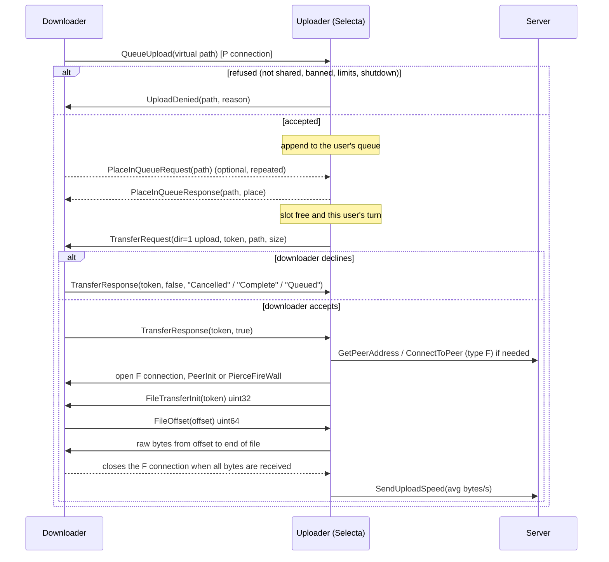

# Sharing and uploads — share index, answering searches, upload queue

> Status: **DRAFT in progress** — sections 3–4 verified against source; sections 5–10 still being filled
> (`TODO(verify)` = from memory, not yet checked). Researched 2026-10-19. Clones and commits are listed in §11.

## 1. TL;DR

- Shares are exposed as **virtual paths** (`<alias>\sub\dir\file.ext`, backslash-separated). Local absolute paths
  never go on the wire. Incoming requests must be resolved **only by looking the virtual path up in the share index**,
  never by building a filesystem path from peer input.
- A sharer must answer: **browse** (peer 4 → 5, one zlib blob per permission level, precomputed), **folder contents**
  (36 → 37), **searches** (server code 26 for user/room searches, distributed `DistribSearch` from the parent, or
  server 93 when we are a branch root) answered with **FileSearchResponse** (peer 9, sent over a P connection we
  open), **QueueUpload** (43), legacy **TransferRequest direction 0** (40) still sent by slskd/Seeker, **PlaceInQueue**
  (51 → 44), **UserInfo** (15 → 16). It reports **SharedFoldersFiles** (server 35) after login and after each rescan,
  and **SendUploadSpeed** (server 121) after each completed upload.
- Search answering = in-memory **inverted index** of lower-cased words of the virtual path; AND of included words,
  `-word` exclusions, `*suffix` partial words (match words *ending* with the term), at least one complete word
  required, server **excluded phrases** filtered as substrings, result cap (Nicotine+ 300, slskd 500). Requests arrive at
  **~30/s** (slskd maintainer's measurement), so each must cost ≪ 33 ms.
- See §9 for upload-queue and macOS recommendations (filled in later sections).

## 2. Key findings

1. **The share list is precomputed and cached as compressed bytes** per permission level (Nicotine+ keeps four:
   public, buddy, trusted, banned = empty). Browse requests are then O(1); repeat requests from one user within 0.4 s
   are ignored (Nicotine+). (High confidence: `pynicotine/shares.py`.)
2. **Locked (buddy-only) shares are visible but not downloadable.** The private section of the share list and of
   search responses carries full file entries; clients render them with a lock. Nicotine+ only includes them for
   non-buddies if "reveal buddy shares" is on; aioslsk always includes them. (High.)
3. **Wire attributes are cheap and format-dependent**: lossy `{0 bitrate, 1 duration, 2 VBR}`; lossless
   `{1 duration, 4 sample rate, 5 bit depth}`. Extension string is sent empty by SoulseekQt and Nicotine+. (High.)
4. **No authoritative matching spec exists.** Nicotine+ (exact words, `*` = suffix, exclusions = whole words), slskd
   (SQLite FTS5 `unicode61` tokens — diacritic-insensitive by default — exclusions = substrings) and aioslsk (term map
   + regex, multi-part terms must be adjacent) differ in details. Official-client behaviour must be probed on a test
   network or inferred. (High that they differ; medium on what the official client does.)
5. **Banned users in SoulseekQt get "File not shared."**, not "Banned" (Nicotine+ protocol doc). Nicotine+ sends
   "Banned" (+ optional custom text) and an empty share list. (Medium-high.)
6. **Accepting a legacy download request (TransferRequest dir 0) is discouraged**: answer "Queued" and start the upload
   yourself later, so the F connection goes to the server-provided address of the real user (anti-spoofing).
   (High: Nicotine+ `slskmessages.py` TransferResponse docstring.)

## 3. How shares appear on the protocol

### 3.1 Virtual roots and path format

| Aspect | Nicotine+ (`pynicotine/shares.py`) | slskd (`src/slskd/Core/Options.cs`, `Shares/`) | aioslsk (`shares/model.py`) |
|---|---|---|---|
| Root name | User-chosen alias, default = folder basename; empty → `Shared`; `/` and `\` → `_`; `.`/`..` → `_`; de-duplicated with a numeric suffix (`get_normalized_virtual_name`) | `[alias]/abs/path` syntax; aliases must be unique, non-blank, no separators; relative paths, root mounts and `.`/`..` segments rejected at config validation | Generated alias per shared directory (`generate_alias`) |
| Separator on the wire | `\` | `\` (stored as "maskedFilename") | `\` (`normalize_remote_path` collapses `/` and repeated separators) |
| Virtual → real | `virtual2real`: alias prefix replace, then **authorisation by membership** of the real path in the shared-files DB (`file_is_shared`); unknown alias → `__INVALID_SHARE__` sentinel | Exact lookup `SELECT originalFilename, size FROM files WHERE maskedFilename = ?`, then a stat to check existence and size (triggers a rescan on mismatch) | Lookup of the remote path in the in-memory item set |
| Quirks | Backslashes inside macOS/Linux file names are replaced by `@@BACKSLASH@@` in the virtual name and reverted on download. A **lower-case path index** resolves paths that Soulseek NS lower-cases in `QueueUpload`. | — | Official clients reportedly don't answer folder-contents requests for unknown folders |

Takeaways for Selecta:
- The alias is all a peer learns about the local layout. Default it to the share folder's basename (e.g. `Collection`),
  never the user's home path or account name; let the user rename it.
- Resolve requests by **exact lookup of the NFC virtual path in the index** (plus a case-insensitive fallback for
  Soulseek NS), then re-check the file on disk before serving (see §7).

### 3.2 Share list (browse): `SharedFileListRequest` (peer 4) → `SharedFileListResponse` (peer 5)

Payload (zlib-compressed as a whole; Nicotine+ protocol doc, `SharedFileListResponse.make_network_message`):

```
uint32 ndirs
  repeat ndirs:
    string dir                (full virtual path, e.g. "Collection\Albums\Artist - Album (2020)")
    uint32 nfiles
      repeat nfiles:
        uint8  code = 1
        string filename       (basename only)
        uint64 size
        string extension      (SoulseekQt and Nicotine+ send ""; Soulseek NS needs "mp3" to show attributes)
        uint32 nattrs
          repeat: uint32 code, uint32 value
uint32 unknown = 0            (official clients always 0)
uint32 nprivdirs              (optional: locked / buddy-only folders, same layout)
  ...
```

- Nicotine+ emits an entry for **every scanned folder, including folders with no files**, and aioslsk emits every
  intermediate path. Selecta should do the same so trees render identically everywhere.
- Strings are UTF-8 (length-prefixed). Sizes are uint64.
- Nicotine+ precomputes the compressed message for each permission level after each scan and caches the bytes
  (`compressed_shares[...]`, "elaborate hack to save CPU"). Banned users get the empty variant.
- Size estimate (inference): ~90 B per file entry (name ≈ 45 B + fixed 21 B + three attributes 24 B) → ~9–10 MB raw for
  100k files, a few MB compressed. Build it off the main thread; keep it on disk, not only in RAM.
- Rate limit: Nicotine+ ignores a browse from the same user within 0.4 s of the previous one. Selecta should add a
  per-user token bucket (e.g. 3 browses / 10 min) since each response can be MBs of upload (see §7).

### 3.3 Folder contents: `FolderContentsRequest` (peer 36) → `FolderContentsResponse` (peer 37)

- Request: `uint32 token, string folder`. Response (zlib): `uint32 token, string folder, uint32 nfolders,` then
  folder entries in the share-list layout.
- The protocol doc says "with all subfolders", but Nicotine+ and aioslsk both reply with **exactly one folder entry
  (that folder's files, no subfolders)**; Nicotine+ replies with `nfolders = 0` for unknown or forbidden folders
  (aioslsk: "official clients don't respond at all" for unknown folders). Downloaders use this to fetch an album
  folder before queueing it. Selecta: one folder, files only; for unknown/forbidden folders send `nfolders = 0` (polite,
  cheap). `TODO(verify)` official-client behaviour on the local test network.
- Nicotine+ answers folder-contents for locked (buddy/trusted) folders to non-buddies only when "reveal" is on, so the
  locked files are listable but downloads get refused.

### 3.4 File attributes and cheap extraction

| Code | Meaning | Unit |
|---|---|---|
| 0 | Bitrate | kbps |
| 1 | Duration | seconds |
| 2 | VBR | 0/1 |
| 3 | Encoder | obsolete |
| 4 | Sample rate | Hz |
| 5 | Bit depth | bits |

Combinations in use (Nicotine+ protocol doc "File Attribute Combinations"):
- Soulseek NS, old SoulseekQt, Nicotine+ (lossy), Museek+, slskd (lossy): `{0, 1, 2}`.
- SoulseekQt ≥ 2015-06-12: `{0, 1}` for MP3/OGG/WMA/M4A; `{1, 4, 5}` for FLAC/WAV/APE; `{0, 1, 4, 5}` for WV.
- Nicotine+ and slskd (lossless): `{1, 4, 5}`.

Nicotine+ packing (`FileListMessage.pack_file_info`): a file counts as lossless when its bit depth is known; lossy
files send bitrate (rounded), duration, VBR flag; lossless send duration, sample rate, bit depth; any value outside
`0 < v < 2^32` is dropped. Extraction uses TinyTag (`tags=False, duration=True, image=False`) and skips files ≤ 128 B.
aioslsk uses mutagen with the same split.

Selecta: reuse the library scanner's TagLib audio properties (`AudioProperties::Fast`/`Average` read style — no tag or
artwork parsing needed for sharing) and only send attributes we trust: MP3 bitrate from the Xing/Info or VBRI header
(VBR flag from it), FLAC from STREAMINFO, WAV/AIFF from `fmt `/`COMM`. Cache them keyed by (path, size, mtime).
Non-audio files (cover.jpg, .cue, .log) are shared with no attributes.

### 3.5 Buddy-only / locked shares

| Client | Model |
|---|---|
| Nicotine+ | Three share groups: public, buddy, trusted (`PermissionLevel`). Buddies see public+buddy; trusted buddies see all. Non-buddies see buddy/trusted folders **in the private section only if "reveal buddy/trusted shares" is enabled** (default off). Counts reported in `SharedFoldersFiles` include buddy/trusted folders only when revealed. Our own username always gets *public* (anti-spoofing: users often add themselves as buddies). |
| aioslsk | Per-directory `DirectoryShareMode`: `everyone`, `friends`, `users` (explicit list). Locked items always go to the private list. |
| SoulseekQt | Has "buddy-only" folders shown locked to others (`TODO(verify)` exact UI semantics). |

Selecta (SHARE-4, P1): two levels are enough — **public** and **buddies-only** — with an off-by-default "show locked
folders to everyone" toggle. Download authorisation is always rechecked at `QueueUpload` time.

### 3.6 Server-side bookkeeping

| Message | Direction | Fields | When |
|---|---|---|---|
| `SharedFoldersFiles` (server 35) | → server | `uint32 dirs, uint32 files` | After login, after every rescan (Nicotine+ `send_num_shared_folders_files`, aioslsk `report_shares`). Counts are **public** folders/files (+ revealed buddy/trusted ones). Nicotine+ counts every scanned folder; aioslsk counts distinct folders that contain files. Not sent while a rescan is running. |
| `SendUploadSpeed` (server 121) | → server | `uint32 speed` (bytes/s) | After each **completed** upload, with that transfer's average speed (Nicotine+ `_file_connection_closed`). The server folds it into our `avgspeed`, which other users see in `GetUserStats` and which affects our position in the distributed network (parents must be faster). |
| `GetUserStats` (server 36) | ← server | `avgspeed, uploadnum, unknown, files, dirs` | Other users judge us (leech detection, e.g. slskd's leecher group) from `files`/`dirs`. The server does not send updates for our own user after the first watch; Nicotine+ fakes a local stats event after each rescan. |
| `UploadSlotsFull` (server 40) | — | — | Obsolete; don't send. |
| `PrivilegedUsers` (server 69) | ← server | list of usernames | At login; used to prioritise uploads. `AddToPrivileged` (91) is obsolete; check per user via `WatchUser`/`GetUserStatus` (privileged flag). |

### 3.7 `UserInfoResponse` (peer 16) fields driven by the upload manager

`string description, bool has_picture, [bytes picture], uint32 total_uploads (upload slots), uint32 queue_size,
bool slots_free, uint32 upload_permitted`. Upload-permission codes: 0 no one, 1 everyone, 2 users in list,
3 permitted users (this is about *receiving* files pushed to us, not our shares; Selecta: 0). Museek+ sends
`slots_free` as an int — parsers must tolerate a short tail.

## 4. Answering searches from a local index

### 4.1 Where search requests come from

| Source | Message | Notes |
|---|---|---|
| Distributed network | `DistribSearch` (distrib 3) from our parent: `uint32 unknown(=49, '1'), string username, uint32 token, string query` | The bulk of traffic. We must also forward it to our children if we accept any. |
| Branch root | `EmbeddedMessage` (server 93) wrapping a `DistribSearch` | Only when the server makes us a branch root. |
| User search / room search | `FileSearch` (server 26) *received*: `string username, uint32 token, string query` | Someone searching our shares specifically, or a room we joined. |
| Legacy | `FileSearchRequest` (peer 8) | Obsolete. |

The answer is a `FileSearchResponse` (peer 9), zlib-compressed, sent on a **P connection we open to the searcher**
(GetPeerAddress / ConnectToPeer, firewall piercing as for any peer connection). Volume: slskd's maintainer measured
search requests "very consistently at a rate of about 30 per second" (`src/slskd/Application.cs`,
`SearchResponseResolver`), and Nicotine+ calls its handler "accessed … several times per second". Both bound the
work: slskd runs at most 10 concurrent resolutions and **drops** requests when > 500 are queued (circuit breaker).

### 4.2 Matching semantics

What the three open implementations do:

| Step | Nicotine+ (`search.py` `_process_search_request`) | slskd (`SqliteShareRepository.Search`) | aioslsk (`SharesManager.query`) |
|---|---|---|---|
| Indexed text | Lower-cased **virtual folder path + basename**, punctuation (ASCII + Unicode list `utils.PUNCTUATION`) → space, split | Full masked path in an FTS5 table, default `unicode61` tokenizer (folds case and **removes diacritics** by default) | Lower-cased relative path (`subdir/filename`, without alias) split on `[\W_]` |
| Included words | Each must equal an indexed word (set intersection) | Each a quoted FTS5 token, ANDed | Each sub-term must be in the term map; multi-part terms then regex-matched as adjacent sequence |
| `*term` | Partial: indexed words **ending with** `term` (scan of the whole dictionary) | No special handling (FTS strips `*`) | Words ending with term |
| `-term` | Remove files containing that word | FTS `NOT`, plus case-insensitive **substring** post-filter | Regex: not present as a word |
| Exclusion-only query | No results ("require at least one complete word … matches official clients") | Dropped | No results |
| Minimum length | `min_search_chars` = 3 on the whole query string | — | — |
| Own searches | Ignored unless the token is ours (searching our own username) | — | — |
| Banned / ignored users | No response | No response (blacklist incl. CIDRs, regex request filters) | — |

Known non-conformities to decide on: diacritics (Nicotine+ does not fold, slskd does), whether the alias is
searchable (Nicotine+ yes, aioslsk no), substring vs word exclusions. Recommendation for Selecta (§9): words =
NFKC-normalised, case-folded, **diacritic-folded** tokens of the full virtual path split on non-alphanumerics; exact word
match; `*x` = suffix; `-x` = word exclusion; ≥ 1 included complete word; min total length 3. Folding diacritics
returns a superset of what a strict client returns, which is harmless (searchers filter by their own terms; their
client may drop non-matching results).

### 4.3 Excluded search phrases (server 160)

- `ExcludedSearchPhrases`: `uint32 n, n × string phrase`, sent by the server after login. "File paths containing
  such phrases should be excluded when responding to search requests" (Nicotine+ doc).
- Nicotine+: per candidate result, `phrase in virtual_path.lower()` → drop (and log). aioslsk: same on the query path.
  slskd: phrases appended to the query's exclusions and enforced by a case-insensitive substring check.
- Selecta: store the list (it can change between logins), lower-case/case-fold both sides, substring match on the full
  virtual path. Apply to **search responses** (required). Applying it to browse is not required by any client; leave
  browse unfiltered, but flag affected files in the Shares view so the user knows.

### 4.4 Result limits and response fields

`FileSearchResponse` (zlib): `string our_username, uint32 token, uint32 n, n × file entry (full virtual path),
bool slot_free, uint32 avg_speed, uint32 queue_length, uint32 unknown = 0, uint32 n_private, n_private × file entry`.

| Field | Nicotine+ | slskd |
|---|---|---|
| Result cap | `maxresults` = **300** (default) | `ResponseFileLimit` = **500** (range 100–5000) |
| `slot_free` | `is_new_upload_accepted()` (a slot or bandwidth headroom is free) | free slots in the *requester's group* |
| `avg_speed` | our `avgspeed` from the server's `GetUserStats` for ourselves | same (refreshed before responding) |
| `queue_length` | total queued uploads (privileged requester: privileged-only queue) | forecast position for that user |
| Ordering | sorted by path | `ORDER BY maskedFilename` |

Downloaders filter on these fields ("free slot", queue length, speed), so they must be honest. Never send an empty
response (all clients suppress it).

### 4.5 Index data structures and performance (100k+ files)

- Nicotine+ keeps `word → [file index]` lists (built during the scan) plus a file-path table, in custom memory-mapped
  pickled databases rebuilt by a separate scanner process. aioslsk keeps `term → WeakSet[item]` in memory. slskd uses
  SQLite FTS5 (`filenames` virtual table joined to `files`).
- Recommended for Selecta (C++): an immutable, rebuilt-on-change **in-memory inverted index**:
  - `std::vector<FileRec>` (virtual path id, size, attrs, share level), dictionary `token → sorted std::vector<uint32>`
    postings (or a flat CSR array), plus a sorted array of **reversed tokens** to answer `*suffix` with two binary
    searches instead of a dictionary scan.
  - Query: sort included postings by length, intersect smallest-first (galloping), subtract exclusions, stop at the cap,
    then run the excluded-phrase substring filter on survivors only.
  - Size (estimate): 100k files × ~12 tokens ≈ 1.2M postings × 4 B ≈ 5 MB + dictionary (~150k tokens) ≈ 3–5 MB. Query
    time: microseconds to ~1 ms. Swap the whole index atomically (`std::shared_ptr<const ShareIndex>`) after rescans so
    readers never lock.
  - Persist only the source rows (SQLite table `shared_files`); rebuild the in-memory index at startup (< 1 s for 100k
    rows, estimate). FTS5 is a valid alternative if memory matters, but suffix search and exclusions are awkward there.
- Budget per request: parse + match + serialise ≤ 1 ms typical; hard-drop requests if a bounded queue (e.g. 200) is
  full, as slskd does.

## 5. Upload management

### 5.1 Protocol flow



Rules from the sources:
- **The downloader closes the F connection**; "the uploader must not close it" (Nicotine+ doc, "Example Flow for
  Downloading a File"). Nicotine+ marks the upload finished when all bytes are sent and the socket closes, even if the
  downloader is still draining.
- **Legacy download requests** (`TransferRequest` direction 0, still sent by slskd and Seeker): Nicotine+ answers
  `TransferResponse(allowed=false, reason="Queued")`, enqueues the file and later starts a normal upload. Accepting
  directly would let a spoofed peer open the F connection itself (Nicotine+ `TransferResponse` docstring).
- `TransferResponse` with reason `Complete` = the downloader already has the whole file → mark finished;
  `Cancelled` → drop the upload. Any other reason string from the peer is mapped to `Cancelled` (Nicotine+ refuses
  "internal statuses as reason").
- **`UploadFailed(path)`** (peer 46) is sent when an active upload's F connection closes before the end (unless the
  user went offline). The downloader re-queues or ignores it.
- **`UploadDenied(path, reason)`** (peer 50) rejects a `QueueUpload` *and* previously queued files (e.g. on ban).
  Nicotine+ sends nothing for a duplicate `QueueUpload` of an already-queued file.
- `QueueUpload` arriving **during a rescan** is parked and replayed when the scan completes (Nicotine+
  `_pending_network_msgs`). Selecta avoids this by swapping indexes atomically (§4.5), but should still not deny files
  just because a scan is in progress.

### 5.2 Queues, slots, bandwidth, fairness, privileges

| | Nicotine+ (defaults from `config.py`) | slskd (`Options.cs`, `UploadQueue.cs`, `UploadGovernor.cs`) | Soulseek.NET (`SoulseekClient.cs`) |
|---|---|---|---|
| Concurrency model | `useupslots=True`, **`uploadslots=3`**; alternative mode: start another upload while total upload speed < `uploadbandwidth` = 50 KiB/s | Global `upload-slots` = **10**; per-group `Slots` (default unlimited, capped by global) | `MaximumConcurrentUploads` = 10 global |
| Per-user concurrency | **1 active upload per user** (users with an active upload are not candidates) | via Soulseek.NET | **`MaximumConcurrentUploadsPerUser` = 1** — "Soulseek NS can't handle concurrent downloads from the same source" |
| Order between users | **Round-robin** (`fifoqueue=False`): the user who has waited longest since their last upload activity (`_user_update_counters`); FIFO optional | Per group: `roundrobin` (default; by the time an upload became *ready*) or `firstinfirstout` (by enqueue time) | — |
| Priorities | Privileged users (server list, code 69) first: when any privileged user has queued files, only they are candidates. Buddies can be prioritised (`preferfriends` or per-buddy flag) | Groups ordered by `Priority`: built-in **privileged** group = priority 0, FIFO, all global slots; default = 1; leechers; user-defined groups | — |
| Speed limit | `use_upload_speed_limit` = unlimited; primary 1000 KiB/s, alternative 100 KiB/s; split per transfer or total (`limitby`) | Token bucket per group (refill every 100 ms), global limit default unlimited | Global token bucket |
| Queue position reply | Round-robin estimate: (privileged queued files) + number of queued users + position within the user's own queue | `ForecastPosition` per group | — |

`UserInfoResponse` and `FileSearchResponse` must expose the same numbers: total slots, queue size, "slot free",
average speed.

### 5.3 Per-user limits and denial reasons

Nicotine+ checks, in order (`_check_queue_upload_allowed`): banned (user or IP, optional geo-block) → already queued
→ pending shutdown → per-user queue limits (unless "no limits for buddies") → file is shared and visible to this user.

| Limit (Nicotine+ default) | Denial string |
|---|---|
| Queued files per user ≥ `filelimit` = **100** | `Too many files` |
| Queued bytes per user ≥ `queuelimit` = **10 000 MB** | `Too many megabytes` |
| Banned user/IP | `Banned` (or `Banned (custom text)`; default custom text "Banned, don't bother retrying") — **SoulseekQt sends `File not shared.` instead** |
| Not in index / not visible to this user | `File not shared.` (with the dot) |
| Read error at start | `File read error.` |
| Quitting after current uploads | `Pending shutdown.` |
| Legacy request accepted into queue | `Queued` (as a TransferResponse reason) |

Deprecated strings still seen from old clients: `Disallowed extension`, `File not shared` (no dot), `Remote file error`,
`User limit of x megabytes exceeded`, `User limit of x files exceeded`, `Blocked country` (Nicotine+ protocol doc).

slskd adds **daily and weekly** limits per group (files, megabytes, *failures*), computed from its transfer database
(`UploadService.cs` daily/weekly succeeded/failed counts). Limits apply to *queued* files; active ones don't count.

### 5.4 Bans, ignores, buddies, leecher rules

- **Ban** (Nicotine+): all of the user's uploads are cleared with `UploadDenied("Banned …")`; they get the empty
  share list, no search results, no folder contents. IP bans and country blocks use the address the server reports.
- **Ignore** is about chat/PMs and their search results; it does not by itself stop uploads (Nicotine+ keeps the two
  lists separate: `banlist`, `ignorelist`).
- **Buddies**: can see buddy-only shares; optionally exempt from queue limits (`friendsnolimits`, default off) or
  prioritised (`preferfriends`, default off). Our own username is never treated as a buddy for share access.
- **Leechers** (slskd): users whose server stats show fewer than `Files` = 1 shared files or `Directories` = 1 shared
  folders go to a "leechers" group that can get fewer slots, lower priority and a speed cap. Nicotine+ has no automatic
  leech rule. Statistics come from `GetUserStats`/`WatchUser`, so they can be stale or zero for users we never
  looked up; slskd treats unknown stats as "not a leecher".
- No client found auto-bans on behaviour (e.g. repeated cancels); bans are manual.

### 5.5 Resume, stalls, timeouts, cancellation

- **Resume**: the downloader's `FileOffset` (uint64) is the number of bytes it already has. Soulseek.NET rejects
  `offset > size`; Soulseek NS sends **−1 (0xFFFF…FF)** when its partial file is > 2 GB (Nicotine+ doc). Nicotine+
  just `seek()`s, so a bad offset stalls until the idle timeout. Selecta: `offset == size` → send nothing and wait for
  the close; `offset > size` → close and mark failed.
- **Timeouts (Nicotine+)**: 45 s from `TransferRequest` to the start of the transfer (15 s margin over slow
  indirect connections: Soulseek NS ~20 s, soulseeX ~30 s); idle connections closed after 60 s; uploads that failed with
  a connection timeout are re-queued every 3 minutes.
- **User goes offline** → queued and failed uploads for that user are aborted ("User logged off"); when they come
  back, nothing is restarted automatically (the downloader re-queues).
- **Persistence**: Nicotine+ reloads only *finished* uploads after a restart (`load_only_finished=True`); queued
  uploads are not restored — downloaders re-request them. slskd keeps everything in its transfer DB.
- Cancelling an active upload: close the F connection; the downloader sees a failure (and may retry later).

### 5.6 Statistics for the ratio (FAIR-3, SHARE-5)

- Nicotine+ counts `started_uploads`, `completed_uploads`, `uploaded_size` (**bytes added as they are sent, so
  partial uploads count**) for the session and all time (`transfers.py` `Statistics`).
- slskd derives per-user daily/weekly succeeded/failed files and bytes from its `Transfers` table.
- Selecta: one SQLite row per upload attempt (user, file id, virtual path, offset, bytes sent, start/end, outcome,
  reason), plus per-user rollups; the ratio uses **bytes actually sent** (including partial) and **files completed**,
  over session / 30 days / all time, mirroring the download side.

## 6. macOS share indexing

### 6.1 Initial scan

- How the others do it: Nicotine+ walks with `os.scandir` in a **separate process**, reuses metadata when
  `mtime` is unchanged, writes all databases, then hands them over; aioslsk walks with `os.walk` and extracts attributes
  in a process pool; slskd scans with `Environment.ProcessorCount` workers into SQLite. All three keep a
  `(path → mtime/size)` cache so rescans only re-read changed files.
- Selecta: two phases on a worker thread pool, never on the GUI thread:
  1. **Enumerate** (cheap): `fts(3)`/`readdir`+`fstatat`, or `getattrlistbulk(2)` (bulk names + attributes per
     directory, the fastest option on APFS — inference, measure), with `lstat` semantics. Record native name bytes,
     size, mtime, inode/device, `st_flags`. Expect seconds for 100k files on an SSD (estimate).
  2. **Attributes** (expensive): only for new/changed audio files, reading headers with TagLib's fast audio
     properties, parallel across cores, low I/O priority (`setiopolicy_np(IOPOL_TYPE_DISK, …, IOPOL_UTILITY)`) so
     playback and previews stay smooth.
- When a share root is (inside) the collection, **reuse the library scanner's rows** (LIB already reads TagLib
  properties) instead of a second scan; NFR-2 asks for < 5 min for a 100k-track initial scan.
- Publish atomically: build the new `ShareIndex` snapshot, swap the pointer, then send `SharedFoldersFiles`.

### 6.2 Change tracking: FSEvents vs `QFileSystemWatcher`

| | `QFileSystemWatcher` on macOS | FSEvents used directly |
|---|---|---|
| Backend | Qt's `QFseventsFileSystemWatcherEngine` (`qfilesystemwatcher_fsevents.mm`; selected in `createNativeEngine` for `Q_OS_MACOS`) | `FSEventStreamCreate`/`…RelativeToDevice` |
| Recursion | API is per path: every directory must be added; the engine stats and keeps a listing of each (`scanForDirEntries`) and restarts the stream when paths are added | One stream per share root watches the whole tree |
| History across restarts | Starts at `FSEventsGetCurrentEventId()`; no persistence → changes made while Selecta was closed are missed | Store the last event ID **and** `FSEventsCopyUUIDForDevice()` per volume; on start, replay since that ID ("the FSEvents service stores events in a persistent, per-volume database", `FSEvents.h`); UUID changed → full rescan |
| Overflow | Handles `MustScanSubDirs` by rescanning watched dirs | Same flag (plus `UserDropped`/`KernelDropped`, `RootChanged`) → rescan the subtree |
| Latency | 0.5 s, directory-level events | Configurable; directory-level events are enough |

Recommendation: a small Objective-C++ `FsEventsWatcher` (one stream per root, directory-level events, latency
≈ 2 s, `kFSEventStreamCreateFlagWatchRoot` to notice the root being moved/unmounted) that feeds **directory paths to
re-list**; the scanner diffs each listing against the index. Keep `QFileSystemWatcher` + periodic rescans as the
Linux/Windows fallback. Also do a slow full verification pass daily or at startup when idle (Nicotine+ rescans at
startup and daily at 00:00 by default).

### 6.3 Offline volumes and iCloud "dataless" files

- **Unmounted roots**: Nicotine+ **aborts a rescan if any share root is unreadable** ("Rescan aborted due to
  unavailable shares") so a missing external disk doesn't wipe the index. Selecta: track availability per root
  (path exists, same volume UUID as recorded); an offline root keeps its rows but is **excluded from browse, search,
  uploads and the counts sent to the server**; rescan when it reappears (DiskArbitration /
  `NSWorkspaceDidMountNotification`), then resend `SharedFoldersFiles`.
- **Dataless files** (iCloud Drive, "Optimise Mac Storage", third-party File Provider clouds): `st_flags &
  SF_DATALESS` (`0x40000000`, `<sys/stat.h>`). `stat` still returns the real size. In a normal GUI app a `read()`
  materialises the file (network download, reported ~1.8 s for a small file; can hang); with
  `setiopolicy_np(IOPOL_TYPE_VFS_MATERIALIZE_DATALESS_FILES, IOPOL_SCOPE_THREAD|PROCESS,
  IOPOL_MATERIALIZE_DATALESS_FILES_OFF)` reads fail immediately with `EDEADLK` (errno 11 on macOS). launchd jobs start
  with materialisation off (Qiita, Apple's iCloud Drive release note as quoted by MacRumors). Selecta: set the policy
  **off on scanner threads**, skip `SF_DATALESS` files (don't index them; show "N files are in iCloud only and are not
  shared"), and at upload time treat `EDEADLK` as `File read error.`. Never trigger iCloud downloads to serve a peer.

### 6.4 Exclusions

| Category | Rule |
|---|---|
| Selecta's own data | Inbox, preview cache, `Originals/` (OQ-2), incomplete downloads, app-support/DB folders — **excluded by canonical path and by (device, inode) of the folder**, even if the user shares a parent such as `~/Music` (PRD SHARE-1). |
| Hidden | Names starting with `.` (covers `.DS_Store`, `._*` AppleDouble, `.Spotlight-V100`, `.fseventsd`, `.Trashes`, `.TemporaryItems`, `.DocumentRevisions-V100`, `.localized`), and files with `UF_HIDDEN` in `st_flags`. Nicotine+'s default share filters are `.*`, `.*\`, `@eaDir\`, `#recycle\`, `#snapshot\`, `desktop.ini`, `Thumbs.db`. |
| Other system junk | `Icon\r`, `$RECYCLE.BIN`, `System Volume Information`, `Network Trash Folder`, `Temporary Items`, `.AppleDB`, `.AppleDesktop`, `.AppleDouble`. |
| Bundles / libraries | Packages (`*.app`, `*.photoslibrary`, `*.musiclibrary`, …) and DJ software databases (`PIONEER/`, `rekordbox` exports, Serato `_Serato_`, Traktor `NI` folders) — suggested, decision for the maintainer. |
| Partial files | Selecta's own temp suffixes (e.g. `*.selecta-part`) and anything modified in the last few seconds (still being written). |
| File types | Decision (§9): share audio + cover images + text companions (`.cue`, `.log`, `.nfo`, `.txt`, `.pdf` booklets) only, or everything not hidden like Nicotine+. |

### 6.5 TCC (privacy prompts)

- TCC applies to non-sandboxed apps too. Protected (macOS 26): `~/Desktop`, `~/Documents`, `~/Downloads`, iCloud
  Drive, third-party cloud storage, **removable volumes**, **network volumes**, Time Machine backups (Eclectic Light,
  2026-04-20; Apple Platform Security guide). `~/Music` is not in that list (`TODO(verify)` on macOS 26: no prompt when
  reading `~/Music/...` files directly; the "Media & Apple Music" permission covers the Music library *APIs*).
- **User intent wins**: a folder the user picks in an open panel can be read without a prompt, and the grant persists
  (stored as a MACL extended attribute). Qt's native `QFileDialog` is an `NSOpenPanel`, so **adding a share via the
  folder picker is the right flow**. Shares restored at startup in protected locations may prompt once, from the
  scanner; add `NSDocumentsFolderUsageDescription`, `NSDesktopFolderUsageDescription`,
  `NSDownloadsFolderUsageDescription`, `NSRemovableVolumesUsageDescription`, `NSNetworkVolumesUsageDescription` to
  `Info.plist`.
- Volumes mounted at boot don't seem to count as "removable"; volumes mounted later do (Eclectic Light testing).
- Ad-hoc/unsigned builds: TCC keys grants to the code signature, so every rebuild can look like a new app; one report
  says such builds sometimes get `EPERM` with no prompt at all. Treat `EPERM` on a share root as "permission needed",
  show a fix-it ("re-select the folder" / Full Disk Access) rather than "folder empty". Never interpret a TCC denial as
  "all files deleted".

### 6.6 Symlinks, aliases, hard links

- Nicotine+ follows symlinked directories (`DirEntry.is_dir()` follows links) and only dedups by virtual path, so a
  loop recurses until the OS returns `ELOOP`. aioslsk uses `os.walk` (doesn't follow directory links by default).
- Selecta: **don't follow symlinks by default** (`lstat`); optional "follow links that stay inside a share root";
  dedupe directories by `(dev, ino)` to break cycles. Finder aliases are regular files (bookmark data) — skip them.
  Hard links: share each path (they are legitimately separate entries).

### 6.7 Unicode normalisation (NFD vs NFC) and odd characters

- Qt on Darwin: `QFile::encodeName()` → **NFD** UTF-8; `QFile::decodeName()` and directory iteration
  (`qfilesystemiterator_unix.cpp`) → **NFC** (`qfile.h`, `#ifdef Q_OS_DARWIN`). APFS preserves the stored form and
  looks names up normalisation-insensitively; HFS+ stores NFD.
- Peers (mostly Windows) send NFC; search terms arrive NFC. So: **wire names and index tokens = NFC**; keep the
  **native byte path** from `readdir` in the index and open files with those exact bytes (POSIX `open`), so files on
  exFAT/SMB/NFS volumes whose names aren't NFD still open (`TODO(verify)`: Qt NFD re-encoding vs NFC names on an SMB
  or exFAT volume).
- Backslash in a macOS file name conflicts with the wire separator: replace it in the virtual name (Nicotine+ uses
  a sentinel) and map back through the index, not by string replacement.
- Names that aren't valid UTF-8 (rare on macOS): skip and log.

## 7. Security

| Threat | Mitigation |
|---|---|
| **Path traversal** via `QueueUpload`, legacy `TransferRequest`, `FolderContentsRequest`, `PlaceInQueueRequest` | Never build a filesystem path from peer input. Look the (NFC, `\`-separated) virtual path up in the index; unknown → `File not shared.`. Reject NUL/control characters and over-long strings early; log `..`/absolute-path attempts as hostile. |
| **Serving something not shared** (index stale, file replaced by a symlink, excluded folder) | At open time: index row → stored native path → `open(O_RDONLY | O_NOFOLLOW | O_CLOEXEC)` → `fstat`: regular file, same `(dev, ino)` as indexed, not `SF_DATALESS`, inside an online root. Size changed → use the new size in `TransferRequest` and schedule a rescan (slskd does the same). |
| **Permission changes between queue and start** (ban, buddy removed, share level changed) | Re-check permission when dequeuing (Nicotine+ re-runs `file_is_shared` in `_check_upload_queue`) and at F-connection time. |
| **Spoofed peers** | Initiate F connections ourselves to the server-provided address after `TransferResponse(allowed)`; don't accept legacy download requests directly; accept incoming F/`PierceFireWall` only for tokens we issued to that user; don't grant buddy rights to our own username. |
| **Resource exhaustion** | Per-user token buckets for browse, folder contents, user info, place-in-queue and queue requests; per-user queue limits; a global queue cap (e.g. 10 000 entries); bounded concurrent browse transmissions (e.g. 2) and search responses; drop incoming searches when the bounded work queue is full (slskd circuit breaker 500 / concurrency 10). |
| **Bad offsets / protocol abuse** | Validate `FileOffset ≤ size`; idle timeout on F connections (Nicotine+ 60 s); 45 s for a requested upload to start. |
| **Information leaks** | Only aliases on the wire; error strings are fixed constants (no `strerror`, no paths); logs stay local (NFR-5). |
| **Hostile parent flooding searches** | Searches only read the immutable index; bounded queue + per-request cap; log rates in the activity log (SAFE-4). |

## 8. Design sketch: ShareIndex + UploadManager

TODO — being written.

## 9. Implications for Selecta

TODO — recommendations, proposed defaults, decisions.

## 10. Open questions / verify on the local test server

TODO

## 11. Sources

Clones (shallow, read-only) under `local/research-clones/sharing/`, accessed 2026-10-19:

| Repo | Commit (date) | Licence | Use |
|---|---|---|---|
| nicotine-plus/nicotine-plus | `f3b9d4d` (2026-10-18) | GPL-3.0-or-later | `pynicotine/shares.py`, `search.py`, `uploads.py`, `transfers.py`, `slskproto.py`, `slskmessages.py`, `config.py`, `doc/SLSKPROTOCOL.md` |
| slskd/slskd | `6a450e4` (2026-10-18) | AGPL-3.0-only (read for ideas only; do not copy code) | `src/slskd/Core/Options.cs`, `Shares/SqliteShareRepository.cs`, `Transfers/Uploads/*.cs`, `Users/UserService.cs`, `Application.cs` |
| JurgenR/aioslsk | `a90ad82` (2026-10-11) | GPL-3.0 (`TODO(verify)` exact SPDX) | `src/aioslsk/shares/*.py`, `search/model.py` |
| jpdillingham/Soulseek.NET | `c07c187` (2026-10-11) | GPL-3.0 (`TODO(verify)`) | `src/SearchQuery.cs`, message builders |
| qt/qtbase (sparse: `src/corelib/io`) | `dd7a64e` (2026-10-19) | LGPL-3.0/GPL | QFileSystemWatcher backends, `QFile::decodeName` |
