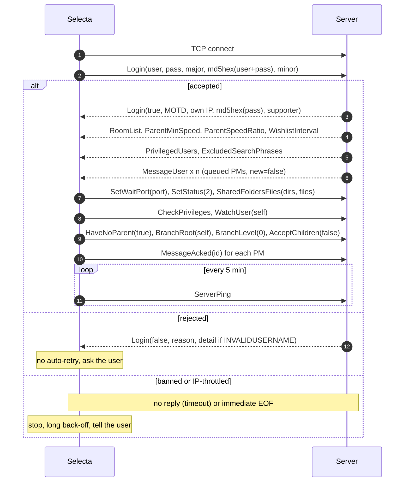
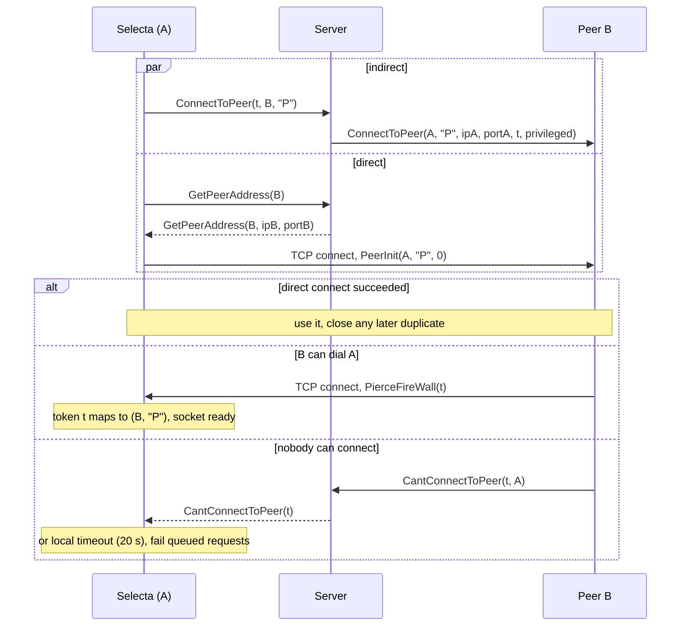
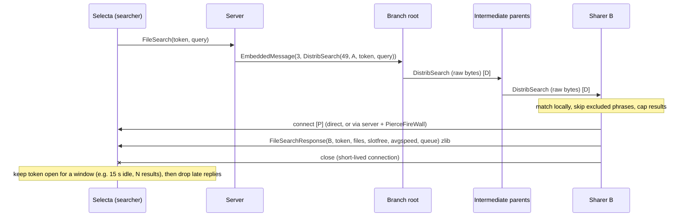
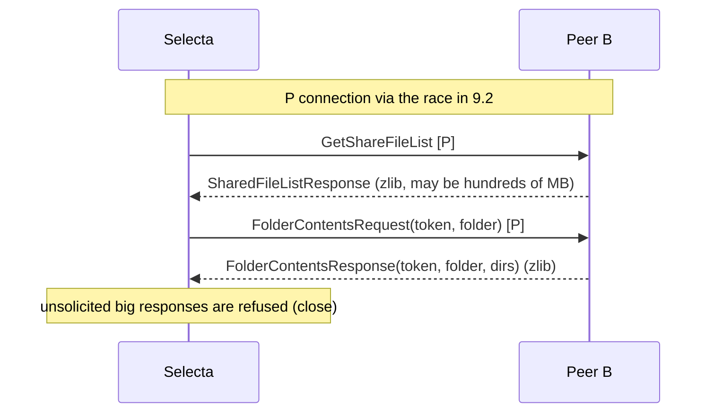
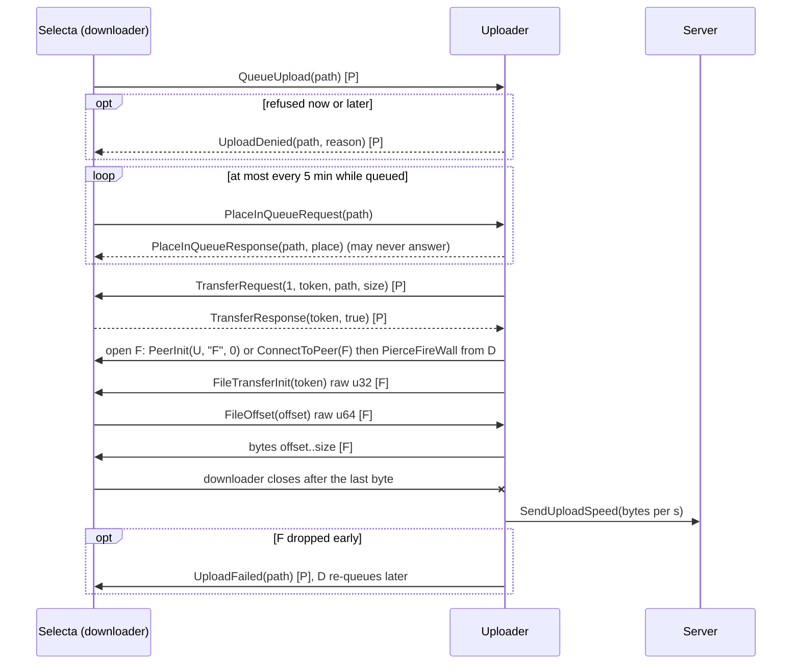
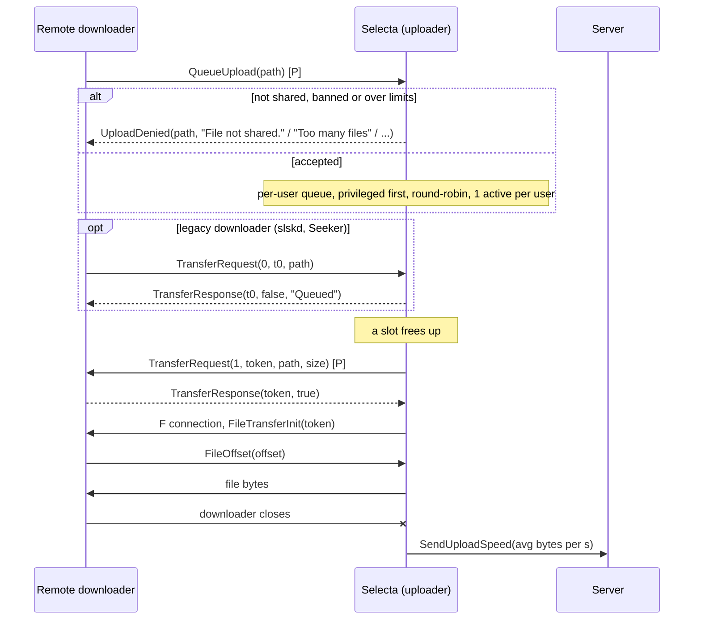
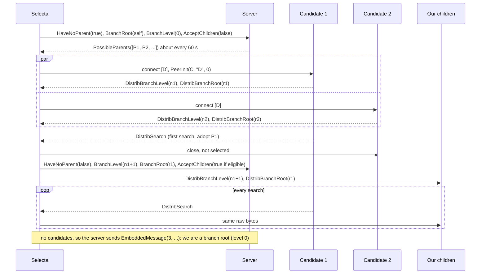

# Soulseek protocol — implementation reference for Selecta

> Status: **DRAFT in progress.** Sections 1–8 are written from the Nicotine+ protocol document and spot-checked
> against Nicotine+ code; items marked **TODO** are not yet verified. Compiled 2026-10-19.
> Primary source: Nicotine+ `doc/SLSKPROTOCOL.md` ("Last updated on August 27, 2026", repo commit `f3b9d4d`),
> cited below as **[N+doc]**; Nicotine+ code `pynicotine/*.py` at the same commit as **[N+]**.

## TL;DR

- Soulseek is a **central server + direct peer** network. One long-lived TCP connection to the server (login,
  presence, address lookup, NAT-traversal brokering, private messages, search injection). Everything else (search
  results, browsing, transfers) is **peer-to-peer over TCP**, opened directly or "indirectly" (the server asks the
  other peer to connect back to us).
- **The server does not answer searches.** A query is injected into a **distributed tree of clients**; every sharer
  matches it against its own files and, on a match, **connects to the searcher** and sends the results.
- Framing is trivial: `uint32 length (LE)` + code + payload. Server and peer codes are `uint32`; peer-init and
  distributed codes are `uint8`. Strings are `uint32 length + bytes` (UTF-8; decode falls back to Latin-1). Share
  lists, search results and folder contents are **zlib** streams. IPv4 only.
- Downloads are **queue-based**: downloader sends `QueueUpload(path)`; when a slot frees up the uploader sends
  `TransferRequest(direction=upload, token, path, size)`; the downloader answers `TransferResponse(token, allowed)`;
  the uploader opens an `F` connection, sends `token`, the downloader sends a `uint64` resume offset, raw bytes follow.
  **The downloader closes the `F` socket** when it has everything.
- **Client identification is a registry**: major version `157` = official, `160` = Nicotine+, `170` = Soulseek.NET,
  `175` = aioslsk, `176` = soulseek-rs, `169` = seeleseek; **`177` = experimental development**. Selecta must not
  reuse another client's number (see §4.2, §12).
- MVP subset: ~30 server messages, 13 peer messages, 4 distributed messages and the file handshake. Chat rooms,
  interests, tickers and private rooms can be decoded-and-dropped (framing makes skipping trivial).

## Key findings

TODO — filled after source verification (Soulseek.NET, aioslsk, Soulfind, Nicotine+ code).

## Contents

1. Architecture overview
2. Wire format
3. Connections (P/F/D, PeerInit vs PierceFireWall, direct vs indirect, tokens, timeouts, NAT, obfuscation)
4. Server messages (full table, login, MVP notes)
5. Peer-init messages
6. Peer messages (share lists, search results, user info, transfers)
7. File connections and transfers
8. Distributed network
9. Sequence diagrams
10. Search semantics
11. Keep-alives, timeouts and reconnect
12. Implications for Selecta (MVP subset, implementation order, defaults, decisions)
13. Open questions / verify on a local test server
14. Sources

---

## 1. Architecture overview

| Component | Transport | Purpose |
|---|---|---|
| Server (official: `server.slsknet.org:2242` — **never contacted from dev/test/CI**; Soulfind locally) | 1 long-lived TCP connection per client | Login, status/stats, user address directory, `ConnectToPeer` brokering, private messages (stored until acked), chat rooms, interests, privileges, distributed-network management, search injection, parameters (wishlist interval, excluded phrases, parent speed rules) |
| Peer connection, type `P` | TCP, framed, `uint32` codes | Search results, browse (share list), folder contents, user info, transfer negotiation, queue position. **One active `P` connection per peer** [N+doc §Peer Messages]. |
| File connection, type `F` | TCP; 4-byte token, 8-byte offset, then raw bytes | Exactly one file transfer per connection |
| Distributed connection, type `D` | TCP, framed, `uint8` codes | Search propagation tree (parent → children). One active `D` connection per peer. |

Facts that shape the design:

- **The listening port matters.** A client that cannot accept incoming connections can still talk to *reachable*
  peers: it dials them directly, and when they want to reach it they ask the server (`ConnectToPeer`) and it dials
  back with `PierceFireWall`. Two unreachable peers cannot talk at all. Search results are delivered by the
  *responder* connecting to the searcher, so an unreachable searcher only gets results from reachable responders.
  See §3.
- **IPv4 only**: every address field is a `uint32`. There is no IPv6 in the protocol.
- **Server-side "username" namespace**: the pseudo-user `server` is used for server notices sent as private
  messages; Nicotine+ rejects peers claiming that name ([N+] `slskproto.py:354, 1718-1722`).
- The official server and client are proprietary; everything here is reverse-engineered [N+doc intro]. The N+ doc
  explicitly asks implementers not to extend the protocol without the Soulseek administrators' approval, and to
  prefer existing implementations because subtle bugs can harm the network.

## 2. Wire format

### 2.1 Primitive types [N+doc §Packing]

| Type | Encoding |
|---|---|
| `uint8` | 1 byte |
| `uint16` | 2 bytes, little-endian (only used for the obfuscated port in `GetPeerAddress`) |
| `uint32` | 4 bytes, little-endian |
| `int32` | 4 bytes, little-endian, signed (`SetStatus` status, `DistribBranchLevel`) |
| `uint64` | 8 bytes, little-endian (file sizes, file offset) |
| `bool` | 1 byte, 0 or 1 (decode: non-zero = true) |
| `string` | `uint32` byte length + bytes, no terminator |
| `bytes` | `uint32` length + raw bytes (user picture). **Exception:** in `EmbeddedMessage` the "bytes" field is the *rest of the message with no length prefix* ([N+] `slskmessages.py:2127-2129` reads `uint8 code` then `message[offset:]`). |
| `ip` | `uint32` LE whose value is the IPv4 address in host order: wire bytes `04 03 02 01` = `1.2.3.4`. In Qt: `QHostAddress(quint32(readU32LE()))` ([N+] `slskmessages.py:361-364` reverses the 4 bytes before `inet_ntoa`). |
| list | `uint32` count, then items (no list type of its own; every list in the doc is "uint32 n, iterate n") |

### 2.2 Strings and encodings

- Send UTF-8. Decode UTF-8, and on invalid UTF-8 fall back to Latin-1 ([N+] `slskmessages.py:340-354`).
- Old clients (Soulseek NS) use Latin-1/ANSI paths. Nicotine+ keeps a per-transfer `legacy_attempt` flag and
  re-sends `QueueUpload`, `PlaceInQueueRequest` and `FolderContentsRequest` with the path **encoded as Latin-1**
  when the peer answers `File not shared.` or when the upload fails once ([N+] `slskmessages.py:3628, 3852, 3948`;
  `downloads.py:1261-1270, 1306-1316`).
- **Design consequence for Selecta:** keep every remote path as the **original raw bytes** received from the peer
  (plus a decoded display string), and echo the raw bytes back in requests. That removes most encoding round-trip
  bugs; the Latin-1 retry then becomes a fallback only for paths typed or reconstructed locally.
- Remote paths use `\` as separator (Windows style) regardless of the peer's OS (TODO: confirm with [N+]
  `shares.py`). Never trust them: they are display data and lookup keys, never local paths.

### 2.3 Message envelopes

| Channel | Envelope | Notes |
|---|---|---|
| Server | `uint32 len` · `uint32 code` · payload | `len` counts code + payload (not itself) |
| Peer-init (first message on every peer socket) | `uint32 len` · `uint8 code` · payload | Code 0 `PierceFireWall`, 1 `PeerInit` |
| Peer (`P`) | `uint32 len` · `uint32 code` · payload | |
| Distributed (`D`) | `uint32 len` · `uint8 code` · payload | |
| File (`F`) | none: `uint32 token` (uploader → downloader), `uint64 offset` (downloader → uploader), then raw bytes | |

Unknown codes are skipped using `len`; an implementation never needs to understand a message to stay in sync.

### 2.4 Compression

`SharedFileListResponse` (peer 5), `FileSearchResponse` (peer 9) and `FolderContentsResponse` (peer 37): the entire
payload after the code is a **zlib stream** (RFC 1950 header + deflate, i.e. `compress()`/`uncompress()` format, not
raw deflate, not gzip). Nicotine+ compresses at level 4 (`ZLIB_COMPRESSION_LEVEL = 4`, [N+] `slskmessages.py:42`).
Use streaming inflate with a hard output cap; reject trailing garbage or truncated streams
(`decompressor.eof` check, [N+] `slskmessages.py:3385-3392`).

### 2.5 Size limits (bounded allocation — NFR-4)

Nicotine+'s inbound limits ([N+] `slskproto.py:340-353, 1530-1540, 1745-1757, 1910-1935, 2545-2556`;
`slskmessages.py:3387, 3509, 3677`):

| Channel / message | Max framed size | Max decompressed |
|---|---|---|
| Server, any message | 448 MiB (then close + no auto-reconnect) | — |
| Peer-init | 16 KiB | — |
| Peer, default | 1 MiB | — |
| Peer `FileSearchResponse`, `FolderContentsResponse`, unknown codes | 16 MiB | 128 MiB |
| Peer `SharedFileListResponse`, `UserInfoResponse` | 448 MiB, **only if we requested it** (unsolicited ones close the connection) | 2 GiB (share list) |
| Distributed | 16 KiB | — |
| Username in `PeerInit` | 256 bytes (real limit 30 chars) | — |

Selecta should copy this structure (per-message caps, "solicited-only" for big responses) with possibly tighter
values; the parser must never pre-allocate from a length or count field without checking it against the bytes
remaining.

Other implementations, for contrast:
- **Soulseek.NET has no upper bound** on inbound message length (it reads `length − 4` bytes for any length; only
  negative lengths and strings longer than the payload are rejected) — `src/Network/MessageConnection.cs:228-242`,
  `src/Network/ListenerHandler.cs:70-73` @ `c07c187`. Do not copy.
- **Soulfind disconnects a client that sends a frame larger than 8 192 bytes** (`src/defines.d:28`,
  `src/server/conns.d:277-284` @ `5a256f5`). Every message Selecta sends to the server is far smaller, but keep
  outbound server messages (PMs, long queries) bounded; the official server's limit is unknown.
- Soulseek NS sends file sizes > 2 GB as a negative 32-bit value sign-extended to 64 bits: if the `u64` has all
  high 4 bytes `0xFF`, use the low 4 bytes as `uint32` (Soulseek.NET `src/Messaging/MessageReaderExtensions.cs:43-79`).

## 3. Connections

### 3.1 Connection types and the init handshake

Every peer socket starts with exactly one peer-init message from the side that *opened* the TCP connection:

| Message | Sent by | Meaning |
|---|---|---|
| `PeerInit(own_username, type, token=0)` | the side that initiates a **direct** connection | "I am `own_username`, this socket is of type `P`/`F`/`D`." The token is always 0 today (it used to pair with the obsolete `SendConnectToken`) [N+doc §Peer Init Code 1]. |
| `PierceFireWall(token)` | the side answering an **indirect** request | "You asked the server for me with this token." The receiver looks up the token it sent in `ConnectToPeer` to learn the username and type. |

After the init message the socket carries messages of its type (`P`, `D`) or the file handshake (`F`).

### 3.2 Direct vs indirect ("modern" order) [N+doc §Modern Peer Connection Message Order]

Used by SoulseekQt, Nicotine+ ≥ 3.2.1 and Soulseek.NET clients. User A wants to reach user B:

1. A sends `ConnectToPeer(token, B, type)` to the server **and** `GetPeerAddress(B)` — at the same time.
2. Server answers `GetPeerAddress(B, ip, port, …)`; A dials B and sends `PeerInit`.
3. Server forwards `ConnectToPeer(A, type, A.ip, A.port, token, privileged, …)` to B.
4. If B already got A's `PeerInit`, the direct connection wins. Otherwise B dials A and sends `PierceFireWall(token)`.
5. If B can't reach A either, B sends `CantConnectToPeer(token, A)` to the server, which relays
   `CantConnectToPeer(token)` to A. **Do not rely on it**: keep a local timeout [N+doc §1001].

Legacy order (Soulseek NS, Nicotine+ ≤ 3.2.0, Museek+): direct first, `ConnectToPeer` only after the direct
attempt fails; NS retries the indirect request every 20 s up to three times [N+doc §Legacy].

Rules that follow:

- A `GetPeerAddress` reply with **IP 0.0.0.0 / port 0** means "user not connected" (aioslsk
  `docs/source/SOULSEEK.rst:75-78, 915-923`; Soulfind `msghandler.d:72-88`; Soulseek.NET throws
  `UserOfflineException`, `src/SoulseekClient.cs:4240-4243`).
- A `ConnectToPeer` for an offline user is answered at once with `CantConnectToPeer(token)` by the server
  (aioslsk `SOULSEEK.rst:91-105`; Soulfind `msghandler.d:198-216`).
- **Race, don't sequence.** Soulseek.NET runs the direct and the indirect attempt in parallel for `P`, `F` and `D`
  connections; the first to complete wins and the other is cancelled (`src/Network/PeerConnectionManager.cs:453-491,
  609-642`, `src/Network/DistributedConnectionManager.cs:869-902`). aioslsk's docs call this the "race method"
  and note the legacy fallback order is slow (`SOULSEEK.rst:50-55`).
- Whoever has data to send opens the connection; if a usable `P` connection to that user already exists (either
  direction), reuse it. If both a direct and an indirect socket end up established, keep one and close the other
  (Soulseek.NET: an inbound direct `PeerInit P` replaces the cached connection, `PeerConnectionManager.cs:106-172`).
- Incoming `ConnectToPeer` from the server = a *request to connect out*; answer with `PierceFireWall` on a new
  outbound socket, or `CantConnectToPeer(token, user)` if it fails. (Soulseek.NET never sends `CantConnectToPeer`,
  `src/Messaging/Messages/Server/CannotConnect.cs:88-102` — another reason not to rely on receiving it.)
- For `F` solicitations, only dial back if we actually expect a transfer from that user (Soulseek.NET handles
  `ConnectToPeer(F)` only for a known download, `ServerMessageHandler.cs:374-399`); for `D`, only if we accept
  children.
- Timers in the wild: Nicotine+ `CONNECTION_INIT_TIMEOUT = 2` s, `INDIRECT_REQUEST_TIMEOUT = 20` s, idle peer
  connection closed after `CONNECTION_MAX_IDLE = 60` s (10 s for "ghost" connections), cached user address TTL
  30 min ([N+] `slskproto.py:340-344`). Soulseek.NET: connect timeout 10 s, peer inactivity timeout **15 s** (idle
  `P` connections die after 15 s), request/response wait 5 s (`src/Options/ConnectionOptions.cs:47-54`,
  `src/Options/SoulseekClientOptions.cs:112-145`).

### 3.3 Tokens

`uint32`, chosen by the client, unique among its outstanding requests. Used for `ConnectToPeer`/`PierceFireWall`,
searches (`FileSearch`, `UserSearch`, `WishlistSearch`; echoed in `FileSearchResponse`), transfers
(`TransferRequest` → `FileTransferInit`) and `FolderContentsRequest`. Tokens are not authenticators: a peer
can echo any token. Validate against (username, token, expected state).

### 3.4 NAT, port forwarding, obfuscation

- Default listen port **2234** [N+doc §2]; reported with `SetWaitPort` after login.
- Reachability decides connectivity: reachable↔anyone works; unreachable↔unreachable fails. UPnP/NAT-PMP (NET-3)
  and a port check therefore matter for result counts and upload contribution.
- **Obfuscation** (type 1, "rotated") is a SoulseekQt scheme for a second, obfuscated listening port (usually
  port + 1), advertised as optional fields of `SetWaitPort` and returned in `GetPeerAddress`/`ConnectToPeer`. Only
  `P` traffic and the init messages are obfuscated: each message is prefixed by a random 4-byte key; every 4-byte
  block is XORed with the key rotated left by 1 bit (aioslsk: "circular shift of 31 bits to the right"), the
  rotated key feeding the next block (aioslsk `docs/source/SOULSEEK.rst:33-43, 148-258`, with a worked example).
  Nicotine+ deliberately does not support it (no evidence of ISP throttling today; one forwarded port is simpler)
  [N+doc §2]; Soulseek.NET does not either (comment at `src/SoulseekClient.cs:4701-4702`); Soulfind only stores and
  relays the fields. Selecta: do not implement; parse and ignore the fields; send `SetWaitPort(port)` only.

## 4. Server messages

### 4.1 Table

Legend — **Dir**: `→` client to server, `←` server to client. **Selecta**: `P0` = MVP, `P1` = v1.0, `parse` = decode
(to stay robust / log) but no feature, `drop` = skip by length, never send. Field notation: `str`, `u8`, `u32`, `i32`,
`u64`, `bool`, `ip`, `[ … ]` = list (u32 count + items). Source: [N+doc §Server Messages] unless noted.

| Code | Name | Dir | Fields | Purpose / notes | Status | Selecta |
|---|---|---|---|---|---|---|
| 1 | Login | → ← | → `str user, str pass, u32 major, str md5hex(user+pass), u32 minor`; ← `bool ok`; ok: `str greet(MOTD), ip own_ip, str md5hex(pass), bool supporter`; fail: `str reason` [+ `str detail` if `INVALIDUSERNAME`] | First message. See §4.2 | active | P0 |
| 2 | SetWaitPort | → | `u32 port` [opt: `u32 obfuscation_type, u32 obfuscated_port`] | Our listening port | active | P0 |
| 3 | GetPeerAddress | → ← | → `str user`; ← `str user, ip, u32 port, u32 obfuscation_type, u16 obfuscated_port` | Address lookup | active | P0 |
| 5 | WatchUser | → ← | → `str user`; ← `str user, bool exists`; exists: `u32 status, u32 avgspeed, u32 uploadnum, u32 unknown, u32 files, u32 dirs`; if status away/online: `str countrycode` | Subscribe to status changes (`GetUserStatus` pushes). Stats are a snapshot, not updated later. `uploadnum` rolls over; incremented by `SendUploadSpeed`. Soulseek.NET/aioslsk read `uploadnum`+`unknown` as one `u64` — same bytes. Watching yourself is implicit (Soulfind) and aioslsk notes no `GetUserStatus` for self ever arrives | active | P0 |
| 6 | UnwatchUser | → | `str user` | | active | P0 |
| 7 | GetUserStatus | → ← | → `str user`; ← `str user, u32 status, bool privileged` | status 0 offline, 1 away, 2 online | active | P0 |
| 11, 12 | IgnoreUser, UnignoreUser | | `str user` | no longer functional | obsolete | drop |
| 13 | SayChatroom | → ← | → `str room, str msg`; ← `str room, str user, str msg` | chat rooms | active | drop (non-goal) |
| 14 | JoinRoom | → ← | → `str room, u32 private`; ← room + users + statuses + stats + slotsfull + countries [+ owner, operators] | chat rooms | active | drop |
| 15–17 | LeaveRoom, UserJoinedRoom, UserLeftRoom | | | chat rooms | active | drop |
| 18 | ConnectToPeer | → ← | → `u32 token, str user, str type`; ← `str user, str type, ip, u32 port, u32 token, bool privileged, u32 obfuscation_type, u32 obfuscated_port` | Indirect connection request / solicitation (§3.2) | active | P0 |
| 22 | MessageUser | → ← | → `str user, str msg`; ← `u32 id, u32 timestamp, str user, str msg, bool new` | Private message. `new=false` = re-delivery of an offline/unacked message. Messages from user **`server`** are server notices (e.g. "connection restricted", errors), and Soulfind's admin commands are PMs to/from `server` | active | P0 receive+ack, P1 UI |
| 23 | MessageAcked | → | `u32 id` | **Must ack** or the server keeps re-sending | active | P0 |
| 25 | FileSearchRoom | → | `u32 token, u32 room_id, str query` | superseded by 120 | obsolete | drop |
| 26 | FileSearch | → ← | → `u32 token, str query`; ← `str user, u32 token, str query` | Send: global search. Receive: a `UserSearch`/`RoomSearch` aimed at us, delivered outside the distributed network | active | P0 |
| 28 | SetStatus | → | `i32 status` (1 away, 2 online) | Server echoes `GetUserStatus` only when going away | active | P0 |
| 32 | ServerPing | → | empty | Keep-alive, "at most once per minute"; server no longer replies (Soulfind doesn't either); Nicotine+ uses TCP keepalive instead; aioslsk pings every 300 s | active | P0 (every 5 min + TCP keepalive) |
| 33 | SendConnectToken | → ← | `str user, u32 token` | forwarded by server, used by nobody; re-adding it would isolate the client | obsolete | drop |
| 34 | SendDownloadSpeed | → | `str user, u32 speed` | superseded by 121 | obsolete | drop |
| 35 | SharedFoldersFiles | → | `u32 dirs, u32 files` | Our share counts (shown to others) | active | P0 |
| 36 | GetUserStats | → ← | → `str user`; ← `str user, u32 avgspeed, u32 uploadnum, u32 unknown, u32 files, u32 dirs` | On request, or pushed for room co-members | active | P0 parse, P1 request |
| 40 | UploadSlotsFull | → ← | `u32 slotsfull` | | obsolete | drop |
| 41 | Relogged | ← | empty | Someone logged in with our name; server disconnects us. Soulfind also sends it before disconnecting a deleted account, "to stop the client re-registering". **No auto-reconnect** (NET-4) | active | P0 |
| 42 | UserSearch | → | `str user, u32 token, str query` | Search one user's shares; target receives code 26 | active | P1 |
| 50 | SimilarRecommendations | | | server sends empty list | obsolete | drop |
| 51, 52 | AddThingILike, RemoveThingILike | → | `str item` | interests | active | drop |
| 54, 56 | Recommendations, GlobalRecommendations | → ← | lists of `(str, i32)` | interests | active | drop |
| 55 | MyRecommendations | | | | obsolete | drop |
| 57 | UserInterests | → ← | `str user` → likes/hates lists | interests | active | drop |
| 58 | AdminCommand | | | | obsolete | drop |
| 59, 60 | PlaceInLineRequest/Response | | | superseded by peer 51/44 | obsolete | drop |
| 62, 63 | RoomAdded, RoomRemoved | | | | obsolete | drop |
| 64 | RoomList | → ← | 3 room lists with user counts | Sent unsolicited after login (rooms ≥ 5 users) | active | parse (skip) |
| 65 | ExactFileSearch | | | no results even with official client | obsolete | drop |
| 66 | AdminMessage | ← | `str message` | Global admin notice | active | P0 (show in activity log / banner) |
| 67, 68 | GlobalUserList, TunneledMessage | | | | obsolete | drop |
| 69 | PrivilegedUsers | ← | `[str user]` | Donors; they get upload-queue priority | active | P0 (upload queue) |
| 71 | HaveNoParent | → | `bool no_parent` | Ask for / stop `PossibleParents` (§8) | active | P0 |
| 73 | ParentIP | → | `ip` | NS only | deprecated | drop |
| 83 | ParentMinSpeed | ← | `u32 speed` | Min upload speed to be a parent | active | P0 parse |
| 84 | ParentSpeedRatio | ← | `u32 ratio` | max children = upload speed ÷ ratio | active | P0 parse |
| 86–88, 90, 91 | ParentInactivityTimeout, SearchInactivityTimeout, MinParentsInCache, DistribPingInterval, AddToPrivileged | ← | `u32` / `str` | no longer sent | obsolete | drop |
| 92 | CheckPrivileges | → ← | → empty; ← `u32 seconds_left` | Our remaining privileges (seconds per N+doc, aioslsk, Soulfind; Soulseek.NET's doc comment says "days" — treat as seconds). Soulfind also pushes it when privileges change | active | P0 (cheap) |
| 93 | EmbeddedMessage | ← | `u8 distrib_code` + raw distributed message (rest of payload, no length) | Only `DistribSearch`. Receiving it means **we are a branch root**: forward the *unpacked* distributed message to children | active | P0 |
| 100 | AcceptChildren | → | `bool accept` | Whether we take distributed children | active | P0 |
| 102 | PossibleParents | ← | `[str user, ip, u32 port]` (≤ 10) | Sent every ~60 s while we report `HaveNoParent(true)` (aioslsk `SOULSEEK.rst:290-295`) | active | P0 |
| 103 | WishlistSearch | → | `u32 token, str query` | One wishlist query per interval | active | P1 |
| 104 | WishlistInterval | ← | `u32 seconds` | "Almost always 12 minutes, or 2 minutes for privileged users"; Soulfind sends 720 / 120 and re-sends it when privileges change | active | P0 parse, P1 use |
| 110–112 | SimilarUsers, ItemRecommendations, ItemSimilarUsers | | | interests | active | drop |
| 113–116 | RoomTickers, RoomTickerAdded/Removed, SetRoomTicker | | | chat rooms | active | drop |
| 117, 118 | AddThingIHate, RemoveThingIHate | → | `str item` | interests | active | drop |
| 120 | RoomSearch | → | `str room, u32 token, str query` | Search a room's members | active | drop (no rooms) |
| 121 | SendUploadSpeed | → | `u32 bytes_per_s` | After each finished upload: speed of *that* transfer. Server keeps a running mean (aioslsk docs: `avg = (avg·n + speed)/(n+1)`; Soulfind: `0.8·old + 0.2·new`) that becomes our `avgspeed` (shown to others; decides parent eligibility and child count) and bumps `uploadnum` | active | P0 |
| 122 | UserPrivileged | → ← | `str user` → `str user, bool` | use 5/7 | deprecated | drop |
| 123 | GivePrivileges | → | `str user, u32 days` | | active | drop |
| 124, 125 | NotifyPrivileges, AckNotifyPrivileges | | | | deprecated | drop |
| 126 | BranchLevel | → | `u32 level` | Our depth in the distributed tree | active | P0 |
| 127 | BranchRoot | → | `str root_user` | Our branch root | active | P0 |
| 129 | ChildDepth | → | `u32 depth` | SoulseekQt sends garbage; server computes it itself | obsolete | drop |
| 130 | ResetDistributed | ← | empty | Drop parent and children, restart parent search | active | P0 |
| 133–141, 143–148 | private rooms (members, operators, ownership, invitations) | | | chat rooms | active | drop |
| 142 | ChangePassword | → ← | `str pass` | Response only if changed | active | P2 |
| 149 | MessageUsers | → | `[str user], str msg` | broadcast PM | active | drop |
| 150–152 | JoinGlobalRoom, LeaveGlobalRoom, GlobalRoomMessage | | | public room feed | active | drop |
| 153 | RelatedSearch | | | server sends empty list | obsolete | drop |
| 160 | ExcludedSearchPhrases | ← | `[str phrase]` | **Paths containing a phrase must not be returned in search results** (NET-6, SHARE-2). aioslsk: case-insensitive substring match on the path, "highly recommended". Sent after login; Soulfind re-broadcasts when the list changes | active | P0 |
| 1001 | CantConnectToPeer | → ← | → `u32 token, str user`; ← `u32 token` | Indirect connection failed (§3.2) | active | P0 |
| 1003 | CantCreateRoom | ← | `str room` | | active | drop |

### 4.2 Login in detail

- `hash` = lowercase hex MD5 of `username + password` (concatenated strings). The success reply returns
  `md5hex(password)` (Nicotine+ does not need it) [N+doc §1].
- Rejection reasons in use: `INVALIDUSERNAME` (+ detail: `Nick empty.`, `Nick too long.` (max 30 chars),
  `Invalid characters in nick.` (printable ASCII only), `No leading and trailing spaces allowed in nick.`),
  `EMPTYPASSWORD`, `INVALIDPASS`, `INVALIDVERSION`, `SVRFULL`, `SVRPRIVATE` (registrations closed). `BANNED` is
  obsolete: **a banned client gets no login response at all** — so a login timeout must be treated as a possible
  ban, not retried aggressively [N+doc §Constants].
- There is no password reset; logging in with a new username **registers** it. Randomly generated usernames are
  forbidden by the official server rules (automated scripting) [N+doc §1, citing slsknet.org/news/node/681].
- **Version numbers** [N+doc §Major/Minor Versions]: the server "uses the major and minor versions to differentiate
  between clients". Reserved majors: `157` Soulseek NS/SoulseekQt (`158`/`159` reserved for SoulseekQt development),
  `160` Nicotine+, `169` seeleseek, `170` Soulseek.NET, `175` aioslsk, `176` soulseek-rs, `177` "experimental
  development and testing". Obsolete: ≤ 156 pre-NS, 178/182 Museek+, 180 PySoulSeek, 181/198/200 old Nicotine.
  Minor version: any non-zero `uint32`; Nicotine+ uses 1/2/3 by capability level (3 = 3.4.0+); Soulseek.NET
  requires each downstream app to pick a unique minor (100 legacy, 760 slskd, 9999 testing); SoulseekQt currently
  `101` (2024-02 onwards). "Experimental clients may use major version 177 and any minor version number they choose
  for each project."
- Values actually sent: Nicotine+ `Login(…, 160, 3)` ([N+] `slskproto.py:1332-1347`); aioslsk `175, 1`
  (`src/aioslsk/client.py:38-39`); Soulseek.NET `170` + a per-application minor > 100 (slskd 760)
  (`src/Common/Constants.cs:34`, `src/SoulseekClient.cs:112-115`).
- **The server can restrict instead of reject.** aioslsk's server-behaviour notes: a client whose version is below an
  unknown threshold is logged in but receives a private message from `server`: *"Your connection is restricted: You
  cannot search or chat. Your client version is too old. You need to upgrade…"* (`docs/source/SOULSEEK.rst:823-825`).
  So a Selecta login that "works" may still be crippled; surface every PM from `server` prominently.
- Soulfind (the local test server) rejects `major == 0 || minor == 0` with `INVALIDVERSION`, does not check the hash,
  rejects the name `server` (empty detail), treats usernames as case-sensitive and ≤ 30 bytes of printable ASCII,
  registers unknown users automatically, and gives **no reply at all to banned users** (`src/server/user.d:104-153,
  307-327`). An unauthenticated socket is closed after 60–75 s.
- **Rapid reconnects get your IP banned.** aioslsk warns the server "has an anti-DDOS mechanism, be careful when
  connecting and disconnecting too quickly or you will get banned" (`docs/source/USAGE.rst:8-11`), and its code
  notes that a banned IP gets an immediate EOF after connecting and that "making any more connections will only
  extend your ban period" (`src/aioslsk/network/network.py:1163-1176`). Hearsay from one maintainer, but consistent
  with the official rules' "maximum 5 clients from the same IP" (slsknet.org/news/node/681). Treat *immediate EOF*
  and *login timeout* as "possibly banned": stop, wait long, ask the user.

### 4.3 What happens around login

Server → client after a successful `Login` (order matters only loosely; parse whatever arrives):

| Server | Sequence |
|---|---|
| Official (aioslsk's notes, `SOULSEEK.rst:865-879`) | Login reply · queued PMs · RoomList · ParentMinSpeed · ParentSpeedRatio · WishlistInterval · PrivilegedUsers · ExcludedSearchPhrases |
| Soulfind (`user.d:383-388`, `server.d:730-802`) | Login reply · RoomList (+ RoomMembers, RoomOperators) · WishlistInterval (720/120) · PrivilegedUsers · ExcludedSearchPhrases · queued PMs (`new=false`) · then online status to watchers. **No** ParentMinSpeed/ParentSpeedRatio/PossibleParents/CheckPrivileges |

Client → server, as implemented:

| Client | Sequence |
|---|---|
| Nicotine+ ([N+] `slskproto.py:1332-1411, 2316-2338`; `users.py:96-109, 260-262`; `shares.py:1106-1124`) | Login · SetWaitPort (pipelined, before the reply) · on success: port mapping · HaveNoParent(1) · BranchRoot(self) · BranchLevel(0) · AcceptChildren(0) · SharedFoldersFiles · CheckPrivileges · SetStatus · WatchUser(self) + GetUserStatus(self) · WatchUser for buddies / users with pending transfers · interests · RoomList, rooms. Never ServerPing. |
| aioslsk (`client.py:173-210`, `distributed.py:249-269`, `user/manager.py:467-483`) | Login · wait for reply · SetListenPort · BranchLevel(0) · BranchRoot(self) · HaveNoParent(1) · CheckPrivileges · SetStatus(2) · AddUser(self, friends) · … · SharedFoldersFiles · ServerPing every 300 s |
| Soulseek.NET (`SoulseekClient.cs:3418-3426, 4699-4708`) | Login + SetListenPort in one write · on success: SetListenPort · private-room toggle · BranchLevel · BranchRoot · AcceptChildren · HaveNoParent (one write) |

Soulfind quirk: messages that arrive **before authentication completes stay unread in its buffer** until more bytes
arrive (password hashing is asynchronous) — `msghandler.d:34-35`, `conns.d:288-289, 434-438`. Pipelining
`SetWaitPort` right after `Login` (as Nicotine+ does) therefore works only by luck there. **Selecta: send `Login`,
wait for its reply, then send the post-login burst.** Recommended burst (§12): `SetWaitPort(port)` ·
`SetStatus(2)` · `SharedFoldersFiles(dirs, files)` · `CheckPrivileges` · `WatchUser(self)` (own `avgspeed` for
the ratio UI and child limit) · `HaveNoParent(1)` · `BranchRoot(self)` · `BranchLevel(0)` · `AcceptChildren(0)`
(switch to 1 once eligible, §8) · `MessageAcked` for every queued PM.

## 5. Peer-init messages

| Code | Name | Fields | Notes |
|---|---|---|---|
| 0 | PierceFireWall | `u32 token` | Answer to a server-forwarded `ConnectToPeer`; token from that message |
| 1 | PeerInit | `str own_username, str type ("P"/"F"/"D"), u32 token (=0)` | Direct connection |

Validation on accept (from [N+] `slskproto.py:1714-1730`): username length 1–256 bytes, printable, not `server`;
type ∈ {P, F, D}; otherwise close. A `PierceFireWall` whose token doesn't match a pending `ConnectToPeer` is closed
(Nicotine+ `slskproto.py:1678-1711`; aioslsk `network.py:1234-1243`). An unknown init code closes the socket.

Quirks: aioslsk puts its real connection ticket in `PeerInit` instead of 0 and parses the token as `u64` if more
than 4 bytes remain (`protocol/messages.py:1811-1852`) — read the token, ignore its value. Nicotine+ moves queued
messages from an older connection of the same type to a newly accepted `PeerInit` connection and closes the old
one; when a `PierceFireWall` arrives while a direct connect is still pending, the indirect socket becomes primary
(`slskproto.py:1678-1735, 955-973`).

## 6. Peer messages

### 6.1 Table

| Code | Name | Dir (from the peer that sends it) | Fields | Selecta |
|---|---|---|---|---|
| 1 | Private message | | | obsolete, drop |
| 4 | GetShareFileList | requester → sharer | empty | P1 send (browse), P0 answer |
| 5 | SharedFileListResponse | sharer → requester | zlib: `[dir]`, `u32 unknown=0`, `[private dir]` (see 6.2) | P1 receive, P0 send |
| 8 | FileSearchRequest | | `u32 token, str query` | obsolete, drop |
| 9 | FileSearchResponse | responder → searcher | zlib: `str user, u32 token, [file]`, `bool slotfree, u32 avgspeed, u32 queue_len, u32 unknown=0`, `[private file]` | P0 both |
| 10, 14 | Room invitation, Cancelled queued transfer | | | obsolete, drop |
| 15 | UserInfoRequest | → | empty | P1 send, P0 answer |
| 16 | UserInfoResponse | ← | `str description, bool has_pic, [bytes pic], u32 total_uploads, u32 queue_size, bool slots_free` [opt: `u32 upload_permitted`] | P1 receive, P0 send |
| 33, 34 | Send connect token, Move download to top | | | obsolete, drop |
| 36 | FolderContentsRequest | → | `u32 token, str folder` | P0 both (album download needs it) |
| 37 | FolderContentsResponse | ← | zlib: `u32 token, str folder, [str dir, [file]]` — N+doc: folder "with all subfolders"; **Nicotine+ code returns only that one folder (no subfolders) or an empty list** ([N+] `shares.py:1386-1409`). Request sub-folders (CD1/CD2…) explicitly | P0 both |
| 40 | TransferRequest | uploader → downloader | `u32 direction (0 download, 1 upload), u32 token, str path` [+ `u64 size` if direction 1] | P0 both |
| 41 | TransferResponse | ← | `u32 token, bool allowed`; allowed & answering a legacy download request: `u64 size`; not allowed: `str reason` | P0 both |
| 42 | PlaceholdUpload | | `str path` | obsolete, drop |
| 43 | QueueUpload | downloader → uploader | `str path` | P0 both |
| 44 | PlaceInQueueResponse | uploader → downloader | `str path, u32 place` | P0 both |
| 46 | UploadFailed | uploader → downloader | `str path` | Sent when the `F` connection of an active upload closes (NS also on read errors); downloader re-queues or ignores if done | P0 both |
| 47–49 | Exact/indirect file search, queued downloads | | | obsolete, drop |
| 50 | UploadDenied | uploader → downloader | `str path, str reason` | Reject a `QueueUpload` or a queued file | P0 both |
| 51 | PlaceInQueueRequest | downloader → uploader | `str path` | P0 both |
| 52 | UploadQueueNotification | | empty | NS only, deprecated, drop |

### 6.2 File entries, share lists and attributes

A **file entry** (used in share lists, search results and folder contents):

```
u8   code = 1
str  filename      // search results: full virtual path; share list / folder contents: bare name within its dir
u64  size
str  extension     // SoulseekQt always sends "", NS needs "mp3" to show attributes → derive from filename
u32  n_attributes
  u32 attr_code, u32 attr_value   × n
```

Attribute codes [N+doc §Constants]: `0` bitrate (kbps), `1` duration (s), `2` VBR (0/1), `3` encoder (obsolete),
`4` sample rate (Hz), `5` bit depth (bits). Combinations seen in the wild:

| Sender | Lossy | Lossless |
|---|---|---|
| NS, SoulseekQt ≤ 2015-02, Nicotine+, Museek+, slskd | `{0 bitrate, 1 duration, 2 VBR}` | Nicotine+/slskd: `{1 duration, 4 sample rate, 5 bit depth}` |
| SoulseekQt ≥ 2015-06 | `{0, 1}` for MP3/OGG/WMA/M4A — **no VBR flag** | `{1, 4, 5}` for FLAC/WAV/APE; `{0, 1, 4, 5}` for WV |

Consequences for Selecta's strict filters (SRCH-3/6): "CBR 320" cannot be proven from SoulseekQt results (no VBR
attribute); VBR files often report an *average* bitrate (e.g. 245–260 for V0) — TODO verify typical values; any
attribute can be missing. Strict mode must treat "no VBR attribute" as "unknown CBR/VBR", not as CBR.

`SharedFileListResponse` body (after inflate): `u32 n_dirs, (str dir, u32 n_files, file×n)×n_dirs, u32 unknown (0),
u32 n_private_dirs, (dir…)×n` — the second list holds folders the peer shares only with some users (buddy-only /
"locked"); they are visible to us but requesting them will be denied. Nicotine+ only puts restricted folders there when
the user enables "reveal buddy/trusted shares"; otherwise they are simply omitted ([N+] `shares.py:408-412,
764-769`). `FileSearchResponse` has the same trailing private-results list. **Parse every trailing field only if
bytes remain** (aioslsk and Soulseek.NET treat them as optional; aioslsk requires the `unknown` u32) and ignore
extra trailing bytes (Soulseek.NET always writes optional fields, e.g. a `u64` size in direction-0
`TransferRequest`s — `TransferRequest.cs:81-112`).

How sharers build these (for SHARE-1/2): Nicotine+ virtual path = `<virtual folder name>\<relative path>` with `/`
→ `\`; a literal backslash inside a file name becomes `@@BACKSLASH@@`; default exclusions `.*`, `@eaDir\`,
`#recycle\`, `#snapshot\`, `desktop.ini`, `Thumbs.db`; extension field sent empty; attributes from TinyTag
([N+] `shares.py:449-468, 596-601, 685-738, 1027-1052`; `config.py:186-194`). aioslsk sends `@@alias\…` paths and
fills the extension. `GetShareFileList` requests closer than 0.4 s from the same user are ignored by Nicotine+
(`shares.py:1370-1373`). aioslsk notes that some Windows clients send/expect an optional `u32` ticket in
`GetShareFileList` (`messages.py:1857-1873`) — send it empty, accept a 4-byte body.

### 6.3 Search response flow

The responder connects to the searcher (P connection, direct or indirect) and sends `FileSearchResponse` with the
search token. `slotfree`, `avgspeed` and `queue_len` are the responder's current upload state; they feed Selecta's
"free slot / queue / speed" filters and ranking (SRCH-5, SRCH-10). `avgspeed` is the server's figure for the
responder (bytes/s; Nicotine+ reports the server value, `uploads.py:827-831`; aioslsk its own mean of completed
uploads). `queue_len` is unreliable (aioslsk always sends 0 due to a bug, `transfer/manager.py:388-393`). Both
Nicotine+ (after sending, `slskproto.py:1987-1991`) and aioslsk (after receiving, `search/manager.py:403`) close
the `P` connection right after a search response: search-result connections are short-lived by convention.

### 6.4 Transfer negotiation (queue-based, current)

1. Downloader → `QueueUpload(path)`. The uploader adds it to its queue (or answers `UploadDenied(path, reason)`).
2. Downloader may poll `PlaceInQueueRequest(path)` → `PlaceInQueueResponse(path, place)`.
3. When a slot frees, uploader → `TransferRequest(direction=1, token, path, size)`.
4. Downloader → `TransferResponse(token, allowed=true)` (or `false` + reason, e.g. `Cancelled` if no longer wanted).
5. Uploader opens an `F` connection (§7).

Legacy request: `TransferRequest(direction=0, token, path)` sent by the *downloader* (still used by slskd and Seeker,
so Selecta must understand it when acting as uploader). Accepting it directly is discouraged because the peer could be
spoofed; instead answer `TransferResponse(token, false, "Queued")`, queue the file, and start the upload normally
[N+doc §41a]. All three libraries do exactly that (N+ `uploads.py:1068`; aioslsk `transfer/manager.py:1309-1381`;
Soulseek.NET `PeerMessageHandler.cs:301-315`).

Who uses what as **downloader**: Nicotine+, aioslsk, SoulseekQt send `QueueUpload`; **Soulseek.NET (slskd, Seeker)
sends the legacy `TransferRequest(direction=0)`**, accepts `TransferResponse(false, "Queued")` (compared
case-insensitively with the trailing dot trimmed) and then waits indefinitely for the uploader's
`TransferRequest(direction=1)` (`src/SoulseekClient.cs:3554-3711`). Selecta sends `QueueUpload` only.

Downloader-side details worth copying from Nicotine+ ([N+] `downloads.py`):
- Reply `TransferResponse(token, true)` (no size) to a `TransferRequest(1)` for a file we queued; take the uploader's
  size if > 0 (SoulseekQt sends 0 for files > 2 GB — keep the size from the search result) (`:1106-1130`).
- Reply `Complete` or `Cancelled` to a `TransferRequest(1)` we don't want (`:1132-1164`); never accept unsolicited
  uploads ("remote downloads") from strangers (`:641-672`).
- `PlaceInQueueRequest` for each queued download every 300 s (`:125-127, 603-609`).
- Abort = close the `F` socket; no message (`transfers.py:410-411`). Same in aioslsk and Soulseek.NET.

### 6.5 Transfer rejection reasons [N+doc §Transfer Rejection Reasons]

| String (exact, case and trailing dot matter) | Meaning |
|---|---|
| `Banned` | Uploader banned us (SoulseekQt sends `File not shared.` instead) |
| `Cancelled` | Transfer cancelled (by either side) |
| `Complete` | Already complete |
| `File not shared.` | Path unknown — or a ban in disguise (SoulseekQt); may also be an encoding mismatch (retry once as Latin-1) |
| `File read error.` | Uploader couldn't read the file |
| `Pending shutdown.` | Uploader is quitting |
| `Queued` | Normal answer to a legacy download request: it's queued |
| `Too many files` | Per-user queued-file limit reached |
| `Too many megabytes` | Per-user queued-size limit reached |
| Deprecated: `Blocked country`, `Disallowed extension` (NS), `File not shared` (no dot, old N+), `Remote file error` (NS, legacy requests), `User limit of x megabytes exceeded`, `User limit of x files exceeded` (old N+) | Recognise when receiving, never send |

Nicotine+ handling as downloader ([N+] `downloads.py:1250-1288`): `File not shared.` → retry once with a Latin-1
path; `Too many files` / `Too many megabytes` / `User limit of…` → show as **queued**, remember a per-user limit of
`max(5, queued − 1)` files and re-queue later automatically. Selecta's FAIR-4 should be at least as polite: treat
these as "back off from this peer", never as "retry now".

When Nicotine+ sends each reason as **uploader** ([N+] `uploads.py`): `Banned` (user/IP ban; may carry a custom
suffix `Banned (<message>)`), `Pending shutdown.`, `Too many files` (queued count ≥ `filelimit`, default 100),
`Too many megabytes` (queued bytes ≥ `queuelimit`, default 10 000 MB), `File not shared.` (unknown path or file
vanished), `File read error.`, `Queued` (legacy request). The strings never contain the numbers.

The reason space is open-ended: Soulseek.NET only *recognises* `Queued` and lets applications send arbitrary text
(its own `"Enqueue failed due to internal error"`), aioslsk stores reasons verbatim. Selecta: match the known strings
exactly (case-sensitive, with the dot), map known synonyms (`File not shared`, `Remote file error`, `Disallowed
extension`, `Blocked country`, `User limit of …`, `Banned (…)`), and treat anything else as a generic denial with
back-off; record the raw string (FAIR-4, SAFE-4).

## 7. File connections and transfers

1. The **uploader** opens the `F` connection (direct `PeerInit(type F)` or, if that fails, the downloader receives a
   `ConnectToPeer(type F)` and connects back with `PierceFireWall`).
2. Uploader sends `FileTransferInit`: raw `u32 token` (the `TransferRequest` token).
3. Downloader sends `FileOffset`: raw `u64 offset` = bytes it already has (0 for a fresh download).
4. Uploader streams bytes from `offset` until `size`.
5. **The downloader closes the connection when it has received `size − offset` bytes; the uploader must not close
   it** [N+doc §Example Flow]. If the connection drops early, the uploader sends `UploadFailed(path)` on the `P`
   connection and the downloader re-queues.

Notes:
- `FileTransferInit` is always sent by the **uploader**, whichever side dialled: direct = `PeerInit(U, "F", 0)` +
  token; indirect = the downloader dials back with `PierceFireWall(solicitation token)` and *then* the uploader sends
  the 4-byte transfer token (Soulseek.NET `PeerConnectionManager.cs:564-598, 644-653`; the solicitation token is a
  fresh one, not the transfer token, `:822-830`). An unknown or reused transfer token closes the socket (Nicotine+
  `downloads.py:1187-1236`; aioslsk reads it within 5 s, `transfer/manager.py:1238-1271`).
- Resume: Nicotine+ downloads into `INCOMPLETE<md5(path+user)>…`, opened in append mode, and sends its current size as
  the offset (`downloads.py:197-240, 769-789`); aioslsk and Soulseek.NET do the same with their partial files.
  Uploaders reject offsets > size (Soulseek.NET `SoulseekClient.cs:4938-4994`).
- The offset is for **resume only**. Do not use it to fetch chunks or ranges: no chunk hashing, every request holds an
  upload slot, and an aborted transfer shows as failed for the uploader [N+doc §File Offset].
- Soulseek NS sends offset `-1` (as `u64`, i.e. 0xFFFF…) when resuming beyond 2 GB — treat as invalid.
- **End of transfer.** The downloader closes after the last byte. Soulseek.NET's uploader lingers up to 3 s doing
  1-byte reads until the downloader closes, then force-closes (`SoulseekClient.cs:5016-5057`, `TransferOptions.cs:82`).
  The uploader then sends `SendUploadSpeed` (Nicotine+: only when a completed upload's `F` connection closes
  normally, `uploads.py:1247-1256`).
- **Cancel by the downloader** (relevant to PREV-6): every implementation just closes the `F` socket without a
  message (Nicotine+ `transfers.py:410-411`; aioslsk `transfer/manager.py:1131-1136`; Soulseek.NET
  `SoulseekClient.cs:3847-3859`). The uploader then marks the upload failed/cancelled and usually sends
  `UploadFailed(path)` (Nicotine+ `uploads.py:1260-1272`; Soulseek.NET sends `UploadDenied(path, "Cancelled")` for its
  own cancels, else `UploadFailed`, `:5150-5178`). **Nicotine+ as downloader re-queues once on the first
  `UploadFailed`** (with a Latin-1 path) — so Selecta must mark a cancelled preview as cancelled *before* closing and
  ignore the `UploadFailed` that follows, or it would re-request what it just abandoned.
- **Withdrawing a queued request** (not yet started): there is no "dequeue" message (peer code 14 is obsolete). When the
  uploader eventually sends `TransferRequest(1)`, reply `TransferResponse(token, false, "Cancelled")`; the uploader
  then moves on to the next user immediately (aioslsk and Nicotine+ do this for unknown/aborted transfers).
- Timers: Nicotine+ marks "Connection timeout" if no progress within 45 s of activation (`transfers.py:553-561`);
  aioslsk waits 60 s for the `F` connection after allowing a transfer, 180 s for data stalls; Soulseek.NET waits 10 s
  for the `F` connection, then tries to open it itself ("second chance", `SoulseekClient.cs:3634-3711`).
- There is no integrity check in the protocol: verify size, and decode the audio afterwards (DL-10).

Upload-side conventions (for SHARE-3): one active upload per user at a time (Nicotine+ `uploads.py:351-353,
527-559`; aioslsk; Soulseek.NET `MaximumConcurrentUploadsPerUser = 1`, "must remain 1 … Soulseek NS",
`SoulseekClientOptions.cs:329-337`); round-robin across users; privileged users first (Nicotine+ considers only
privileged users while any is queued, `uploads.py:498-547`); defaults: Nicotine+ 3 slots, aioslsk 2, Soulseek.NET 10
global. Nicotine+ answers `PlaceInQueueRequest` only when the position is > 0; aioslsk answers with a 0-based index and
never for index 0 — so "no answer" is normal.

## 8. Distributed network

Purpose: deliver every search to every sharer without the server fanning out to all users itself.

| Concept | Meaning |
|---|---|
| Branch root | Client at level 0; receives searches from the server as `EmbeddedMessage` (93) and forwards them |
| Parent | The peer that forwards searches to us over a `D` connection |
| Children | Peers we forward searches to; max = our upload speed ÷ `ParentSpeedRatio` (server 84); eligibility needs ≥ `ParentMinSpeed` (server 83) |
| Branch level | Parent's level + 1 (0 for a root); reported to the server (126) and to children (distrib 4) |
| Branch root name | Reported to the server (127) and children (distrib 5) |

Distributed messages [N+doc §Distributed Messages]:

| Code | Name | Fields | Notes |
|---|---|---|---|
| 0 | DistribPing | empty | NS only, deprecated |
| 3 | DistribSearch | `u32 identifier (always 49 = '1'), str username, u32 token, str query` | Forward the **raw message unchanged** (including unknown attributes) to all children. Reject other identifiers [N+] `slskmessages.py:4084-4113` |
| 4 | DistribBranchLevel | `i32 level` | Sent by parent on connect; level 0 ⇒ parent is the root |
| 5 | DistribBranchRoot | `str root` | Sent by parent on connect; a root sends its own name (SoulseekQt fixed this early 2026) |
| 7 | DistribChildDepth | `u32 depth` | obsolete |
| 93 | DistribEmbeddedMessage | `u8 code` + raw message | Only from older SoulseekQt roots (bug fixed early 2026); unpack, forward if code 3, else ignore |

Joining:

1. After login send `HaveNoParent(true)`, `BranchRoot(self)`, `BranchLevel(0)`, `AcceptChildren(false)` (Nicotine+
   `slskproto.py:2316-2338`; aioslsk and Soulseek.NET send the same set, minor order differences).
2. Server sends `PossibleParents` (≤ 10 candidates whose upload speed is higher than ours) about every 60 s while we
   have no parent. If there are no candidates, we become a branch root and start receiving `EmbeddedMessage`.
3. Connect `D` to **all** candidates at once (Nicotine+ `slskproto.py:1481-1496`; Soulseek.NET races direct/indirect
   per candidate). Each sends `DistribBranchLevel` and `DistribBranchRoot` (level 0 ⇒ the candidate is the root; it
   may omit the root message). Parent selection differs:
   - Nicotine+ / SoulseekQt: the **first candidate that sends a `DistribSearch` after level and root are known**
     (`slskproto.py:2340-2373, 2434-2440`).
   - Soulseek.NET: every candidate must deliver level + a first search within 5 s; **lowest branch level wins**; the
     losers are closed with "Not selected." but kept as fallbacks (`DistributedConnectionManager.cs:360-458,
     1097-1142`).
   - aioslsk: first candidate with level + root known (`distributed.py:428-473`); its docs admit this differs from
     the official clients.
   Close the other candidates.
4. Tell the server `HaveNoParent(false)`, `BranchLevel(parent+1)`, `BranchRoot(parent's root)`, then
   `AcceptChildren(true)` if we can take children; tell children the same via distrib 4/5. Pass later level/root
   changes from the parent on (Nicotine+ forwards them to server and children).
5. Only the parent may send us distributed messages; Nicotine+ closes any other peer that does, and a negative level
   (`slskproto.py:2303-2314, 2444-2446, 2473-2478`).
6. On parent loss: back to step 1 (`HaveNoParent(true)`, level 0, root self). Nicotine+ keeps its children and does
   not notify them; aioslsk keeps them and sends them level 0 / root self. On `ResetDistributed` (130): close parent
   **and** children, back to step 1.
7. No distributed keep-alive exists (DistribPing is NS-only); a silent parent is detected by the idle timeout
   (Nicotine+ 60 s, Soulseek.NET 15 s inactivity, aioslsk 60 s read timeout).

Branch root: receiving `EmbeddedMessage(93)` with distrib code 3 (Nicotine+ accepts it only when it has no peer
parent) means the server feeds us directly: level stays 0, root = self; unpack the `DistribSearch`, forward it to
children as a normal code-3 message, and process it locally (Nicotine+ `slskproto.py:1369-1390, 740-769`;
Soulseek.NET `DistributedMessageHandler.cs:267-293`). Also accept code 93 *from a parent* (older SoulseekQt roots)
and unpack it the same way.

How many children (the server decides eligibility through `ParentMinSpeed`/`ParentSpeedRatio` and our `avgspeed`):

| Implementation | Formula / limit |
|---|---|
| Nicotine+ (`slskproto.py:2397-2414`) | if `avgspeed ≥ ParentMinSpeed` and ratio > 0: `min(avgspeed // ratio // 100, 10)` ("limit to 10 for now due to socket limit concerns"), else 0 |
| aioslsk (`SOULSEEK.rst:343-393`) | if `avgspeed ≥ ParentMinSpeed × 1024`: `floor(avgspeed / ((ratio / 10) × 1024))`, else `AcceptChildren(false)`; recomputed on each `GetUserStats(self)` |
| Soulseek.NET (`SoulseekClientOptions.cs:112-145`) | fixed default 25, only when it has a parent or is a root |

aioslsk's notes give the server's presumed defaults: `parent_min_speed = 1`, `parent_speed_ratio = 50`,
`min_parents_in_cache = 10`, `parent_inactivity_timeout = 300`, `wishlist_interval = 720`
(`SOULSEEK.rst:582-595`). Server-side, a `BranchRoot` naming an offline user triggers `ResetDistributed`
(`SOULSEEK.rst:1211-1225`).

**What a sharer must do to receive searches:** have a parent (or be a root) — a client with no parent receives no
global searches at all, only `UserSearch`/`RoomSearch` via server code 26. Then match each `DistribSearch` locally,
skip our own username, and on a hit connect to `username` and send `FileSearchResponse(token)`. Forward every
search to children **as the raw bytes received** (never re-serialise: Soulseek.NET's builder writes 0 in the
identifier field that Nicotine+ requires to be 49), regardless of local matches. Soulseek.NET also drops a message
identical to the previous one (`DistributedMessageHandler.cs:147-157`) — a cheap loop/duplicate guard worth copying.

**Testing caveat:** Soulfind implements **none** of the distributed network (no `PossibleParents`, no
`EmbeddedMessage`; it parses and ignores 71/100/126/127/129 and delivers every search to every connected user as
server code 26 — `msghandler.d:465-501, 610-632`). The D-connection code path must be tested with Selecta's own
fake peers/fixtures (§13).

## 9. Sequence diagrams

Solid arrows = messages, `[P]`/`[F]`/`[D]` = connection type, `-x` = socket close.

### 9.1 Login



### 9.2 Connection race (direct vs indirect)



### 9.3 Search (distributed network)



### 9.4 Browse and folder contents



### 9.5 Queue-based download



### 9.6 Upload (Selecta as uploader)



### 9.7 Joining the distributed network



## 10. Search semantics

### 10.1 Query syntax — what responders actually match

The server only routes the query string; **each responder's client does the matching**, so semantics vary
slightly by client. Consensus behaviour (aioslsk `docs/source/SOULSEEK.rst:2528-2556` describing the official
clients; Nicotine+ `search.py:757-900`; aioslsk `shares/utils.py:25-36`):

| Syntax | Meaning |
|---|---|
| `word` | the virtual path (folders + file name) contains `word` as a **whole word**, case-insensitive. Word boundaries are non-alphanumeric characters (`_` counts as a separator in Nicotine+ and aioslsk) |
| `a b c` | all terms must match (AND); order irrelevant |
| `-word` | exclude paths containing the word; position irrelevant |
| `*ord` | **suffix wildcard**: any word ending in `ord` (zero or more leading characters, so `*song` matches `song`). Only valid at the start of a term; `wo*`, `w*rd` are not wildcards (Nicotine+ treats a trailing `*` as punctuation) |
| `"two words"` | quotes are ignored by the official clients today (phrase search "no longer seems to be implemented") |
| exclusions only (`-mp3`) | unofficial: few, odd results (aioslsk returns nothing) — don't rely on it |
| `\` or `/` in a term | matches across directory components only (`my\cool` matches `my\cool\band\song.mp3`) |

Outgoing query hygiene seen in clients: Nicotine+ replaces special characters by spaces (except leading `*`/`-`),
keeps quoted phrases as one unit, drops lone `-` (`search.py:117-122, 394-464`; `slskmessages.py:1194-1195`);
Soulseek.NET removes single-character terms by default (`SearchOptions.cs:52-64`). Responders ignore very short
queries: Nicotine+ drops the whole request if the query string is shorter than `min_search_chars = 3`
(`search.py:868-870`, `config.py`). No source documents an official minimum term length or diacritic folding:
Nicotine+ and aioslsk do **no** accent folding, so `Beyoncé` and `Beyonce` are different words to most responders.

### 10.2 Routing

| Search | Client sends | Delivered to responders as | Who receives it |
|---|---|---|---|
| Global | `FileSearch(26)` | `EmbeddedMessage(93)` to branch roots → `DistribSearch(3)` down the tree | every client with a parent (or root) |
| User | `UserSearch(42)` | server `FileSearch(26)` | that user only |
| Room | `RoomSearch(120)` | server `FileSearch(26)` | room members |
| Wishlist | `WishlistSearch(103)` | presumably like a global search (not documented) | everyone; at most one per `WishlistInterval` |
| Soulfind (test) | any | server `FileSearch(26)`, batched every 650 ms; queries > 256 bytes dropped; filter phrases | every connected user **including the searcher** |

Responder rules for Selecta (SHARE-2): ignore our own searches (unless it is our own user-search), ignore queries
shorter than 3 characters, match on folder + file name, **drop paths containing any excluded phrase**
(case-insensitive substring; both Nicotine+ and aioslsk lowercase only the path, not the phrase — do both), put
buddy-only files in the private list or omit them, cap results (Nicotine+ `maxresults = 300`, aioslsk 100), reply
only if ≥ 1 file matches, and close the `P` connection once the response is flushed. Never answer from files that
are not in the share index.

### 10.3 Searcher side: tokens, windows, caps

- There is **no end-of-search message**. Results trickle in for many seconds; the searcher decides when to stop.
  Defaults in the wild: Soulseek.NET stops 15 s after the *last* response, at 250 responses or 25 000 files
  (`SearchOptions.cs:52-64`, `SearchInternal.cs:196-199, 266`); Nicotine+'s GUI stops displaying at 2 500 results
  (`gtkgui/search.py:364-367`), its core has no timeout; aioslsk stores 500 and never times out.
- Accept `FileSearchResponse` only for open tokens. Nicotine+ inflates just the username and token first and only
  inflates the rest for a wanted token (`slskmessages.py:3504-3526`) — copy this to make late/unknown results cheap.
- De-duplicate per (user, token); expect the same peer to answer twice when it is reachable through several paths.
- Responses carry per-peer state (slot free, speed, queue) — store it with the result for filtering (SRCH-5).
- Soulseek.NET filters responses client-side (`minimumResponseFileCount 1`, `maximumPeerQueueLength`,
  `minimumPeerUploadSpeed`); Selecta's filters live above the protocol layer (SRCH-2…9).
- Server-side search rate limits are not documented by any source read here; see
  `network-etiquette-and-safe-development.md`. The wishlist interval (12 min, 2 min privileged) is the only
  server-published pacing number.

## 11. Keep-alives, timeouts and reconnect

| Timer | Nicotine+ | Soulseek.NET | aioslsk | Soulfind (server) |
|---|---|---|---|---|
| Server keep-alive | TCP keepalive on the server socket: idle 10 s, interval 2 s, 10 probes, `TCP_USER_TIMEOUT` 30 s; **never sends ServerPing** (`slskproto.py:1206-1253`) | none by default (`PingServerAsync` on demand) | `ServerPing` every 300 s | TCP keepalive 60 s / 5 s / 10 probes; no ping needed, none answered (`conns.d:379-409`) |
| TCP connect | 2 s (`CONNECTION_INIT_TIMEOUT`) | 10 s | 10 s peers, 30 s server | — |
| Indirect (PierceFireWall) wait | 20 s | = connect timeout | 60 s | — |
| Idle peer connection | 60 s; 10 s if nothing after init | 15 s inactivity | 60 s per-message read timeout | — |
| Request/response waits | — | 5 s messages, 15 s TransferResponse | 30 s TransferResponse, 15 s place-in-queue | unauthenticated socket closed after 60–75 s |
| Download retries | every 180 s (connection closed/timeout, pending shutdown), 900 s (file errors), and when the user comes online (`downloads.py:129-135, 611-639`) | application's job | each management cycle, no backoff | — |
| Server reconnect | first delay random 5–15 s, doubling while < 300 s (so 300–598 s cap); reset on TCP connect; **none** after manual disconnect, login rejection, Relogged, oversized message (`slskproto.py:1188-1204, 1643-1648`) | none (example app: backoff, never after Kicked) | off by default; fixed 10 s; **none after server EOF** (possible IP ban) | kicked users: login silently times out; login timeout jitter 0–15 s |

Selecta proposal (governor-owned, compile-time ceilings, SAFE-1/2):
- Server: TCP keepalive (idle 60 s, interval 10 s, 6 probes) **and** `ServerPing` every 5 min (harmless, matches
  the doc's "at most once per minute" bound and aioslsk).
- Login: wait ≤ 30 s for the reply. Timeout or EOF before/right after Login ⇒ assume throttled/banned: no automatic
  retry for ≥ 30 min, notify the user.
- Reconnect after an unexpected drop of an *established* session: exponential backoff with full jitter, 30 s → 60 s
  → … capped at 15 min; reset only after a session that stayed logged in ≥ 5 min (not on mere TCP connect, unlike
  Nicotine+ — an IP ban answers TCP and then closes). Never auto-reconnect after `Relogged`, a login rejection,
  a user-initiated disconnect, or an oversized/malformed server frame (NET-4).
- Peers: connect 10 s; indirect wait 20 s; idle `P` close 60 s (immediately after a search response); `D` idle
  60 s; `F` stall 60–120 s.
- Re-polls: `PlaceInQueueRequest` ≥ 5 min apart and only for downloads the user is looking at; failed downloads
  retry with per-peer backoff (3 min → 15 min → 1 h), and immediately when the peer comes back online
  (`GetUserStatus` push) — through the governor.

## 12. Implications for Selecta

TODO.

## 13. Open questions / verify on a local test server

TODO.

## 14. Sources

TODO (accessed 2026-10-19).
